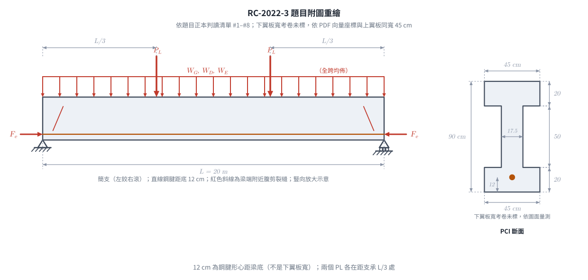
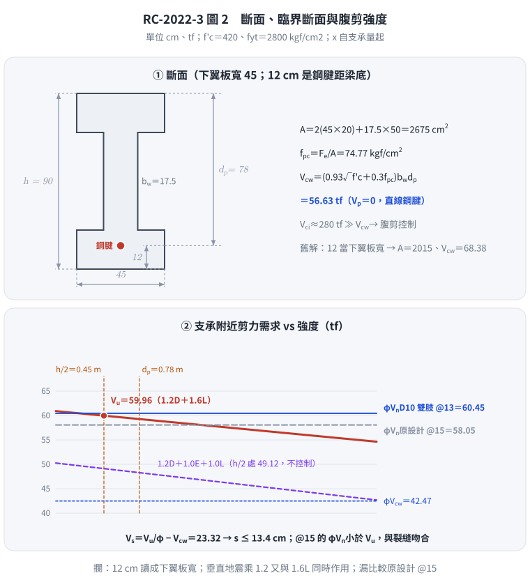

# 考題編號：RC-2022-3

**主分類：** `RC-U4-4` 預力梁剪力分析與設計
**副分類：** `RC-U2-1` RC 剪力強度分析與設計
**設計法：** USD 強度設計法
**標籤：** `預力梁` `腹剪裂縫` `Vcw` `PCI形梁` `垂直地震力` `肋筋間距` `腹剪破壞` `載重組合` `臨界斷面h/2`

---

## 1. 題目（考卷原文見題目正本）

> 考卷原文、公式／附表、附圖與判讀清單（已確認）見 [`RC-2022-3-problem.md`](RC-2022-3-problem.md)。本節只列解題時最容易讀錯的地方與本解使用的記號；題意以題目正本為準。


*重繪自考卷附圖，依題目正本判讀清單 #1–#8。本圖攔下的讀錯：把 12 cm 當成下翼板寬；鋼腱距底取 10 cm。*

### 常見誤讀

| 項目 | 正確判讀 | 常見誤讀 |
|------|---------|---------|
| 下翼板寬 | 45 cm（考卷未標，向量量測與上翼板同寬） | 12 cm（本庫舊解） |
| 12 cm | 鋼腱形心距梁底 → $d_p$＝78 cm | 下翼板寬；鋼腱距底 10 cm、$d_p$＝80 |
| 附圖 | 考卷只有一張複合圖（受力圖＋斷面） | 另有第二張斷面圖（本庫舊 §1 引用不存在的 fig-2） |
| 載重組合 | 考卷沒有給；依現行規範各組合取控制者（含 $1.2D+1.0E+1.0L$ 與 $1.2D+1.6L$） | $W_E$ 併入靜載重乘 1.2，再與 $1.6L$ 同時作用（本庫舊解；非規範組合） |
| $V_s$ 間距減半門檻 | kgf 制 $1.06\sqrt{f'_c}b_wd$ | SI 係數 $\tfrac13\sqrt{f'_c}b_wd$ 直接代 kgf（本庫舊解） |
| $V_p$ | 直線鋼腱，$V_p$＝0 | — |

**本解記號：** $L$＝20 m；上翼板 45×20、腹板 $b_w$＝17.5×50、下翼板 45×20 cm；$h$＝90、$d_p$＝78 cm；$F_e$＝200 tf；$\gamma$＝2.4 tf/m³；$W_D$＝1.1 tf/m；$P_L$＝25 tf（$L/3$ 兩處）；$W_E$＝0.25($W_G$＋$W_D$)；D10 $A_b$＝0.7133 cm²，雙肢 $A_v$＝1.4266 cm²；$f'_c$＝420、$f_{yt}$＝2800 kgf/cm²；$D=W_G+W_D$。

---

## 2. 考題核心精神與出題者意圖 (Core Concepts & Examiner's Intent)

**核心觀念：** 預力梁支承附近剪力大、彎矩小，混凝土剪力強度由**腹剪強度** $V_{cw}$ 控制（主拉應力在形心處達到開裂強度）。預力 $f_{pc}=F_e/A$ 提高 $V_{cw}$，所以 $V_{cw}$ 對斷面積非常敏感——斷面讀錯（下翼板寬），$V_{cw}$ 就錯。

**出題者意圖：**
1. 由 PCI 斷面求 $A$、自重、$d_p$；$f_{pc}=F_e/A$ 與 $V_{cw}$（kgf 制係數）
2. 加入垂直地震力 $W_E$ 後，依規範載重組合求 $V_u$，判斷控制組合
3. 由 $V_s=V_u/\phi-V_{cw}$ 求 D10 肋筋間距，並檢核間距上限、最少剪力筋、$V_s$ 上限
4. 檢討原設計 D10@15 為何出現腹剪裂縫

---

## 3. 解題戰略地圖與陷阱分析 (Strategic Roadmap & Trap Analysis)

**作戰計畫：**
```
Step 1：斷面性質 A、形心、dp（≥0.8h）、WG、WE
Step 2：fpc = Fe/A → Vcw = (0.93√f'c + 0.3fpc) bw dp + Vp
Step 3：各載重組合在臨界斷面（距支承 h/2）的 Vu → 取控制者
Step 4：Vs = Vu/φ − Vcw → s = Av fyt dp / Vs
Step 5：檢核 Vs 上限、間距上限、Av,min；Vci 確認不控制；原設計 @15 檢討
```

**關鍵陷阱：**

| # | 陷阱 | 應對策略 |
|---|------|---------|
| ⚠1 | 斷面讀錯 | 12 cm 是鋼腱距底；下翼板寬 45 → $A$＝2675 cm² |
| ⚠2 | $d_p$ | 頂面至鋼腱形心 90−12＝78 cm（≥ 0.8h＝72），剪力計算的 $d$ 取 $d_p$ |
| ⚠3 | $f_{pc}$ 只取 $F_e/A$ | 形心處偏心項為零 |
| ⚠4 | 載重組合 | 現行規範：$1.4D$、$1.2D+1.6L$、$1.2D+1.0E+1.0L$；$W_E$ 是地震載重 $E$，不可再乘 1.2，也不與 $1.6L$ 同時作用 |
| ⚠5 | 臨界斷面 | 預力構材取距支承面 $h/2$（＝45 cm）；裂縫在約 $d_p$ 處，兩者結果同為 @13 |
| ⚠6 | kgf 制係數 | $V_{cw}$ 0.93、間距減半門檻 1.06、$V_s$ 上限 2.12、$A_{v,\min}$ $0.2\sqrt{f'_c}$ 與 3.5——SI 係數（0.29、0.33、0.66、0.062、0.35）不可直接代 kgf |

---

## 3.5 變數層次分析 (Variable Hierarchy Analysis)

> 複習提示：第一次解題後，在每個卡住的知識點旁標記 `⚠`；第二次複習時只看有 `⚠` 的項目。

### 最終目標

`求加入垂直地震力檢討後，D10 肋筋所需間距 s，以滿足 φ(Vcw + Vs) ≥ Vu`

### 本題關鍵公式（依計算順序）

$$\text{Step 1：} A=\sum b_ih_i,\quad W_G=A\gamma,\quad W_E=0.25(W_G+W_D)$$

$$\text{Step 2：} \boxed{V_{cw}}=(0.93\sqrt{f'_c}+0.3\boxed{f_{pc}})\,b_w d_p+V_p,\quad \boxed{f_{pc}}=\frac{F_e}{A}$$

$$\text{Step 3：} \boxed{V_u}=w_u\left(\frac{L}{2}-x\right)+P_u\quad(x<L/3)$$

$$\text{Step 4：} \boxed{V_s}=\frac{\boxed{V_u}}{\phi}-\boxed{V_{cw}},\quad \phi=0.75$$

$$\text{Step 5：} s\le\frac{A_vf_{yt}d_p}{\boxed{V_s}}$$

### L1：題目直接給定

| 符號 | 數值 | 說明 |
|------|------|------|
| $L$ | 20 m | 跨度 |
| $f'_c$ | 420 kgf/cm² | 混凝土強度 |
| $f_{yt}$ | 2800 kgf/cm² | 肋筋降伏強度 |
| $F_e$ | 200 tf | 有效預力 |
| $\gamma$ | 2.4 tf/m³ | RC 單位重 |
| $W_D$ | 1.1 tf/m | 均佈靜載重 |
| $P_L$ | 25 tf × 2（在 $L/3$、$2L/3$） | 集中活載重 |
| D10 | $d_b = 0.953$ cm，$A_b = 0.7133$ cm² | 卷首表 1 |
| 斷面 | 上翼板 45×20、腹板 17.5×50、下翼板 45×20 cm；鋼腱距底 12 | 附圖（下翼板寬向量量測） |

### L2：需知識點推導

| 符號 | 公式／來源 | 卡關? |
|------|-----------|:-----:|
| $A$ | $2(45\times20)+17.5\times50=2675$ cm² | |
| $d_p$ | $90-12=78$ cm ≥ $0.8h$＝72 | |
| $W_G$、$W_E$ | 0.642、0.4355 tf/m | |
| $f_{pc}$、$V_{cw}$ | 74.77 kgf/cm²；56.63 tf | |
| 控制組合 | $1.2D+1.6L$：$V_u$＝59.96 tf（$h/2$） | |
| $A_v$ | 雙肢 1.4266 cm²（考卷未給肢數，假設） | |

### L3：深層知識（不懂就卡住）

| 知識點 | 說明 | 卡關? |
|--------|------|:-----:|
| 腹剪 vs 彎剪 | 支承附近 $V_{ci}$ 很大（$M_{cre}/M_{\max}$ 項），$V_c=\min(V_{ci},V_{cw})$ 由 $V_{cw}$ 控制 | |
| 垂直地震的載重組合 | $W_E$ 屬地震載重 $E$，與 $1.2D$、$1.0L$ 組合；它不一定控制 | |
| 預力構材臨界斷面 | 距支承面 $h/2$（RC 為 $d$） | |
| kgf 制係數換算 | $\sqrt{\text{MPa}}$ 係數 ×3.19 → $\sqrt{\text{kgf/cm}^2}$ 係數（0.29→0.93、0.33→1.06、0.66→2.12） | |

---

## 4. 步驟化詳細計算過程 (Step-by-Step Detailed Calculation)

> 依現行建築物混凝土結構設計規範（2023）：載重組合 5.3、預力構材腹剪強度 $V_{cw}$、剪力筋間距與最少剪力筋（kgf 制係數）。

### Step 1：截面性質與載重

$$A=45\times20+17.5\times50+45\times20=900+875+900=\mathbf{2675\ \text{cm}^2}$$

斷面上下對稱，形心距底 45 cm；$I=2\left(\frac{45\times20^3}{12}+900\times35^2\right)+\frac{17.5\times50^3}{12}=2{,}447{,}292$ cm⁴。

$$d_p=90-12=\mathbf{78\ \text{cm}}\ \ge 0.8h=72\ \text{cm}\ \checkmark,\qquad b_w=17.5\ \text{cm}$$

$$W_G=2675\times10^{-4}\times2.4=\mathbf{0.642\ \text{tf/m}},\qquad D=W_G+W_D=1.742\ \text{tf/m}$$

$$W_E=0.25\times1.742=\mathbf{0.4355\ \text{tf/m}}$$

### Step 2：腹剪混凝土強度 $V_{cw}$

$$f_{pc}=\frac{F_e}{A}=\frac{200{,}000}{2675}=\mathbf{74.77\ \text{kgf/cm}^2}$$

$$V_{cw}=(0.93\sqrt{420}+0.3\times74.77)\times17.5\times78=(19.06+22.43)\times1365=\mathbf{56{,}630\ \text{kgf}=56.63\ \text{tf}}$$

（直線鋼腱 $V_p$＝0。）

### Step 3：各載重組合的 $V_u$（臨界斷面 $x=h/2=0.45$ m）

兩個 $P_L$ 對稱，支承反力含 $P_u$；$x<L/3$，故 $V_u=w_u(10-x)+P_u$。

| 組合 | $w_u$ (tf/m) | $P_u$ (tf) | $V_u$ @ $h/2$ (tf) | $V_u$ @ $d_p$ (tf) |
|------|-------------|-----------|-------------------|-------------------|
| $1.4D$ | 2.439 | 0 | 23.29 | 22.49 |
| $\mathbf{1.2D+1.6L}$ | 2.090 | 40 | **59.96** | **59.27** |
| $1.2D+1.0E+1.0L$ | $2.090+0.4355=2.526$ | 25 | 49.12 | 48.29 |

→ **$1.2D+1.6L$ 控制**，$V_u$＝59.96 tf。依題目要求加入垂直地震力檢討後，含地震的組合（49.12 tf）不控制。

### Step 4：需求鋼筋剪力

$$\phi V_{cw}=0.75\times56.63=42.47\ \text{tf}<V_u=59.96\ \text{tf}\Rightarrow\text{需剪力筋}$$

$$V_s=\frac{59.96}{0.75}-56.63=79.95-56.63=\mathbf{23.32\ \text{tf}}$$

### Step 5：D10 肋筋間距與檢核

$$s\le\frac{A_vf_{yt}d_p}{V_s}=\frac{1.4266\times2800\times78}{23{,}320}=\mathbf{13.4\ \text{cm}}$$

**檢核：**
- $V_s$ 上限：$2.12\sqrt{f'_c}b_wd_p=59.31$ tf ≥ 23.32 ✓（斷面足夠）
- 間距減半門檻：$1.06\sqrt{f'_c}b_wd_p=29.65$ tf > 23.32 → 間距上限 $\min(0.75h,60)=\min(67.5,60)=60$ cm ✓
- 最少剪力筋：$A_{v,\min}/s=\max(0.2\sqrt{f'_c},3.5)\,b_w/f_{yt}$ → $s\le\frac{1.4266\times2800}{4.099\times17.5}=55.7$ cm ✓（另一條 $A_{ps}f_{pu}$ 式因考卷未給鋼腱資料無法檢核，且 13 cm 遠小於上述限值）

採 **D10 雙肢 @13 cm**：

$$V_s=\frac{1.4266\times2800\times78}{13}=23.97\ \text{tf},\qquad \phi(V_{cw}+V_s)=0.75(56.63+23.97)=60.45\ \text{tf}\ge59.96\ \checkmark$$

$$\boxed{s\le13.4\ \text{cm，採 D10（雙肢）@13 cm}}$$

（以裂縫位置 $x=d_p$ 計：$V_u$＝59.27、$V_s$＝22.40、$s\le13.9$ cm，同樣配 @13。）



*圖 2　斷面、臨界斷面與腹剪強度。12 cm 是鋼腱距梁底（下翼板寬 45）；臨界斷面取 $h/2$，需求線在此高於原設計 @15 的強度、低於 @13 的強度。本圖攔：把 12 cm 讀成下翼板寬、垂直地震乘 1.2 又與 1.6L 同時作用、漏比原設計 @15。*

---

## 5. 關鍵爭議點與進階探討 (Critical Issues & Advanced Discussion)

### 爭議點 1：原設計 D10@15 為何出現腹剪裂縫

$$V_s^{@15}=\frac{1.4266\times2800\times78}{15}=20.77\ \text{tf},\qquad \phi V_n=0.75(56.63+20.77)=58.05\ \text{tf}<V_u=59.96\ \text{tf}$$

原設計在 $1.2D+1.6L$ 下強度已不足（約差 3%），與梁端出現腹剪裂縫的現象方向一致；只要把間距縮到 13 cm 即可。垂直地震組合（49.12 tf）在現行組合下不控制。

### 爭議點 2：舊解（2026-11-15 勘誤前）與差異

| 項目 | 舊解 | 本解 |
|------|------|------|
| 下翼板寬 | 12 cm | 45 cm |
| $A$、$W_G$ | 2015 cm²、0.484 tf/m | 2675 cm²、0.642 tf/m |
| $d_p$ | 80 | 78 |
| $f_{pc}$、$V_{cw}$ | 99.25、68.38 tf | 74.77、56.63 tf |
| 載重組合 | $1.2(W_G+W_D+W_E)+1.6P_L$ → $V_u$＝61.86（$x$＝0.8 m） | 現行組合取控制者 → 59.96（$h/2$） |
| 間距減半門檻 | $\tfrac13\sqrt{f'_c}b_wd$＝9.49 tf（SI 係數代 kgf） | $1.06\sqrt{f'_c}b_wd$＝29.65 tf |
| 答案 | $s\le22.7$，D10@20 | $s\le13.4$，**D10@13** |

斷面積少算 25% → $f_{pc}$ 高估 33%、$V_{cw}$ 高估 21%，是答案改變的主因。若照舊解的組合（非規範組合）配合正確斷面，$V_u$＝64.95 tf、$s\le10.4$ cm，僅作對照。

### 爭議點 3：$V_{ci}$ 不控制（驗算）

$x=h/2$、$1.2D+1.6L$：$e=33$ cm，$f_{pe}$（底緣）＝196.1、$f_d$＝14.09 kgf/cm²，$M_{cre}=\frac{I}{y_b}(1.6\sqrt{f'_c}+f_{pe}-f_d)=116.8$ tf·m；$V_i$＝43.33 tf、$M_{\max}$＝19.53 tf·m：

$$V_{ci}=0.16\sqrt{f'_c}b_wd_p+V_d+\frac{V_iM_{cre}}{M_{\max}}\approx280\ \text{tf}\gg V_{cw}=56.63\ \text{tf}$$

支承附近 $V_c=V_{cw}$，題目以腹剪檢討正確。

### 爭議點 4：$f_{pc}$ 為何只取 $F_e/A$

鋼腱偏心 $e=45-12=33$ cm，但 $f_{pc}$ 定義在形心處，偏心彎矩項 $F_ee\cdot0/I=0$，故 $f_{pc}=F_e/A$。

### 爭議點 5：規範版本

考卷指定土木 401-100，本解改依現行建築物混凝土結構設計規範（2023）：載重組合為 $1.2D+1.6L$、$1.2D+1.0E+1.0L$ 等（401-100 同屬 ACI 318-05 以後的組合，結果相同）；$V_{cw}$、間距上限、$A_{v,\min}$ 以 kgf 制係數計算。肋筋肢數考卷未給，本解假設雙肢。

*修正日期：2026-11-15（§1 改為指向題目正本，插入重繪附圖 figs/RC-2022-3-fig-1-problem.svg；舊 §1 重述改寫為常見誤讀與本解記號；本行非答案勘誤）*

*修正日期：2026-11-15（解析勘誤 FIX-RC-U4-2-B1，改依現行台灣規範（建築物混凝土結構設計規範 2023）：依題目正本 #1–#3 下翼板寬 12 → 45 cm、鋼腱距底 10 → 12 cm（$d_p$ 80 → 78）：$A$ 2015 → 2675 cm²、$f_{pc}$ 99.25 → 74.77、$V_{cw}$ 68.38 → **56.63 tf**；載重組合改現行規範取控制者（$1.2D+1.6L$），臨界斷面取 $h/2$：$V_u$ 61.86 → **59.96 tf**；間距減半門檻 $\tfrac13\sqrt{f'_c}b_wd$ → $1.06\sqrt{f'_c}b_wd$；肋筋 D10@20（$s\le22.7$）→ **D10 雙肢 @13（$s\le13.4$）**；補 $V_{ci}$ 驗算與原設計 @15 檢討；撤除 §1 待勘誤提示；驗證：`.work/u4b1c/check_errata_U4_2_B1.py` 重算 MISMATCHES: 0）*

*圖解補繪：2026-11-15（DIAG-RC-U4-2-B1，向量圖 `figs/RC-2022-3-fig-2-shear.svg`，腳本 `figs/gen_RC-2022-3.py`，數值取自本解 §4 並於腳本檔尾 assert，可重跑）*
