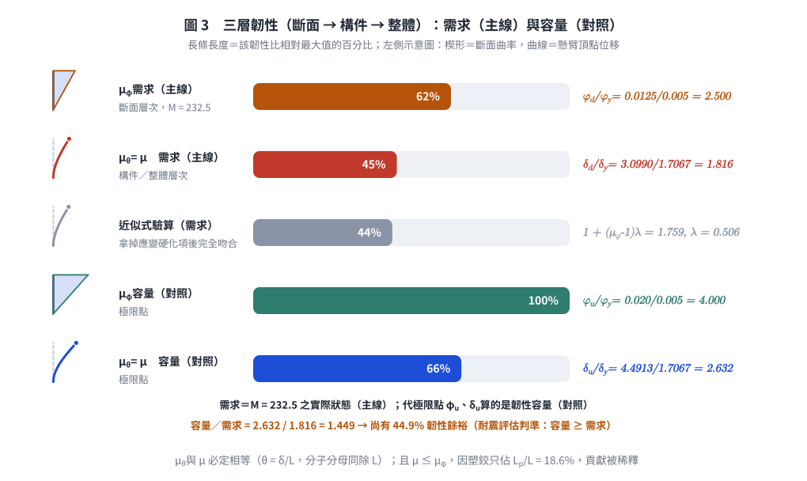

# 考題編號：RC-2022-4

**主分類：** `RC-U3-3` 韌性要求與耐震設計
**副分類：** `RC-U1-2` RC 柱強度分析與設計
**設計法：** USD（耐震評估計算）
**標籤：** `曲率韌性` `轉角韌性` `位移韌性` `彎矩塑鉸` `線性內插` `塑鉸長度Lp` `公路橋梁耐震規範` `單曲率柱` `需求vs容量`

---

## 1. 題目（考卷原文見題目正本）

> 考卷原文、公式／附表、附圖與判讀清單（已確認）見 [`RC-2022-4-problem.md`](RC-2022-4-problem.md)。本節只列解題時最容易讀錯的地方與本解使用的記號；題意以題目正本為準。

### 常見誤讀

| 項目 | 正確判讀 | 常見誤讀 |
|------|---------|---------|
| 韌性需求狀態 | 以 $M$＝232.5 tf-m 的需求狀態為準：由內插曲線反求需求曲率 $\phi_d$，公式中 $M_u$、$\phi_u$ 代需求狀態值 $M$、$\phi_d$（判讀 #1） | 直接代表 3 極限點（本庫舊解主線；算出的是韌性**容量**） |
| $L$ | 反曲點以下 3.2 m，視為單曲率懸臂 | 取全淨高 6.4 m |
| $L_P$ 單位 | 係數已含換算：$f_y$ 以 kgf/cm² 代入，$d_b$ 與 $L_P$ 同單位 | $f_y$ 改用 MPa 再代入 |
| 內插 | $P$＝270 tf 為 180、360 的中點，四個參數各自線性內插（$\phi_u$ 隨軸壓遞減） | $\phi_u$ 內插方向弄反 |
| $d_b$ | D32 3.22 cm（卷首表 1） | — |

**本解記號：** $L$＝320 cm；$d_b$＝3.22 cm；$f_y$＝4200 kgf/cm²；$P$＝270 tf、$M$＝232.5 tf-m；內插降伏點與極限點見題目正本表 3；需求狀態以下標 $d$ 表示（$\phi_d$、$\delta_d$、$\theta_d$）。

---

## 2. 考題核心精神與出題者意圖 (Core Concepts & Examiner's Intent)

**核心觀念：** 依橋梁耐震規範的雙線性彎矩-曲率模型，評估 RC 柱在指定軸力與彎矩下的三種韌性**需求**比。

> **題意（題目正本判讀 #1 已確認）：** 題幹問「韌性**需求**」並給定柱底實際彎矩 $M$＝232.5 tf·m（恰為內插後 $M_y$＝220 與 $M_u$＝245 的正中點）。
> 需求狀態即柱底承受 $M$＝232.5 時的狀態：在內插後的雙線性曲線上由 $M$ 反求 $\phi_d$，再把考卷公式中的 $M_u$、$\phi_u$ 換成 $M$、$\phi_d$。
> 直接代入極限點（$\phi_u$、$M_u$）算的是韌性**容量**，降為 §5 對照。

**出題者意圖：**
1. 測驗線性內插的正確執行（$P = 270$ 在 180~360 之間）
2. 由彎矩反求雙線性曲線上的需求曲率（$M$ 在降伏後段）
3. 考驗 $L_p$ 公式的適用（混合單位、下限控制）
4. 確認三個韌性需求的計算層次：曲率（斷面層次）→ 轉角（構件層次）→ 位移（整體層次）

---

## 3. 解題戰略地圖與陷阱分析 (Strategic Roadmap & Trap Analysis)

**作戰計畫：**
```
Step 1：確認懸臂長度 L = lu/2
Step 2：線性內插 P = 270 tf 的塑鉸參數
Step 3：由 M = 232.5 在內插曲線上反求需求曲率 φd
Step 4：計算 Lp（注意下限控制）
Step 5：計算 δy、θy
Step 6：計算需求位移 δd、θd（公式中 Mu、φu 換成 M、φd）
Step 7：計算三個韌性需求比
```

**關鍵陷阱：**

| # | 陷阱 | 應對策略 |
|---|------|---------|
| ⚠1 | $L$ 是**反曲點到柱底的距離** $= l_u/2$，不是全柱高 $l_u$ | $L = 6.4/2 = 3.2$ m |
| ⚠2 | 「需求」用極限點代入 → 算成容量 | 由 $M$＝232.5 反求 $\phi_d$ |
| ⚠3 | $L_p$ 公式的**下限**：$0.0044d_b f_y$ 可能控制 | 計算兩式後取 $\max$ |
| ⚠4 | $L_p$ 公式混合單位：$d_b$ 與 $L_p$ 同單位，$f_y$ 在 kgf/cm² | 係數已含換算，勿再改 MPa |
| ⚠5 | $\mu_\theta = \mu$（因 $\theta = \delta/L$） | 驗算：兩者應相等 |

---

## 3.5 變數層次分析 (Variable Hierarchy Analysis)

> 複習提示：第一次解題後，在每個卡住的知識點旁標記 `⚠`；第二次複習時只看有 `⚠` 的項目。

### 最終目標

`依線性內插得 P = 270 tf 的塑鉸參數，由 M = 232.5 求需求曲率 φd，套入橋梁耐震規範公式，求 μφ = φd/φy、μθ = θd/θy、μ = δd/δy`

### 本題關鍵公式（依計算順序）

$$\text{Step 1：線性內插（}\alpha = 0.5\text{）} \quad \boxed{\phi_y},\,\boxed{M_y},\,\boxed{\phi_u},\,\boxed{M_u} \text{ 由表 3 插值得出}$$

$$\text{Step 2：需求曲率} \quad \boxed{\phi_d} = \boxed{\phi_y} + \frac{M-\boxed{M_y}}{\boxed{M_u}-\boxed{M_y}}\left(\boxed{\phi_u}-\boxed{\phi_y}\right)$$

$$\text{Step 3：塑鉸長度} \quad L_p = \max\!\left(0.08L + 0.0022d_b f_y,\; 0.0044d_b f_y\right) \;\Rightarrow\; \boxed{L_p}$$

$$\text{Step 4：降伏位移} \quad \boxed{\delta_y} = \frac{\boxed{\phi_y} \cdot L^2}{3}, \quad \boxed{\theta_y} = \frac{\boxed{\delta_y}}{L}$$

$$\text{Step 5：需求位移} \quad \boxed{\delta_d} = \frac{M}{\boxed{M_y}}\boxed{\delta_y} + (\boxed{\phi_d}-\boxed{\phi_y})\cdot\boxed{L_p}\cdot(L-0.5\boxed{L_p}), \quad \boxed{\theta_d} = \frac{\boxed{\delta_d}}{L}$$

$$\text{Step 6：三種韌性需求} \quad \mu_\phi = \frac{\boxed{\phi_d}}{\boxed{\phi_y}}, \quad \mu_\theta = \frac{\boxed{\theta_d}}{\boxed{\theta_y}}, \quad \mu = \frac{\boxed{\delta_d}}{\boxed{\delta_y}}$$

---

### L1：題目直接給定

| 符號 | 數值 | 說明 |
|------|------|------|
| $l_u$ | 6.4 m | 柱淨高 |
| $P$ | 270 tf | 軸壓力（題目給定，用於內插） |
| $M$ | 232.5 tf·m | 柱底彎矩（需求狀態） |
| $d_b$ | 3.22 cm = 0.0322 m | D32 主筋直徑 |
| $f_y$ | 4200 kgf/cm² | 主筋降伏強度 |
| 表 3 | 見題目正本 | 兩組軸力下的雙線性塑鉸參數 |

---

### L2：需知識點推導

**Step 1：線性內插**

| 符號 | 公式／來源 | 卡關? |
|------|-----------|:-----:|
| $\alpha$ | $(P-180)/(360-180) = 0.5$ | |
| $\phi_y$ | $0.004 + 0.5\times(0.006-0.004) = 0.005$ | |
| $M_y$ | $200 + 0.5\times(240-200) = 220$ | |
| $\phi_u$ | $0.030 + 0.5\times(0.010-0.030) = 0.020$ | |
| $M_u$ | $230 + 0.5\times(260-230) = 245$ | |

**Step 2：需求曲率**

| 符號 | 公式／來源 | 卡關? |
|------|-----------|:-----:|
| $\phi_d$ | $0.005 + \frac{232.5-220}{245-220}(0.020-0.005) = 0.0125$ rad/m | |

**Step 3：$L_p$ 與懸臂長**

| 符號 | 公式／來源 | 卡關? |
|------|-----------|:-----:|
| $L$ | $l_u/2 = 3.2$ m | |
| $L_p$（第一式） | $0.08L + 0.0022 d_b f_y = 0.5535$ m | |
| $L_p$（下限） | $0.0044 d_b f_y = 0.5951$ m | |
| $L_p$ | $\max$(兩式) $=0.595$ m | |

**Step 4–5：位移計算**

| 符號 | 公式／來源 | 卡關? |
|------|-----------|:-----:|
| $\delta_y$ | $\phi_y L^2 / 3$ | |
| $\theta_y$ | $\delta_y / L$ | |
| $\delta_d$ | $(M/M_y)\delta_y + (\phi_d-\phi_y)L_p(L-0.5L_p)$ | |
| $\theta_d$ | $\delta_d / L$ | |

**Step 6：韌性需求**

| 符號 | 公式／來源 | 卡關? |
|------|-----------|:-----:|
| $\mu_\phi$ | $\phi_d/\phi_y$ | |
| $\mu_\theta$ | $\theta_d/\theta_y = \delta_d/\delta_y = \mu$ | |
| $\mu$ | $\delta_d/\delta_y$ | |

---

### L3：深層知識（不懂就卡住）

| 知識點 | 說明 | 卡關? |
|--------|------|:-----:|
| 反曲點 → 懸臂柱分析 | 反曲點將雙曲率柱拆成兩根等長懸臂柱；塑鉸在柱端，分析長度 $L = l_u/2$ | |
| 需求 vs 容量 | 需求＝實際受力狀態（$M$＝232.5）的變形比；容量＝極限點的變形比；耐震評估判準為容量 ≥ 需求 | |
| 三種韌性的物理層次 | $\mu_\phi$ 描述斷面；$\mu_\theta$ 描述構件轉角；$\mu$ 描述整體位移；$\mu_\theta = \mu \le \mu_\phi$ | |
| $\delta$ 公式拆解 | 第一項 $(M/M_y)\delta_y$：硬化段等效彈性位移；第二項：塑鉸轉角 $\theta_p = (\phi_d-\phi_y)L_p$ 乘力臂 $(L-0.5L_p)$ | |
| 為何 $\mu_\theta = \mu$？ | $\theta = \delta/L$，分子分母同比例 → $\mu_\theta = \mu$ | |
| $L_p$ 混合單位慣例 | $0.0022d_b\times f_y(\text{kgf/cm}^2)$：$d_b$ 用 m 得 m；係數已吸收單位換算 | |

---

## 4. 步驟化詳細計算過程 (Step-by-Step Detailed Calculation)

### Step 1：確認懸臂長度

反曲點位於淨高一半：
$$L = \frac{l_u}{2} = \frac{6.4}{2} = \mathbf{3.2 \text{ m}}$$

---

### Step 2：線性內插塑鉸參數（$P = 270$ tf）

$$\alpha = \frac{270 - 180}{360 - 180} = \frac{90}{180} = 0.5$$

| 參數 | $P=180$ tf | $P=360$ tf | 內插（$P=270$ tf） |
|------|:---------:|:---------:|:---------:|
| $\phi_y$（rad/m） | 0.004 | 0.006 | $0.004 + 0.5\times0.002 = \mathbf{0.005}$ |
| $M_y$（tf·m） | 200 | 240 | $200 + 0.5\times40 = \mathbf{220}$ |
| $\phi_u$（rad/m） | 0.030 | 0.010 | $0.030 + 0.5\times(-0.020) = \mathbf{0.020}$ |
| $M_u$（tf·m） | 230 | 260 | $230 + 0.5\times30 = \mathbf{245}$ |

---

### Step 3：需求曲率 $\phi_d$

$M = 232.5$ tf·m 介於 $M_y = 220$ 與 $M_u = 245$ 之間，位於雙線性曲線的降伏後段：

$$\phi_d = \phi_y + \frac{M - M_y}{M_u - M_y}(\phi_u - \phi_y) = 0.005 + \frac{232.5-220}{245-220}\times(0.020-0.005) = 0.005 + 0.5\times0.015 = \mathbf{0.0125 \text{ rad/m}}$$


*圖 1　表 3 兩組軸力與內插後的三條雙線性 $M$–$\phi$ 折線畫在同一張，並在內插曲線上標出 $M = 232.5$ 對應的需求曲率 $\phi_d$。攔的是 $\phi_u$ 內插方向弄反（四個參數只有它隨軸壓遞減），以及把 $M = 232.5$ 只當成「確認已降伏」而直接用極限點。*

---

### Step 4：塑鉸長度 $L_p$

$$d_b = 3.22 \text{ cm} = 0.0322 \text{ m}, \quad f_y = 4200 \text{ kgf/cm}^2$$

**第一式：**
$$0.08L + 0.0022\,d_b\,f_y = 0.08\times3.2 + 0.0022\times0.0322\times4200 = 0.256 + 0.2975 = 0.5535 \text{ m}$$

**下限：**
$$0.0044\,d_b\,f_y = 0.0044\times0.0322\times4200 = 0.5951 \text{ m}$$

$$\boxed{L_p = \max(0.5535,\ 0.5951) = \mathbf{0.595 \text{ m}}} \quad \text{（下限控制）}$$

---

### Step 5：降伏位移與轉角

$$\delta_y = \frac{\phi_y L^2}{3} = \frac{0.005 \times 3.2^2}{3} = \frac{0.05120}{3} = \mathbf{0.01707 \text{ m}}$$

$$\theta_y = \frac{\delta_y}{L} = \frac{0.01707}{3.2} = \mathbf{0.005333 \text{ rad}}$$

---

### Step 6：需求位移與轉角

考卷公式中的 $M_u$、$\phi_u$ 代入需求狀態的 $M$＝232.5、$\phi_d$＝0.0125：

$$\frac{M}{M_y} = \frac{232.5}{220} = 1.0568,\qquad L - 0.5L_p = 3.2 - 0.2975 = 2.9025 \text{ m}$$

$$\delta_d = \frac{M}{M_y}\delta_y + (\phi_d - \phi_y)\cdot L_p\cdot(L - 0.5L_p)$$

$$= 1.0568\times0.017067 + (0.0125 - 0.005)\times0.595\times2.9025 = 0.018036 + 0.012954 = \mathbf{0.030990 \text{ m}}$$

$$\theta_d = \frac{\delta_d}{L} = \frac{0.030990}{3.2} = \mathbf{0.009684 \text{ rad}}$$


*圖 2　左格畫全柱雙曲率變形與中點反曲點，右格畫由此切出的懸臂柱及其降伏／需求變形（極限點虛線對照）、柱底塑鉸長度與力臂。攔的是 $L$ 誤用全柱淨高、第二項力臂誤用 $L$ 或 $L_p$、$L_p$ 忘記取下限，以及把極限點當需求。*

---

### Step 7：三種韌性需求

$$\boxed{\mu_\phi = \frac{\phi_d}{\phi_y} = \frac{0.0125}{0.005} = \mathbf{2.50}}$$

$$\boxed{\mu_\theta = \frac{\theta_d}{\theta_y} = \frac{0.009684}{0.005333} = \mathbf{1.82}}$$

$$\boxed{\mu = \frac{\delta_d}{\delta_y} = \frac{0.030990}{0.017067} = \mathbf{1.82}}$$

**驗算：** $\mu_\theta = (\delta_d/L)/(\delta_y/L) = \delta_d/\delta_y = \mu$ ✓（兩者必定相等）

---

### 彙整表

| 項目 | 計算值 | 韌性需求 |
|------|:------:|:-------:|
| 降伏曲率 $\phi_y$ | 0.005 rad/m | — |
| 需求曲率 $\phi_d$ | 0.0125 rad/m | $\mu_\phi = \mathbf{2.50}$ |
| 降伏位移 $\delta_y$ | 1.707 cm | — |
| 需求位移 $\delta_d$ | 3.099 cm | $\mu = \mathbf{1.82}$ |
| 降伏轉角 $\theta_y$ | 0.005333 rad | — |
| 需求轉角 $\theta_d$ | 0.009684 rad | $\mu_\theta = \mathbf{1.82}$ |

---

## 5. 關鍵爭議點與進階探討 (Critical Issues & Advanced Discussion)

### 爭議點 1：$M = 232.5$ tf·m 的角色——需求（主線）與容量（對照）

**關鍵觀察：** $M = 232.5 = \dfrac{220 + 245}{2}$，**恰好是內插後 $M_y$ 與 $M_u$ 的正中點**，是要被「用」的，不只是拿來確認已降伏。

| | **需求（本解主線）** | 容量（對照：直接代極限點，本庫舊解主線） |
|---|---|---|
| 依據 | 「需求」＝在實際承受的 $M = 232.5$ 之狀態評估（題目正本判讀 #1） | 照原卷公式下標 $u$ 代入極限點 |
| 曲率 | $\phi_d = \mathbf{0.0125}$ rad/m | $\phi_u = 0.020$ rad/m |
| $\mu_\phi$ | $0.0125/0.005 = \mathbf{2.50}$ | $0.020/0.005 = 4.00$ |
| 位移 | $\delta_d = \mathbf{3.099}$ cm | $\delta_u = 1.1136\times1.707 + 0.015\times0.595\times2.9025 = 4.491$ cm |
| $\mu_\theta = \mu$ | $3.099/1.707 = \mathbf{1.82}$ | $4.491/1.707 = 2.63$ |
| 名稱 | 嚴格意義的**韌性需求** | 其實是**韌性容量** |



*圖 3　需求（主線）與容量（對照）下的斷面／構件／整體三層韌性比與近似式驗算並列。攔的是算出 $\mu > \mu_\phi$（不可能），或 $\mu_\theta$ 與 $\mu$ 得到不同值——它們必定相等。*

**考場建議：** 主答需求（$\mu_\phi = 2.50$、$\mu_\theta = \mu = 1.82$），再補一句「若照公式下標以極限點計，得容量 $\mu_\phi = 4.0$、$\mu_\theta = \mu = 2.63$；容量／需求 $= 2.632/1.816 = 1.449$，尚有 44.9% 韌性餘裕」。

### 爭議點 2：$L_p$ 公式的單位系統

原式為 Priestley & Park (1987)：$L_p = 0.08L + 0.022\,d_b f_{ye} \ge 0.044\,d_b f_{ye}$（$L,d_b$：m；$f_{ye}$：MPa）。
換成 kgf/cm²：$0.022/10.197 = 0.002157 \approx \mathbf{0.0022}$、$0.044/10.197 = 0.004315 \approx \mathbf{0.0044}$ ✓
與規範印出的係數吻合——**代入時 $f_y$ 直接用 4200 kgf/cm²，不要再換算成 MPa**。

本題 $0.08L = 0.256$ m 只佔第一式的 46%，**下限式 $0.0044d_bf_y = 0.595$ m 控制**（大 7.5%）。$L$ 越短、主筋越粗、$f_y$ 越高，下限越容易控制。

### 進階：三層韌性的物理意義與近似式交叉驗算

$$\mu_\phi = 2.50 > \mu_\theta = \mu = 1.82$$

- $\mu_\phi$ 只看**斷面塑鉸點**的曲率比（局部）。
- $\mu$ 看的是**整體頂點位移**（全局），塑鉸區只是 $L_p = 0.595$ m 的一段，其貢獻被稀釋於整根 $L = 3.2$ m 的柱中。
- 兩者關係：$\mu \approx 1 + (\mu_\phi - 1)\,\lambda$，其中 $\lambda = 3\dfrac{L_p}{L}\!\left(1 - 0.5\dfrac{L_p}{L}\right)$。

  驗算：$\lambda = 3\times0.1859\times0.9070 = 0.506$，$\mu \approx 1 + (2.50-1)\times0.506 = \mathbf{1.759}$

  比主線的 1.816 略小——差額來自公式第一項的**應變硬化** $\dfrac{M}{M_y}\delta_y$（$M/M_y = 1.057$）。
  把硬化拿掉：$\delta_d = 0.017067 + 0.012954 = 0.030021$ m，$\mu = 1.759$ ✓ 與近似式吻合（容量對照同理：無硬化 $\mu$＝2.518＝$1+3\times0.506$）。

### 爭議點 3：規範版本

- 本題指定的「**公路橋梁耐震評估與補強設計規範**」於民國 109 年底定稿、110 年 3 月 23 日由交通部頒布（交技(110)字第 1105003536 號令）；截至 2026 年 8 月未再改版，即為現行規範，答案不受規範版本影響。
- 與建築物系統（建築物混凝土結構設計規範 2023、耐震規範 111）的分工：

| | 公路橋梁耐震（本題） | 建築物（混凝土規範 2023／耐震規範 111） |
|---|---|---|
| 韌性的表達 | 分三層：$\mu_\phi$（斷面）→ $\mu_\theta$（構件）→ $\mu_\Delta$（整體） | 以**結構系統韌性容量 $R$** 與 $F_u$ 折減地震力 |
| 塑鉸長度 | 明訂 $L_p = 0.08L + 0.0022d_bf_y \ge 0.0044d_bf_y$ | 未訂 $L_p$；以 $\ell_o$（圍束區長度）處理 |
| 評估方式 | 容量／需求比對（Pushover 導向） | 強度設計（$\phi S_n \ge U$）＋ 韌性細節規定 |
| 圍束需求 | 依曲率韌性需求反算 $\rho_s$ | $A_{sh}$ 依表 18.7.5.4 |

**考場提醒：** 看到「$\mu_\phi$、$\mu_\theta$、$\mu_\Delta$」「$L_p$」「反曲點」就是**橋梁系統**；看到「$A_{sh}$、$s_o$、$\ell_o$、$1.25f_y$、$M_{pr}$」就是**建築系統**。

*圖解補繪：2026-09-07（向量圖 3 張，腳本 `figs/gen_RC-2022-4.py`，可重跑；腳本檔尾對 §4 公佈值做 assert）*

*修正日期：2026-11-15（§1 改為指向題目正本；舊 §1 重述改寫為常見誤讀與本解記號；本行非答案勘誤）*

*修正日期：2026-11-15（非勘誤）分類標頭依 `wiki/queries/分類稽核-RC-2026-11-15.md` 調整：設計法改 USD；解析內容與答案未改*

*修正日期：2026-11-15（依題目正本判讀 #1 勘誤：韌性需求改以 $M$＝232.5 tf·m 的需求狀態為主線（$\phi_d$＝0.0125 rad/m）：$\mu_\phi$ 4.0 → **2.50**、$\mu_\theta$＝$\mu$ 2.63 → **1.82**；極限點結果（容量）降為 §5 對照；舊 §6 規範對照併入 §5（本題所引橋梁規範即現行版）；圖 2、圖 3 改以需求為主線重跑；改依現行台灣規範（建築物混凝土結構設計規範 2023／耐震規範 111）之相關敘述；驗證：`.work/u33b2c/check_errata_U3_3_B2.py` 重算 MISMATCHES: 0）*
