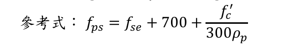

# RC-2023-4 題目正本

> 本檔只記錄**考卷上寫了什麼、圖上畫了什麼**，不含任何解法。解析見同資料夾 `RC-2023-4.md`。
> 判讀清單已經使用者確認（凍結）；本檔原則上不再修改（改動須回考卷原圖並記 log）。

| 項目 | 內容 |
|------|------|
| 考卷 | `raw/exams/RC-2023_鋼筋混凝土設計與預力.pdf` 第 2 頁，第四題；作答規範與鋼筋資料見第 1 頁 |
| 考年 | 民國 112 年（2023） |
| 配分 | 25 分 |
| 附圖 | 無（本題無附圖）；參考式截圖 `RC-2023-4-eqn-1.png` |
| 判讀狀態 | **已確認**（2026-11-14 使用者確認；影響答案項目使用者選擇：#1 普通鋼筋取規範無握裹預力版最少握裹鋼筋量 0.004A_ct；轉錄 2026-11-14；PyMuPDF 110 dpi 目視＋抽出文字核對（參考式為特殊字型，以目視為準）；盲讀後才比對既有解析） |

## 1. 考卷原文（逐字）

> 四、一簡支後拉預力混凝土單向版，短向跨度為 10 m，斷面深度 h= 25 cm，有效深度 d= 22 cm，配置無握裹鋼絞線（$A_b$ = 1.47 cm²）及普通具握裹鋼筋，兩者間距均為 20 cm。試求此單向版之計算撓曲強度 $M_n$。已知鋼絞線 $f_{pu}$ = 19000 kgf/cm²，鋼鍵有效預力 $f_{se}$= 11000 kgf/cm²，$f_{py}$=0.85 $f_{pu}$，$f'_c$ = 420 kgf/cm²，$f_y$＝4200 kgf/cm²。（25 分）
> 參考式：$f_{ps} = f_{se} + 700 + \dfrac{f'_c}{300\rho_p}$

## 2. 考卷給的公式、附表與參數

- 題文數值：跨度 10 m；$h=25$、$d=22$ cm；無握裹鋼絞線每根 1.47 cm²、間距 20 cm；普通具握裹鋼筋間距 20 cm；$f_{pu}=19{,}000$、$f_{se}=11{,}000$、$f_{py}=0.85f_{pu}$、$f'_c=420$、$f_y=4200$ kgf/cm²。
- 參考式（無握裹、跨深比大於 35 的形式），照錄如上，見 `RC-2023-4-eqn-1.png`。
- 第 1 頁作答規範：中國土木水利工程學會「混凝土工程設計規範與解說」（土木 401-110），未依上述規範作答，不予計分。第 1 頁鋼筋資料：D10 $d_b$ 0.96、$A_b$ 0.71；D13 1.27、1.27；D25 2.54、5.07；D29 2.87、6.47；D32 3.22、8.14；D36 3.58、10.07（cm、cm²）。
- **沒有給**：**普通具握裹鋼筋的號數或面積**、兩者是否同在 $d=22$ cm、$\beta_1$、$\phi$（題目只問 $M_n$）。
- 卷首注意事項：可以使用電子計算器。不必抄題，作答時請將試題題號及答案依照順序寫在試卷上，於本試題上作答者，不予計分。本科目除專門名詞或數理公式外，應使用本國文字作答。

## 3. 附圖

本題無附圖。

## 4. 判讀清單

「把握」標**不確定**者請優先確認；解讀類項目（題目用字的意思）另標「解讀」。

| # | 項目 | 判讀 | 圖上／題文依據 | 把握 |
|---|------|------|---------------|------|
| 1 | 普通鋼筋量 | 考卷**只給間距 20 cm，沒有給號數或面積**；作答必須自行假設（例：依規範無握裹預力版最少握裹鋼筋量 $0.004A_{ct}$ 自行配筋，或自選號數） | 題文「配置…普通具握裹鋼筋，兩者間距均為 20 cm」；第 1 頁鋼筋表未指定 | 不確定（影響答案）；使用者確認（選擇見頭表判讀狀態） |
| 2 | 深度 | 題目只給一個 $d=22$ cm，解讀為鋼絞線與普通鋼筋皆在 $d=22$ cm | 題文 | 確定（解讀） |
| 3 | 鋼絞線量 | 每 20 cm 一根 1.47 cm² → 每公尺 5 根、7.35 cm²/m | 題文 | 確定 |
| 4 | 參考式適用 | 跨深比 $L/h = 1000/25 = 40 > 35$，與考卷給的 $300\rho_p$ 形式一致；上限（$f_{py}$、$f_{se}+2100$）考卷未印 | 題文、參考式 | 確定（解讀） |
| 5 | 計算寬度 | 單向版，以每公尺寬（或每 20 cm 一單元）計算，考卷未指定 | 題文 | 確定（解讀） |
| 6 | 問的量 | 計算撓曲強度 $M_n$（標稱，不乘 $\phi$） | 題文 | 確定 |
| 7 | 考卷沒有給 | 普通鋼筋面積、$\beta_1$、$\phi$ | 全題 | 確定（作答須自行假設） |

---

*轉錄：2026-11-14（RC-U4-1 題目正本推廣・批 1）*

*確認：2026-11-14 使用者確認（RC-U4-1 題目正本推廣・批 1，關卡一）*
