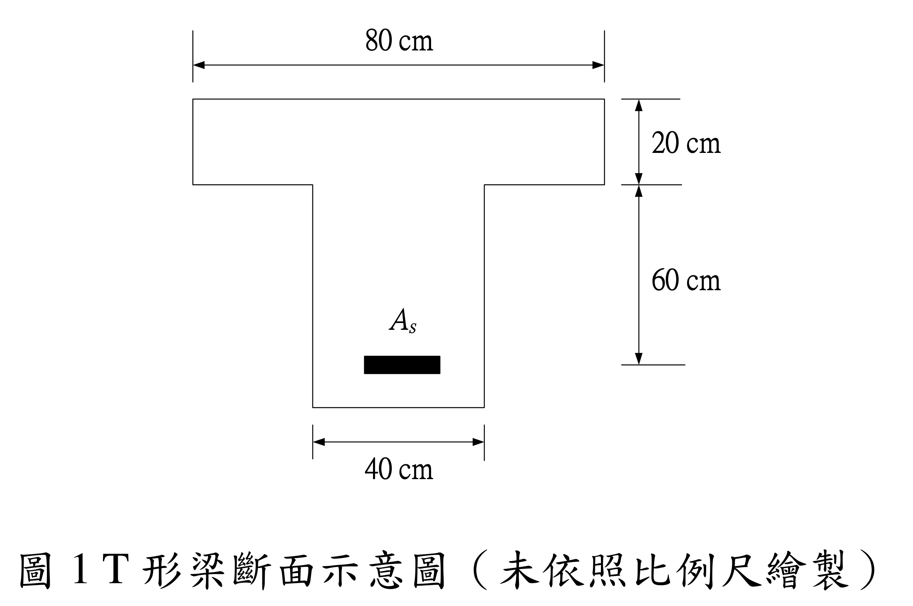

# RC-2024-1 題目正本

> 本檔只記錄**考卷上寫了什麼、圖上畫了什麼**，不含任何解法。解析見同資料夾 `RC-2024-1.md`。
> 判讀清單已經使用者確認（凍結）；本檔原則上不再修改（改動須回考卷原圖並記 log）。

| 項目 | 內容 |
|------|------|
| 考卷 | `raw/exams/RC-2024_鋼筋混凝土設計與預力.pdf` 第 1 頁（頁次 3－1），第一題 |
| 考年 | 民國 113 年（2024） |
| 配分 | 25 分 |
| 附圖 | `RC-2024-1-fig-2.png`（圖 1：T 形梁斷面示意圖，500 dpi 重新擷取）；舊證據圖 `RC-2024-1-fig-1.png` 右側壓有滑鼠游標，保留不刪 |
| 判讀狀態 | **已確認**（2026-11-13 使用者確認；#2 使用者確認 d = 80（推翻解析假設 d = 74）；轉錄 2026-11-13，PyMuPDF 110 dpi 全頁目視＋抽出文字核對，附圖 500 dpi＋PDF 向量座標；盲讀後才比對既有解析） |

## 1. 考卷原文（逐字）

> 一、某一左右對稱 T 形梁斷面示意圖如圖 1 所示。若採用中強度鋼筋（fy = 4200 kgf/cm²、Es = 2.04×10⁶ kgf/cm²）、混凝土（f'c = 280 kgf/cm²、εu = 0.003）時，請依規範計算該斷面之最大鋼筋量與最小鋼筋量。若更換為高強度鋼筋（fy = 6900 kgf/cm²、Es = 2.04×10⁶ kgf/cm²）及較低強度混凝土（f'c = 210 kgf/cm²、εu = 0.004），斷面不變，則 T 形梁斷面之平衡鋼筋量與最大鋼筋量分別為若干？（25 分）
>
> 圖 1 T 形梁斷面示意圖（未依照比例尺繪製）

## 2. 考卷給的公式、附表與參數

- 卷首：依據與作答規範：中國土木水利工程學會「混凝土工程設計規範與解說」（土木 401-112），未依上述規範作答，不予計分。
- 情況一：$f_y=4200$、$E_s=2.04\times10^6$、$f'_c=280$ kgf/cm²、$\varepsilon_u=0.003$。
- 情況二：$f_y=6900$、$E_s=2.04\times10^6$、$f'_c=210$ kgf/cm²、$\varepsilon_u=0.004$。
- 斷面尺寸**只在圖上**（見 §3）。
- **沒有給**：梁全深 $h$（As 以下的腹板高度沒有標註）、$\beta_1$、最大鋼筋量所依的應變限制（由規範決定）。
- 卷首注意事項：㈠可以使用電子計算器；㈡不必抄題；㈢除專門名詞或數理公式外，應使用本國文字作答。

## 3. 附圖

圖面文字照錄：`80 cm`、`20 cm`、`60 cm`、`As`、`40 cm`、`圖 1 T 形梁斷面示意圖（未依照比例尺繪製）`。

## 4. 判讀清單

「把握」標**不確定**者請優先確認；解讀類項目（題目用字的意思）另標「解讀」。

| # | 項目 | 判讀 | 圖上／題文依據 | 把握 |
|---|------|------|---------------|------|
| 1 | 翼板 | 寬 80 cm、厚 $h_f=20$ cm | 80 cm 尺寸線對齊翼板兩側；20 cm 尺寸線 y = 485.6→516.5 夾翼板頂（485.6）與翼板底（516.5） | 確定 |
| 2 | 60 cm 段 | 由**翼板底面**量到 **As 形心**（不是到梁底） → $d=20+60=80$ cm | 500 dpi 目視＋PDF 向量：60 cm 尺寸線 y = 516.5→581.3，下端延伸線 y = 581.3；As 長條 y = 578.2–584.4（中線 581.3）；梁底 y = 596.7 在延伸線之下 | 確定（使用者選擇：d = 80） |
| 3 | 全深 $h$ | 考卷沒有給（As 到梁底那段沒有尺寸） | 圖上梁底無尺寸線 | 確定 |
| 4 | 腹板寬 | $b_w=40$ cm | 40 cm 尺寸線對齊腹板兩側 | 確定 |
| 5 | 鋼筋 | 單層拉力筋 $A_s$（長條，無根數），無壓力筋 | 圖上只有一條 As | 確定 |
| 6 | 翼寬 | 80 cm 即受壓翼寬（題目未給跨度、梁距，不另檢核有效翼寬） | 題文「左右對稱 T 形梁斷面」 | 確定（解讀） |
| 7 | 所求 | 情況一：最大、最小鋼筋量；情況二：平衡、最大鋼筋量 | 題文 | 確定 |
| 8 | 考卷沒有給 | $h$、$\beta_1$、最大鋼筋量的應變限制 | 全題 | 確定 |

---

*轉錄：2026-11-13（RC-U1-1 題目正本推廣・批 2）*

*確認：2026-11-13 使用者確認（RC-U1-1 題目正本推廣・批 2，關卡一）*
