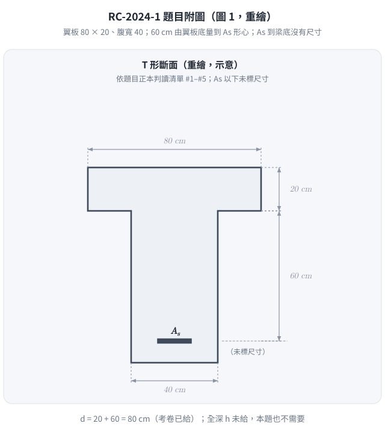
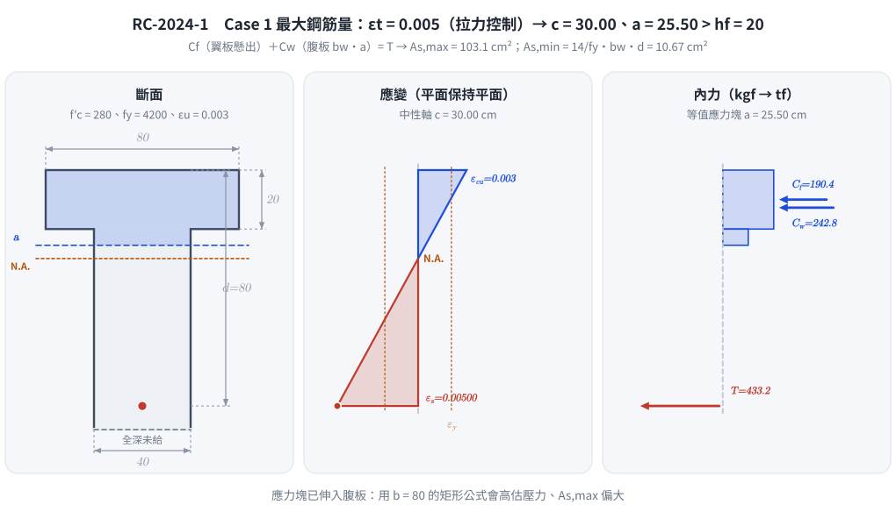
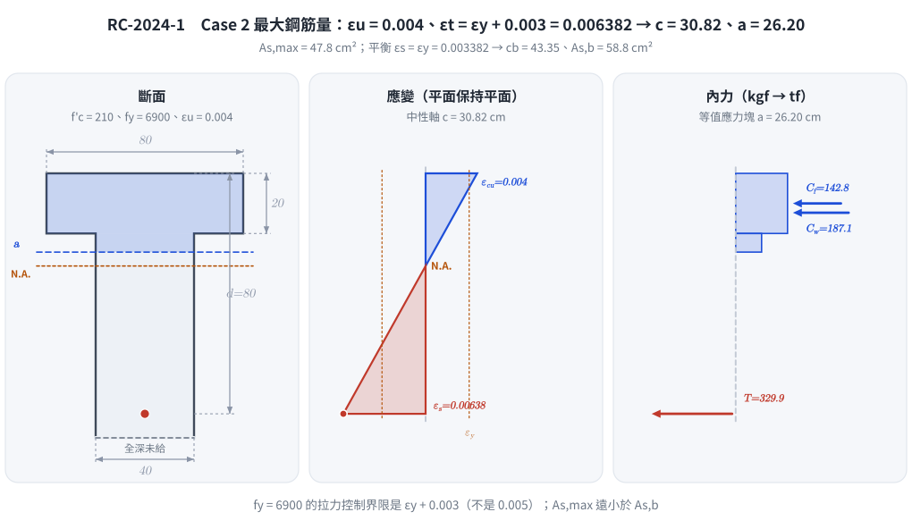

# 考題編號：RC-2024-1

**主分類：** `RC-U1-1` RC 梁彎矩強度分析與設計
**副分類：** 無
**設計法：** USD 強度設計法
**標籤：** `T形梁` `最大鋼筋量` `最小鋼筋量` `平衡鋼筋量` `Whitney應力塊` `β1係數` `拉力控制` `高強度鋼筋` `尺寸鏈判讀` `d=80`

---

## 1. 題目（考卷原文見題目正本）

> 考卷原文、公式／附表、附圖與判讀清單（已確認）見 [`RC-2024-1-problem.md`](RC-2024-1-problem.md)。本節只列解題時最容易讀錯的地方與本解使用的記號；題意以題目正本為準。


*重繪自考卷圖 1（考卷註明未依比例），依題目正本判讀清單。60 cm 的下端畫在 As 中心線上——這張圖攔下「60 cm 是腹板高、d 要自己扣保護層」：考卷給的就是 $d = 20 + 60 = 80$ cm，沒給的是全深 $h$。*

### 常見誤讀

| 項目 | 正確判讀 | 常見誤讀 |
|---|---|---|
| 60 cm 尺寸 | 翼板底面到 As 形心（判讀 #2） | 當成腹板高（翼板底到梁底），再假設保護層求 $d$（本解 2026-11-13 前即採 $h = 80$、$d = 74$） |
| 有效深度 | $d = 20 + 60 = 80$ cm（考卷已給） | $d = h - 6 = 74$ cm |
| 全深 $h$ | 考卷沒有給，本題也用不到 | 推成 $h = 80$ |
| 最小鋼筋量寬度 | 用腹板寬 $b_w = 40$ cm | 用翼板寬 80 cm |

**本解記號：** 翼板寬 $b = 80$ cm、$h_f = 20$ cm、$b_w = 40$ cm、$d = 80$ cm；Case 1：$f_y = 4200$、$f'_c = 280$、$\varepsilon_u = 0.003$；Case 2：$f_y = 6900$、$f'_c = 210$、$\varepsilon_u = 0.004$（$E_s = 2.04\times10^6$ kgf/cm² 兩者相同）。

---

## 2. 考題核心精神與出題者意圖 (Core Concepts & Examiner's Intent)

**核心觀念：** T 形梁的最大、最小、平衡鋼筋量計算，以及當材料參數（$f_y$、$f'_c$、$\varepsilon_u$）改變時，如何系統性修正計算流程。

**出題意圖：**
1. 測試學生能否判斷「中性軸在翼板內或腹板內」並切換計算模式
2. 測試 $\varepsilon_u = 0.004$（非標準值）時的平衡條件修正
3. 高強度鋼筋 $f_y = 6900$ 導致 $\varepsilon_y > \varepsilon_u(\text{Case 1})$，學生必須重新計算 $\varepsilon_y$ 而非套用舊公式
4. 最大鋼筋量由「梁須拉力控制」決定（112 年版／土木 401-112 §9.3.3.1：$\varepsilon_t \ge \varepsilon_{ty}+0.003$），高強度鋼筋的界限不是 0.005

---

## 3. 解題戰略地圖與陷阱分析 (Strategic Roadmap & Trap Analysis)

**作戰計畫：**
```
Step 1：確定 β1（依 f'c 大小）
Step 2（Case 1 最大）：由拉力控制 εt = εty + 0.003 = 0.005（SD420 取 εty = 0.002）→ c_max → a_max → 判斷 NA 位置 → 求壓力 → As,max
Step 3（Case 1 最小）：公式 max(0.8√f'c/fy, 14/fy) × bw × d
Step 4（Case 2 平衡）：由 εu/(εu+εy) → cb → ab → 判斷 NA 位置 → As,b
Step 5（Case 2 最大）：同 Step 2，但 εu = 0.004、εt = fy/Es + 0.003 = 0.006382
```

**關鍵陷阱：**

| # | 陷阱 | 正確做法 |
|---|------|---------|
| ①  | 最大鋼筋量套 $\rho_{max} = 0.75\rho_b$（ACI 318-99）或 $\varepsilon_t \ge 0.004$（ACI 318-02～14、土木 401-100） | 土木 401-112／112 年版 §9.3.3.1：非預力梁須拉力控制，$\varepsilon_t \ge \varepsilon_{ty}+0.003$，$c_{max}/d = \varepsilon_u/(\varepsilon_u+\varepsilon_{ty}+0.003)$ |
| ①' | 高強度鋼筋的拉力控制界限仍用 0.005 | $f_y = 6900$ 時 $\varepsilon_{ty} = f_y/E_s = 0.003382$（§21.2.2.1 的 0.002 只適用 $f_y = 4200$），界限 0.006382 |
| ② | 假設 $a \leq h_f$ 不驗算就套矩形梁公式 | 計算 $a_{max}$ 後必須與 $h_f=20\ \text{cm}$ 比較，本題均 $>h_f$，需用 T 形梁公式 |
| ③ | 最小鋼筋量用翼板寬 $b$ 而非腹板寬 $b_w$ | 依規範明確使用 $b_w$ |
| ④ | Case 2 的 $\varepsilon_u=0.004$ 認為是打字錯誤 | 這是本題刻意設定，影響 $c_b$ 與 $c_{max}$ 的應變圖起點 |

---

## 3.5 變數層次分析（Variable Hierarchy Analysis）

> 複習提示：第一次解題後，在每個卡住的知識點旁標記 `⚠`；第二次複習時只看有 `⚠` 的項目。

### 最終目標

`Case 1：計算 As,max（拉力控制 εt ≥ 0.005）與 As,min（規範下限）`
`Case 2：計算 As,b（平衡狀態）與 As,max（拉力控制 εt ≥ εy + 0.003 = 0.006382，εu=0.004）`

### 本題關鍵公式鏈

$$\text{Case 1 最大：} c_{max} = \frac{\varepsilon_u}{\varepsilon_u+0.005} \cdot d \xrightarrow{\times \beta_1} \boxed{a_{max}} \xrightarrow{\text{T形壓力}} C = 0.85f'_c[(b-b_w)h_f + b_w \boxed{a_{max}}] \xrightarrow{\div f_y} A_{s,max}$$

$$\text{Case 1 最小：} A_{s,min} = \max\!\left(\frac{0.8\sqrt{f'_c}}{f_y},\ \frac{14}{f_y}\right) \cdot b_w \cdot d$$

$$\text{Case 2 平衡：} c_b = \frac{\varepsilon_u}{\varepsilon_u + \boxed{\varepsilon_y}} \cdot d \xrightarrow{\times \beta_1} \boxed{a_b} \xrightarrow{\text{T形壓力}} C_b \xrightarrow{\div f_y} A_{s,b}$$

$$\text{Case 2 最大：} c_{max} = \frac{\varepsilon_u}{\varepsilon_u+\varepsilon_y+0.003} \cdot d = \frac{0.004}{0.010382} \cdot d = 0.3853d$$

### L1：題目直接給定

| 符號 | 數值（Case 1） | 數值（Case 2） | 說明 |
|------|:---:|:---:|------|
| $b$ | 80 cm | 80 cm | T 形梁翼板寬度 |
| $h_f$ | 20 cm | 20 cm | 翼板厚度 |
| $b_w$ | 40 cm | 40 cm | 腹板寬度 |
| $d$ | 80 cm | 80 cm | 有效深度（翼板厚 20 + 翼板底到 As 形心 60，判讀 #2） |
| $f'_c$ | 280 kgf/cm² | 210 kgf/cm² | 混凝土抗壓強度 |
| $f_y$ | 4200 kgf/cm² | 6900 kgf/cm² | 鋼筋降伏強度 |
| $E_s$ | 2.04×10⁶ kgf/cm² | 2.04×10⁶ kgf/cm² | 鋼筋彈性模數 |
| $\varepsilon_u$ | 0.003 | 0.004 | 混凝土極限壓應變 |

### L2：需知識點推導

**Step A：β₁ 係數**

| 符號 | 公式/來源 | 卡關? |
|------|----------|:-----:|
| $\beta_1$ | $f'_c \leq 280\ \text{kgf/cm}^2 \Rightarrow \beta_1=0.85$；每增加 $70\ \text{kgf/cm}^2$ 減 $0.05$ | |

**Step B：Case 1 最大鋼筋量**

| 符號 | 公式/來源 | 卡關? |
|------|----------|:-----:|
| $c_{max}$ | $\varepsilon_u/(\varepsilon_u+0.005) \cdot d = (3/8) \times 80 = 30.00\ \text{cm}$ | |
| $a_{max}$ | $\beta_1 \cdot c_{max} = 0.85 \times 30.00 = 25.50\ \text{cm}$ | |
| 判斷 | $a_{max}=25.50 > h_f=20 \Rightarrow$ NA 在腹板，T 形梁行為 | |
| $C_{total}$ | $0.85f'_c[(b-b_w)h_f + b_w \cdot a_{max}]$ | |
| $A_{s,max}$ | $C_{total}/f_y$ | |

**Step C：Case 1 最小鋼筋量**

| 符號 | 公式/來源 | 卡關? |
|------|----------|:-----:|
| $0.8\sqrt{f'_c}/f_y$ | $0.8\times16.73/4200 = 0.003187$ | |
| $14/f_y$ | $14/4200 = 0.003333$ → 控制 | |
| $A_{s,min}$ | $0.003333 \times b_w \times d$ | |

**Step D：Case 2 鋼筋降伏應變**

| 符號 | 公式/來源 | 卡關? |
|------|----------|:-----:|
| $\varepsilon_y$ | $f_y/E_s = 6900/(2.04\times10^6) = 0.003382$ | |

**Step E：Case 2 平衡鋼筋量**

| 符號 | 公式/來源 | 卡關? |
|------|----------|:-----:|
| $c_b$ | $\varepsilon_u/(\varepsilon_u+\varepsilon_y) \cdot d = 0.004/0.007382 \times 80 = 43.35\ \text{cm}$ | |
| $a_b$ | $\beta_1 \cdot c_b = 0.85 \times 43.35 = 36.84\ \text{cm}$ | |
| 判斷 | $a_b=36.84 > h_f=20 \Rightarrow$ T 形梁行為 | |
| $A_{s,b}$ | $0.85f'_c[(b-b_w)h_f + b_w \cdot a_b]/f_y$ | |

**Step F：Case 2 最大鋼筋量**

| 符號 | 公式/來源 | 卡關? |
|------|----------|:-----:|
| $c_{max}$ | $\varepsilon_u/(\varepsilon_u+\varepsilon_y+0.003) \cdot d = 0.004/0.010382 \times 80 = 30.82\ \text{cm}$ | |
| $a_{max}$ | $0.85 \times 30.82 = 26.20\ \text{cm} > h_f$ → T 形梁 | |
| $A_{s,max}$ | $0.85f'_c[(b-b_w)h_f + b_w \cdot a_{max}]/f_y$ | |

### L3：深層知識（不懂就卡住）

| 知識點 | 說明 | 卡關? |
|--------|------|:-----:|
| 最大鋼筋量的三個世代 | ACI 318-99：$\rho_{max}=0.75\rho_b$；ACI 318-02～14／土木 401-100：$\varepsilon_t \ge 0.004$；**ACI 318-19／土木 401-112／112 年版：梁須拉力控制 $\varepsilon_t \ge \varepsilon_{ty}+0.003$** | |
| T 形梁 NA 位置判斷 | $a \leq h_f$ → 矩形梁（用 $b$）；$a > h_f$ → T形梁壓力公式（分翼板+腹板兩部分） | |
| $\varepsilon_u$ 非標準值的影響 | 公式 $c_b = \varepsilon_u d/(\varepsilon_u+\varepsilon_y)$ 需用題目給定的 $\varepsilon_u$，不可固定套 0.003 | |
| 最小鋼筋量用 $b_w$ 不用 $b$ | T 形梁翼板屬壓力區，裂縫後受拉區接近腹板，故最小鋼筋量以 $b_w$ 計算 | |
| Case 2 驗證：$A_{s,max} < A_{s,b}$ | 拉力控制 $\varepsilon_t = 0.006382 > \varepsilon_y$，$c_{max}/d=0.385 < c_b/d=0.542$，故 $A_{s,max} < A_{s,b}$（合理） | |

---

## 4. 步驟化詳細計算過程 (Step-by-Step Detailed Calculation)

### 前置：斷面幾何確認

$$b = 80\ \text{cm},\quad h_f = 20\ \text{cm},\quad b_w = 40\ \text{cm}$$

$$d = 20 + 60 = 80\ \text{cm} \quad \text{（圖 1：60 cm 由翼板底面量到 } A_s \text{ 形心；全深 } h \text{ 考卷未給，本題不需要）}$$

---

### 【Case 1】$f_y = 4200\ \text{kgf/cm}^2$，$f'_c = 280\ \text{kgf/cm}^2$，$\varepsilon_u = 0.003$

**Step A1：β₁ 係數**

$$f'_c = 280\ \text{kgf/cm}^2 \leq 280\ \text{kgf/cm}^2 \Rightarrow \boxed{\beta_1 = 0.85}$$

**Step A2：最大鋼筋量**（土木 401-112／112 年版 §9.3.3.1：非預力梁須拉力控制）

拉力控制界限 $\varepsilon_t = \varepsilon_{ty} + 0.003$；$f_y = 4200$ 依 §21.2.2.1 取 $\varepsilon_{ty} = 0.002$，故 $\varepsilon_t \ge 0.005$。最大鋼筋量對應 $\varepsilon_t = 0.005$：

$$c_{max} = \frac{\varepsilon_u}{\varepsilon_u + 0.005} \cdot d = \frac{0.003}{0.003 + 0.005} \times 80 = \frac{3}{8} \times 80 = 30.00\ \text{cm}$$

等值應力塊深度：

$$a_{max} = \beta_1 \cdot c_{max} = 0.85 \times 30.00 = \mathbf{25.50\ \text{cm}}$$

**判斷 NA 位置：** $a_{max} = 25.50\ \text{cm} > h_f = 20\ \text{cm}$ → 中性軸在腹板，T 形梁行為

壓力合力（分翼板懸挑部分 + 腹板部分）：

$$C = 0.85 f'_c \left[(b - b_w) \cdot h_f + b_w \cdot a_{max}\right]$$

$$= 0.85 \times 280 \times \left[(80-40) \times 20 + 40 \times 25.50\right] = 238 \times \left[800 + 1020\right] = 238 \times 1820 = 433{,}160\ \text{kgf}$$

最大鋼筋量（$T = C$，鋼筋已降伏）：

$$\boxed{A_{s,max} = \frac{C}{f_y} = \frac{433{,}160}{4200} \approx 103.1\ \text{cm}^2}$$

> 照舊規範 $\varepsilon_t \ge 0.004$（土木 401-100）會得 $c = 34.29$、$a = 29.14$、$A_{s,max} = 111.4$ cm²（本解 2026-11-21 前的答案），偏大 8%。

---

**Step A3：最小鋼筋量**（土木401-112 Section 9.6.1）

$$A_{s,min} = \max\!\left(\frac{0.8\sqrt{f'_c}}{f_y},\ \frac{14}{f_y}\right) \cdot b_w \cdot d$$

各值計算：

$$\frac{0.8\sqrt{280}}{4200} = \frac{0.8 \times 16.73}{4200} = \frac{13.39}{4200} = 0.003187$$

$$\frac{14}{4200} = 0.003333 \quad \text{← 控制}$$

$$\boxed{A_{s,min} = 0.003333 \times 40 \times 80 = 10.67\ \text{cm}^2}$$



*圖 1　Case 1 最大鋼筋量。$a = 25.50$ cm 已伸入腹板，壓力要拆成翼板懸出 $C_f$ 與腹板 $C_w$——這張圖攔下用 $b = 80$ 的矩形公式高估 $A_{s,max}$。*

---

### 【Case 2】$f_y = 6900\ \text{kgf/cm}^2$，$f'_c = 210\ \text{kgf/cm}^2$，$\varepsilon_u = 0.004$

**Step B1：基本材料參數**

$$\beta_1：f'_c = 210\ \text{kgf/cm}^2 < 280\ \text{kgf/cm}^2 \Rightarrow \beta_1 = 0.85$$

$$\varepsilon_y = \frac{f_y}{E_s} = \frac{6900}{2.04 \times 10^6} = 0.003382$$

**Step B2：平衡鋼筋量**（平衡條件：$\varepsilon_s = \varepsilon_y$，$\varepsilon_c = \varepsilon_u = 0.004$）

$$c_b = \frac{\varepsilon_u}{\varepsilon_u + \varepsilon_y} \cdot d = \frac{0.004}{0.004 + 0.003382} \times 80 = \frac{0.004}{0.007382} \times 80 = 0.5419 \times 80 = 43.35\ \text{cm}$$

$$a_b = \beta_1 \cdot c_b = 0.85 \times 43.35 = \mathbf{36.84\ \text{cm}}$$

**判斷 NA 位置：** $a_b = 36.84\ \text{cm} > h_f = 20\ \text{cm}$ → T 形梁行為

壓力合力：

$$C_b = 0.85 \times 210 \times \left[(80-40) \times 20 + 40 \times 36.84\right]$$

$$= 178.5 \times \left[800 + 1473.6\right] = 178.5 \times 2273.6$$

$$= 405{,}838\ \text{kgf}$$

平衡鋼筋量：

$$\boxed{A_{s,b} = \frac{405{,}838}{6900} \approx 58.8\ \text{cm}^2}$$

---

**Step B3：最大鋼筋量**（拉力控制；$f_y = 6900$ 不適用 §21.2.2.1 的 0.002，$\varepsilon_{ty} = f_y/E_s = 0.003382$）

$$\varepsilon_t \ge \varepsilon_{ty} + 0.003 = 0.006382$$

$$c_{max} = \frac{\varepsilon_u}{\varepsilon_u + 0.006382} \cdot d = \frac{0.004}{0.010382} \times 80 = 0.3853 \times 80 = 30.82\ \text{cm}$$

$$a_{max} = 0.85 \times 30.82 = 26.20\ \text{cm} > h_f = 20\ \text{cm} \Rightarrow \text{T 形梁行為}$$

壓力合力：

$$C_{max} = 178.5 \times \left[(80-40) \times 20 + 40 \times 26.20\right] = 178.5 \times 1847.9 = 329{,}856\ \text{kgf}$$

最大鋼筋量：

$$\boxed{A_{s,max} = \frac{329{,}856}{6900} \approx 47.8\ \text{cm}^2}$$

> 照舊規範 $\varepsilon_t \ge 0.004$ 會得 $c = 40.0$、$A_{s,max} = 55.9$ cm²（本解 2026-11-21 前的答案）。

**合理性檢驗：** $A_{s,max} = 47.8 < A_{s,b} = 58.8\ \text{cm}^2$ ✓（最大鋼筋量應小於平衡鋼筋量；比值 0.81）



*圖 2　Case 2 換成 $\varepsilon_u = 0.004$、$f_y = 6900$ 後，$c$ 變深、$\varepsilon_y = 0.00338$ 也變大；最大量由拉力控制 $\varepsilon_t = \varepsilon_y + 0.003 = 0.006382$ 決定且小於平衡量——這張圖攔下沿用 0.003、把高強度鋼筋的界限當 0.005、或把平衡量當最大量。*

---

### 結果彙整

| 項目 | 說明 | 結果 |
|------|------|------|
| Case 1 $A_{s,max}$ | $f_y=4200$，$f'_c=280$，$\varepsilon_u=0.003$，拉力控制 $\varepsilon_t=0.005$ | **103.1 cm²** |
| Case 1 $A_{s,min}$ | $14/f_y \times b_w \times d$ 控制 | **10.67 cm²** |
| Case 2 $A_{s,b}$ | $f_y=6900$，$f'_c=210$，$\varepsilon_u=0.004$，平衡條件 | **58.8 cm²** |
| Case 2 $A_{s,max}$ | 拉力控制 $\varepsilon_t=0.006382$，$c_{max}=0.385d$ | **47.8 cm²** |

---

## 5. 關鍵爭議點與進階探討 (Critical Issues & Advanced Discussion)

**爭議點 1：有效深度 $d$——考卷給的是 $d$，沒給的是 $h$**

圖 1 右側的 60 cm 尺寸線下端對齊 $A_s$ 長條中心（考卷 PDF 向量：尺寸線止於 $A_s$ 中線，梁底在其下另有一段未標尺寸），所以 $d = 20 + 60 = 80$ cm 是題目給定值，不必假設保護層。若把 60 cm 讀成腹板高、再自取 $d = 74$，四個答案全部偏小：$A_{s,max}$ 98.8（應 103.1）、$A_{s,min}$ 9.87（應 10.67）、$A_{s,b}$ 56.0（應 58.8）、Case 2 $A_{s,max}$ 45.8（應 47.8）cm²（最大鋼筋量依 2026-11-21 改正後的拉力控制條件）。四個量都與 $d$ 成線性（翼板項為常數），所以誤差約 5–8%。

**爭議點 2：最大鋼筋量的規範依據**

考卷指定土木 401-112（對應 ACI 318-19，與內政部 112 年版同世代）。這一版的 §9.3.3.1 規定**非預力梁應符合表 21.2.2 拉力控制之規定**，即 $\varepsilon_t \ge \varepsilon_{ty} + 0.003$；舊版（ACI 318-02～14、土木 401-100）的 $\varepsilon_t \ge 0.004$ 已取消，更早的 $0.75\rho_b$ 也不再使用。因此：
- $\varepsilon_t \geq \varepsilon_{ty}+0.003$：拉力控制，$\phi = 0.90$，梁允許的範圍
- $\varepsilon_{ty} < \varepsilon_t < \varepsilon_{ty}+0.003$：過渡區，$\phi$ 依 $0.65+0.25(\varepsilon_t-\varepsilon_{ty})/0.003$ 內插；柱可用、非預力梁不允許
- $\varepsilon_t \le \varepsilon_{ty}$：壓力控制

本解 2026-11-21 前沿用 $\varepsilon_t \ge 0.004$，得 Case 1 111.4、Case 2 55.9 cm²；改依拉力控制後為 103.1、47.8 cm²。

**爭議點 3：高強度鋼筋的「拉力控制界限」不是固定的 0.005**

| | $f_y = 4200$（Case 1） | $f_y = 6900$（Case 2） |
|---|---|---|
| $\varepsilon_{ty}$（φ 分區用） | 0.002（§21.2.2.1 可採） | $f_y/E_s = 0.003382$ |
| 壓力控制界限 | $\varepsilon_t \leq 0.002$ | $\varepsilon_t \leq 0.003382$ |
| 拉力控制界限＝梁的最大鋼筋量條件 | 0.005 | $\varepsilon_{ty} + 0.003 = 0.006382$ |

§21.2.2.1 的「$\varepsilon_{ty}$ 可採 0.002」只適用 $f_y = 4200$ 竹節鋼筋；SD690 必須用 $f_y/E_s$，拉力控制界限因此升到 0.006382，最大鋼筋量明顯變小——這正是 Case 2 要考的地方。

**進階：Case 2 為何 $A_{s,max} < A_{s,b}$？**

最大鋼筋條件 $\varepsilon_t = 0.006382$ 使 $c_{max}/d = 0.004/0.010382 = 0.385$，平衡條件 $c_b/d = 0.004/0.007382 = 0.542$。拉力控制界限一定大於 $\varepsilon_y$，所以最大鋼筋量的中性軸必定比平衡條件高，$A_{s,max} < A_{s,b}$。這與 Case 1（$\varepsilon_u = 0.003$，$\varepsilon_y = fy/Es \approx 0.00206 < 0.003$）相反，是高強度鋼筋的特殊現象。

---

*修正日期：2026-11-13（§1 改為指向題目正本＋常見誤讀＋本解記號，嵌入重繪附圖 figs/RC-2024-1-fig-1-problem.svg；舊 §1 證據圖 fig-1 已收入題目正本，改以 fig-2 為證據圖）*
*修正日期：2026-11-13（題意（判讀）勘誤：圖 1 的 60 cm 由翼板底量到 As 形心，d = 80 cm（原解假設 h = 80、d = 74）。Case 1 As,max 106.4 → 111.4 cm²、As,min 9.87 → 10.67 cm²；Case 2 As,b 56.0 → 58.8 cm²、As,max 53.2 → 55.9 cm²；c、a 隨 d 等比例改變，a > hf 與 As,max < As,b 結論不變。改 §1、§3.5 L1／L2、§4 前置與 Step A2、A3、B2、B3、彙整、§5 爭議點 1。驗證：程式重算 15 值 MISMATCHES: 0；由 As 反算 εt＝0.004、εs＝εy 兩條回代路徑一致）*

*圖解補繪：2026-11-13（向量圖 2 張，腳本 `gen_RC-2024-1.py`，可重跑；腳本檔尾對 §4 公佈值做 assert）*

*修正日期：2026-11-21（解析勘誤，改依現行台灣規範（建築物混凝土結構設計規範 2023；考卷指定之土木 401-112 同世代）：最大鋼筋量由 εt ≥ 0.004 改為 §9.3.3.1 拉力控制 εt ≥ εty + 0.003（Case 1 SD420 取 εty = 0.002 → 0.005；Case 2 fy = 6900 → 0.006382）；Case 1 As,max 111.4 → 103.1 cm²、Case 2 As,max 55.9 → 47.8 cm²；As,min、As,b 不變；gen 腳本與圖 1、圖 2 重產）*
