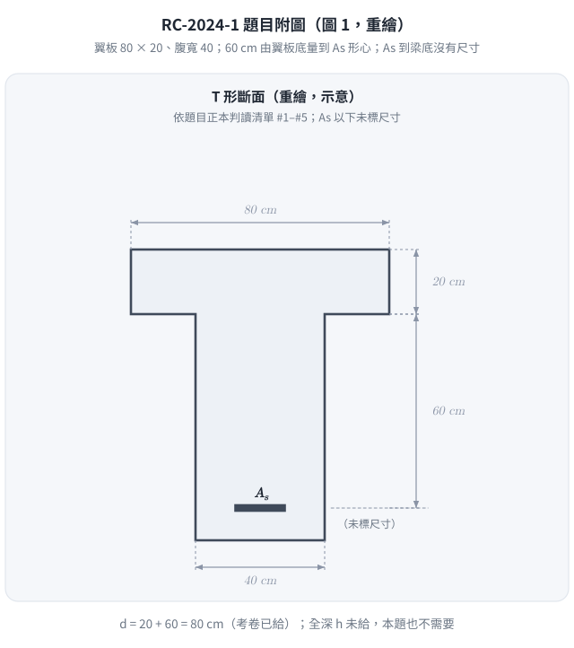
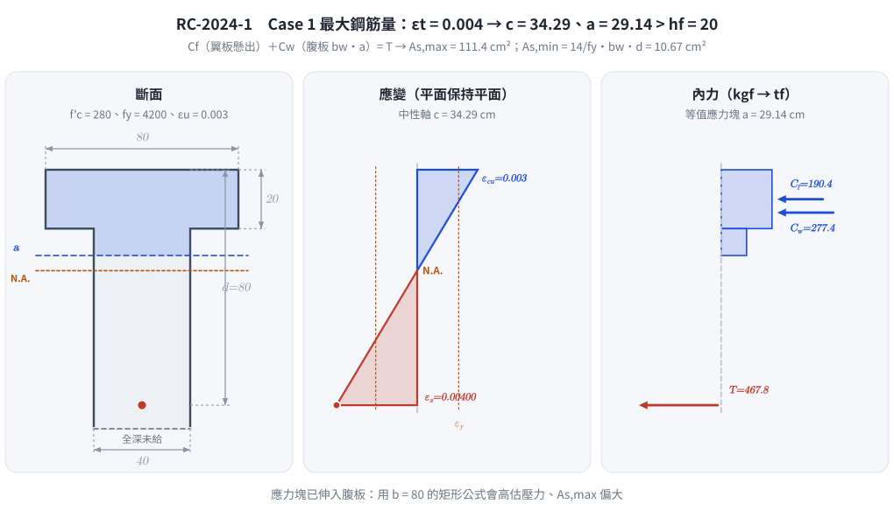
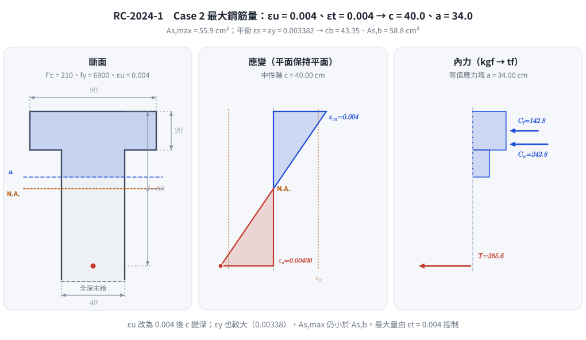

# 考題編號：RC-2024-1

**主分類：** `RC-U1-1` RC 梁彎矩強度分析與設計
**副分類：** 無
**設計法：** USD 強度設計法
**標籤：** `T形梁` `最大鋼筋量` `最小鋼筋量` `平衡鋼筋量` `Whitney應力塊` `β1係數` `延性控制` `高強度鋼筋` `尺寸鏈判讀` `d=80`

---

## 1. 題目（考卷原文見題目正本）

> 考卷原文、公式／附表、附圖與判讀清單（已確認）見 [`RC-2024-1-problem.md`](RC-2024-1-problem.md)。本節只列解題時最容易讀錯的地方與本解使用的記號；題意以題目正本為準。


*重繪自考卷圖 1（考卷註明未依比例），依題目正本判讀清單。60 cm 的下端畫在 As 中心線上——這張圖攔下「60 cm 是腹板高、d 要自己扣保護層」：考卷給的就是 $d = 20 + 60 = 80$ cm，沒給的是全深 $h$。*

### 常見誤讀

| 項目 | 正確判讀 | 常見誤讀 |
|---|---|---|
| 60 cm 尺寸 | 翼板底面到 As 形心（判讀 #2） | 當成腹板高（翼板底到梁底），再假設保護層求 $d$（本解 2026-11-13 前即採 $h = 80$、$d = 74$） |
| 有效深度 | $d = 20 + 60 = 80$ cm（考卷已給） | $d = h - 6 = 74$ cm |
| 全深 $h$ | 考卷沒有給，本題也用不到 | 推成 $h = 80$ |
| 最小鋼筋量寬度 | 用腹板寬 $b_w = 40$ cm | 用翼板寬 80 cm |

**本解記號：** 翼板寬 $b = 80$ cm、$h_f = 20$ cm、$b_w = 40$ cm、$d = 80$ cm；Case 1：$f_y = 4200$、$f'_c = 280$、$\varepsilon_u = 0.003$；Case 2：$f_y = 6900$、$f'_c = 210$、$\varepsilon_u = 0.004$（$E_s = 2.04\times10^6$ kgf/cm² 兩者相同）。

---

## 2. 考題核心精神與出題者意圖 (Core Concepts & Examiner's Intent)

**核心觀念：** T 形梁的最大、最小、平衡鋼筋量計算，以及當材料參數（$f_y$、$f'_c$、$\varepsilon_u$）改變時，如何系統性修正計算流程。

**出題意圖：**
1. 測試學生能否判斷「中性軸在翼板內或腹板內」並切換計算模式
2. 測試 $\varepsilon_u = 0.004$（非標準值）時的平衡條件修正
3. 高強度鋼筋 $f_y = 6900$ 導致 $\varepsilon_y > \varepsilon_u(\text{Case 1})$，學生必須重新計算 $\varepsilon_y$ 而非套用舊公式
4. 最大鋼筋量（$\varepsilon_t \geq 0.004$）在 $\varepsilon_u = 0.004$ 的情況下的邊界意義

---

## 3. 解題戰略地圖與陷阱分析 (Strategic Roadmap & Trap Analysis)

**作戰計畫：**
```
Step 1：確定 β1（依 f'c 大小）
Step 2（Case 1 最大）：由 εt = 0.004 → c_max → a_max → 判斷 NA 位置 → 求壓力 → As,max
Step 3（Case 1 最小）：公式 max(0.8√f'c/fy, 14/fy) × bw × d
Step 4（Case 2 平衡）：由 εu/(εu+εy) → cb → ab → 判斷 NA 位置 → As,b
Step 5（Case 2 最大）：同 Step 2 但用 εu=0.004
```

**關鍵陷阱：**

| # | 陷阱 | 正確做法 |
|---|------|---------|
| ①  | 最大鋼筋量直接套 $\rho_{max} = 0.75\rho_b$（舊 ACI 法）| 土木401-112 改用 $\varepsilon_t \geq 0.004$ 控制，$c_{max}/d = \varepsilon_u/(\varepsilon_u+0.004)$ |
| ② | 假設 $a \leq h_f$ 不驗算就套矩形梁公式 | 計算 $a_{max}$ 後必須與 $h_f=20\ \text{cm}$ 比較，本題均 $>h_f$，需用 T 形梁公式 |
| ③ | 最小鋼筋量用翼板寬 $b$ 而非腹板寬 $b_w$ | 依規範明確使用 $b_w$ |
| ④ | Case 2 的 $\varepsilon_u=0.004$ 認為是打字錯誤 | 這是本題刻意設定，影響 $c_b$ 公式與最大鋼筋量條件 |

---

## 3.5 變數層次分析（Variable Hierarchy Analysis）

> 複習提示：第一次解題後，在每個卡住的知識點旁標記 `⚠`；第二次複習時只看有 `⚠` 的項目。

### 最終目標

`Case 1：計算 As,max（εt≥0.004 限制）與 As,min（規範下限）`
`Case 2：計算 As,b（平衡狀態）與 As,max（εt≥0.004 限制，εu=0.004）`

### 本題關鍵公式鏈

$$\text{Case 1 最大：} c_{max} = \frac{\varepsilon_u}{\varepsilon_u+0.004} \cdot d \xrightarrow{\times \beta_1} \boxed{a_{max}} \xrightarrow{\text{T形壓力}} C = 0.85f'_c[(b-b_w)h_f + b_w \boxed{a_{max}}] \xrightarrow{\div f_y} A_{s,max}$$

$$\text{Case 1 最小：} A_{s,min} = \max\!\left(\frac{0.8\sqrt{f'_c}}{f_y},\ \frac{14}{f_y}\right) \cdot b_w \cdot d$$

$$\text{Case 2 平衡：} c_b = \frac{\varepsilon_u}{\varepsilon_u + \boxed{\varepsilon_y}} \cdot d \xrightarrow{\times \beta_1} \boxed{a_b} \xrightarrow{\text{T形壓力}} C_b \xrightarrow{\div f_y} A_{s,b}$$

$$\text{Case 2 最大：} c_{max} = \frac{\varepsilon_u}{\varepsilon_u+0.004} \cdot d = \frac{0.004}{0.008} \cdot d = 0.5d$$

### L1：題目直接給定

| 符號 | 數值（Case 1） | 數值（Case 2） | 說明 |
|------|:---:|:---:|------|
| $b$ | 80 cm | 80 cm | T 形梁翼板寬度 |
| $h_f$ | 20 cm | 20 cm | 翼板厚度 |
| $b_w$ | 40 cm | 40 cm | 腹板寬度 |
| $d$ | 80 cm | 80 cm | 有效深度（翼板厚 20 + 翼板底到 As 形心 60，判讀 #2） |
| $f'_c$ | 280 kgf/cm² | 210 kgf/cm² | 混凝土抗壓強度 |
| $f_y$ | 4200 kgf/cm² | 6900 kgf/cm² | 鋼筋降伏強度 |
| $E_s$ | 2.04×10⁶ kgf/cm² | 2.04×10⁶ kgf/cm² | 鋼筋彈性模數 |
| $\varepsilon_u$ | 0.003 | 0.004 | 混凝土極限壓應變 |

### L2：需知識點推導

**Step A：β₁ 係數**

| 符號 | 公式/來源 | 卡關? |
|------|----------|:-----:|
| $\beta_1$ | $f'_c \leq 280\ \text{kgf/cm}^2 \Rightarrow \beta_1=0.85$；每增加 $70\ \text{kgf/cm}^2$ 減 $0.05$ | |

**Step B：Case 1 最大鋼筋量**

| 符號 | 公式/來源 | 卡關? |
|------|----------|:-----:|
| $c_{max}$ | $\varepsilon_u/(\varepsilon_u+0.004) \cdot d = (3/7) \times 80 = 34.29\ \text{cm}$ | |
| $a_{max}$ | $\beta_1 \cdot c_{max} = 0.85 \times 34.29 = 29.14\ \text{cm}$ | |
| 判斷 | $a_{max}=29.14 > h_f=20 \Rightarrow$ NA 在腹板，T 形梁行為 | |
| $C_{total}$ | $0.85f'_c[(b-b_w)h_f + b_w \cdot a_{max}]$ | |
| $A_{s,max}$ | $C_{total}/f_y$ | |

**Step C：Case 1 最小鋼筋量**

| 符號 | 公式/來源 | 卡關? |
|------|----------|:-----:|
| $0.8\sqrt{f'_c}/f_y$ | $0.8\times16.73/4200 = 0.003187$ | |
| $14/f_y$ | $14/4200 = 0.003333$ → 控制 | |
| $A_{s,min}$ | $0.003333 \times b_w \times d$ | |

**Step D：Case 2 鋼筋降伏應變**

| 符號 | 公式/來源 | 卡關? |
|------|----------|:-----:|
| $\varepsilon_y$ | $f_y/E_s = 6900/(2.04\times10^6) = 0.003382$ | |

**Step E：Case 2 平衡鋼筋量**

| 符號 | 公式/來源 | 卡關? |
|------|----------|:-----:|
| $c_b$ | $\varepsilon_u/(\varepsilon_u+\varepsilon_y) \cdot d = 0.004/0.007382 \times 80 = 43.35\ \text{cm}$ | |
| $a_b$ | $\beta_1 \cdot c_b = 0.85 \times 43.35 = 36.84\ \text{cm}$ | |
| 判斷 | $a_b=36.84 > h_f=20 \Rightarrow$ T 形梁行為 | |
| $A_{s,b}$ | $0.85f'_c[(b-b_w)h_f + b_w \cdot a_b]/f_y$ | |

**Step F：Case 2 最大鋼筋量**

| 符號 | 公式/來源 | 卡關? |
|------|----------|:-----:|
| $c_{max}$ | $\varepsilon_u/(\varepsilon_u+0.004) \cdot d = 0.004/0.008 \times 80 = 40\ \text{cm}$ | |
| $a_{max}$ | $0.85 \times 40 = 34.0\ \text{cm} > h_f$ → T 形梁 | |
| $A_{s,max}$ | $0.85f'_c[(b-b_w)h_f + b_w \cdot a_{max}]/f_y$ | |

### L3：深層知識（不懂就卡住）

| 知識點 | 說明 | 卡關? |
|--------|------|:-----:|
| 土木401-112 改用 $\varepsilon_t \geq 0.004$ 替代 $0.75\rho_b$ | 舊ACI 318-99 用 $\rho_{max}=0.75\rho_b$；新版改用淨拉應變控制，兩者結果不同 | |
| T 形梁 NA 位置判斷 | $a \leq h_f$ → 矩形梁（用 $b$）；$a > h_f$ → T形梁壓力公式（分翼板+腹板兩部分） | |
| $\varepsilon_u$ 非標準值的影響 | 公式 $c_b = \varepsilon_u d/(\varepsilon_u+\varepsilon_y)$ 需用題目給定的 $\varepsilon_u$，不可固定套 0.003 | |
| 最小鋼筋量用 $b_w$ 不用 $b$ | T 形梁翼板屬壓力區，裂縫後受拉區接近腹板，故最小鋼筋量以 $b_w$ 計算 | |
| Case 2 驗證：$A_{s,max} < A_{s,b}$ | 當 $\varepsilon_u=0.004$ 且最大鋼筋條件同為 $\varepsilon_t=0.004$，$c_{max}/d=0.5 < c_b/d=0.542$，故 $A_{s,max} < A_{s,b}$（合理） | |

---

## 4. 步驟化詳細計算過程 (Step-by-Step Detailed Calculation)

### 前置：斷面幾何確認

$$b = 80\ \text{cm},\quad h_f = 20\ \text{cm},\quad b_w = 40\ \text{cm}$$

$$d = 20 + 60 = 80\ \text{cm} \quad \text{（圖 1：60 cm 由翼板底面量到 } A_s \text{ 形心；全深 } h \text{ 考卷未給，本題不需要）}$$

---

### 【Case 1】$f_y = 4200\ \text{kgf/cm}^2$，$f'_c = 280\ \text{kgf/cm}^2$，$\varepsilon_u = 0.003$

**Step A1：β₁ 係數**

$$f'_c = 280\ \text{kgf/cm}^2 \leq 280\ \text{kgf/cm}^2 \Rightarrow \boxed{\beta_1 = 0.85}$$

**Step A2：最大鋼筋量**（土木401-112：$\varepsilon_t \geq 0.004$）

最大鋼筋量對應 $\varepsilon_t = 0.004$（最小淨拉應變），中性軸深度：

$$c_{max} = \frac{\varepsilon_u}{\varepsilon_u + 0.004} \cdot d = \frac{0.003}{0.003 + 0.004} \times 80 = \frac{3}{7} \times 80 = 34.29\ \text{cm}$$

等值應力塊深度：

$$a_{max} = \beta_1 \cdot c_{max} = 0.85 \times 34.29 = \mathbf{29.14\ \text{cm}}$$

**判斷 NA 位置：** $a_{max} = 29.14\ \text{cm} > h_f = 20\ \text{cm}$ → 中性軸在腹板，T 形梁行為

壓力合力（分翼板懸挑部分 + 腹板部分）：

$$C = 0.85 f'_c \left[(b - b_w) \cdot h_f + b_w \cdot a_{max}\right]$$

$$= 0.85 \times 280 \times \left[(80-40) \times 20 + 40 \times 29.14\right]$$

$$= 238 \times \left[800 + 1165.7\right] = 238 \times 1965.7$$

$$= 467{,}840\ \text{kgf}$$

最大鋼筋量（$T = C$，鋼筋已降伏）：

$$\boxed{A_{s,max} = \frac{C}{f_y} = \frac{467{,}840}{4200} \approx 111.4\ \text{cm}^2}$$

---

**Step A3：最小鋼筋量**（土木401-112 Section 9.6.1）

$$A_{s,min} = \max\!\left(\frac{0.8\sqrt{f'_c}}{f_y},\ \frac{14}{f_y}\right) \cdot b_w \cdot d$$

各值計算：

$$\frac{0.8\sqrt{280}}{4200} = \frac{0.8 \times 16.73}{4200} = \frac{13.39}{4200} = 0.003187$$

$$\frac{14}{4200} = 0.003333 \quad \text{← 控制}$$

$$\boxed{A_{s,min} = 0.003333 \times 40 \times 80 = 10.67\ \text{cm}^2}$$



*圖 1　Case 1 最大鋼筋量。$a = 29.14$ cm 已伸入腹板，壓力要拆成翼板懸出 $C_f$ 與腹板 $C_w$——這張圖攔下用 $b = 80$ 的矩形公式高估 $A_{s,max}$。*

---

### 【Case 2】$f_y = 6900\ \text{kgf/cm}^2$，$f'_c = 210\ \text{kgf/cm}^2$，$\varepsilon_u = 0.004$

**Step B1：基本材料參數**

$$\beta_1：f'_c = 210\ \text{kgf/cm}^2 < 280\ \text{kgf/cm}^2 \Rightarrow \beta_1 = 0.85$$

$$\varepsilon_y = \frac{f_y}{E_s} = \frac{6900}{2.04 \times 10^6} = 0.003382$$

**Step B2：平衡鋼筋量**（平衡條件：$\varepsilon_s = \varepsilon_y$，$\varepsilon_c = \varepsilon_u = 0.004$）

$$c_b = \frac{\varepsilon_u}{\varepsilon_u + \varepsilon_y} \cdot d = \frac{0.004}{0.004 + 0.003382} \times 80 = \frac{0.004}{0.007382} \times 80 = 0.5419 \times 80 = 43.35\ \text{cm}$$

$$a_b = \beta_1 \cdot c_b = 0.85 \times 43.35 = \mathbf{36.84\ \text{cm}}$$

**判斷 NA 位置：** $a_b = 36.84\ \text{cm} > h_f = 20\ \text{cm}$ → T 形梁行為

壓力合力：

$$C_b = 0.85 \times 210 \times \left[(80-40) \times 20 + 40 \times 36.84\right]$$

$$= 178.5 \times \left[800 + 1473.6\right] = 178.5 \times 2273.6$$

$$= 405{,}838\ \text{kgf}$$

平衡鋼筋量：

$$\boxed{A_{s,b} = \frac{405{,}838}{6900} \approx 58.8\ \text{cm}^2}$$

---

**Step B3：最大鋼筋量**（$\varepsilon_t \geq 0.004$，$\varepsilon_u = 0.004$）

$$c_{max} = \frac{\varepsilon_u}{\varepsilon_u + 0.004} \cdot d = \frac{0.004}{0.004 + 0.004} \times 80 = 0.5 \times 80 = 40.0\ \text{cm}$$

$$a_{max} = 0.85 \times 40.0 = 34.0\ \text{cm} > h_f = 20\ \text{cm} \Rightarrow \text{T 形梁行為}$$

壓力合力：

$$C_{max} = 178.5 \times \left[(80-40) \times 20 + 40 \times 34.0\right]$$

$$= 178.5 \times \left[800 + 1360.0\right] = 178.5 \times 2160.0$$

$$= 385{,}560\ \text{kgf}$$

最大鋼筋量：

$$\boxed{A_{s,max} = \frac{385{,}560}{6900} \approx 55.9\ \text{cm}^2}$$

**合理性檢驗：** $A_{s,max} = 55.9 < A_{s,b} = 58.8\ \text{cm}^2$ ✓（最大鋼筋量應小於平衡鋼筋量）



*圖 2　Case 2 換成 $\varepsilon_u = 0.004$、$f_y = 6900$ 後，$c$ 變深、$\varepsilon_y = 0.00338$ 也變大；最大量仍由 $\varepsilon_t = 0.004$ 控制且小於平衡量——這張圖攔下沿用 0.003、或把平衡量當最大量。*

---

### 結果彙整

| 項目 | 說明 | 結果 |
|------|------|------|
| Case 1 $A_{s,max}$ | $f_y=4200$，$f'_c=280$，$\varepsilon_u=0.003$，$\varepsilon_t=0.004$ 控制 | **111.4 cm²** |
| Case 1 $A_{s,min}$ | $14/f_y \times b_w \times d$ 控制 | **10.67 cm²** |
| Case 2 $A_{s,b}$ | $f_y=6900$，$f'_c=210$，$\varepsilon_u=0.004$，平衡條件 | **58.8 cm²** |
| Case 2 $A_{s,max}$ | $\varepsilon_t=0.004$ 控制，$c_{max}=0.5d$ | **55.9 cm²** |

---

## 5. 關鍵爭議點與進階探討 (Critical Issues & Advanced Discussion)

**爭議點 1：有效深度 $d$——考卷給的是 $d$，沒給的是 $h$**

圖 1 右側的 60 cm 尺寸線下端對齊 $A_s$ 長條中心（考卷 PDF 向量：尺寸線止於 $A_s$ 中線，梁底在其下另有一段未標尺寸），所以 $d = 20 + 60 = 80$ cm 是題目給定值，不必假設保護層。若把 60 cm 讀成腹板高、再自取 $d = 74$，四個答案全部偏小：$A_{s,max}$ 106.4（應 111.4）、$A_{s,min}$ 9.87（應 10.67）、$A_{s,b}$ 56.0（應 58.8）、Case 2 $A_{s,max}$ 53.2（應 55.9）cm²。四個量都與 $d$ 成線性（翼板項為常數），所以誤差約 5–8%。

**爭議點 2：最大鋼筋量的規範依據**

土木401-112（2023 年版）已取消舊 ACI 318-99 的 $\rho_{max} = 0.75\rho_b$ 規定，改用淨拉應變條件 $\varepsilon_t \geq 0.004$。考生應注意：
- $\varepsilon_t \geq 0.005$：拉力控制斷面，$\phi = 0.90$
- $0.004 \leq \varepsilon_t < 0.005$：過渡區，$\phi$ 線性內插
- $\varepsilon_t < 0.004$：梁設計**不允許**（壓力控制，延性不足）

**爭議點 3：高強度鋼筋的「拉力控制界限」不是固定的 0.005**

本題只問**最大鋼筋量**（由 $\varepsilon_t \geq 0.004$ 控制），故不受影響。但若延伸去算 $\phi$ 就要小心：

| | $f_y = 4200$（Case 1） | $f_y = 6900$（Case 2） |
|---|---|---|
| $\varepsilon_{ty} = f_y/E_s$ | 0.002059 | 0.003382 |
| 壓力控制界限 | $\varepsilon_t \leq 0.002059$ | $\varepsilon_t \leq 0.003382$ |
| 拉力控制界限 | 0.005 | $\varepsilon_{ty} + 0.003 = 0.006382$ |

土木401-112／ACI 318-19 的拉力控制界限是 $\varepsilon_{ty} + 0.003$，
對 SD420 恰好等於 $0.002 + 0.003 = 0.005$（習慣上直接記 0.005），但**對 SD690 是 0.006382**。
Case 2 在 $\varepsilon_t = 0.004$ 時只比 $\varepsilon_{ty} = 0.003382$ 高一點點，
$\phi$ 會落在**過渡區的很前段**（約 0.70），離 0.90 還很遠——高強度鋼筋的斷面延性餘裕遠比想像中小。

**進階：Case 2 為何 $A_{s,max} < A_{s,b}$？**

當 $\varepsilon_u = 0.004$ 時，最大鋼筋條件 $\varepsilon_t = 0.004$ 使 $c_{max}/d = 0.5$，而平衡條件中 $\varepsilon_y = 0.003382 < 0.004 = \varepsilon_u$，導致 $c_b/d = 0.5419 > 0.5$。因此最大鋼筋量的中性軸反而比平衡條件更高（壓力區更小），導致 $A_{s,max} < A_{s,b}$。這與 Case 1（$\varepsilon_u = 0.003$，$\varepsilon_y = fy/Es \approx 0.00206 < 0.003$）相反，是高強度鋼筋的特殊現象。

---

*修正日期：2026-11-13（§1 改為指向題目正本＋常見誤讀＋本解記號，嵌入重繪附圖 figs/RC-2024-1-fig-1-problem.svg；舊 §1 證據圖 fig-1 已收入題目正本，改以 fig-2 為證據圖）*
*修正日期：2026-11-13（題意（判讀）勘誤：圖 1 的 60 cm 由翼板底量到 As 形心，d = 80 cm（原解假設 h = 80、d = 74）。Case 1 As,max 106.4 → 111.4 cm²、As,min 9.87 → 10.67 cm²；Case 2 As,b 56.0 → 58.8 cm²、As,max 53.2 → 55.9 cm²；c、a 隨 d 等比例改變，a > hf 與 As,max < As,b 結論不變。改 §1、§3.5 L1／L2、§4 前置與 Step A2、A3、B2、B3、彙整、§5 爭議點 1。驗證：程式重算 15 值 MISMATCHES: 0；由 As 反算 εt＝0.004、εs＝εy 兩條回代路徑一致）*

*圖解補繪：2026-11-13（向量圖 2 張，腳本 `gen_RC-2024-1.py`，可重跑；腳本檔尾對 §4 公佈值做 assert）*
