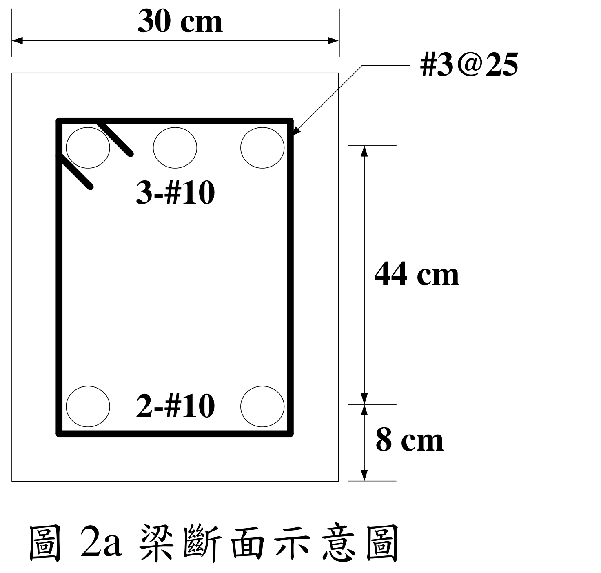
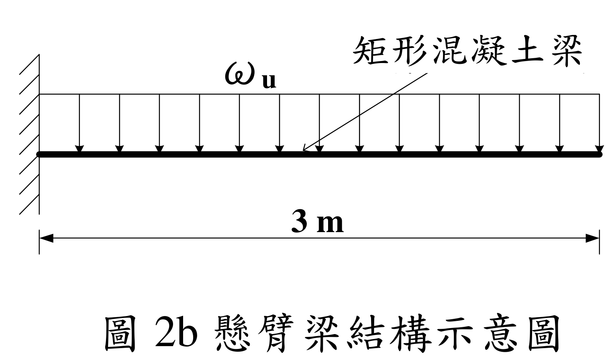

# RC-2024-2 題目正本

> 本檔只記錄**考卷上寫了什麼、圖上畫了什麼**，不含任何解法。解析見同資料夾 `RC-2024-2.md`。
> 判讀清單已經使用者確認（凍結）；本檔原則上不再修改（改動須回考卷原圖並記 log）。

| 項目 | 內容 |
|------|------|
| 考卷 | `raw/exams/RC-2024_鋼筋混凝土設計與預力.pdf` 第 2 頁（頁次 3－2），第二題 |
| 考年 | 民國 113 年（2024） |
| 配分 | 25 分 |
| 附圖 | `RC-2024-2-fig-3.png`（圖 2a 梁斷面示意圖）、`RC-2024-2-fig-4.png`（圖 2b 懸臂梁結構示意圖），皆 500 dpi 重新擷取；舊證據圖 `RC-2024-2-fig-1.png`、`-fig-2.png` 壓有滑鼠游標，保留不刪 |
| 判讀狀態 | **已確認**（2026-11-13 使用者確認；#1、#3 使用者確認 d = 52（推翻解析 d = 44）；轉錄 2026-11-13，PyMuPDF 110 dpi 全頁目視＋抽出文字核對，附圖 400／500 dpi＋PDF 向量座標；盲讀後才比對既有解析） |

## 1. 考卷原文（逐字）

> 二、懸臂梁斷面示意圖如圖 2a，若採用中強度鋼筋（fy = 4200 kgf/cm²、Es = 2.04×10⁶ kgf/cm²）、#10（D32）與 #3（D10）鋼筋之斷面積分別為 8.14 cm²、0.71 cm²；混凝土性質（f'c = 210 kgf/cm²、εu = 0.003）；下方斷面為受壓力，若考慮壓力鋼筋之貢獻，請計算採斷面彎矩強度及壓力鋼筋應力大小。若相同斷面之懸臂梁長度為 3 m（示意圖如圖 2b），請計算最大因數化均佈載重 ωu（含自重、靜載重、活載重等）。（示意圖未依照比例尺繪製）（25 分）

（「請計算採斷面彎矩強度」照考卷原文，「採」字疑為贅字或漏字。）

## 2. 考卷給的公式、附表與參數

- 卷首：依據與作答規範：中國土木水利工程學會「混凝土工程設計規範與解說」（土木 401-112），未依上述規範作答，不予計分。
- 題文數值：$f_y=4200$、$E_s=2.04\times10^6$、$f'_c=210$ kgf/cm²、$\varepsilon_u=0.003$；#10 面積 8.14 cm²、#3 面積 0.71 cm²；懸臂長 3 m。
- **沒有給**：梁全深 $h$（拉力筋到頂面沒有標尺寸）、#10 的直徑、$\beta_1$、$\phi$。
- 卷首注意事項：㈠可以使用電子計算器；㈡不必抄題；㈢除專門名詞或數理公式外，應使用本國文字作答。

## 3. 附圖

圖面文字照錄：圖 2a `30 cm`、`#3@25`、`3-#10`、`2-#10`、`44 cm`、`8 cm`、`圖 2a 梁斷面示意圖`；圖 2b `ωu`、`矩形混凝土梁`、`3 m`、`圖 2b 懸臂梁結構示意圖`。

## 4. 判讀清單

「把握」標**不確定**者請優先確認；解讀類項目（題目用字的意思）另標「解讀」。

| # | 項目 | 判讀 | 圖上／題文依據 | 把握 |
|---|------|------|---------------|------|
| 1 | 44 cm 段 | **上排鋼筋中心到下排鋼筋中心**（不是受壓面到拉力筋） | 400／500 dpi 目視：44 cm 上端延伸線對齊上排圓心、下端對齊下排圓心。PDF 向量：上端延伸線 y = 279.2，上排圓心 y = 280.1；下排圓心 y = 371.4；8 cm 下端 y = 397.7＝斷面底 397.8 | 確定（使用者選擇：44 cm 為兩排鋼筋中心距） |
| 2 | 8 cm 段 | 下排鋼筋中心到斷面底面 → $d'=8$ cm | 同上 | 確定 |
| 3 | 有效深度 | 受壓面（底面）到拉力筋（上排）＝$8+44=52$ cm | #1＋#2 | 確定（使用者選擇：d = 52、d' = 8） |
| 4 | 全深 $h$ | 考卷沒有給（頂面到上排鋼筋無尺寸；圖未依比例，頂部畫法與底部對稱但不能據以推 $h$） | 圖上無尺寸 | 確定 |
| 5 | 受力方向 | 懸臂負彎矩：上排 3-#10 為拉力筋、下排 2-#10 為壓力筋 | 題文「下方斷面為受壓力」；圖 2b 固定端在左 | 確定 |
| 6 | 斷面寬 | $b=30$ cm | 30 cm 尺寸線對齊外框 | 確定 |
| 7 | 箍筋 | #3@25（D10，0.71 cm²），彎矩計算不需要 | 圖上標註；題文 | 確定 |
| 8 | 懸臂 | 長 3 m，左端固定、右端自由，全長均佈 $\omega_u$（已含自重、靜載、活載的因數化合計） | 圖 2b；題文 | 確定 |
| 9 | 所求 | ①考慮壓力筋的彎矩強度（題文「採斷面彎矩強度」未寫明 $M_n$ 或 $\phi M_n$）與壓力筋應力；②最大 $\omega_u$ | 題文 | 不確定（解讀）；使用者確認：Mn 與 φMn 並列作答 |
| 10 | 考卷沒有給 | $h$、#10 直徑、$\beta_1$、$\phi$ | 全題 | 確定 |

---

*轉錄：2026-11-13（RC-U1-1 題目正本推廣・批 2）*

*確認：2026-11-13 使用者確認（RC-U1-1 題目正本推廣・批 2，關卡一）*
