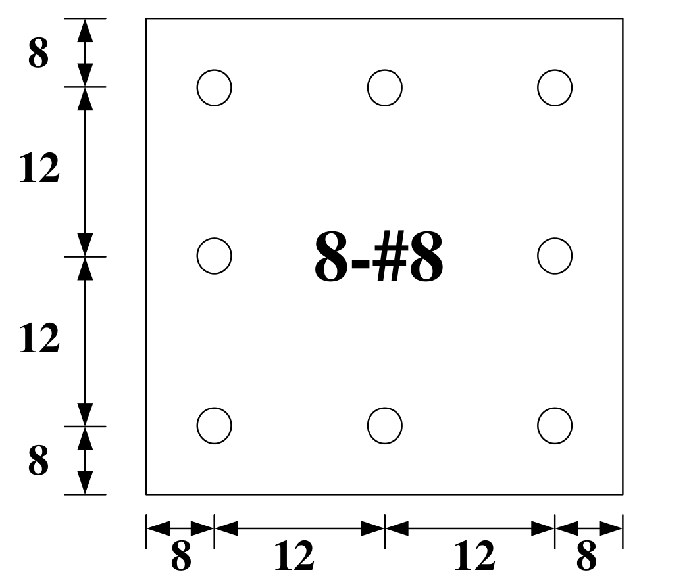

# RC-2024-3 題目正本

> 本檔只記錄**考卷上寫了什麼、圖上畫了什麼**，不含任何解法。解析見同資料夾 `RC-2024-3.md`。
> 判讀清單已經使用者確認（凍結）；本檔原則上不再修改（改動須回考卷原圖並記 log）。

| 項目 | 內容 |
|------|------|
| 考卷 | `raw/exams/RC-2024_鋼筋混凝土設計與預力.pdf` 第 2 頁（頁次 3－2），第三題 |
| 考年 | 民國 113 年（2024） |
| 配分 | 25 分 |
| 附圖 | `RC-2024-3-fig-2.png`（圖 3，500 dpi 重新擷取）；既有 `RC-2024-3-fig-1.png` 尺寸字太小，保留不刪 |
| 判讀狀態 | **已確認**（2026-11-14 使用者確認；無不確定項；轉錄 2026-11-14；PyMuPDF 110 dpi 全頁目視＋抽出文字核對，附圖 500 dpi 放大；盲讀後才比對既有解析） |

## 1. 考卷原文（逐字）

> 三、某一正方形（40 cm×40 cm）柱斷面如圖 3 所示。若採用 8-#8（D25）主筋（$d_b$=2.54 cm，$A_b$=5.07 cm²、$f_y$=4200 kgf/cm²、$E_s$=2.04×10⁶ kgf/cm²）、混凝土（$f'_C$=280 kgf/cm²、$\varepsilon_u$=0.003）。此柱受軸力與單向彎矩。若柱破壞時，拉力鋼筋的應變恰為零。請計算斷面承受之軸力與破壞時承受之彎矩。（25 分）

## 2. 考卷給的公式、附表與參數

- 題文數值：40×40 cm；8-#8，$d_b=2.54$ cm、$A_b=5.07$ cm²；$f_y=4200$ kgf/cm²；$E_s=2.04\times10^6$ kgf/cm²；$f'_c=280$ kgf/cm²；$\varepsilon_u=0.003$。
- 卷首：「依據與作答規範：中國土木水利工程學會『混凝土工程設計規範與解說』（土木401-112），未依上述規範作答，不予計分。」
- **沒有給**：$\beta_1$、彎曲方向（斷面對稱，不影響）、箍筋。
- 卷首注意事項：㈠可以使用電子計算器。㈡不必抄題，作答時請將試題題號及答案依照順序寫在試卷上，於本試題上作答者，不予計分。㈢本科目除專門名詞或數理公式外，應使用本國文字作答。

## 3. 附圖

圖面文字照錄：「8」「12」「12」「8」（左側與下方各一組）「8-#8」「圖 3 方形柱斷面（未依照比例尺繪製）」。

## 4. 判讀清單

| # | 項目 | 判讀 | 圖上／題文依據 | 把握 |
|---|------|------|---------------|------|
| 1 | 斷面 | 40×40 cm | 題文；尺寸 8+12+12+8＝40 | 確定 |
| 2 | 鋼筋配置 | 四角＋四邊中點共 8-#8；沿彎曲深度三層：$d'=8$ cm（3 根）、20 cm（2 根）、$d=32$ cm（3 根）；尺寸量至鋼筋中心 | 500 dpi：尺寸線端點對齊圓心 | 確定 |
| 3 | 彎曲方向 | 「單向彎矩」，方向未指定；斷面雙向對稱，任一主軸結果相同 | 題文、圖 3 | 確定 |
| 4 | 中性軸條件 | 「拉力鋼筋」＝距壓力緣最遠一層（$d=32$ cm）；其應變為零 → $c=d=32$ cm | 題文 | 確定（解讀） |
| 5 | 所求的量 | 破壞（$\varepsilon_u=0.003$）時的標稱軸力 $P_n$ 與標稱彎矩 $M_n$（不乘 $\phi$），彎矩對斷面中心 | 題文「破壞時承受之彎矩」 | 確定（解讀） |
| 6 | 圖不依比例 | 以標註數字為準 | 圖說「未依照比例尺繪製」 | 確定 |
| 7 | 考卷沒有給 | $\beta_1$ 需依規範自行採用 | 題文 | 確定 |

---

*轉錄：2026-11-14（RC-U1-2 題目正本推廣・批 1）*

*確認：2026-11-14 使用者確認（RC-U1-2 題目正本推廣・批 1，關卡一）*
