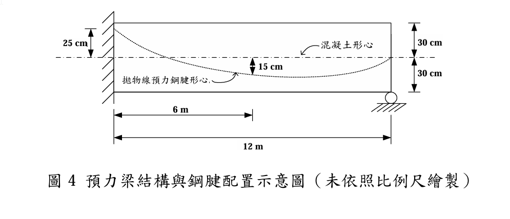

# RC-2024-4 題目正本

> 本檔只記錄**考卷上寫了什麼、圖上畫了什麼**，不含任何解法。解析見同資料夾 `RC-2024-4.md`。
> 判讀清單已經確認（凍結）；本檔原則上不再修改（改動須回考卷原圖並記 log）。

| 項目 | 內容 |
|------|------|
| 考卷 | `raw/exams/RC-2024_鋼筋混凝土設計與預力.pdf` 第 3 頁（頁次 3－3），第四題 |
| 考年 | 民國 113 年（2024） |
| 配分 | 25 分 |
| 附圖 | `RC-2024-4-fig-1.png`（圖 4 預力梁結構與鋼腱配置示意圖，未依照比例尺繪製） |
| 判讀狀態 | **已確認**（2026-11-15 使用者授權依 Claude 建議確認；轉錄 2026-11-15；PyMuPDF 110 dpi 全頁目視、文字層逐字核對、圖 4 向量曲線座標擬合；盲讀後才比對既有解析） |

## 1. 考卷原文（逐字）

> 四、某一後拉預力梁結構系統，一端為固定端，一端為輥支承；梁全長為 12 m，梁全長具統一對稱矩形斷面，斷面深度為 60 cm，寬度為 40 cm。今配一拋物線鋼腱，其在固定端斷面鋼腱偏心距為混凝土形心上方 25 cm，梁中央斷面偏心距為混凝土形心下方 15 cm，輥支承端處則無偏心，如圖 4 所示。假設鋼腱預力大小為 120 噸，請繪製由該預力所產生之壓力作用線、計算由該預力引起固定端與輥支承端之受力，以及如何調整鋼腱使其成為「同位鋼腱」。（25 分）
>
> 圖 4 預力梁結構與鋼腱配置示意圖（未依照比例尺繪製）

## 2. 考卷給的公式、附表與參數

- 一端固定、一端輥支承；全長 12 m；矩形斷面深 60、寬 40 cm（形心在中央）。
- 拋物線鋼腱偏心：固定端形心上方 25 cm；梁中央形心下方 15 cm；輥支承端 0。
- 鋼腱預力 120 噸（tf）。
- 所求：①繪製預力產生的壓力作用線（C 線）；②預力引起固定端與輥支承端的受力；③如何調整鋼腱成為同位（一致）鋼腱。
- **沒有給**：外加載重（題目只問預力效應）、預力損失、$f'_c$。
- 卷首：※依據與作答規範：中國土木水利工程學會「混凝土工程設計規範與解說」（土木401-112），未依上述規範作答，不予計分。注意事項：可以使用電子計算器。不必抄題，作答時請將試題題號及答案依照順序寫在試卷上，於本試題上作答者，不予計分。本科目除專門名詞或數理公式外，應使用本國文字作答。

## 3. 附圖

圖面文字照錄：25 cm、15 cm、30 cm、30 cm、6 m、12 m、混凝土形心、拋物線預力鋼腱形心、圖 4 預力梁結構與鋼腱配置示意圖（未依照比例尺繪製）。

## 4. 判讀清單

| # | 項目 | 判讀 | 圖上／題文依據 | 把握 |
|---|------|------|---------------|------|
| 1 | 拋物線的形式 | **通過三個給定偏心點的單一拋物線**（頂點不在梁中央）。不採「以梁中央為頂點的兩段拋物線」。向量曲線：梁 x＝174.8～434.4 pt、梁中央 304.6 pt；曲線最低點畫在 x≈340 pt（距固定端約 7.6 m），與單一拋物線頂點位置（約 7.4 m）相符；兩段拋物線的最低點應在 6 m。題文也只說「一拋物線鋼腱」 | 題文；圖 4 向量座標 | 確定（解讀；圖未依比例，形狀僅定性。2026-11-15 使用者授權依 Claude 建議確認） |
| 2 | 支承 | 左端固定（牆面斜線）、右端輥支承（圓輪） | 題文；圖 4 | 確定 |
| 3 | 斷面 | 矩形 40×60 cm，形心距頂、底各 30 cm | 題文；圖 4 尺寸 30＋30 | 確定 |
| 4 | 偏心 | 固定端形心上方 25 cm；梁中央（6 m）形心下方 15 cm；輥支承端 0 | 題文；圖 4 尺寸 25、15 量自點劃線 | 確定 |
| 5 | 預力 | 120 tf，沿全長視為定值（考卷未給損失） | 題文「鋼腱預力大小為 120 噸」 | 確定（解讀） |
| 6 | 「受力」 | 預力在超靜定梁中引起的支承反力（固定端反力與彎矩、輥支承反力），即二次反力 | 題文「由該預力引起固定端與輥支承端之受力」 | 確定（解讀） |
| 7 | 考卷沒有給 | 外加載重、損失、$f'_c$ | 全題 | 確定 |

---

*轉錄：2026-11-15（RC-U4-2+U4-3+U4-4 題目正本推廣・批 1）*

*確認：2026-11-15 使用者授權依 Claude 建議確認（RC-U4-2+U4-3+U4-4 題目正本推廣・批 1，關卡一）*
