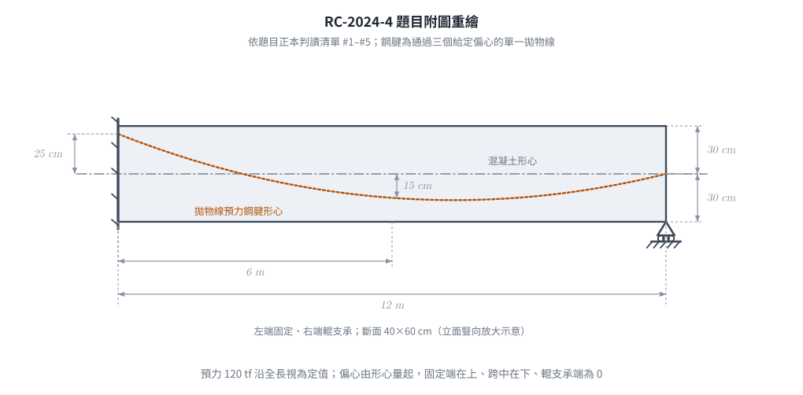
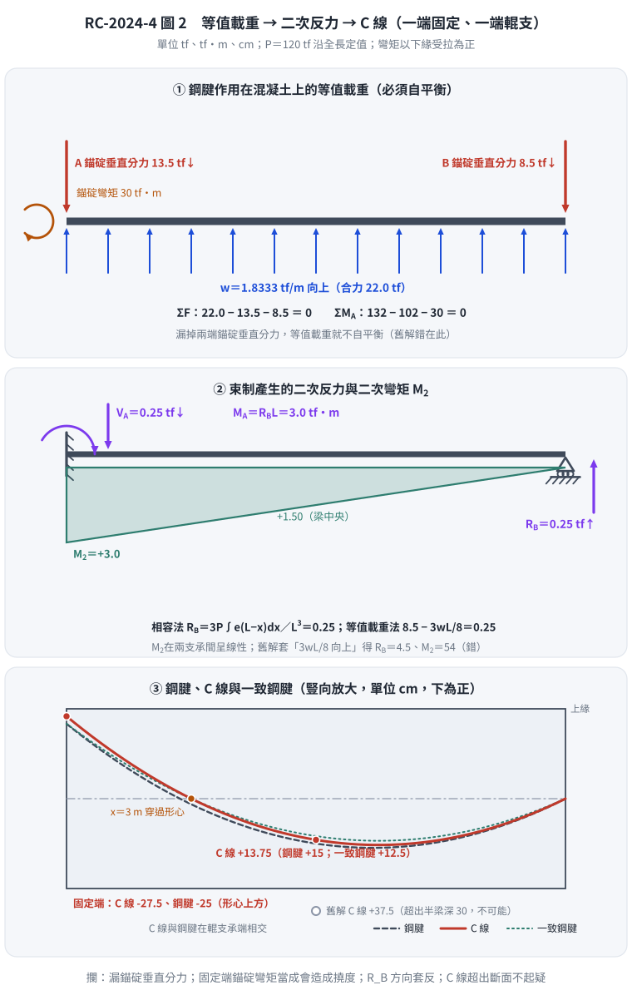

# 考題編號：RC-2024-4

**主分類：** `RC-U4-2` 預力量與偏心量設計
**副分類：** `RC-U4-1` 預力梁斷面應力分析
**設計法：** WSD 工作應力法
**標籤：** `等效載重法` `拋物線腱` `次彎矩` `C線` `壓力線` `超靜定預力梁` `一致腱` `固定端彎矩` `錨碇垂直分力` `相容法`

---

## 1. 題目（考卷原文見題目正本）

> 考卷原文、公式／附表、附圖與判讀清單（已確認）見 [`RC-2024-4-problem.md`](RC-2024-4-problem.md)。本節只列解題時最容易讀錯的地方與本解使用的記號；題意以題目正本為準。


*重繪自考卷圖 4，依題目正本判讀清單 #1–#5。本圖攔下的讀錯：固定端／輥支承端對調；把梁中央當拋物線頂點、拆成兩段拋物線。*

### 常見誤讀

| 項目 | 正確判讀 | 常見誤讀 |
|------|---------|---------|
| 拋物線形式 | 通過三個給定偏心的單一拋物線（頂點不在梁中央；圖 4 最低點畫在中央右側） | 以梁中央為頂點的兩段拋物線 |
| 預力 | 120 tf（1 tf ≈ 9.81 kN），沿全長定值 | 換算成其他數值（本庫舊 §1 圖說寫成 2500 kN） |
| 所求 | 壓力線（C 線）、預力引起的固定端與輥支承端反力、調整為同位鋼腱的方法 | 只算主彎矩 |
| 偏心符號 | 固定端在形心上方、梁中央在下方 | 上下弄反 |
| 等值載重 | 均佈向上力 **加上兩端錨碇的垂直分力**（左 13.5、右 8.5 tf 向下）與固定端錨碇彎矩，三者自平衡 | 只列均佈力與錨碇彎矩（不自平衡），再套「$R_B=3wL/8$ 向上」→ $R_B$＝4.5 tf、C 線跨中 +37.5 cm（超出半梁深 30 cm，不可能）——本庫 2026-11-15 前舊解即此錯 |

**本解記號：** $L$＝12 m；$b$＝40、$h$＝60 cm；$P$＝120 tf；$x$ 自固定端 A 量起，輥支承端為 B；偏心 $e(x)$ 以形心為準、**下為正**：$e(0)=-25$、$e(6)=+15$、$e(12)=0$ cm。彎矩以正彎矩（下緣受拉）為正；主彎矩 $M_1=-Pe$，二次彎矩 $M_2$，總彎矩 $M=M_1+M_2=-Pe_C$。

---

## 2. 考題核心精神與出題者意圖 (Core Concepts & Examiner's Intent)

**核心觀念：** 超靜定預力梁中，鋼腱想讓梁產生的變形（主曲率 $M_1/EI$）被多餘支承束制，支承因而產生**二次反力**，沿梁分佈成線性的**二次彎矩** $M_2$；壓力線（C 線）偏離鋼腱 $M_2/P$。鋼腱的等值載重**一定自平衡**（均佈向上力＝兩端錨碇垂直分力之和），反力只來自「被束制」的部分。一致（同位）鋼腱是 $M_2\equiv0$ 的鋼腱，此時 C 線與鋼腱重合。

**出題意圖：**
1. 擬合三點拋物線，求等值載重（含錨碇垂直分力與錨碇彎矩）並檢查自平衡
2. 用相容法（力法）或等值載重法求一端固定一端輥支梁的二次反力
3. 由 $M_2$ 求 C 線並作圖：$e_C=e-M_2/P$
4. 一致鋼腱：線性轉換（只改支承處偏心、不改形狀）不改變 C 線；鋼腱放在 C 線上即為一致鋼腱

---

## 3. 解題戰略地圖與陷阱分析 (Strategic Roadmap & Trap Analysis)

**作戰計畫：**
```
Step 1：三點擬合拋物線 e(x)
Step 2：等值載重：均佈向上力 w、兩端錨碇垂直分力、固定端錨碇彎矩 → 驗自平衡
Step 3：二次反力 R_B（路徑一：相容法；路徑二：等值載重法）→ 兩條路徑一致
Step 4：固定端二次反力 V_A、M_A 與二次彎矩 M2(x)
Step 5：C 線 e_C(x) = e(x) − M2(x)/P，作圖
Step 6：同位鋼腱：沿 C 線布設（線性轉換），或改支承處偏心使 R_B = 0
```

**關鍵陷阱：**

| # | 陷阱 | 正確做法 |
|---|------|---------|
| ① | 漏掉錨碇垂直分力 | 鋼腱在兩端有斜率：左端 $Pe'(0)$＝13.5 tf、右端 $P\lvert e'(12)\rvert$＝8.5 tf，皆向下作用於混凝土；少了它們等值載重不平衡 |
| ② | 把固定端錨碇彎矩當成會造成 B 點撓度的載重 | 固定端上的集中彎矩、垂直力直接由固定支承吸收；輥支承端的錨碇垂直力直接由輥支承吸收 |
| ③ | 向上載重套「$R_B=3wL/8$ 向上」 | 向上均佈載重使輥支承反力**向下** $3wL/8$ |
| ④ | C 線超出斷面仍不起疑 | 總彎矩 $M=-Pe_C$；$e_C$ 不可能超過半梁深 30 cm，超出代表算錯 |
| ⑤ | 一致鋼腱答「把鋼腱移到 C 線」卻用錯的 C 線 | 一致鋼腱的檢驗：$\int_0^L e(x)(L-x)\,dx=0$（本題束制條件），代入確認 $R_B=0$ |

---

## 3.5 變數層次分析（Variable Hierarchy Analysis）

> 複習提示：第一次解題後，在每個卡住的知識點旁標記 `⚠`；第二次複習時只看有 `⚠` 的項目。

### 最終目標
C 線 $e_C(x)$、固定端與輥支承端反力（$V_A$、$M_A$、$R_B$）、同位鋼腱配置。

### 本題關鍵公式（依計算順序）

> $\boxed{\cdot}$ = 需由前步驟推導，非題目直接給定的變數

1. $e(x)=ax^2+bx+c$（三點擬合）→ $\boxed{a}$、$\boxed{b}$
2. $w=-P\,e''$、錨碇垂直力 $Pe'(0)$、$P\lvert e'(L)\rvert$、錨碇彎矩 $Pe(0)$
3. $R_B=\dfrac{3P}{L^3}\displaystyle\int_0^L e(x)(L-x)\,dx$（相容法）＝ $P\lvert e'(L)\rvert-\dfrac{3wL}{8}$（等值載重法）
4. $M_2(x)=R_B(L-x)$
5. $e_C=e-M_2/P$

### L1：題目直接給定
- $L$＝12 m、$h$＝60 cm、$b$＝40 cm、$P$＝120 tf
- $e(0)=-25$、$e(6)=+15$、$e(12)=0$ cm；支承：A 固定、B 輥支

### L2：需知識點推導
- 拋物線係數 $a=-0.76389$ cm/m²、$b=11.25$ cm/m
- 等值載重 $w$＝1.8333 tf/m（向上）、錨碇垂直力 13.5／8.5 tf（向下）、錨碇彎矩 30 tf·m
- 二次反力 $R_B$＝0.25 tf、$V_A$＝0.25 tf、$M_{2,A}$＝3.0 tf·m

### L3：深層知識（不懂就卡住）
- 等值載重自平衡：預力是內力，作用在混凝土上的等值載重合力與合力矩皆為零；只有超靜定束制才產生反力
- 主彎矩 $M_1=-Pe$ 是「靜定時」的彎矩；二次彎矩在兩支承間呈線性（支承反力為集中力）
- 線性轉換：只改支承處偏心而不改跨內形狀（等值載重不變），C 線不變

---

## 4. 詳細計算 (Detailed Calculation)

### Step 1：擬合拋物線 $e(x)$

設 $e(x)=ax^2+bx+c$（$x$：m；$e$：cm，下為正）：

$$e(0)=-25\Rightarrow c=-25$$

$$e(6)=15\Rightarrow 36a+6b=40\quad\cdots(1)$$

$$e(12)=0\Rightarrow 144a+12b=25\quad\cdots(2)$$

$(2)-2\times(1)$：$72a=-55\Rightarrow a=-0.76389\ \text{cm/m}^2$；代回 $(1)$：$b=11.25\ \text{cm/m}$

$$\boxed{e(x)=-0.76389x^2+11.25x-25\ \text{(cm)}}$$

頂點（最低點）在 $x=-b/2a=7.36$ m，$e_{\max}=16.42$ cm（與圖 4 最低點畫在中央右側相符）。

### Step 2：等值載重（作用在混凝土上）

$e'(x)=2ax+b$：$e'(0)=+11.25$ cm/m＝0.1125；$e'(12)=-7.083$ cm/m＝−0.07083。

| 等值載重 | 計算 | 大小與方向 |
|---------|------|-----------|
| 跨內均佈力 | $w=-P\,e''=-120\times2(-0.0076389)$ | **1.8333 tf/m 向上**（合力 22.0 tf，作用於 6 m） |
| A 端錨碇垂直分力 | $P\,e'(0)=120\times0.1125$ | **13.5 tf 向下** |
| B 端錨碇垂直分力 | $P\lvert e'(12)\rvert=120\times0.07083$ | **8.5 tf 向下** |
| A 端錨碇彎矩 | $P\,e(0)=120\times0.25$ | **30 tf·m**（水平力作用在形心上方，順時針，使 A 端下緣受拉） |
| B 端錨碇彎矩 | $P\,e(12)$ | 0 |

**自平衡檢查：**

$$\Sigma F_y=22.0-13.5-8.5=0\ \checkmark$$

$$\Sigma M_A\ (\circlearrowleft+)=22.0\times6-8.5\times12-30=132-102-30=0\ \checkmark$$

> 📌 舊解只列 1.833 tf/m 與 30 tf·m，兩者合力 22 tf、合力矩 102 tf·m 都不為零——等值載重不自平衡是第一個警訊。

### Step 3：二次反力 $R_B$（兩條獨立路徑）

**路徑一：相容法（力法）。** 以 $R_B$（向上為正）為贅餘力，基本結構為 A 端固定的懸臂梁。預力主曲率 $M_1/EI=-Pe/EI$ 使 B 點產生撓度 $\delta_{B1}=\int_0^L\frac{M_1}{EI}(L-x)\,dx$；$R_B$ 造成 $\delta_{BR}=\frac{R_BL^3}{3EI}$。相容 $\delta_{B1}+\delta_{BR}=0$：

$$R_B=-\frac{3}{L^3}\int_0^L M_1(L-x)\,dx=\frac{3P}{L^3}\int_0^L e(x)(L-x)\,dx$$

$$\int_0^{12}e(x)(12-x)\,dx=1728a+288b+72c=1728(-0.76389)+288(11.25)+72(-25)$$

$$=-1320+3240-1800=120\ \text{cm·m}^2$$

$$R_B=\frac{3\times120\ \text{tf}}{12^3\ \text{m}^3}\times120\ \text{cm·m}^2\times\frac{1\ \text{m}}{100\ \text{cm}}=\frac{43{,}200}{172{,}800}=0.25\ \text{tf（向上）}$$

**路徑二：等值載重法。** 把 Step 2 的等值載重放到一端固定一端輥支梁上：
- A 端的 13.5 tf 與 30 tf·m 作用在固定支承上，直接由固定端吸收，不使梁變形；
- B 端的 8.5 tf 向下作用在輥支承正上方，直接由輥支承吸收 → 輥支承反力 +8.5 tf；
- 跨內向上 1.8333 tf/m：一端固定一端輥支梁受均佈載重，輥支承反力 $3wL/8$，方向與載重相反 → $-\frac{3\times1.8333\times12}{8}=-8.25$ tf。

$$R_B=8.5-8.25=\boxed{0.25\ \text{tf（向上）}}$$

兩條路徑一致（另以 240 元素有限元素、施加初始曲率驗算得 0.2500 tf）。

### Step 4：固定端二次反力與二次彎矩

二次反力自成平衡（只有 $R_B$ 一個贅餘力）：

$$V_A=0.25\ \text{tf（向下）},\qquad M_A=R_B\,L=0.25\times12=3.0\ \text{tf·m}$$

固定端反力矩 3.0 tf·m 為順時針，使 A 端斷面產生 **+3.0 tf·m（正彎矩）** 的二次彎矩。水平方向：預力為內力，輥支承可自由軸向移動，無水平反力。

$$M_2(x)=R_B(L-x)=0.25(12-x)\ \text{tf·m}$$

### Step 5：C 線

$$e_C(x)=e(x)-\frac{M_2(x)}{P}=e(x)-\frac{0.25(12-x)}{120}\times100=e(x)-0.2083(12-x)\ \text{(cm)}$$

| 位置 | $x$ (m) | $e$ (cm) | $M_1=-Pe$ (tf·m) | $M_2$ (tf·m) | $M=M_1+M_2$ (tf·m) | $M_2/P$ (cm) | $e_C$ (cm) |
|------|---------|---------|-----------------|--------------|-------------------|-------------|-----------|
| A（固定端） | 0 | −25.00 | +30.00 | +3.00 | +33.00 | 2.50 | **−27.50**（形心上方） |
| | 3 | +1.88 | −2.25 | +2.25 | 0 | 1.88 | **0** |
| 梁中央 | 6 | +15.00 | −18.00 | +1.50 | −16.50 | 1.25 | **+13.75** |
| | 9 | +14.38 | −17.25 | +0.75 | −16.50 | 0.63 | **+13.75** |
| B（輥支承） | 12 | 0 | 0 | 0 | 0 | 0 | **0** |

$$\boxed{e_C(0)=-27.5\ \text{cm（形心上方）},\quad e_C(6)=+13.75\ \text{cm},\quad e_C(12)=0}$$

C 線仍為拋物線：$e_C(x)=-0.76389x^2+11.458x-27.5$（cm），在 $x$＝3 m 穿過形心，最低點 $x$＝7.5 m、$e_C$＝15.47 cm。**作圖**：在鋼腱線上方畫一條曲線，固定端高出鋼腱 2.5 cm、向輥支承端線性遞減到 0（兩線在輥支承端相交）。C 線全長落在斷面內（$\lvert e_C\rvert\le27.5<30$ cm）。



*圖 2　等值載重 → 二次反力 → C 線。等值載重必須自平衡；二次彎矩 $M_2$ 在兩支承間呈線性；C 線由鋼腱上移 $M_2/P$ 並全長落在斷面內。本圖攔：漏掉錨碇垂直分力、把固定端錨碇彎矩當成會造成撓度、$R_B$ 方向套反、C 線超出斷面仍不起疑。*

### Step 6：調整為同位（一致）鋼腱

一致鋼腱的條件：$R_B=0$，即 $\int_0^L e(x)(L-x)\,dx=0$。

1. **把鋼腱放在 C 線上**（理論標準答案）：固定端 −27.5、梁中央 +13.75、輥支承端 0 cm 的拋物線。它與原鋼腱只差一個線性轉換 $0.2083(12-x)$（形狀、跨內等值載重不變），所以 C 線不變而與鋼腱重合：代入檢驗 $1728(-0.76389)+288(11.458)+72(-27.5)=0$ ✓。但固定端偏心 27.5 cm 只剩 2.5 cm 到上緣，保護層不足，實務上不可行。
2. **保留兩端偏心、改梁中央偏心**（實務可行）：固定端 −25、輥支承端 0 不變，求梁中央 $e_m$ 使積分為零：$48e_m-600=0\Rightarrow e_m=+12.5$ cm（形心下方 12.5 cm）。
3. 保留梁中央 +15 與輥支承端 0、改固定端：$24e_0+720=0\Rightarrow e_0=-30$ cm——鋼腱形心落在上緣，不可行，只作理論對照。

一致鋼腱時 $R_B=V_A=M_{2}=0$，預力只產生主彎矩，C 線即鋼腱線。

---

## 5. 最終答案彙整與討論 (Summary & Discussion)

| 項目 | 結果 |
|------|------|
| 拋物線 | $e(x)=-0.76389x^2+11.25x-25$ cm（下為正） |
| 等值載重 | 均佈 1.8333 tf/m 向上；錨碇垂直力 A 13.5、B 8.5 tf 向下；A 端錨碇彎矩 30 tf·m（自平衡） |
| 輥支承端反力 $R_B$ | **0.25 tf（向上）** |
| 固定端反力 | $V_A$＝**0.25 tf（向下）**；反力矩 **3.0 tf·m**（二次彎矩 $M_{2,A}$＝+3.0 tf·m） |
| 總彎矩 | A 端 +33.0、梁中央 −16.5 tf·m |
| C 線 | 固定端 **−27.5 cm**（形心上方）、$x$＝3 m 為 0、梁中央 **+13.75 cm**、輥支承端 0 |
| 同位鋼腱 | 沿 C 線布設（−27.5／+13.75／0）；實務可保留兩端偏心、梁中央改為 **+12.5 cm** |

**討論一：舊解的三個錯誤（2026-11-15 勘誤）。** ①等值載重漏了兩端錨碇垂直分力（13.5、8.5 tf），不自平衡；②把固定端錨碇彎矩當成會造成 B 點撓度的載重（$ML^2/2EI$）；③相容方程式解出 −1.05 後棄用，改套「$R_B=3wL/8$ 向上」，再疊加錨碇彎矩的 −3.75，得 $R_B$＝4.5 tf、$M_2(0)$＝54 tf·m、C 線 +20／+37.5 cm（跨中超出半梁深 30 cm，物理上不可能）。正確的二次反力很小（0.25 tf），是因為本鋼腱已很接近一致鋼腱（梁中央只比一致鋼腱深 2.5 cm）。

**討論二：反力的「受力」解讀。** 題目「由該預力引起固定端與輥支承端之受力」解讀為二次反力（判讀清單 #6）。若改問「預力在支承處對混凝土施加的力」，則是 Step 2 的錨碇力：A 端水平 120 tf、向下 13.5 tf、錨碇彎矩 30 tf·m；B 端水平 120 tf、向下 8.5 tf——這些與跨內向上 22 tf 自平衡，不經支承傳出。

**討論三：規範。** 本題只涉及結構力學（預力二次效應），不涉及容許應力或強度係數，現行建築物混凝土結構設計規範（2023）與考卷指定的土木 401-112 結果相同。設計時二次彎矩需納入載重組合（規範 5.3.11，載重因數 1.0）。

---

## 6. 核心知識點連結 (Key Concept Links)

- [[RC-U4-equivalent-load-method]] 等效載重法（拋物線腱，含錨碇垂直分力）
- [[RC-U4-secondary-moment]] 次彎矩與超靜定預力梁
- [[RC-U4-pressure-line]] 壓力線（C 線）
- [[RC-U4-concordant-tendon]] 一致腱定義與線性轉換
- [[RC-U4-propped-cantilever-reactions]] 一端固定一端輥支梁反力

*修正日期：2026-11-15（§1 改為指向題目正本，插入重繪附圖 figs/RC-2024-4-fig-1-problem.svg；舊 §1 重述改寫為常見誤讀與本解記號；本行非答案勘誤）*

*修正日期：2026-11-15（解析勘誤 FIX-RC-U4-2-B1，改依現行台灣規範（建築物混凝土結構設計規範 2023）：等值載重補兩端錨碇垂直分力 13.5／8.5 tf 並驗自平衡；$R_B$ 4.5 → **0.25 tf（向上）**、固定端 $V_A$＝0.25 tf 向下、$M_{2,A}$ 54 → **3.0 tf·m**；C 線 +20／+37.5／0 → **−27.5／+13.75／0 cm**；同位鋼腱改為沿正確 C 線布設或梁中央改 +12.5 cm；補 §3.5；驗證：`.work/u4b1c/check_errata_U4_2_B1.py` 相容法、等值載重法、有限元素三路徑一致，MISMATCHES: 0）*

*圖解補繪：2026-11-15（DIAG-RC-U4-2-B1，向量圖 `figs/RC-2024-4-fig-2-cline.svg`，腳本 `figs/gen_RC-2024-4.py`，數值取自本解 §4 並於腳本檔尾 assert，可重跑）*
