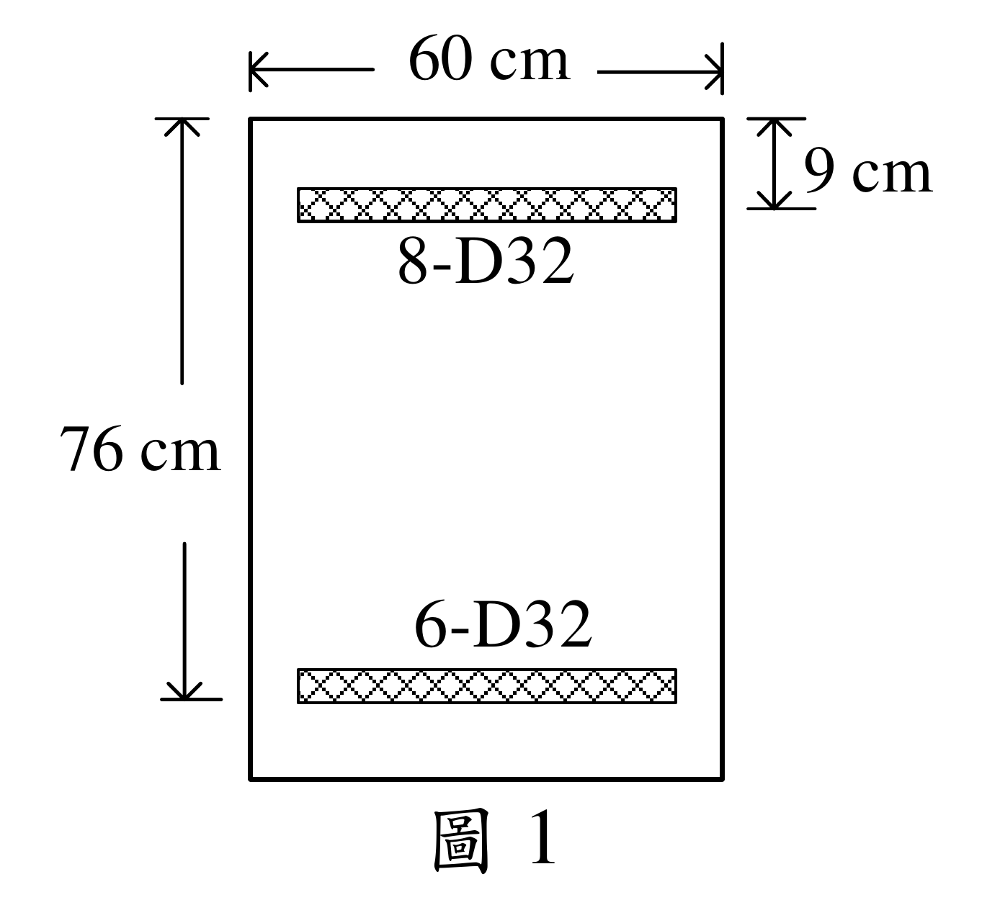

# RC-2025-2 題目正本

> 本檔只記錄**考卷上寫了什麼、圖上畫了什麼**，不含任何解法。解析見同資料夾 `RC-2025-2.md`。
> 判讀清單已經確認（凍結）；本檔原則上不再修改（改動須回考卷原圖並記 log）。

| 項目 | 內容 |
|------|------|
| 考卷 | `raw/exams/RC-2025_鋼筋混凝土設計與預力.pdf` 第 1 頁（頁次 2－1），第二題 |
| 考年 | 民國 114 年（2025） |
| 配分 | 30 分 |
| 附圖 | `RC-2025-2-fig-2.png`（圖 1：梁斷面；2026-11-15 由考卷重新擷取 500 dpi）；既有 `RC-2025-2-fig-1.png` 為同一圖，斷面內 76 cm 尺寸線旁有滑鼠游標，保留不刪 |
| 判讀狀態 | **已確認**（2026-11-15 使用者授權依 Claude 建議確認；轉錄 2026-11-15；PyMuPDF 110 dpi 全頁目視，附圖 400–450 dpi 局部放大；文字以 PDF 文字層核對（公式以影像為準）；尺寸線端點以 PDF 向量座標量測；盲讀後才比對既有解析） |

## 1. 考卷原文（逐字）

> 二、一連接於兩內柱間之耐震梁，其淨跨距為 9 m，斷面如圖 1 所示。此梁跨距內承受重力均布載重 $W_u$＝2 tf/m，並於柱面處配置 8-D32 頂層鋼筋及 6-D32 底層鋼筋。試以耐震設計規範，以及採用 D13，設計此梁於靠近柱端所需之剪力筋。（30 分）

## 2. 考卷給的公式、附表與參數

- 題文數值：淨跨 9 m；$W_u$＝2 tf/m（跨距內重力均布載重，下標 u）；柱面處頂層 8-D32、底層 6-D32；剪力筋用 D13。
- 卷首（全卷）：混凝土強度 $f'_c$＝280 kgf/cm²，鋼筋 D13 $f_y$＝2800 kgf/cm²；D25 以上 $f_y$＝4200 kgf/cm²。D13 $d_b$＝1.27 cm、$A_b$＝1.27 cm²；D25 2.54 cm、5.07 cm²；D29 2.87 cm、6.47 cm²；D32 3.22 cm、8.14 cm²。
- 作答規範（卷首）：中國土木水利工程學會「混凝土工程設計規範與解說」（土木 401-112），未依上述規範作答，不予計分。
- **沒有給**：梁全深 $h$（圖上只有 60、76、9 三個尺寸）、底面到底層筋的距離、保護層、柱寬、軸力、地震分析剪力。
- 卷首注意事項：㈠可以使用電子計算器。㈡不必抄題，作答時請將試題題號及答案依照順序寫在試卷上，於本試題上作答者，不予計分。㈢本科目除專門名詞或數理公式外，應使用本國文字作答。

## 3. 附圖

圖面文字照錄：`60 cm`、`9 cm`、`8-D32`、`76 cm`、`6-D32`、`圖 1`。

## 4. 判讀清單

「把握」標**不確定**者優先列；解讀類項目（題目用字的意思）另標「解讀」。標「依 Claude 建議確認」者，為使用者 2026-11-15 授權「要我確認的請依你建議」後定案。

| # | 項目 | 判讀 | 圖上／題文依據 | 把握 |
|---|------|------|---------------|------|
| 1 | 76 cm 尺寸量到哪裡 | **頂面量到底層鋼筋（6-D32）形心**＝底筋受拉時的有效深度 $d$＝76 cm；**不是梁全深** | PDF 向量座標：斷面外框 y＝643.7～775.8；76 cm 尺寸上端 643.7（頂面）、下端延伸線 y＝759.8，落在底層筋帶 y＝753.9～760.5，距底面 775.8 尚差 16 pt（約 10 cm） | 確定（影響答案）；依 Claude 建議確認 |
| 2 | 梁全深 $h$ | 考卷沒有標；**採 $h$＝76＋9＝85 cm**（底層筋形心到底面與頂面到頂層筋同為 9 cm），頂筋受拉時 $d$＝85－9＝76 cm | 圖上底層筋帶到底面的空隙與頂面到頂層筋帶的空隙相當（16 pt vs. 14–21 pt）；考卷未給，屬合理假設 | 不確定（影響答案）；依 Claude 建議確認 |
| 3 | 9 cm 尺寸 | 頂面量到頂層鋼筋（8-D32）形心，$d'$＝9 cm | 向量座標：9 cm 尺寸 y＝643.7～661.7；頂層筋帶 y＝657.6～664.2（中心 660.9） | 確定 |
| 4 | 梁寬 | $b_w$＝60 cm | 60 cm 尺寸延伸線 x＝265.1／359.4，與斷面外框左右邊重合 | 確定 |
| 5 | 鋼筋 | 柱面處頂層 8-D32（$A_s$＝65.12 cm²）、底層 6-D32（48.84 cm²），各以一條帶表示（排數考卷未畫，以形心位置為準） | 題文；圖上兩條網格帶 | 確定（解讀） |
| 6 | $W_u$ | 2 tf/m 為已因數化的重力均布載重（下標 u），作用於淨跨全長 | 題文「重力均布載重 $W_u$＝2 tf/m」 | 確定（解讀）；依 Claude 建議確認 |
| 7 | 構件 | 特殊抗彎矩構架梁，兩端連接內柱，淨跨 $\ell_n$＝9 m | 題文「連接於兩內柱間之耐震梁」 | 確定 |
| 8 | 剪力筋 | D13（$f_{yt}$＝2800），肢數自行設計 | 題文「採用 D13」；卷首材料 | 確定 |
| 9 | 所求 | 靠近柱端（塑性鉸區）的剪力筋設計 | 題文 | 確定 |
| 10 | 考卷沒有給 | 梁全深、保護層、柱寬、地震分析剪力 | 全題 | 確定 |

---

*轉錄：2026-11-15（RC-U3-3 批 2＋U1-3＋U2-3 題目正本推廣）*

*確認：2026-11-15 使用者授權依 Claude 建議確認（RC-U3-3 批 2＋U1-3＋U2-3 題目正本推廣，關卡一）*
