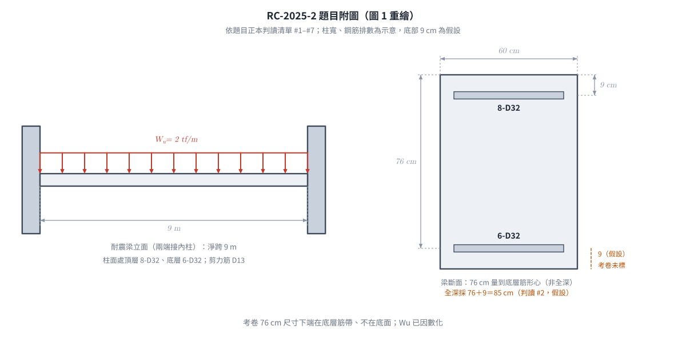
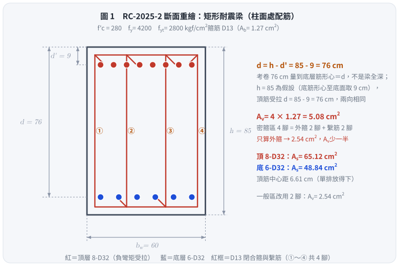
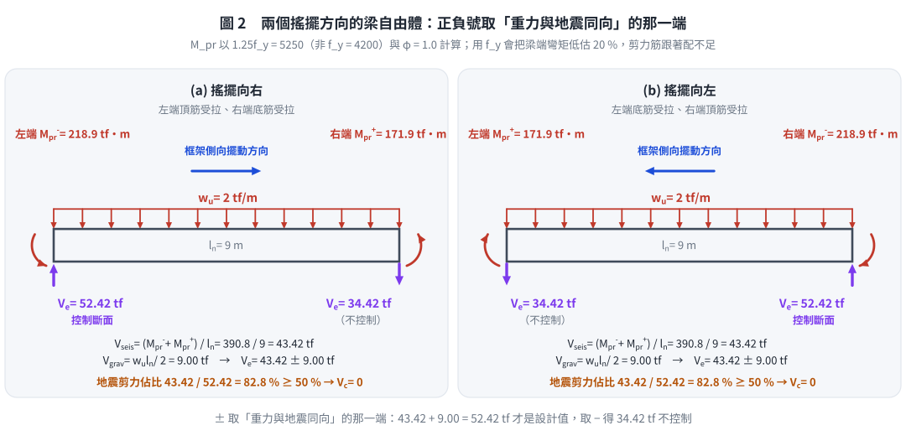
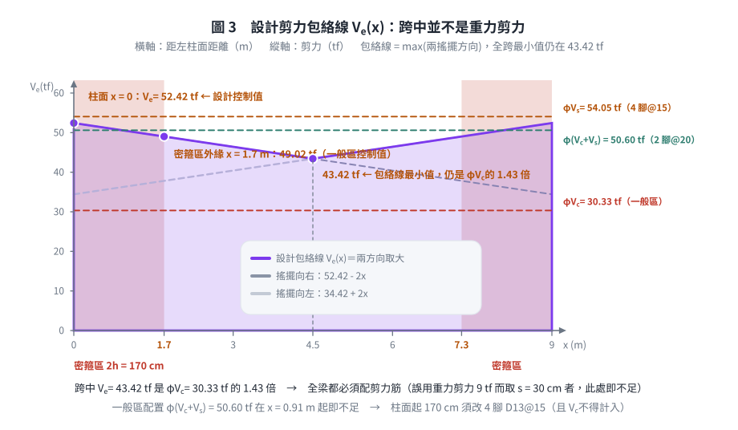
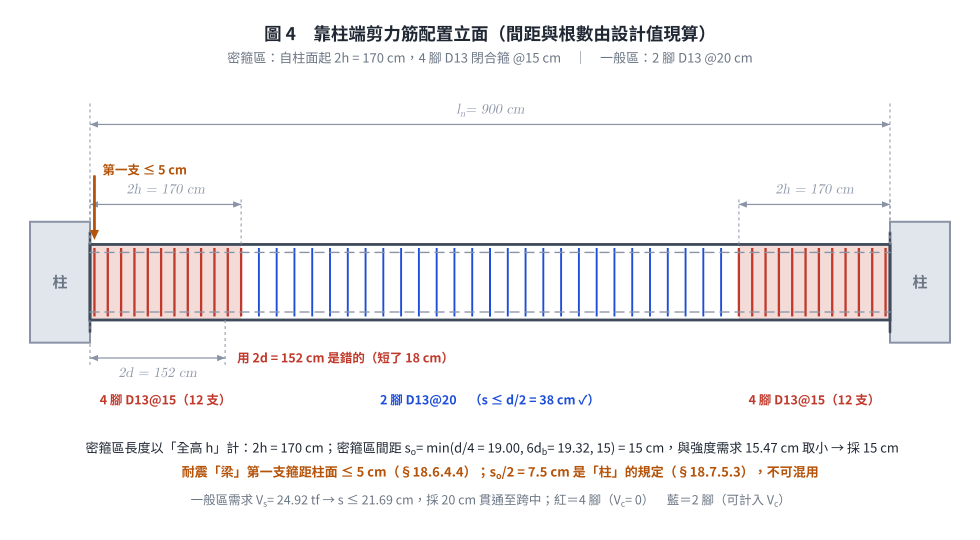

# 考題編號：RC-2025-2

**主分類：** `RC-U3-3` 韌性要求與耐震設計
**副分類：** `RC-U2-1` RC 剪力強度分析與設計
**設計法：** USD強度設計法（耐震規範）
**標籤：** `耐震梁` `特殊矩形框架梁` `可能彎矩強度Mpr` `Vc=0條件` `密箍區` `剪力包絡線` `第一支箍筋5cm` `剪力筋設計` `閉合箍筋`

---

## 1. 題目（考卷原文見題目正本）

> 考卷原文、公式／附表、附圖與判讀清單（已確認）見 [`RC-2025-2-problem.md`](RC-2025-2-problem.md)。本節只列解題時最容易讀錯的地方與本解使用的記號；題意以題目正本為準。

*重繪自考卷圖 1，依題目正本判讀清單 #1–#7。本圖攔下的讀錯：76 cm 只量到底層筋形心，不是梁全深。*

### 常見誤讀

| 項目 | 正確判讀 | 常見誤讀 |
|------|---------|---------|
| 76 cm | 頂面到底層筋形心＝底筋受拉的 $d$＝76 cm（向量座標：下端延伸線落在底層筋帶） | 梁全深 $h$＝76、$d$＝76－9＝67（本庫舊解） |
| 梁全深 | 考卷未標；採 76＋9＝85 cm（假設），頂筋受拉 $d$＝85－9＝76 cm | 取 76 cm |
| 9 cm | 頂面到頂層筋形心 | 淨保護層 |
| $W_u$ | 已因數化的重力均布載重 | 再乘載重因數 |
| 密箍區長度 | $2h$，依全深（假設 85 cm）＝170 cm | 依 76 cm（152 cm）或 $2d$ |

**本解記號：** $b_w$＝60 cm；$h$＝85 cm（假設）；$d$＝76 cm（頂、底筋受拉皆同）；$A_s^{top}$＝65.12、$A_s^{bot}$＝48.84 cm²；$\ell_n$＝9 m；$W_u$＝2 tf/m；D13 $f_{yt}$＝2800、D32 $f_y$＝4200、$f'_c$＝280 kgf/cm²。規範：建築物混凝土結構設計規範（2023 年版，即考卷指定之土木 401-112）18.6.4、18.6.5、22.5、9.6.3。

#### 判讀圖解（解析自繪）

*圖 1　斷面向量重繪：$b_w = 60$、$h = 85$（假設）、頂 8-D32／底 6-D32 單排，$d = 76$，以及 4 腳 D13 閉合箍（外箍 2 腳＋2 支繫筋）的實際位置。攔的是把考卷 76 cm 當梁全深、以及 $A_v$ 只算外箍 2 腳——這兩個錯在第一步就把後面全部帶偏。*

---

## 2. 考題核心精神與出題者意圖 (Core Concepts & Examiner's Intent)

**核心觀念：** 耐震梁剪力設計的「靈魂」是**可能彎矩強度（Mpr）法**——不依賴因數化剪力圖，而是假設梁端塑鉸發生並充分轉動時，以 $1.25 f_y$ 計算梁端最大可能彎矩，再反算出對應的設計剪力 $V_e$。此法確保剪力筋不會先於彎矩鉸破壞（容量設計）。

**出題者意圖：**
1. 測試是否懂得用 $1.25f_y$（非 $f_y$）計算 $M_{pr}$
2. 測試能否判斷 $V_c = 0$ 的適用條件（地震剪力 ≥ $0.5V_e$）
3. 測試密箍區長度（$2h$）及最大間距（$d/4$, $6d_b$, 15 cm 取最小）
4. 測試是否記得第一支箍筋距柱面 $\le 5$ cm（耐震**梁**的規定；$s_o/2$ 是**柱**的規定，不可混用）
5. 讀圖：76 cm 尺寸量到底層筋形心（即 $d$），不是梁全深

---

## 3. 解題戰略地圖與陷阱分析 (Strategic Roadmap & Trap Analysis)

**作戰計畫：**
1. 由圖定 $d$＝76 cm（全深假設 85 cm）
2. 計算 $M_{pr}^-$（頂筋受拉）和 $M_{pr}^+$（底筋受拉）— 用 $1.25f_y$、$\phi=1.0$
3. 建立自由體圖，計算兩個搖擺方向的柱端剪力，取最大 $V_e$
4. 判斷 $V_c = 0$ 條件
5. 設計箍筋（$V_s$ 需求 → 間距），同時驗算耐震間距限制
6. 明確標出密箍區範圍（$2h$ 從柱面算起），並設計密箍區外

**關鍵陷阱：**

| # | 陷阱 | 正確做法 |
|---|------|---------|
| 1 | **把 76 cm 當梁全深** | 76 cm 的下端在底層筋帶 → $d$＝76；$h$ 考卷未標，假設 85 |
| 2 | **用 $f_y$ 算 $M_{pr}$** | $M_{pr}$ 用 $1.25f_y = 5250\text{ kgf/cm}^2$，$\phi = 1.0$ |
| 3 | **以為 $V_c \neq 0$** | 地震剪力佔比 $\ge 50\%$ 且 $P_u$ 小 → 密箍區 $V_c = 0$ |
| 4 | **密箍區長度用 $2d$** | 密箍區 $= 2h = 170\text{ cm}$ |
| 5 | **$\phi$ 取錯** | 剪力 $\phi=0.75$：$V_s \geq V_e/0.75$ |
| 6 | **密箍區外用「重力剪力」設計** | 耐震設計剪力包絡線沿全梁都存在；跨中仍有 $V_e = 43.4$ tf，密箍區外緣 49.0 tf，遠大於 $\phi V_c = 30.3$ tf |
| 7 | **第一支箍筋位置寫 $s_o/2$** | 耐震**梁**的規定是距柱面 $\le \mathbf{5\ cm}$（柱才是 $s_o/2$） |
| 8 | **$A_{v,\min}$ 用 SI 係數配 kgf 單位** | kgf/cm² 制為 $\max\!\left(\dfrac{3.5b_w}{f_{yt}},\ \dfrac{0.2\sqrt{f'_c}b_w}{f_{yt}}\right)$ |

---

## 3.5 變數層次分析 (Variable Hierarchy Analysis)

> 複習提示：第一次解題後，在每個卡住的知識點旁標記 `⚠`；第二次複習時只看有 `⚠` 的項目。

### 最終目標
`計算 Mpr⁻, Mpr⁺ → 求柱端 Ve → 設計 D13 箍筋間距（密箍區 + 一般區）`

### 本題關鍵公式（依計算順序）

> $\boxed{\cdot}$ = 需由前步驟推導，非題目直接給定的變數

$$\text{Step 1: } a_{top} = \frac{A_{s,top}\cdot 1.25f_y}{0.85f'_c b_w} \quad\Rightarrow\quad M_{pr}^- = A_{s,top}\cdot1.25f_y\!\left(d-\frac{\boxed{a_{top}}}{2}\right)$$

$$\text{Step 2: } a_{bot} = \frac{A_{s,bot}\cdot 1.25f_y}{0.85f'_c b_w} \quad\Rightarrow\quad M_{pr}^+ = A_{s,bot}\cdot1.25f_y\!\left(d-\frac{\boxed{a_{bot}}}{2}\right)$$

$$\text{Step 3: } V_e = \frac{\boxed{M_{pr}^-}+\boxed{M_{pr}^+}}{\ell_n} + \frac{w_u \ell_n}{2}$$

$$\text{Step 4: 判斷 } V_c=0\text{ 條件：}\frac{({\boxed{M_{pr}^-}+\boxed{M_{pr}^+}})/\ell_n}{\boxed{V_e}} \ge 50\%$$

$$\text{Step 5: } s \leq \frac{A_v f_{yt} d}{\boxed{V_e}/\phi} \quad \text{且} \quad s \leq \min\!\left(\frac{d}{4},\,6d_b,\,15\text{ cm}\right)$$

### L1：題目直接給定

| 符號 | 數值 | 說明 |
|------|------|------|
| $\ell_n$ | 9 m | 梁淨跨距 |
| $b_w$ | 60 cm | 梁寬 |
| $d$ | 76 cm | 圖 1：頂面到底層筋形心 |
| $d'$ | 9 cm | 圖 1：頂面到頂層筋形心 |
| $h$ | 85 cm | **假設**（76＋9；考卷未標） |
| $A_{s,top}$ | $8\times8.14=65.12\text{ cm}^2$ | 柱面頂層 8-D32 |
| $A_{s,bot}$ | $6\times8.14=48.84\text{ cm}^2$ | 柱面底層 6-D32 |
| $w_u$ | 2 tf/m | 因數化重力均布載重 |
| $d_{b}$ | 3.22 cm | D32 |
| D13 | $A_b$＝1.27 cm²，$f_{yt}$＝2800 | 剪力筋 |

### L2：需知識點推導

| 符號 | 公式/來源 | 卡關? |
|------|----------|:-----:|
| $a_{top}$ | $\frac{65.12\times5250}{0.85\times280\times60} = 23.94\text{ cm}$ | |
| $M_{pr}^-$ | $341{,}880\times(76-11.97) = 218.90\text{ tf·m}$ | |
| $a_{bot}$ | $\frac{48.84\times5250}{14{,}280} = 17.96\text{ cm}$ | |
| $M_{pr}^+$ | $256{,}410\times(76-8.98) = 171.85\text{ tf·m}$ | |
| $V_{seis}$ | $(218.90+171.85)/9 = 43.42\text{ tf}$ | |
| $V_{grav}$ | $2\times9/2 = 9\text{ tf}$ | |
| $V_e$ | $43.42 + 9.00 = 52.42\text{ tf}$ | |
| 地震剪力比 | $43.42/52.42 = 82.8\% \ge 50\%$ → $V_c = 0$ | |
| $V_s$ | $52.42/0.75 = 69.89\text{ tf}$ | |
| $s_{req}$（4 腳） | $5.08\times2800\times76/69{,}890 = 15.47\text{ cm}$ | |
| $s_{max}$ | $\min(76/4,\,6\times3.22,\,15) = \min(19,\,19.32,\,15) = 15\text{ cm}$ | |
| $2h$ | $2\times85 = 170\text{ cm}$ | |

### L3：深層知識（不懂就卡住）

| 知識點 | 說明 | 卡關? |
|--------|------|:-----:|
| $M_{pr}$ 定義 | 以 $1.25f_y$、$\phi=1.0$ 計算的**可能彎矩強度**（不是 $\phi M_n$） | |
| 為何用 $1.25$ | 鋼筋實際降伏應力與應變硬化使梁端彎矩超過標稱值 | |
| $V_c=0$ 的物理意義 | 塑鉸區反覆受力使混凝土剪力機制退化，保守設定 $V_c=0$ | |
| 密箍區 = $2h$（不是 $2d$） | 規範以**全深 $h$** 計算密箍區長度 | |
| 第一箍筋位置 | **梁：距柱面 $\le 5$ cm**（18.6.4.4）；柱才是 $s_o/2$（18.7.5.3） | |

---

## 4. 步驟化詳細計算過程 (Step-by-Step Detailed Calculation)

### 【Step 1】斷面幾何

$$b_w = 60\text{ cm},\quad d = 76\text{ cm（圖 1：頂面至底層筋形心）},\quad d' = 9\text{ cm}$$

梁全深考卷未標，採 $h = 76 + 9 = 85$ cm（底層筋形心至底面與頂面至頂層筋同為 9 cm）→ 頂筋受拉時 $d = 85 - 9 = \boxed{76\text{ cm}}$，兩個搖擺方向的 $d$ 相同。

$$A_{s,top} = 8 \times 8.14 = 65.12\text{ cm}^2,\qquad A_{s,bot} = 6 \times 8.14 = 48.84\text{ cm}^2$$

---

### 【Step 2】可能彎矩強度 $M_{pr}$（$\phi = 1.0$，$1.25f_y$）

**頂筋受拉（負彎矩，$M_{pr}^-$）：**

$$a_{top} = \frac{65.12 \times 5250}{0.85 \times 280 \times 60} = \frac{341{,}880}{14{,}280} = 23.94\text{ cm}$$

$$M_{pr}^- = 341{,}880 \times (76 - 11.97) = 21{,}890{,}000\text{ kgf·cm} = \boxed{218.90\text{ tf·m}}$$

**底筋受拉（正彎矩，$M_{pr}^+$）：**

$$a_{bot} = \frac{256{,}410}{14{,}280} = 17.96\text{ cm}$$

$$M_{pr}^+ = 256{,}410 \times (76 - 8.98) = 17{,}185{,}000\text{ kgf·cm} = \boxed{171.85\text{ tf·m}}$$

---

### 【Step 3】耐震設計剪力 $V_e$

$$\boxed{V_e = \frac{M_{pr}^- + M_{pr}^+}{\ell_n} + \frac{w_u \ell_n}{2}} = \frac{218.90 + 171.85}{9.0} + \frac{2.0 \times 9.0}{2} = 43.42 + 9.00 = \boxed{52.42\text{ tf}}$$

（另一端：$V_e = 43.42 - 9.00 = 34.42\text{ tf}$，不控制）

*圖 2　兩個搖擺方向各自的梁自由體：兩端塑鉸彎矩同向、與重力載重疊加後兩端剪力一大一小。攔的是 $V_e$ 公式裡 $\pm$ 取錯邊（重力與地震同向的那一端才控制），以及用 $f_y$ 而非 $1.25f_y$ 算 $M_{pr}$。*

---

### 【Step 4】判斷密箍區是否 $V_c = 0$

$$\frac{V_{seis}}{V_e} = \frac{43.42}{52.42} = 82.8\% \ge 50\%,\quad P_u \approx 0 < A_gf'_c/20 \quad \Rightarrow \quad \boxed{V_c = 0 \text{（密箍區內）}}$$

**密箍區長度（從柱面算起）：**

$$\ell_{hinge} = 2h = 2 \times 85 = \boxed{170\text{ cm}}$$

---

### 【Step 5】所需 $V_s$ 與箍筋設計

$$V_s \geq \frac{V_e}{\phi} - V_c = \frac{52.42}{0.75} - 0 = \boxed{69.89\text{ tf}}$$

**斷面上限：** $V_{s,\max} = 2.12\sqrt{f'_c}\,b_w d = 2.12\times16.733\times60\times76 = 161.8\text{ tf}$；$69.89 \ll 161.8$ ✓

**採 4 腳 D13 閉合箍筋（外箍 2 腳＋2 支繫筋）：** $A_v = 4 \times 1.27 = 5.08\text{ cm}^2$

$$s_{req} = \frac{A_v f_{yt} d}{V_s} = \frac{5.08 \times 2800 \times 76}{69{,}890} = 15.47\text{ cm}$$

---

### 【Step 6】耐震間距限制（密箍區）

$$s_{max} = \min\left(\frac{d}{4},\;6d_b,\;15\text{ cm}\right) = \min(19.0,\;19.32,\;15.0) = \boxed{15.0\text{ cm}}$$

$$\therefore \text{採用 } s = 15\text{ cm} \leq \min(s_{req}{=}15.47,\; 15.0) \quad \checkmark$$

$$\phi V_s = 0.75 \times \frac{5.08 \times 2800 \times 76}{15} = 54.05\text{ tf} \geq V_e = 52.42\text{ tf} \quad \checkmark\ \text{（餘裕 3\%）}$$

---

### 【Step 7】最小箍筋量

$$\frac{A_{v,\min}}{s} \geq \max\!\left(\frac{3.5\,b_w}{f_{yt}},\;\frac{0.2\sqrt{f'_c}\,b_w}{f_{yt}}\right) = \max(0.0750,\;0.0717) = 0.0750\text{ cm}^2/\text{cm}$$

密箍區 $5.08/15 = 0.339$、一般區 $2.54/20 = 0.127\text{ cm}^2/\text{cm}$，皆 $\gg 0.0750$ ✓

---

### 【Step 8】密箍區以外的設計

**設計剪力包絡線**（$x$ 自左柱面量起，m）：

$$V_e(x) = \max\big(52.42 - 2x,\ 34.42 + 2x\big)\ \text{tf}$$

| 位置 | $V_e$ |
|---|:---:|
| 柱面 $x = 0$ | **52.42 tf** |
| 密箍區外緣 $x = 1.70$ m | **49.02 tf** ← 一般區的控制值 |
| 跨中 $x = 4.5$ m | **43.42 tf** ← 包絡線最小值（不是重力剪力 9 tf） |

**混凝土貢獻（密箍區外可計入 $V_c$）：**

$$V_c = 0.53\sqrt{f'_c}\,b_w d = 0.53\times16.733\times60\times76 = 40.44\ \text{tf} \quad \Rightarrow \quad \phi V_c = 30.33\ \text{tf}$$

$\phi V_c = 30.3\ \text{tf} < 43.4\ \text{tf}$ ⇒ **跨中也不足，全梁都必須配剪力筋。**

*圖 3　全跨設計剪力包絡線與三條容量門檻，並標出柱面、密箍區外緣、跨中三個關鍵點。攔的是把跨中誤當「重力剪力」而放寬間距——跨中仍是 $\phi V_c$ 的 1.43 倍。*

**一般區所需 $V_s$（控制點 $x = 1.70$ m）：**

$$V_s \geq \frac{49.02}{0.75} - 40.44 = 65.36 - 40.44 = 24.92\ \text{tf}$$

$$s \leq \frac{2.54\times2800\times76}{24{,}920} = 21.7\ \text{cm}$$

取 **2 腳 D13 @ 20 cm**（$\le d/2 = 38$ cm ✓）：

$$\phi(V_c + V_s) = 0.75\left(40.44 + \frac{2.54\times2800\times76}{20\times1000}\right) = 0.75\times67.47 = 50.60\ \text{tf} \ \geq\ 49.02\ \text{tf}\ \checkmark$$

**特殊規定（規範 18.6.4）：**
- **第一支箍筋距柱面 $\leq \mathbf{5\ cm}$**（18.6.4.4，梁；$s_o/2$ 是柱的規定 18.7.5.3）
- 密箍區使用**閉合箍筋**，耐震彎鉤 $135°$，延伸 $\ge 6d_b$ 且 $\ge 7.5$ cm
- 密箍區外 $s \le d/2$，用耐震彎鉤肋筋（18.6.4.6）

---

$$\boxed{\text{柱端密箍區（}2h = 170\text{ cm）：4 腳 D13 閉合箍筋，第一支距柱面 } \le 5\text{ cm，以後 @15 cm；其餘：2 腳 D13 @20 cm}}$$

*圖 4　箍筋配置立面，箍筋位置與根數由第一支位置及 15／20 cm 間距現算。攔的是密箍區長度誤用 $2d$ 而非 $2h$，以及把「柱」的 $s_o/2$ 誤用到「梁」的第一支箍筋位置上。*

---

## 5. 關鍵爭議點與進階探討 (Critical Issues & Advanced Discussion)

**爭議1：梁全深 $h$＝85 cm 為假設——影響範圍**

考卷只標 60、76、9 三個尺寸；76 cm 量到底層筋形心（題目正本判讀 #1，PDF 向量座標確認），全深未標。本解假設底層筋形心至底面亦 9 cm → $h$＝85。$h$ 只影響兩處：

| 影響項 | $h$＝82.9（底筋單排，$d'$＝6.88） | **$h$＝85（主線）** | $h$＝90 |
|---|:---:|:---:|:---:|
| 密箍區 $2h$ | 166 cm | **170 cm** | 180 cm |
| 頂筋受拉 $d$＝$h-9$ | 73.9 | **76** | 81 |
| $M_{pr}^-$ | 211.66 | **218.90** | 236.00 tf·m |
| $V_e$ | 51.61 | **52.42** | 54.32 tf |
| 4 腳強度間距（取該向 $d$） | 15.3 | **15.47** | 15.9 cm |

底筋受拉的 $d$＝76 是考卷直接給的，不受 $h$ 影響；在合理範圍內設計結論（4 腳 D13@15、一般區 @20）不變，只有密箍區長度隨 $h$ 改變。

**爭議2：舊解（把 76 當全深，$d$＝67）對照**

| 項目 | 舊解（$h$＝76、$d$＝67） | **本解（$d$＝76、$h$＝85）** |
|---|:---:|:---:|
| $M_{pr}^-$／$M_{pr}^+$ | 188.1／148.8 | **218.90／171.85 tf·m** |
| $V_e$ | 46.43 | **52.42 tf** |
| 4 腳強度間距 | 15.39 | **15.47 cm** |
| 密箍區 $2h$ | 152 | **170 cm** |
| 配筋 | 4 腳 D13@15、一般區 @20 | **同左** |

配筋結果相同，但 $V_e$ 低估 11%、密箍區短 18 cm（不保守）。

**爭議3：$V_c = 0$ 的適用範圍**
- 僅適用於**密箍區（$2h$）內**；密箍區外可恢復 $V_c$，依一般剪力設計（Step 8）

**爭議4：8-D32 單排放得下嗎？**

$$\text{所需寬度} = 2(4) + 2(1.27) + 8(3.22) + 7\times3.22 = 58.84 \le 60\ ✓$$

單排放得下（餘裕 1.16 cm），單排時 $d' = 4 + 1.27 + 1.61 = 6.88$ cm；圖 1 標 9 cm，**以圖面為準**。

**爭議5：4 腳箍筋的橫向支撐**

8 根 D32 單排、中心距 $(60-8-2.54-3.22)/7 = 6.61$ cm。4 腳（外箍 2 腳 + 2 繫筋）時，被支撐鋼筋間距 $\le 3\times6.61 = 19.8$ cm $< 35$ cm ✓，每根未支撐鋼筋距最近支撐點 $< 15$ cm，符合 18.6.4.5、25.7.2.3。

**爭議6：規範版本與逐條依據**

考卷指定土木 401-112（2023 年版，ACI 318-19 世代），即現行建築物混凝土結構設計規範，**沒有新舊制落差**：

| 項目 | 條文 | 本題值 |
|---|---|---|
| 設計剪力 $V_e$ | 18.6.5.1：$(M_{pr1}+M_{pr2})/\ell_n \pm w_u\ell_n/2$ | 52.42 tf |
| $M_{pr}$ 之鋼筋應力 | 18.6.5.1：$1.25f_y$，$\phi = 1.0$ | 5,250 kgf/cm² |
| 密箍區長度 | 18.6.4.1：自柱面起 $2h$ | 170 cm |
| 密箍區間距 | 18.6.4.4：$\min(d/4,\ 6d_b,\ 15\text{ cm})$ | 15 cm |
| 第一支箍筋位置 | 18.6.4.4：距柱面 $\le 5$ cm | 5 cm |
| $V_c = 0$ 條件 | 18.6.5.2：地震剪力 ≥ 最大需求之 1/2 且 $P_u < A_gf'_c/20$ | 82.8% ✓ |
| 密箍區外 | 18.6.4.6：$s \le d/2$、耐震彎鉤 | 20 ≤ 38 ✓ |
| $V_{s,\max}$ | 22.5.1.2：$2.12\sqrt{f'_c}b_wd$（kgf 制） | 161.8 tf |
| $A_{v,\min}$ | 9.6.3.4：$\max(3.5b_w/f_{yt},\ 0.2\sqrt{f'_c}b_w/f_{yt})$ | 0.0750 cm²/cm |
| $V_c$（一般區） | 表 22.5.5.1(a)：$0.53\lambda\sqrt{f'_c}b_wd$ | 40.44 tf |

> 與 401-100 世代的差異：密箍區間距由 $8d_b$／$24d_{b,hoop}$／30 cm 改為 $6d_b$／15 cm（318-14 起）；若考的是舊題（如 RC-2016-2），這一條要特別留意。

**進階思考：若 $V_s$ 需求超過 $V_{s,max}$？** 代表斷面過小，需加大梁深或梁寬，不應只靠增加箍筋。

*圖解補繪：2026-09-07（向量圖 4 張，腳本 `figs/gen_RC-2025-2.py`，可重跑；腳本檔尾對 §4 公佈值做 assert）*

*修正日期：2026-11-15（§1 改為指向題目正本，插入重繪附圖 figs/RC-2025-2-fig-1-problem.svg；舊 §1 重述改寫為常見誤讀與本解記號；本行非答案勘誤）*

*修正日期：2026-11-15（依題目正本判讀 #1–#2 勘誤：76 cm 為頂面至底層筋形心 → $d$＝76（原 67）、全深假設 $h$＝85（原 76）；$M_{pr}$ 188.1／148.8 → **218.90／171.85 tf·m**、$V_e$ 46.43 → **52.42 tf**、$s_{req}$ 15.39 → 15.47、密箍區 $2h$ 152 → **170 cm**、一般區控制點 $V_e$ 43.39 → 49.02、$\phi(V_c+V_s)$ 44.61 → 50.60 tf；配筋 4 腳 D13@15／2 腳 @20 不變；斷面自繪圖依新尺寸重畫、圖 2–4 重跑；舊 §6 併入 §5 爭議6；改依現行台灣規範（建築物混凝土結構設計規範 2023／耐震規範 111），與考卷指定 401-112 相同；驗證：`.work/u33b2c/check_errata_U3_3_B2.py` 重算 MISMATCHES: 0）*
