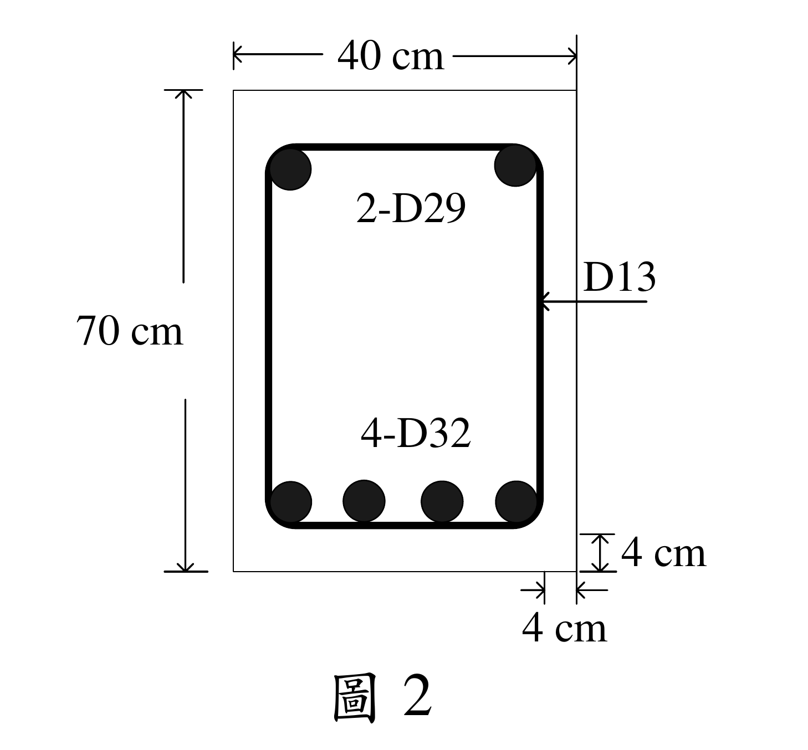

# RC-2025-3 題目正本

> 本檔只記錄**考卷上寫了什麼、圖上畫了什麼**，不含任何解法。解析見同資料夾 `RC-2025-3.md`。
> 判讀清單已經使用者確認（凍結）；本檔原則上不再修改（改動須回考卷原圖並記 log）。

| 項目 | 內容 |
|------|------|
| 考卷 | `raw/exams/RC-2025_鋼筋混凝土設計與預力.pdf` 第 2 頁，第三題 |
| 考年 | 民國 114 年（2025） |
| 配分 | 25 分 |
| 附圖 | `RC-2025-3-fig-2.png`（圖 2：梁斷面；2026-11-15 由考卷重新擷取 500 dpi）；既有 `RC-2025-3-fig-1.png` 為同一圖，圖左下空白處有滑鼠游標，保留不刪 |
| 判讀狀態 | **已確認**（2026-11-15 使用者確認；轉錄 2026-11-15；PyMuPDF 110 dpi 全頁目視，附圖 450 dpi 局部放大；尺寸文字以 PDF 文字座標核對；盲讀後才比對既有解析） |

## 1. 考卷原文（逐字）

> 三、一鋼筋混凝土矩形梁斷面（如圖 2），配置下層 4 支 D32 拉力筋，上層 2 支 D29 壓力筋，閉合箍筋使用 D13，間距 15 cm，淨保護層為 4 cm。若箍筋僅用於抵抗扭矩，試求此斷面之扭矩強度 $T_n$ (tf-m)。（25 分）

## 2. 考卷給的公式、附表與參數

- 卷首依據與作答規範：中國土木水利工程學會「混凝土工程設計規範與解說」（土木 401-112），未依上述規範作答，不予計分。
- 卷首材料與鋼筋表（照錄）：混凝土強度 $f'_c$＝280 kgf/cm²，鋼筋 D13 $f_y$＝2800 kgf/cm²；D25 以上 $f_y$＝4200 kgf/cm²。D13，$d_b$＝1.27 cm，$A_b$＝1.27 cm²；D25，$d_b$＝2.54 cm，$A_b$＝5.07 cm²；D29，$d_b$＝2.87 cm，$A_b$＝6.47 cm²；D32，$d_b$＝3.22 cm，$A_b$＝8.14 cm²。
- 題文數值：下層 4-D32 拉力筋、上層 2-D29 壓力筋；D13 閉合箍筋 @15 cm；淨保護層 4 cm。
- **沒有給**：公式、斜壓桿角度 θ、專供扭力用的縱筋（圖上只有撓曲用的 4-D32 與 2-D29）、混凝土種類（常重／輕質）。
- 卷首注意事項：可以使用電子計算器；不必抄題，作答時請將試題題號及答案依照順序寫在試卷上，於本試題上作答者，不予計分。

## 3. 附圖

圖面文字照錄：`40 cm`、`70 cm`、`2-D29`、`D13`、`4-D32`、`4 cm`（垂直）、`4 cm`（水平）、`圖 2`。

## 4. 判讀清單

「把握」標**不確定**者請優先確認；解讀類項目（題目用字的意思）另標「解讀」。

| # | 項目 | 判讀 | 圖上／題文依據 | 把握 |
|---|------|------|---------------|------|
| 1 | 「箍筋僅用於抵抗扭矩」 | 箍筋全部提供扭力用的 $A_t$（不分給剪力）；所求 $T_n$ 只由箍筋量計算，不再以現有縱筋（4-D32、2-D29 為撓曲筋）檢核或限制 $A_\ell$ | 題文 | 確定（解讀） |
| 2 | 斷面 | $b$＝40 cm、$h$＝70 cm（外緣） | 40cm、70cm 延伸線對齊外緣 | 確定 |
| 3 | 淨保護層 | 4 cm，量到箍筋外緣（底面與側面） | 450 dpi：右下兩個 4cm 尺寸一端對齊外緣、另一端對齊箍筋外緣；題文「淨保護層為 4 cm」 | 確定 |
| 4 | 箍筋 | D13 閉合箍筋（兩肢）、間距 15 cm，$f_{yt}$＝2800 kgf/cm² | 題文；卷首「D13 $f_y$＝2800」 | 確定 |
| 5 | 縱筋 | 下層 4-D32（拉力筋）一排、上層 2-D29（壓力筋）在兩角；$f_y$＝4200 kgf/cm² | 題文；圖上筋數與位置；卷首「D25 以上 4200」 | 確定 |
| 6 | 所求 | 斷面的扭矩強度 $T_n$（標稱值，單位 tf-m） | 題文 | 確定 |
| 7 | 考卷沒有給 | θ、扭力專用縱筋、混凝土種類 | 全題 | 確定 |

---

*轉錄：2026-11-15（RC-U2-1／U2-2 題目正本推廣・批 1）*

*確認：2026-11-15 使用者確認（RC-U2-1／U2-2 題目正本推廣・批 1，關卡一）*
