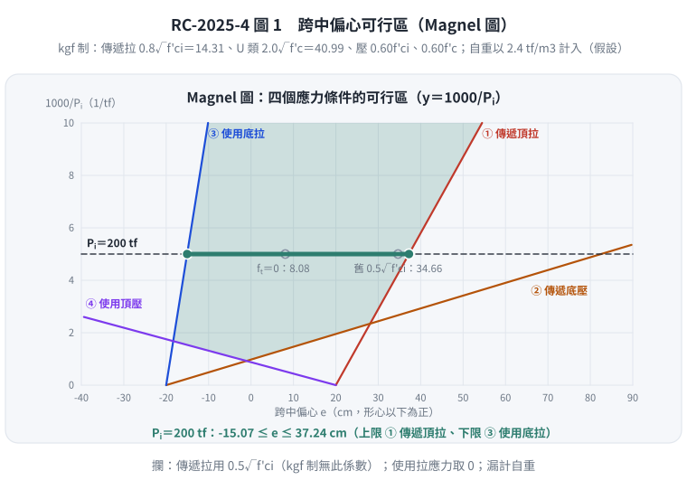

### 考題編號：RC-2025-4

**主分類：** `RC-U4-2` 預力量與偏心量設計
**副分類：** `RC-U4-1` 預力梁斷面應力分析
**設計法：** WSD（容許應力法）
**標籤：** `偏心距限制` `核心距` `傳遞階段` `使用階段` `簡支預力梁` `應力驗核` `eccentricity` `U類拉應力` `kgf制係數`

---

## 1. 題目（考卷原文見題目正本）

> 考卷原文、公式／附表、附圖與判讀清單（已確認）見 [`RC-2025-4-problem.md`](RC-2025-4-problem.md)。本節只列解題時最容易讀錯的地方與本解使用的記號；題意以題目正本為準。

### 常見誤讀

| 項目 | 正確判讀 | 常見誤讀 |
|------|---------|---------|
| 自重 | 題文未提但須計入；單位重考卷沒有給（第一題的 2.4 tf/m³ 屬第一題），假設 2.4 tf/m³ | 當成題目已知或忽略 |
| 傳遞拉應力 | kgf 制 $0.8\sqrt{f'_{ci}}$＝14.31 kgf/cm²（SI 0.25$\sqrt{f'_{ci}}$ MPa 換算） | $0.5\sqrt{f'_{ci}}$＝8.94（kgf 制無此係數；本庫舊解） |
| 使用拉應力 | 考卷沒給 → 現行 U 類上限 $2.0\sqrt{f'_c}$＝40.99 kgf/cm² | 取 0「最保守、最常見考場設定」（本庫舊解）；T 類寫成 $0.5\sqrt{f'_c}$（舊解 §5，係數錯） |
| 卷首 $f'_c$＝280 | 屬鋼筋混凝土各題；本題用 $f'_{ci}$＝320、$f'_c$＝420 | 誤用 280 |
| 兩階段預力 | 傳遞 $P_i$＝200 tf、使用 $P_e=0.85P_i$ | — |

**本解記號：** $l$＝12 m；$b$＝40、$h$＝120 cm；$P_i$＝200 tf、$P_e$＝0.85$P_i$＝170 tf；$f'_{ci}$＝320、$f'_c$＝420 kgf/cm²；$W_l$＝1.5 tf/m；$e$ 為鋼鍵在形心以下的偏心（負值表示在形心以上）；應力壓為正、拉為負。

---

## 2. 考題核心精神與出題者意圖 (Core Concepts & Examiner's Intent)

**核心觀念：** 跨中偏心太大 → 傳遞時（$P_i$ 最大、只有自重）頂纖維拉應力超限；偏心太小 → 使用時（$P_e$ 已損失、全部載重）底纖維拉應力超限。兩階段四個應力條件圍出偏心的可行範圍。容許應力考卷沒給，須依現行規範取值，且必須用 **kgf 制係數**。

**解題架構（四個應力控制條件）：**

| 條件 | 控制點 | 時間點 | 限制 | 給出 |
|------|-------|--------|------|------|
| ① | 頂纖維 | 傳遞（$P_i$、$M_D$） | 拉 $\le0.8\sqrt{f'_{ci}}$ | $e$ 上界 |
| ② | 底纖維 | 傳遞（$P_i$、$M_D$） | 壓 $\le0.60f'_{ci}$ | $e$ 上界 |
| ③ | 底纖維 | 使用（$P_e$、$M_T$） | 拉 $\le2.0\sqrt{f'_c}$（U 類） | $e$ 下界 |
| ④ | 頂纖維 | 使用（$P_e$、$M_T$） | 壓 $\le0.60f'_c$（全部）／$0.45f'_c$（持續） | $e$ 下界（通常不控制） |

---

## 3. 解題戰略地圖與陷阱分析 (Strategic Roadmap & Trap Analysis)

**作戰計畫：**
1. 斷面 $A$、$S_t=S_b$
2. 彎矩 $M_D$（自重，假設 2.4 tf/m³）、$M_L$、$M_T$
3. 現行規範容許應力（kgf 制）
4. 四個不等式 → $e_{\min}$、$e_{\max}$

**關鍵陷阱：**

| # | 陷阱 | 正確做法 |
|---|------|---------|
| 1 | 使用階段仍用 $P_i$ | 使用階段 $P_e=0.85P_i$ |
| 2 | 單位 | 彎矩換成 kgf·cm |
| 3 | 忘記自重 | $w_D=2.4\times0.40\times1.20=1.152$ tf/m |
| 4 | **SI 係數代 kgf 制** | $\sqrt{\text{MPa}}$ 係數 ×3.19：傳遞拉 0.25→0.8、端部 0.5→1.6、U 類 0.62→2.0、T 類上限 1.0→3.2 |
| 5 | 使用拉應力取 0 | 考卷沒給容許值時用現行 U 類上限；取 0 是「完全預力」設計條件，只作對照 |

---

## 3.5 變數層次分析 (Variable Hierarchy Analysis)

> 複習提示：第一次解題後，在每個卡住的知識點旁標記 `⚠`；第二次複習時只看有 `⚠` 的項目。

### 最終目標
`求梁中點偏心距可行範圍 e_min ≤ e ≤ e_max`

### 本題關鍵公式（依計算順序）

> $\boxed{\cdot}$ = 需由前步驟推導，非題目直接給定的變數

**① 傳遞頂拉：**

$$\frac{P_i}{A}-\frac{P_ie}{\boxed{S}}+\frac{\boxed{M_D}}{\boxed{S}}\ge-f_{ti}\Rightarrow e\le e_{\max,1}$$

**② 傳遞底壓：**

$$\frac{P_i}{A}+\frac{P_ie}{\boxed{S}}-\frac{\boxed{M_D}}{\boxed{S}}\le f_{ci}\Rightarrow e\le e_{\max,2}$$

**③ 使用底拉：**

$$\frac{P_e}{A}+\frac{P_ee}{\boxed{S}}-\frac{\boxed{M_T}}{\boxed{S}}\ge-f_t\Rightarrow e\ge e_{\min,3}$$

**④ 使用頂壓：**

$$\frac{P_e}{A}-\frac{P_ee}{\boxed{S}}+\frac{\boxed{M_T}}{\boxed{S}}\le f_c\Rightarrow e\ge e_{\min,4}$$

### L1：題目直接給定

| 符號 | 數值 | 說明 |
|------|------|------|
| $l$ | 12 m | 簡支跨度 |
| $b$ | 40 cm | 梁寬 |
| $h$ | 120 cm | 梁高 |
| $P_i$ | 200 tf = 200,000 kgf | 初始預力 |
| $f_{pe}/f_{pi}$ | 0.85 | 預力保留率 |
| $f'_{ci}$ | 320 kgf/cm² | 傳遞時混凝土強度 |
| $f'_c$ | 420 kgf/cm² | 使用時混凝土強度 |
| $w_L$ | 1.5 tf/m | 均布活載重 |

### L2：需知識點推導

| 符號 | 公式/來源 | 值 |
|------|----------|-----|
| $P_e$ | $0.85 \times 200$ | 170 tf |
| $A$ | $40 \times 120$ | 4800 cm² |
| $S_t = S_b$ | $bh^2/6$ | 96,000 cm³ |
| $w_D$ | $2.4 \times 0.40 \times 1.20$（假設） | 1.152 tf/m |
| $M_D$ | $1.152 \times 12^2/8$ | 20.74 tf·m |
| $M_L$ | $1.5 \times 12^2/8$ | 27.0 tf·m |
| $M_T$ | $M_D + M_L$ | 47.74 tf·m |
| $f_{ti}$ | $0.8\sqrt{320}$ | 14.31 kgf/cm² |
| $f_{ci}$ | $0.60 \times 320$ | 192 kgf/cm² |
| $f_t$（U 類） | $2.0\sqrt{420}$ | 40.99 kgf/cm² |
| $f_c$ | $0.60f'_c$／$0.45f'_c$ | 252／189 kgf/cm² |

### L3：深層知識（不懂就卡住）

| 知識點 | 說明 | 卡關? |
|--------|------|:-----:|
| 傳遞時自重的作用 | 後拉施預力時梁起拱、自重立即作用，$M_D$ 抵銷部分偏心彎矩 → 上界放寬 | |
| U／T／C 分類 | 現行規範依使用階段預壓拉力區拉應力分類：U 類 $f_t\le2.0\sqrt{f'_c}$、T 類 $2.0\sim3.2\sqrt{f'_c}$、C 類 $>3.2\sqrt{f'_c}$（kgf 制）；U 類可用全斷面性質 | |
| kgf 制係數 | 1 MPa＝10.197 kgf/cm²，$\sqrt{10.197}=3.19$；SI 係數 ×3.19 才是 kgf 制係數 | |
| 負偏心 | 下界為負值表示鋼鍵即使在形心以上，使用階段底纖維拉應力仍在 U 類內 | |

---

## 4. 步驟化詳細計算過程 (Step-by-Step Detailed Calculation)

> 依現行建築物混凝土結構設計規範（2023）預力構材容許應力（kgf 制）；考卷指定的土木 401-112 與現行規範同世代，係數相同。

### 【前置】斷面幾何

$$A = 40 \times 120 = 4800\ \text{cm}^2,\qquad S_t = S_b = \frac{40\times120^2}{6} = 96{,}000\ \text{cm}^3$$

### 【Step 1】各階段彎矩

$$w_D = 2.4 \times 0.40 \times 1.20 = 1.152\ \text{tf/m}\ （\text{單位重假設}）$$

$$M_D = \frac{1.152 \times 12^2}{8} = 20.74\ \text{tf·m} = 2{,}073{,}600\ \text{kgf·cm}$$

$$M_L = \frac{1.5 \times 12^2}{8} = 27.0\ \text{tf·m},\qquad M_T = 47.74\ \text{tf·m} = 4{,}773{,}600\ \text{kgf·cm}$$

### 【Step 2】容許應力（kgf 制）

| 時間 | 類型 | 公式 | 數值 (kgf/cm²) |
|------|------|------|------|
| 傳遞時 | 壓 | $0.60 f'_{ci}$ | 192 |
| 傳遞時 | 拉（跨中） | $0.8\sqrt{f'_{ci}}$ | 14.31 |
| 使用時 | 壓（全部／持續） | $0.60 f'_c$／$0.45 f'_c$ | 252／189 |
| 使用時 | 拉（U 類） | $2.0\sqrt{f'_c}$ | 40.99 |

**常數：**

$$\frac{P_i}{A}=41.67,\quad\frac{P_i}{S}=2.0833,\quad\frac{P_e}{A}=35.42,\quad\frac{P_e}{S}=1.7708,\quad\frac{M_D}{S}=21.60,\quad\frac{M_T}{S}=49.73$$

### 【Step 3】四個應力控制條件（壓為正）

**① 傳遞時頂纖維拉力：**

$$41.67-2.0833e+21.60\ge-14.31\Rightarrow2.0833e\le77.58\Rightarrow\boxed{e\le37.24\ \text{cm}}\ \leftarrow\text{控制上界}$$

**② 傳遞時底纖維壓力：**

$$41.67+2.0833e-21.60\le192\Rightarrow\boxed{e\le82.53\ \text{cm}}\ （\text{不控制}）$$

**③ 使用時底纖維拉力（U 類）：**

$$35.42+1.7708e-49.73\ge-40.99\Rightarrow1.7708e\ge-26.68\Rightarrow\boxed{e\ge-15.07\ \text{cm}}\ \leftarrow\text{控制下界}$$

**④ 使用時頂纖維壓力：**

$$35.42-1.7708e+49.73\le252\Rightarrow e\ge-94.23\ \text{cm}；\ \text{取 }0.45f'_c=189\text{（把活載全當持續）}：e\ge-58.65\ \text{cm}\ （\text{不控制}）$$

### 【結論】梁中點鋼鍵偏心距限制

$$\boxed{-15.07\ \text{cm} \le e \le 37.24\ \text{cm}}\quad（e\text{ 以形心以下為正；下界為形心以上 15.07 cm}）$$

| 控制條件 | 限制 | 計算值 |
|---------|------|-------|
| ① 傳遞頂拉（$\le0.8\sqrt{f'_{ci}}$） | $e \leq$ | **37.24 cm**（控制） |
| ② 傳遞底壓（$\le0.60f'_{ci}$） | $e \leq$ | 82.53 cm |
| ③ 使用底拉（U 類 $\le2.0\sqrt{f'_c}$） | $e \geq$ | **−15.07 cm**（控制） |
| ④ 使用頂壓（$\le0.60f'_c$） | $e \geq$ | −94.23 cm（不控制） |

**驗算（壓為正）：**

| $e$ | 傳遞頂 | 傳遞底 | 使用頂 | 使用底 |
|-----|-------|-------|-------|-------|
| −15.07（下限） | +94.66 | −11.33 | +111.83 | −40.99 ✓（＝限值） |
| 37.24（上限） | −14.32 ✓（＝限值） | +97.65 | +19.20 | +51.64 |

幾何：鋼鍵形心距底至少約 10 cm → $e\le50$ cm，上限 37.24 可行。

> 📝 **結論：** 跨中鋼鍵偏心距須在形心以上 15.07 cm 至形心以下 37.24 cm 之間。實務上取靠近上限的偏心，以獲得較大的使用階段預壓。

*圖 1　跨中偏心可行區（Magnel 圖）。kgf 制傳遞拉 $0.8\sqrt{f'_{ci}}$、U 類 $2.0\sqrt{f'_c}$ 時，上限由傳遞頂拉、下限由使用底拉控制；傳遞底壓與使用頂壓不控制。本圖攔：傳遞拉用 $0.5\sqrt{f'_{ci}}$（kgf 制無此係數）、使用拉應力取 0、漏計自重。*

---

## 5. 關鍵爭議點與進階探討 (Critical Issues & Advanced Discussion)

**爭議1：舊解（2026-11-15 勘誤前）的兩個錯誤**

| 項目 | 舊解 | 本解 |
|------|------|------|
| 傳遞拉應力 | $0.5\sqrt{f'_{ci}}$＝8.94（kgf 制無此係數） | $0.8\sqrt{f'_{ci}}$＝14.31 |
| 使用拉應力 | 0（「最常見考場設定」） | U 類 $2.0\sqrt{f'_c}$＝40.99（考卷未給容許值，依現行規範） |
| 範圍 | 8.08～34.66 cm | **−15.07～37.24 cm** |

舊解 §1 常見誤讀表已寫「SI 係數直接代 kgf 制」是誤讀，正文卻仍這樣做。

**爭議2：使用拉應力的其他取法（對照）**

- $f_t=0$（完全預力、不允許拉應力）：下界 $(49.73-35.42)/1.7708=8.08$ cm → 範圍 8.08～37.24 cm。這是比現行規範嚴的設計條件；考卷沒有指定，不採為主線。
- T 類上限 $3.2\sqrt{f'_c}=65.58$：下界 −28.95 cm，但 T 類須改用開裂斷面驗撓度等額外檢核，題目只問偏心限制，不採。

**爭議3：自重**

- 後拉施預力時梁起拱、自重立即作用，必須計入。
- 若不計自重：上界 $(14.31+41.67)\times96{,}000/200{,}000=26.87$ cm、下界 −27.26 cm——自重使上界放寬約 10 cm，影響很大，所以須明列單位重假設。

**進階：可行區域（Magnel 圖）**

把 $1/P_i$ 對 $e$ 作圖，四個條件為四條直線，圍出的區域即可行的（預力、偏心）組合；本題 $P_i$ 已給定，只在 $P_i$＝200 tf 這條水平線上讀出 $e$ 的範圍。沿梁長各斷面的可行範圍連成「鋼鍵可行帶」，鋼鍵線須落在帶內。

*修正日期：2026-11-15（§1 改為指向題目正本；舊 §1 重述改寫為常見誤讀與本解記號；本行非答案勘誤）*

*修正日期：2026-11-15（解析勘誤 FIX-RC-U4-2-B1，改依現行台灣規範（建築物混凝土結構設計規範 2023）：傳遞拉應力 $0.5\sqrt{f'_{ci}}$＝8.94 → kgf 制 $0.8\sqrt{f'_{ci}}$＝14.31；使用拉應力 0 → U 類 $2.0\sqrt{f'_c}$＝40.99（考卷未給容許值）；偏心範圍 8.08～34.66 → **−15.07～37.24 cm**；§5 T 類係數更正（$0.5\sqrt{f'_c}$ → 2.0～3.2$\sqrt{f'_c}$），$f_t$＝0 降為對照；應力符號改壓為正；驗證：`.work/u4b1c/check_errata_U4_2_B1.py` 重算 MISMATCHES: 0）*

*圖解補繪：2026-11-15（DIAG-RC-U4-2-B1，向量圖 `figs/RC-2025-4-fig-1-magnel.svg`，腳本 `figs/gen_RC-2025-4.py`，數值取自本解 §4 並於腳本檔尾 assert，可重跑）*
