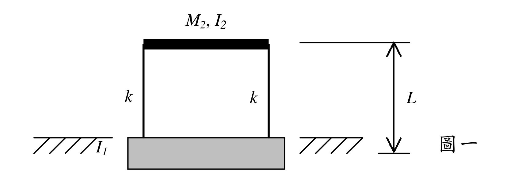

# SD-2002-1 題目正本

> 本檔只記錄考卷上寫了什麼、圖上畫了什麼，不含任何解法。解析見同資料夾 `SD-2002-1.md`。
> 判讀清單經使用者確認前，狀態為「待確認」；確認後本檔原則上不再修改（改動須回考卷原圖並記 log）。

| 項目 | 內容 |
|---|---|
| 考卷 | `raw/exams/SD-2002_結構動力分析與耐震設計.pdf`，第 1 頁（正面），第一題 |
| 考年 | 2002（民國九十一年）專技高考結構工程技師「結構動力分析與耐震設計」 |
| 配分 | 25 分 |
| 附圖 | `SD-2002-1-fig-1.png`（原證據圖，中央有文字游標雜訊）、`SD-2002-1-fig-2.png`（2026-11-15 由考卷 500 dpi 重新擷取，無雜訊） |
| 判讀狀態 | **已確認**（2026-11-15 使用者授權依 Claude 建議確認。原轉錄：2026-11-15 轉錄；PyMuPDF 110／150 dpi 整頁＋450–500 dpi 局部放大，PDF 文字層與向量座標核對；盲讀於開啟解析前完成） |

## 1. 考卷原文（逐字）

一、圖一為座落於柔性地基之單層平面剪力房屋。若此單層房屋之基座不會產生水平方向或垂直方向之位移，僅會產生繞著基座質心(center of mass)之旋轉，其旋轉之勁度 $k_\theta$＝1.2×107 kN-m，基座對基座質心之慣性矩 $I_1$＝8000 Ton-m2。樓版總質量 $M_2$＝100 Ton，樓版對樓版質心之慣性矩為 $I_2$＝4000 Ton-m2。樓版質心與基座質心之距離 $L$＝3 m，每根柱之勁度分別為 $k$＝3×104 kN/m。不考慮軸向變形，試求此構造之震動自然頻率及模態形狀。（25 分）

## 2. 考卷給的公式、附表與參數

- 考卷沒有給任何參考公式或附表。
- 給定：$k_\theta=1.2\times10^{7}$ kN-m（考卷單位照錄，未寫 /rad）、$I_1=8000$ Ton-m²、$M_2=100$ Ton、$I_2=4000$ Ton-m²、$L=3$ m、每根柱 $k=3\times10^{4}$ kN/m。
- 考卷沒有給：基座質量（基座不平移，題目只給 $I_1$）、柱質量、阻尼、地震輸入（只問自然頻率與模態）。
- 卷首注意事項：㈠可以使用電子計算器，使用電子計算器計算之試題，需詳列解答過程。㈡不必抄題，作答時請將試題題號及答案依照順序寫在試卷上，於本試題上作答者，不予計分。考試時間：二小時。

## 3. 附圖

*證據圖 SD-2002-1-fig-2.png（500 dpi 重擷取；原 fig-1 同內容但有游標雜訊）*

圖面文字照錄：M2, I2、k、k、L、I1、圖一

## 4. 判讀清單

| # | 項目 | 判讀 | 圖上／題文依據 | 把握 |
|---|---|---|---|---|
| 1 | 自由度 | 基座只繞基座質心旋轉（無水平、垂直位移）；樓版可側移；題文「單層平面剪力房屋」 | 題文 | 確定 |
| 2 | 每根柱勁度 | 每根 $k=3\times10^{4}$ kN/m，兩根柱並聯（「每根柱之勁度分別為 k」） | 題文；圖上兩柱各標 k | 確定（解讀） |
| 3 | 尺寸 L | 題文定義為樓版質心與基座質心之距離 3 m；圖上尺寸線上端在樓版頂、下端在基座厚度內（非基座頂面） | 題文；500 dpi 圖面 | 確定 |
| 4 | 慣性矩基準 | $I_1$ 對基座質心；$I_2$ 對樓版質心（不是對基座質心） | 題文 | 確定 |
| 5 | 質量單位 | Ton 為質量（公噸，1000 kg），與 kN 搭配 | 題文「質量」「Ton-m²」 | 確定（解讀） |
| 6 | 軸向變形 | 不考慮（柱不伸縮） | 題文 | 確定 |
| 7 | 所求 | 自然頻率與模態形狀 | 題文 | 確定 |
| 8 | 考卷沒有給 | 基座質量、柱質量、阻尼；$k_\theta$ 單位只寫 kN-m | 題文 | 確定 |

---
*轉錄：2026-11-15（SD-U1-3 題目正本推廣・批 1）*
*確認：2026-11-15 使用者授權依 Claude 建議確認（SD-U1-3 題目正本推廣・批 1，關卡一）*
