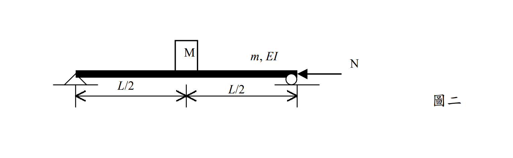

# SD-2002-2 題目正本

> 本檔只記錄考卷上寫了什麼、圖上畫了什麼，不含任何解法。解析見同資料夾 `SD-2002-2.md`。
> 判讀清單經使用者確認前，狀態為「待確認」；確認後本檔原則上不再修改（改動須回考卷原圖並記 log）。

| 項目 | 內容 |
|---|---|
| 考卷 | `raw/exams/SD-2002_結構動力分析與耐震設計.pdf`，第 1 頁（正面）下半，第二題 |
| 考年 | 2002（民國91年）專技高考結構工程技師「結構動力分析與耐震設計」 |
| 配分 | 25 分（㈠5、㈡10、㈢5、㈣5） |
| 附圖 | `SD-2002-2-fig-1.png`（舊擷取，完整、無游標，沿用） |
| 判讀狀態 | **已確認（2026-11-16，使用者授權依 Claude 建議）**（2026-11-16 轉錄；PyMuPDF 110 dpi 整頁＋400 dpi 局部放大，PDF 文字層核對原文；附圖為向量線條；盲讀於開啟解析前完成） |

## 1. 考卷原文（逐字）

二、圖二長度為 $L$ 之簡支梁，每單位長度之質量為 $m$，於中心放置一質量為 $M$ 之重物，受軸向壓力 $N$。若此簡支梁之變位形狀(deflected shape)可以正弦函數模擬，試求：

㈠一般質量(generalized mass)。（5 分）

㈡一般勁度(generalized stiffness)。（10 分）

㈢臨界軸向載重 $N_{cr}$。（5 分）

㈣列出震動週期與 $N/N_{cr}$ 之關係。（5 分）

## 2. 考卷給的公式、附表與參數

- 考卷沒有給參考公式。
- 給定（全為符號）：梁長 $L$、單位長度質量 $m$、撓曲勁度 $EI$（圖上「m, EI」）、跨中集中質量 $M$、軸向壓力 $N$；變位形狀以正弦函數模擬。
- 考卷沒有給：任何數值；正弦函數的具體寫法與振幅（廣義座標）定義；$M$ 的轉動慣量；阻尼。
- 卷首注意事項：㈠可以使用電子計算器，使用電子計算器計算之試題，需詳列解答過程。㈡不必抄題，作答時請將試題題號及答案依照順序寫在試卷上，於本試題上作答者，不予計分。考試時間：二小時。

## 3. 附圖

*證據圖 SD-2002-2-fig-1.png（舊擷取，內容完整、無雜訊）*

圖面文字照錄：M、m, EI、N、L/2、L/2、圖二

## 4. 判讀清單

| # | 項目 | 判讀 | 圖上／題文依據 | 把握 |
|---|---|---|---|---|
| 1 | 「正弦函數」的寫法 | 採簡支梁一次正弦 $\psi(x)=\sin(\pi x/L)$，廣義座標取跨中撓度（$\psi(L/2)=1$）；考卷未指定振幅定義，但頻率、$N_{cr}$ 與週期比不受正規化影響 | 題文「變位形狀可以正弦函數模擬」；簡支邊界 $v(0)=v(L)=0$ | 不確定（解讀）；定案：取 $\sin(\pi x/L)$，不影響㈢㈣答案 |
| 2 | 「一般勁度」是否含軸力效應 | 含：題目明寫受軸壓 $N$，且㈢㈣要 $N_{cr}$ 與週期－$N/N_{cr}$ 關係，故㈡應寫成撓曲勁度扣掉軸壓的幾何勁度 | 題文「受軸向壓力 N」、㈢㈣所求 | 確定（解讀） |
| 3 | $M$ 的性質 | 跨中集中質量（只計平移慣性，不計轉動慣量） | 題文「於中心放置一質量為 M 之重物」；圖上方塊中心對齊尺寸分界點 | 確定（解讀） |
| 4 | 支承 | 左端鉸支承、右端滾支承（簡支） | 圖上左三角形、右圓圈；題文「簡支梁」 | 確定 |
| 5 | 軸力 | 壓力 $N$，作用於右（滾支承）端、沿梁軸向左 | 圖上右端水平向左箭頭；題文「軸向壓力」 | 確定 |
| 6 | 跨度 | 全長 $L$，$M$ 位於 $L/2$ | 尺寸線兩段各 $L/2$ | 確定 |
| 7 | 梁性質 | 均勻 $m$（質量／長度）、$EI$ | 圖上「m, EI」、題文 | 確定 |
| 8 | 振動方向 | 梁的橫向（垂直）撓曲振動 | 題文「變位形狀」 | 確定 |
| 9 | 所求 | ㈠廣義質量 ㈡廣義勁度 ㈢$N_{cr}$ ㈣週期與 $N/N_{cr}$ 的關係 | 題文 | 確定 |
| 10 | 考卷沒有給 | 數值、$M$ 轉動慣量、阻尼、重物重量對軸力的影響（$M$ 只是質量） | 題文 | 確定 |

---
*轉錄：2026-11-16（SD-U1-2 題目正本推廣・組 U1-2-G1）*
*確認：2026-11-16 使用者授權依 Claude 建議確認（SD-U1-2 題目正本推廣・組 U1-2-G1，關卡一）*
