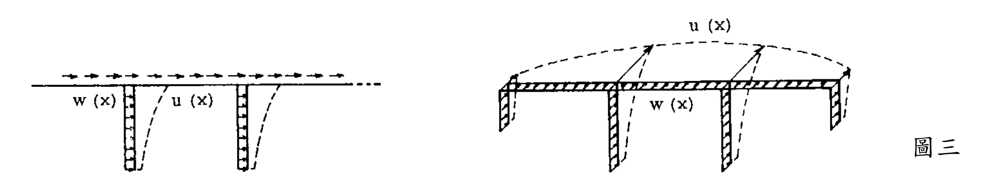

# SD-2002-3 題目正本

> 本檔只記錄考卷上寫了什麼、圖上畫了什麼，不含任何解法。解析見同資料夾 `SD-2002-3.md`。
> 判讀清單經使用者確認前，狀態為「待確認」；確認後本檔原則上不再修改（改動須回考卷原圖並記 log）。

| 項目 | 內容 |
|---|---|
| 考卷 | `raw/exams/SD-2002_結構動力分析與耐震設計.pdf`，第 2 頁（背面），第三題 |
| 考年 | 2002（民國91年）專技高考結構工程技師「結構動力分析與耐震設計」 |
| 配分 | 25 分（㈠10、㈡5、㈢10） |
| 附圖 | `SD-2002-3-fig-1.png`（舊擷取，左上角有游標）、`SD-2002-3-fig-2.png`（2026-11-16 由考卷 500 dpi 重擷取） |
| 判讀狀態 | **已確認**（2026-11-16，使用者授權依 Claude 建議）。原轉錄：2026-11-16；PyMuPDF 110 dpi 整頁＋500 dpi 局部放大，PDF 文字層核對原文；盲讀於開啟解析前完成 |

## 1. 考卷原文（逐字）

三、橋梁之耐震設計規範中，橋梁基本震動週期 $T$，單位為秒，可依下列步驟計算：
沿橋梁軸向或橫向施加載重 $w(x)$（單位：力/單位長），如圖三所示，其中 $w(x)$ 為橋梁結構單位長度靜載重，並計算橋梁震動單位沿軸向或橫向之變形 $u(x)$。

橋梁週期依下式計算：$T=2.01\sqrt{\dfrac{\gamma}{\beta}}$，其中 $\beta=\int w(x)u(x)\,dx$，$\gamma=\int w(x)u^2(x)\,dx$

試問：㈠試推導為何橋梁週期可以上述之方式計算？（10 分）
㈡作此計算時，是否須考慮橋梁自重？請說明原因。（5 分）
㈢施加載重若非 $w(x)$ 而為 $2w(x)$，則所求得之週期公式是否需要作修正？如需修正，又該如何進行之？（10 分）

## 2. 考卷給的公式、附表與參數

- 考卷給的公式（題文）：$T=2.01\sqrt{\gamma/\beta}$，$\beta=\int w(x)u(x)\,dx$，$\gamma=\int w(x)u^2(x)\,dx$；$T$ 單位為秒，$w(x)$ 單位為力/單位長。
- 考卷沒有給：$u(x)$ 的長度單位、重力加速度 $g$ 的數值、係數 2.01 的來源；任何橋梁尺寸、勁度或數值資料（本題無數值計算）。
- 卷首注意事項：可以使用電子計算器，使用電子計算器計算之試題，需詳列解答過程。不必抄題，作答時請將試題題號及答案依照順序寫在試卷上，於本試題上作答者，不予計分。考試時間：二小時。

## 3. 附圖

*證據圖 SD-2002-3-fig-2.png（500 dpi 重擷取；舊圖 SD-2002-3-fig-1.png 內容相同，左上角有游標）*

圖面文字照錄：w (x)、u (x)（左圖各一）；u (x)、w (x)（右圖各一）；圖三

## 4. 判讀清單

| # | 項目 | 判讀 | 圖上／題文依據 | 把握 |
|---|---|---|---|---|
| 1 | 係數 2.01 | 照錄；數值上等於 $2\pi/\sqrt{9.81}$（$g$ 以 m/s² 計、$u$ 以 m 計時），考卷未說明來源 | 題文只寫「$T=2.01\sqrt{\gamma/\beta}$」「單位為秒」 | 確定（解讀） |
| 2 | 圖三左、右兩圖 | 左圖＝沿橋軸向（縱向）施加 $w(x)$，墩柱彎曲；右圖＝沿橫向施加 $w(x)$，橋面形成橫向變形曲線 $u(x)$ | 左圖箭頭沿橋面方向；右圖為立體示意、$u(x)$ 曲線在橋面外側，與題文「軸向或橫向」對應 | 確定（解讀） |
| 3 | $w(x)$ | 橋梁結構單位長度靜載重（重量），以「力/單位長」沿計算方向施加，為靜力載重 | 題文 | 確定 |
| 4 | $u(x)$ | 在 $w(x)$ 作用下橋梁震動單位沿同方向的靜變形 | 題文「並計算橋梁震動單位沿軸向或橫向之變形 $u(x)$」 | 確定 |
| 5 | ㈡「是否須考慮橋梁自重」 | 問的是作此計算（施加 $w(x)$、求 $u(x)$）時是否還要另外考慮自重；照錄，屬論述 | 題文 | 確定（解讀） |
| 6 | ㈢「$2w(x)$」 | 施加載重放大為兩倍時，原週期公式是否要改、如何改 | 題文 | 確定 |
| 7 | 所求 | ㈠推導公式由來、㈡㈢論述；無數值計算 | 題文 | 確定 |
| 8 | 考卷沒有給 | 橋梁幾何、勁度、跨數、支承條件、$g$ 值、$u$ 的單位 | 題文與圖三皆無 | 確定 |

---
*轉錄：2026-11-16（X-G1 題目正本推廣：SD-U2-3／SD-U1-1）*
*確認：2026-11-16 使用者授權依 Claude 建議確認（X-G1，關卡一）*
