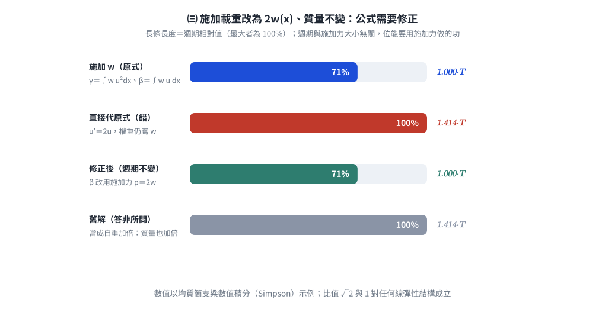

# 考題編號：SD-2002-3

**主分類：** `SD-U2-3` 橋梁耐震設計規範
**副分類：** `SD-U1-3` 單自由度、多自由度系統之動態分析及應用
**分析方法：** Rayleigh 能量法（橋梁基本週期推導）
**標籤：** `橋梁耐震` `Rayleigh法` `能量法` `橋梁週期公式` `廣義質量` `廣義勁度` `α法` `自重` `幾何積分` `γ-β公式`

---

## 1. 題目（考卷原文見題目正本）

> 考卷原文、公式／附表、附圖與判讀清單（已確認）見 [`SD-2002-3-problem.md`](SD-2002-3-problem.md)。本節只列解題時最容易讀錯的地方與本解使用的記號；題意以題目正本為準。

### 常見誤讀

| 項目 | 正確判讀 | 常見誤讀 |
|------|---------|---------|
| ㈢「施加載重 $2w(x)$」 | 只把**施加的靜載重**加倍、質量（自重 $w/g$）不變，問依此求得的 $u(x)$ 代入原公式時要不要修正、如何修正（判讀 #6） | 讀成「自重加倍」（質量也加倍），改問新週期 $T'$ 與 $T$ 的關係（本庫舊解的讀法，2026-11-16 已勘誤） |
| ㈡ 問法 | 「作此計算時，是否須考慮橋梁自重？請說明原因」（判讀 #5） | 改寫成「說明以自重作為側向荷重的物理意義」 |
| 係數 2.01 | 考卷只給數值，等於 $2\pi/\sqrt{9.81}=2.006$（$u$ 以 m 計；判讀 #1） | 當成純數、不交代單位 |
| 圖三 | 左圖沿橋軸向（縱向）、右圖沿橫向施加 $w(x)$（判讀 #2） | 讀成立面圖與透視圖、只談側向 |

**本解記號：** $w(x)$ 單位長度靜載重（力/長）；$u(x)$ 在 $w(x)$ 作用下的靜變形；$\beta=\int wu\,dx$、$\gamma=\int wu^2dx$。

---

## 2. 考題核心精神與出題者意圖 (Core Concepts & Examiner's Intent)

**核心觀念：** 橋梁規範的週期公式 $T=2.01\sqrt{\gamma/\beta}$ 是 Rayleigh 法：把結構自重 $w(x)$ 沿計算方向（軸向或橫向）當靜力施加，得到的靜變形 $u(x)$ 當作振態形狀，令最大動能＝最大位能求 $\omega$。式中 $w(x)$ 同時扮演兩個角色：在 $\gamma$ 裡代表**質量**（$w/g$），在 $\beta$ 裡代表**施加的靜力**——兩者相等，公式才成立。

**出題意圖：**
1. ㈠：能否由能量守恆推導 $\gamma$、$\beta$ 的定義，並說出係數 $2.01=2\pi/\sqrt{g}$（$g=9.81$ m/s²，$u$ 以 m 計）。
2. ㈡：是否須考慮橋梁自重——須考慮：$w(x)$ 就是結構自重，它代表參與振動的質量；但它是沿水平計算方向施加，垂直重力造成的變形不進入計算。
3. ㈢：施加載重改成 $2w(x)$（質量不變）時，公式裡「質量」與「施加力」不再相等，直接代原式會高估週期 $\sqrt2$ 倍，必須修正（題目正本判讀 #6）。

---

## 3. 解題戰略地圖與陷阱分析 (Strategic Roadmap & Trap Analysis)

**作戰計畫（4步）：**
1. 假設振態 $u(x)$（施加 $w(x)$ 的靜變形），寫出最大動能（質量 $w/g$）與最大位能（靜力功）
2. 令兩者相等 → $\omega^2=g\beta/\gamma$ → $T=2\pi/\omega$，代 $g=9.81$ m/s² 得 $2.006\approx2.01$
3. ㈡：說明 $w(x)$ 必須是結構自重（代表質量），以及施加方向
4. ㈢：區分「施加力 $p(x)=2w(x)$」與「質量 $w(x)/g$」，寫出修正式

**陷阱分析：**

| # | 陷阱 | 應對 |
|---|------|------|
| ⚠ | ㈢讀成「自重加倍」（質量也加倍），答「週期變成 $\sqrt2T$」 | 考卷問的是**施加的靜載重**改成 $2w(x)$、公式要不要修正；質量不變，真實週期不變 |
| ⚠ | ㈢以 $2w$ 求得 $u'=2u$ 後直接代原式 | $\beta=\int wu'dx=2\beta_0$、$\gamma=\int wu'^2dx=4\gamma_0$ → 算出 $\sqrt2T$，高估 41%；$\beta$ 的權重要改用實際施加的 $2w$ |
| ⚠ | 係數 2.01 當純數 | $2\pi/\sqrt{g}$，$g=9.81$ m/s²、$u$ 以 m 計；改用 cm 時係數不同 |
| ⚠ | Rayleigh 法方向寫反 | 假設振態給 $\omega$ 的**上限**、$T$ 的**下限**（$T_{Rayleigh}\le T_1$） |
| ⚠ | $\gamma$ 與 $\beta$ 互換 | $\gamma=\int wu^2dx$（分子）；$\beta=\int wu\,dx$（分母） |

---

## 3.5 變數層次分析 (Variable Hierarchy Analysis)

> 複習提示：第一次解題後，在每個卡住的知識點旁標記 `⚠`；第二次複習時只看有 `⚠` 的項目。

### 最終目標
推導 $T=2.01\sqrt{\gamma/\beta}$；說明自重的角色；施加 $2w(x)$ 時寫出修正式。

### 本題關鍵公式（依計算順序）

$$\text{Step 1：} T_{max} = \frac{\omega^2}{2g}\int w(x)u^2(x)\,dx = \frac{\omega^2}{2g}\,\boxed{\gamma}$$

$$\text{Step 2：} V_{max} = \frac{1}{2}\int w(x)\,u(x)\,dx = \frac{1}{2}\,\boxed{\beta}$$

$$\text{Step 3：} T_{max}=V_{max} \implies \omega^2 = \frac{g\,\beta}{\gamma}$$

$$\text{Step 4：} T = \frac{2\pi}{\sqrt{g}}\sqrt{\frac{\gamma}{\beta}} = 2.006\sqrt{\frac{\gamma}{\beta}} \approx 2.01\sqrt{\frac{\gamma}{\beta}}$$

$$\text{Step 5（施加 } p=2w\text{）：} T = 2\pi\sqrt{\frac{\int w\,u'^2dx}{g\int p\,u'dx}} = \frac{1}{\sqrt2}\cdot 2.01\sqrt{\frac{\int w u'^2dx}{\int w u'dx}}$$

### L1：題目直接給定

| 符號 | 說明 |
|------|------|
| $w(x)$ | 橋梁結構單位長度靜載重（力／長），沿軸向或橫向施加（判讀 #3） |
| $u(x)$ | 震動單位在 $w(x)$ 作用下沿同方向的靜變形（判讀 #4） |
| 2.01 | 考卷給的係數（判讀 #1） |

### L2：需知識點推導

**【能量建立】**

| 符號 | 公式／來源 | 卡關? |
|------|-----------|-------|
| $T_{max}$ | $\frac{1}{2}\omega^2\int(w/g)u^2dx$（質量分布 $w/g$） | |
| $V_{max}$ | $\frac{1}{2}\int w\,u\,dx$（靜力功＝應變能；施加力 $w$、位移 $u$） | |
| $\omega^2$ | $g\beta/\gamma$ | |

**【係數】**

| 符號 | 公式／來源 | 卡關? |
|------|-----------|-------|
| $2\pi/\sqrt{g}$ | $6.2832/3.1321=2.006\approx2.01$（$g=9.81$ m/s²） | |

**【㈢ 施加 $2w$】**

| 符號 | 公式／來源 | 卡關? |
|------|-----------|-------|
| $u'(x)$ | $2u(x)$（線彈性） | |
| 直接代原式 | $\int wu'dx=2\beta$、$\int wu'^2dx=4\gamma$ → $2.01\sqrt{4\gamma/2\beta}=\sqrt2\,T$（錯） | |
| 修正 | $V_{max}=\frac12\int p\,u'dx$，$\beta$ 權重改用 $p=2w$ → $T$ 不變 | |

### L3：深層知識（不懂就卡住）

| 知識點 | 說明 | 卡關? |
|--------|------|-------|
| $w$ 的雙重角色 | 動能裡是質量 $w/g$、位能裡是施加力；原公式能寫成 $\int wu\,dx$、$\int wu^2dx$，是因為施加力恰好等於自重 | |
| 週期與施加力大小無關 | 線彈性下振態形狀不隨施加力大小改變；只要質量權重與力權重分開寫，施加任何倍數的 $w$ 都得到同一週期 | |
| Rayleigh 法的上下限 | 假設振態給 $\omega$ 上限、$T$ 下限；以靜變形為振態通常非常接近（均質簡支梁誤差 0.07%） | |

---

## 4. 步驟化詳細計算過程 (Step-by-Step Detailed Calculation)

### ㈠ 推導週期公式

**Step 1：假設振態**

設震動單位沿計算方向做簡諧振動，振態取 $w(x)$ 作用下的靜變形 $u(x)$：

$$y(x,t) = u(x)\sin\omega t,\qquad \dot y(x,t) = u(x)\,\omega\cos\omega t$$

**Step 2：最大動能**

單位長度質量 $=w(x)/g$：

$$T_{max} = \frac{1}{2}\int \frac{w(x)}{g}\,[\omega u(x)]^2dx = \frac{\omega^2}{2g}\,\gamma,\qquad \gamma\equiv\int w(x)\,u^2(x)\,dx$$

**Step 3：最大位能（靜力功）**

$u(x)$ 是 $w(x)$ 靜力作用下的變形，應變能等於靜力功：

$$V_{max} = \frac{1}{2}\int w(x)\,u(x)\,dx = \frac{1}{2}\,\beta,\qquad \beta\equiv\int w(x)\,u(x)\,dx$$

**Step 4：能量守恆**

$$\frac{\omega^2}{2g}\gamma = \frac{1}{2}\beta \implies \omega^2 = \frac{g\beta}{\gamma}$$

**Step 5：週期**

$$T = \frac{2\pi}{\omega} = \frac{2\pi}{\sqrt g}\sqrt{\frac{\gamma}{\beta}},\qquad \frac{2\pi}{\sqrt{9.81}} = \frac{6.2832}{3.1321} = 2.006$$

$$\boxed{T = 2.01\sqrt{\frac{\gamma}{\beta}}}\quad(\gamma/\beta\ \text{以 m 計，}T\ \text{以 s 計})$$

> **量綱：** $w$ 為 kN/m、$u$ 為 m 時，$\gamma$ 為 kN·m²、$\beta$ 為 kN·m，$\gamma/\beta$ 為 m；係數 $2\pi/\sqrt g$ 的單位是 s/m$^{1/2}$。

### ㈡ 是否須考慮橋梁自重

**須考慮。** 理由：

1. 公式裡的 $w(x)$ 就是橋梁結構單位長度靜載重（自重）。它在 $\gamma$ 中代表參與振動的質量（$w/g$），在 $\beta$ 中代表施加的靜力。地震慣性力與質量成正比，以自重分布施加，得到的變形形狀最接近基本振態。
2. 不計自重（或用與自重分布不同的載重）時，$\gamma$ 的質量權重就錯了，算出的週期沒有意義。
3. 自重是**沿水平計算方向（軸向或橫向）施加**的靜力；垂直方向的重力及其造成的垂直變形不進入此計算。

### ㈢ 施加載重改為 $2w(x)$ 時的修正

施加的靜力改為 $p(x)=2w(x)$，結構質量不變（仍是 $w/g$）。線彈性下：

$$u'(x) = 2u(x)$$

**若直接代原式**（積分權重仍寫 $w$）：

$$\int w\,u'dx = 2\beta,\qquad \int w\,u'^2dx = 4\gamma \implies 2.01\sqrt{\frac{4\gamma}{2\beta}} = \sqrt2\cdot2.01\sqrt{\frac{\gamma}{\beta}} = \sqrt2\,T$$

高估 41%。原因：位能應是施加力做的功 $\frac12\int p\,u'dx$，不是 $\frac12\int w\,u'dx$。

**需要修正。** 動能仍用質量 $w/g$、位能改用施加力 $p$：

$$\omega^2 = \frac{g\int p(x)\,u'(x)\,dx}{\int w(x)\,u'^2(x)\,dx}$$

$$\boxed{T = 2\pi\sqrt{\frac{\int w\,u'^2dx}{g\int p\,u'dx}} = \frac{1}{\sqrt2}\cdot 2.01\sqrt{\frac{\int w\,u'^2dx}{\int w\,u'dx}}}$$

代入 $p=2w$、$u'=2u$：$\int p\,u'dx=4\beta$、$\int w\,u'^2dx=4\gamma$，$T=2.01\sqrt{\gamma/\beta}$，與原週期相同。

一般化：施加 $p(x)=c\,w(x)$ 時，$\beta$ 改用 $\int p\,u\,dx$（或把原式結果除以 $\sqrt c$）；週期是結構性質，與施加力的大小無關。

*圖解：施加載重改為 2w(x)、質量不變時的週期比（均質簡支梁數值積分示例；比值對任何線彈性結構成立）。本圖攔下的錯誤：把「施加載重 2w」讀成「自重加倍」，或直接代原式得 √2T；修正後週期不變。*

### 結果彙整

| 項目 | 結果 |
|------|------|
| 週期公式 | $T=2.01\sqrt{\gamma/\beta}$，$\gamma=\int wu^2dx$、$\beta=\int wu\,dx$ |
| 係數 2.01 | $2\pi/\sqrt{9.81}=2.006$（$u$ 以 m 計） |
| ㈡ 自重 | 須考慮：$w$ 即自重，代表質量；沿水平計算方向施加 |
| ㈢ 施加 $2w$ | 公式需修正：$\beta$ 權重改用施加力（$\int p\,u\,dx$），或原式結果除以 $\sqrt2$；週期不變 |

---

## 5. 關鍵爭議點與進階探討 (Critical Issues & Advanced Discussion)

**係數的精確值：**
$2\pi/\sqrt{9.81}=2.006$、$2\pi/\sqrt{9.80}=2.007$，取 2.01 差異可忽略。若 $u$ 改以 cm 計（$g=981$ cm/s²），係數為 $2\pi/\sqrt{981}=0.2006$。

**Rayleigh 法的方向性：**
以假設振態求得的 $\omega$ 是真實基本頻率的上限，所以 $T_{Rayleigh}\le T_1$（週期偏短）。以靜變形為振態時誤差很小：均質簡支梁施加均佈 $w$，規範式得 $0.63617\,L^2\sqrt{m/EI}$，精確解 $2L^2\sqrt{m/EI}/\pi=0.63662\,L^2\sqrt{m/EI}$，短 0.07%（驗算腳本）。

**與「質量加倍」的區別（舊解對照，2026-11-16 勘誤前）：**
舊解把㈢讀成「自重加倍」（質量也加倍），把 $2w$ 同時代進 $\beta$、$\gamma$ 的權重（$\beta'=4\beta$、$\gamma'=8\gamma$），答「$T'=\sqrt2T$，週期變長」。若質量真的加倍，真實週期確實變為 $\sqrt2T$；但考卷問的是施加載重改成 $2w(x)$ 時公式要不要修正，質量不變，正確答案是「需要修正，週期不變」。

**規範對應：**
現行公路橋梁耐震設計規範的週期公式寫成 $T=2\pi\sqrt{\gamma/(\beta g)}$（2024 年考卷引作規範（2-6）式，記號 $\zeta$），與本題 $2.01\sqrt{\gamma/\beta}$ 相同（$g=9.81$ m/s²）。使用時 $w(x)$ 取參與振動的靜載重，$u(x)$ 以結構分析求沿計算方向的靜變形，$\gamma$、$\beta$ 以數值積分計算。

*修正日期：2026-11-16（§1 改為指向題目正本）*

*修正日期：2026-11-16（勘誤：讀題＋觀念。㈢考卷問施加載重改為 2w(x)（質量不變）時公式是否修正，舊解讀成自重加倍、答 T′＝√2T；改為「直接代原式會高估 √2 倍，需修正：β 權重改用施加力 ∫p·u dx 或結果除以 √2，週期不變」。㈡改為正面回答須考慮自重；Rayleigh 法方向改正為 T_R ≤ T1（舊寫偏大）；係數 2π/√9.81 由 2.007 改 2.006；刪除未核的「α 法」名稱。改 §2、§3、§3.5、§4、§5；主分類由 SD-U2 改 SD-U2-3、副分類與索引一致（非勘誤）。驗證：scripts/fixes/2026-11-16_verify_SD-2002-3.py 均質簡支梁數值積分，MISMATCHES: 0）*

*修正日期：2026-11-16（非勘誤）圖解補繪：§4 ㈢ 補施加 2w 週期比圖 figs/SD-2002-3-fig-3-weights.svg（腳本 gen_SD-2002-3.py，可重跑）*
