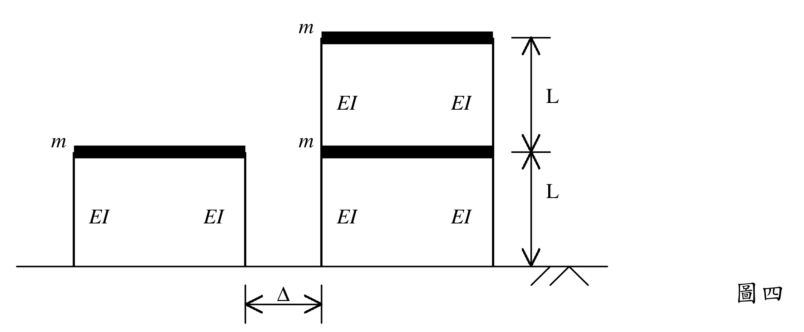

# SD-2002-4 題目正本

> 本檔只記錄考卷上寫了什麼、圖上畫了什麼，不含任何解法。解析見同資料夾 `SD-2002-4.md`。
> 判讀清單經使用者確認前，狀態為「待確認」；確認後本檔原則上不再修改（改動須回考卷原圖並記 log）。

| 項目 | 內容 |
|---|---|
| 考卷 | `raw/exams/SD-2002_結構動力分析與耐震設計.pdf`，第 2 頁（背面），第四題 |
| 考年 | 2002（民國91年）專技高考結構工程技師「結構動力分析與耐震設計」（代號 00440） |
| 配分 | 25 分 |
| 附圖 | `SD-2002-4-fig-1.png`（舊擷取，單層屋樓版上有滑鼠游標）、`SD-2002-4-fig-2.png`（2026-11-16 由考卷 500 dpi 重擷取） |
| 判讀狀態 | **已確認**（2026-11-16，使用者授權依 Claude 建議）。原轉錄：2026-11-16；PyMuPDF 110 dpi 整頁＋300／500 dpi 局部放大目視（CID 字型，文字層抽不到中文），附圖另讀 PDF 向量座標；盲讀於開啟解析前完成 |

## 1. 考卷原文（逐字）

四、圖四為相鄰之單層及雙層平面剪力房屋，已知各樓版總質量 $m$ 皆為 800 Ton， 各樓層柱高 $L$ 皆為 3 m，每根柱之 $EI$ 值皆為 $4.5\times10^4$ kN-m²。若工址水平向正規化加速度反應譜係數 $C$ 與週期的關係為：

$C=1.0,\quad T\le 0.03$ 秒
$C=8.824T+0.7352,\quad 0.03$ 秒 $\le T\le 0.2$ 秒
$C=2.5,\quad 0.2$ 秒 $\le T\le 1.32$ 秒
$C=3.3/\mathrm{T},\quad 1.32$ 秒 $\le T\le 3.3$ 秒
$C=1.0,\quad T\ge 3.3$ 秒

試問此兩座剪力房屋之間距 $\Delta$ 至少需維持多少的距離，才不會在設計水平加速度係數為 0.2 時發生碰撞。（25 分）

（照考卷原文：「800 Ton，」後有一空格；「3.3/T」的 T 為正體。）

## 2. 考卷給的公式、附表與參數

- 給定：各樓版總質量 $m=800$ Ton；各樓層柱高 $L=3$ m；每根柱 $EI=4.5\times10^4$ kN·m²；正規化加速度反應譜係數 $C(T)$ 五段式（如上，照錄）；設計水平加速度係數 0.2。
- 考卷沒有給：阻尼比、反應譜對應的阻尼、振態組合方式（SRSS／絕對值和）、兩棟反應的組合方式、柱的端部條件文字說明（只說「平面剪力房屋」）、梁的勁度（只以粗黑線表示樓版）、跨度、柱軸向變形。
- 卷首注意事項：㈠可以使用電子計算器，使用電子計算器計算之試題，需詳列解答過程。㈡不必抄題，作答時請將試題題號及答案依照順序寫在試卷上，於本試題上作答者，不予計分。考試時間：二小時。

## 3. 附圖

*證據圖 SD-2002-4-fig-2.png（500 dpi 重擷取；舊圖 SD-2002-4-fig-1.png 內容相同，單層屋樓版上有游標）*

圖面文字照錄：m（三處）、EI（六處）、L（兩處）、Δ、圖四

## 4. 判讀清單

| # | 項目 | 判讀 | 圖上／題文依據 | 把握 |
|---|---|---|---|---|
| 1 | 「設計水平加速度係數為 0.2」 | 定案：工址設計水平加速度係數（地表加速度）0.2 g，與正規化譜相乘得譜加速度 $S_a=0.2\,C(T)\,g$；不是「譜加速度直接取 0.2 g」（那樣題目給的 $C(T)$ 就用不到）。理由：題文稱 $C$ 為「正規化」加速度反應譜係數，正規化即以地表加速度為 1；$C(T\le0.03)=1.0$ 也符合這個定義 | 題文「正規化加速度反應譜係數 C」「設計水平加速度係數為 0.2」 | 不確定（影響答案）→ 依本列定案（2026-11-16 使用者授權依 Claude 建議） |
| 2 | 碰撞位置 | 單層屋屋頂與雙層屋二樓同高（皆在地面上 $L$），碰撞檢核取這個高度兩屋的側移 | 圖上兩樓版上緣同在 y≈634–639 pt（PDF 座標）；題文「各樓層柱高 L 皆為 3 m」 | 確定（解讀） |
| 3 | 考卷沒有給 | 阻尼比、振態組合方式、兩棟反應的組合方式 | 題文 | 確定 |
| 4 | 「800 Ton」 | 質量 800 公噸（800,000 kg），不是重量 tf | 題文「總質量 m」 | 確定（解讀） |
| 5 | 剪力房屋 | 樓版為剛體（不轉動、只平移），柱上下端視為固定，柱軸向變形不計 | 題文「平面剪力房屋」；圖上樓版畫粗黑線 | 確定（解讀） |
| 6 | 柱數 | 每棟每層 2 根柱，每根 $EI=4.5\times10^4$ kN·m² | 圖上每層兩柱各標 EI；題文「每根柱」 | 確定 |
| 7 | 樓層高 | 單層屋柱高 $L$；雙層屋兩層各 $L$；$L=3$ m | 右側尺寸線兩段各標 L；題文 | 確定 |
| 8 | 質量 | 單層屋屋頂 $m$；雙層屋二樓 $m$、屋頂 $m$；$m=800$ Ton | 圖上三處 m | 確定 |
| 9 | 柱底 | 固定於地面 | 地面線（剖線只畫在右端尺寸線下方，視為整條地面） | 確定（解讀） |
| 10 | $\Delta$ 的量法 | 單層屋右柱外緣到雙層屋左柱外緣的水平淨距 | 尺寸線延伸線 x≈226.5、256.0 pt，分別對齊單層屋右柱（x 226.1–226.9）與雙層屋左柱（x 255.5–256.3） | 確定 |
| 11 | 所求 | 不碰撞所需的最小間距 $\Delta$ | 題文 | 確定 |
| 12 | 規範版本 | 本題給的是題目自訂的正規化譜與加速度係數，照題目給的值用；不涉及現行規範公式替換 | 題文 | 確定（解讀） |

---
*轉錄：2026-11-16（SD-U2-2 題目正本推廣・組 U2-2-G1）*
*確認：2026-11-16 使用者授權依 Claude 建議確認（組 U2-2-G1，關卡一）*
