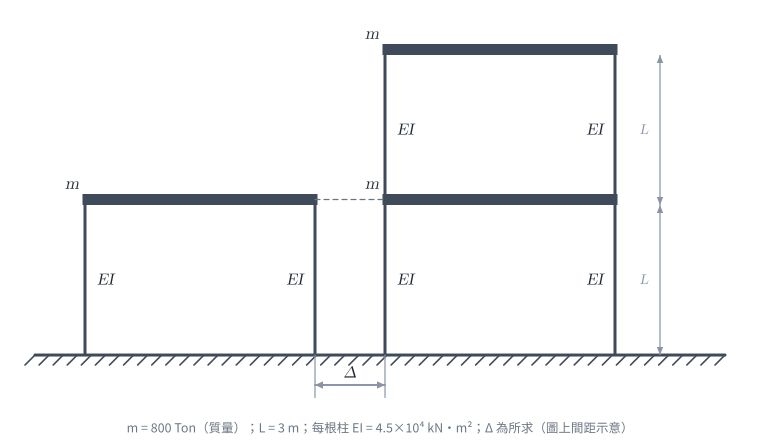
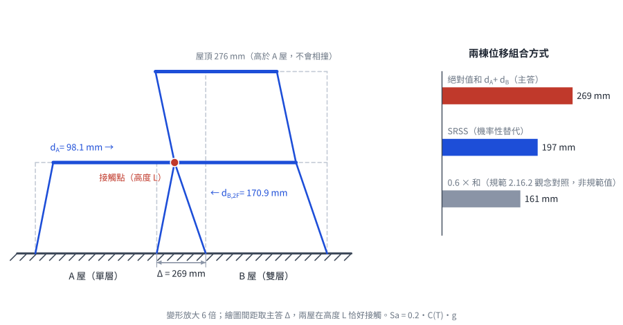

# 考題編號：SD-2002-4

**主分類：** `SD-U2-2` 建築耐震設計規範
**副分類：** `SD-U1-3` 單自由度、多自由度系統之動態分析及應用；`SD-U2-1` 地震力之設計規範
**分析方法：** MDOF 模態疊加法 + SRSS 組合 + 反應譜分析（兩棟位移以絕對值和取間距，SRSS 為替代）
**標籤：** `鄰棟碰撞` `防震間距` `SRSS` `模態疊加法` `反應譜` `模態參與因子` `黃金比例振態` `2DOF剪力構架` `有效質量`

---

## 1. 題目（考卷原文見題目正本）

> 考卷原文、公式／附表、附圖與判讀清單（已確認）見 [`SD-2002-4-problem.md`](SD-2002-4-problem.md)。本節只列解題時最容易讀錯的地方與本解使用的記號；題意以題目正本為準。

*重繪自考卷附圖，依題目正本判讀清單；本圖攔下的判讀錯誤：碰撞高度是單層屋屋頂＝雙層屋二樓樓版（同在地面上 L），不是雙層屋屋頂；Δ 量到兩柱外緣。*

### 常見誤讀

| 項目 | 正確判讀 | 常見誤讀 |
|------|---------|---------|
| 設計水平加速度係數 0.2 | 地表設計加速度 0.2 g，譜加速度 $S_a=0.2\,C(T)\,g$（判讀 #1，定案） | 譜加速度直接取 0.2 g（題目給的 $C(T)$ 就用不到） |
| 碰撞位置 | 單層屋屋頂與雙層屋二樓樓版同高 $L$（判讀 #2） | 用雙層屋屋頂位移檢核；把高度 $L$ 的樓版叫「一樓」（本庫舊解用詞；台灣慣例為二樓樓版） |
| 質量 | $m=800$ Ton 為質量（800,000 kg）（判讀 #4） | 當成重量 tf 再除 g |
| 剪力房屋 | 樓版剛體、柱兩端固定，柱側向勁度 $12EI/L^3$、每層兩根（判讀 #5、#6） | 柱頂鉸接用 $3EI/L^3$；每層只算一根 |
| 兩棟位移組合 | 考卷沒指定（判讀 #3）；「才不會碰撞」要保證值，本解主答取絕對值和 $d_A+d_B$，SRSS 列替代 | 斷言 SRSS 才對、絕對值和是錯的（本庫舊解 §2、§3 曾如此寫） |

**本解記號：** A棟＝左側單層屋、B棟＝右側雙層屋；$k_{col}=12EI/L^3$、$k_s=2k_{col}$；$C_n$ 為第 $n$ 振態週期對應的正規化譜係數，$S_{an}=C_n\cdot0.2g$、$S_{dn}=S_{an}/\omega_n^2$；$d_A$、$d_{B,2F}$ 為碰撞高度 $L$ 處兩棟最大位移（B棟二樓樓版）；$\Delta$ 為所需最小間距。

---

## 2. 考題核心精神與出題者意圖 (Core Concepts & Examiner's Intent)

**核心觀念：** 各棟在碰撞高度的最大位移由反應譜求得；兩棟的最大位移若反向同時發生就會相撞，題目問「至少需維持多少距離才不會碰撞」，保證不撞的間距是兩者絕對值和 $d_A+d_B$（上界）。兩棟週期不同、最大值同時反向發生的機率不高，因此也常見以 SRSS 估計的機率性間距，或如現行建築物耐震設計規範 §2.16.2 以折減係數 0.6 考慮——三者框架不同，作答時要寫明採用哪一種。

**出題意圖：**
1. 考驗能否正確推導 2-DOF 系統的特徵值（$\lambda^2 - 3\lambda + 1 = 0$，根為黃金比例相關值）。
2. 測試模態疊加法的完整流程：特徵值→模態→模態參與因子→反應譜位移→振態 SRSS→兩棟位移組合。
3. 考察碰撞界面的正確選取（A棟屋頂 = B棟二樓，高度 $L$）及兩棟位移組合方式（絕對值和 vs SRSS）的判斷。

---

## 3. 解題戰略地圖與陷阱分析 (Strategic Roadmap & Trap Analysis)

**作戰計畫（7步）：**
1. 計算柱側向勁度 $k_{col} = 12EI/L^3$，樓層勁度 $k_s = 2k_{col}$
2. A棟（SDOF）：$T_A = 2\pi\sqrt{m/k_s}$，查反應譜，得 $S_{d,A}$
3. B棟（2-DOF）：解 $\lambda^2 - 3\lambda + 1 = 0$，得 $\lambda_{1,2} = (3\pm\sqrt{5})/2$
4. 計算 $\omega_{1,2}^2$，$T_{1,2}$，查反應譜，得 $S_{d1}$、$S_{d2}$
5. 計算模態形狀 $\{\phi\}_1$、$\{\phi\}_2$（黃金比例）
6. 計算模態參與因子 $\Gamma_1$、$\Gamma_2$
7. SRSS 組合 B棟二樓（高度 $L$）位移；A棟、B棟位移取絕對值和 → $\Delta$（SRSS 合成列為替代）

**陷阱分析：**

| # | 陷阱 | 應對 |
|---|------|------|
| ⚠ | 碰撞界面取錯（用 B棟屋頂） | 碰撞在 A棟屋頂 = B棟二樓樓版的高度（高度 $L$） |
| ⚠ | $T_1 > 1.32\ \text{s}$ 使用 $C = 2.5$（用錯範圍） | $T_1 = 1.44\ \text{s} > 1.32$，應用 $C = 3.3/T$ |
| ⚠ | 兩棟組合方式不交代 | 考卷未指定：保證不撞取 $d_A+d_B$（本解主答）；SRSS $\sqrt{d_A^2+d_B^2}$ 是機率性估計，用時須說明，不可說絕對值和是錯的 |
| ⚠ | B棟模態參與因子漏算（只用第一模態） | 兩個模態均須包含，但第一模態在二樓樓版的位移遠大於第二模態 |

---

## 3.5 變數層次分析 (Variable Hierarchy Analysis)

> 複習提示：第一次解題後，在每個卡住的知識點旁標記 `⚠`；第二次複習時只看有 `⚠` 的項目。

### 最終目標
求兩棟建築間的最小防震間距 $\Delta$，使地震下 A棟屋頂（高度 $L$）與 B棟二樓樓版（高度 $L$）不發生碰撞。

### 本題關鍵公式（依計算順序）

$$\text{Step 1：} k_s = 2\times\frac{12EI}{L^3}$$

$$\text{Step 2（A棟）：} T_A = 2\pi\sqrt{\frac{m}{k_s}},\quad S_{d,A} = \frac{C_A \cdot 0.2g}{\omega_A^2}$$

$$\text{Step 3（B棟特徵值）：} \lambda^2 - 3\lambda + 1 = 0,\quad \lambda_{1,2} = \frac{3\pm\sqrt{5}}{2},\quad \omega_n^2 = \lambda_n\frac{k_s}{m}$$

$$\text{Step 4（B棟模態）：} \frac{\phi_{2n}}{\phi_{1n}} = 2-\lambda_n = \begin{cases}(1+\sqrt{5})/2\\(1-\sqrt{5})/2\end{cases}$$

$$\text{Step 5（參與因子）：} \Gamma_n = \frac{(1+\phi_{2n}/\phi_{1n})}{(1+(\phi_{2n}/\phi_{1n})^2)}$$

$$\text{Step 6（B棟二樓 SRSS）：} d_{B,2F} = \sqrt{(\Gamma_1 S_{d1})^2 + (\Gamma_2 S_{d2})^2}$$

$$\text{Step 7（防震間距）：} \boxed{\Delta = d_A + d_{B,2F}}\quad(\text{替代：}\sqrt{d_A^2+d_{B,2F}^2})$$

### L1：題目直接給定

| 符號 | 數值 | 說明 |
|------|------|------|
| $m$ | 800 Ton | 各樓版質量 |
| $L$ | 3 m | 各層柱高 |
| $EI$ | $4.5\times10^4\ \text{kN-m}^2$ | 各柱彎曲剛度 |
| $A$ | 0.2 | 設計水平加速度係數 |
| $g$ | 9.81 m/s² | 重力加速度 |

### L2：需知識點推導

**【勁度計算】**

| 符號 | 公式／來源 | 卡關? |
|------|-----------|-------|
| $k_{col}$ | $12EI/L^3$（定端柱側向勁度） | |
| $k_s$ | $2k_{col}$（兩柱並聯） | |

**【B棟特徵值】**

| 符號 | 公式／來源 | 卡關? |
|------|-----------|-------|
| $\lambda_{1,2}$ | $(3\pm\sqrt{5})/2$（二次公式，$\lambda=m\omega^2/k_s$） | |
| 模態比例 | $\phi_{2n}/\phi_{1n} = 2-\lambda_n$（黃金比例 $\pm\sqrt5$） | |
| $\Gamma_n$ | $(1+r_n)/(1+r_n^2)$，其中 $r_n = \phi_{2n}/\phi_{1n}$ | |

**【反應譜位移】**

| 符號 | 公式／來源 | 卡關? |
|------|-----------|-------|
| $S_{dn}$ | $C_n \cdot 0.2g / \omega_n^2 = C_n \cdot 0.2g \cdot T_n^2/(4\pi^2)$ | |
| 反應譜區間 | 比對 $T$ 與各分段邊界 (0.03, 0.2, 1.32, 3.3 s) | |

### L3：深層知識（不懂就卡住）

| 知識點 | 說明 | 卡關? |
|--------|------|-------|
| 兩棟位移的組合 | 絕對值和＝保證不撞的上界；SRSS＝假設兩棟反應不相關的機率性估計；現行規範 §2.16.2 以 0.6 折減（反向且同時最大的機率不高）。同一棟內各振態的組合（SRSS／CQC）是另一回事 | ⚠ |
| 防震間距的碰撞界面選取 | 只在 A棟屋頂與 B棟二樓樓版高度相交處可能碰撞；需比較該高度的各棟側移 | |
| 模態參與因子的物理意義 | $\Gamma_n$ 表示第 $n$ 模態在地震中被激發的比例；有效質量 = $\Gamma_n^2 M_n^*$ | |

---

## 4. 步驟化詳細計算過程 (Step-by-Step Detailed Calculation)

### Step 1：柱與樓層側向勁度

每根柱（固端-固端）側向勁度：
$$k_{col} = \frac{12EI}{L^3} = \frac{12\times 4.5\times10^4}{3^3} = \frac{5.4\times10^5}{27} = 20{,}000\ \text{kN/m} = 2\times10^4\ \text{kN/m}$$

每層兩根柱並聯，樓層側向勁度：
$$k_s = 2k_{col} = 40{,}000\ \text{kN/m} = 4\times10^4\ \text{kN/m}$$

### Step 2：A棟（SDOF，單層）自然週期與位移

$$\omega_A^2 = \frac{k_s}{m} = \frac{40{,}000}{800} = 50\ \text{rad}^2/\text{s}^2$$

$$T_A = \frac{2\pi}{\sqrt{50}} = \frac{2\pi}{5\sqrt{2}} = \frac{\pi\sqrt{2}}{5} \approx 0.889\ \text{s}$$

查反應譜：$0.2\ \text{s} \leq T_A = 0.889\ \text{s} \leq 1.32\ \text{s}$，故 $C_A = 2.5$

設計譜加速度：
$$S_{a,A} = C_A \times 0.2g = 2.5 \times 0.2 \times 9.81 = 4.905\ \text{m/s}^2$$

設計譜位移（= A棟屋頂最大位移）：
$$\boxed{S_{d,A} = \frac{S_{a,A}}{\omega_A^2} = \frac{4.905}{50} = 0.0981\ \text{m} \approx 98.1\ \text{mm}}$$

### Step 3：B棟（2-DOF，雙層）建立質量與勁度矩陣

廣義座標：$\{q\} = \{u_1, u_2\}^\top$（第一層、第二層絕對水平位移）

$$[M] = \begin{bmatrix} m & 0 \\ 0 & m \end{bmatrix} = \begin{bmatrix} 800 & 0 \\ 0 & 800 \end{bmatrix}\ \text{Ton}$$

$$[K] = \begin{bmatrix} 2k_s & -k_s \\ -k_s & k_s \end{bmatrix} = \begin{bmatrix} 80{,}000 & -40{,}000 \\ -40{,}000 & 40{,}000 \end{bmatrix}\ \text{kN/m}$$

### Step 4：B棟特徵值求解

特徵方程 $\det([K] - \omega^2[M]) = 0$，令 $\lambda = m\omega^2/k_s$：

$$(2k_s - \lambda k_s)(k_s - \lambda k_s) - k_s^2 = 0$$

$$k_s^2[(2-\lambda)(1-\lambda) - 1] = 0 \implies \lambda^2 - 3\lambda + 1 = 0$$

$$\lambda = \frac{3 \pm \sqrt{5}}{2}, \qquad \sqrt{5} = 2.2361$$

| 模態 | $\lambda_n$ | $\omega_n^2 = \lambda_n k_s/m$ | $T_n$ |
|:----:|:----------:|:-----------------------------:|:-----:|
| 1 | $(3-\sqrt{5})/2 = 0.3820$ | $0.3820 \times 50 = 19.10\ \text{rad}^2/\text{s}^2$ | $2\pi/\sqrt{19.10} = 1.438\ \text{s}$ |
| 2 | $(3+\sqrt{5})/2 = 2.6180$ | $2.6180 \times 50 = 130.9\ \text{rad}^2/\text{s}^2$ | $2\pi/\sqrt{130.9} = 0.549\ \text{s}$ |

### Step 5：B棟模態形狀

由 $(2k_s - \omega_n^2 m)\phi_{1n} = k_s\phi_{2n}$ → $\phi_{2n}/\phi_{1n} = 2 - \lambda_n$

**模態 1**（令 $\phi_{11} = 1$）：
$$\frac{\phi_{21}}{\phi_{11}} = 2 - \frac{3-\sqrt{5}}{2} = \frac{1+\sqrt{5}}{2} \approx 1.618\ (\text{黃金比例}\ \varphi)$$

$$\{\phi\}_1 = \begin{Bmatrix} 1 \\ 1.618 \end{Bmatrix}$$

**模態 2**（令 $\phi_{12} = 1$）：
$$\frac{\phi_{22}}{\phi_{12}} = 2 - \frac{3+\sqrt{5}}{2} = \frac{1-\sqrt{5}}{2} \approx -0.618$$

$$\{\phi\}_2 = \begin{Bmatrix} 1 \\ -0.618 \end{Bmatrix}$$

> **策略註解：** 等質量等勁度的2-DOF系統，特徵方程 $\lambda^2-3\lambda+1=0$ 的根恰好是 $(3\pm\sqrt{5})/2$，對應模態比為黃金比例 $\varphi$ 及 $-1/\varphi$，是結構動力學中的經典結果。

### Step 6：模態參與因子

$$\Gamma_n = \frac{\{\phi_n\}^\top [M]\{1\}}{\{\phi_n\}^\top [M]\{\phi_n\}}$$

**模態 1：**
$$\Gamma_1 = \frac{m(1 + 1.618)}{m(1^2 + 1.618^2)} = \frac{2.618}{1 + 2.618} = \frac{2.618}{3.618} = 0.7236$$

**模態 2：**
$$\Gamma_2 = \frac{m(1 + (-0.618))}{m(1^2 + (-0.618)^2)} = \frac{0.382}{1 + 0.382} = \frac{0.382}{1.382} = 0.2764$$

**有效質量驗算：**
$$m_{eff,1} + m_{eff,2} = \frac{(2.618m)^2}{3.618m} + \frac{(0.382m)^2}{1.382m} = 1.894m + 0.106m = 2.000m\ \checkmark$$

### Step 7：B棟反應譜位移

查反應譜：
- $T_1 = 1.438\ \text{s}$：$1.32 \leq 1.438 \leq 3.3$ → $C_1 = 3.3/1.438 = 2.295$
- $T_2 = 0.549\ \text{s}$：$0.2 \leq 0.549 \leq 1.32$ → $C_2 = 2.5$

$$S_{a1} = 2.295 \times 0.2g = 2.295 \times 1.962 = 4.503\ \text{m/s}^2$$
$$S_{d1} = S_{a1}/\omega_1^2 = 4.503/19.10 = 0.2358\ \text{m}$$

$$S_{a2} = 2.5 \times 0.2g = 4.905\ \text{m/s}^2$$
$$S_{d2} = S_{a2}/\omega_2^2 = 4.905/130.9 = 0.03747\ \text{m}$$

### Step 8：B棟二樓樓版（高度 L）最大位移（振態 SRSS）

各模態對二樓樓版（$\phi_{1n} = 1$）的位移貢獻：

$$X_{1,\text{2F}} = \Gamma_1 \times \phi_{11} \times S_{d1} = 0.7236 \times 1 \times 0.2358 = 0.1706\ \text{m}$$

$$X_{2,\text{2F}} = \Gamma_2 \times \phi_{12} \times S_{d2} = 0.2764 \times 1 \times 0.03747 = 0.01036\ \text{m}$$

同一棟內兩振態以 SRSS 組合（兩振態頻率相差大，SRSS 適用）：

$$d_{B,\text{2F}} = \sqrt{X_{1,\text{2F}}^2 + X_{2,\text{2F}}^2} = \sqrt{0.1706^2 + 0.01036^2} = \sqrt{0.02910 + 0.000107}$$

$$= \sqrt{0.02921} = 0.1709\ \text{m} \approx 170.9\ \text{mm}$$

> **策略註解：** 第二模態貢獻僅 10.4 mm，遠小於第一模態 170.6 mm，第一模態主導。

### Step 9：防震間距 $\Delta$（兩棟位移絕對值和）

A棟屋頂（高度 $L$）位移：$d_A = 98.1\ \text{mm}$
B棟二樓樓版（高度 $L$）位移：$d_{B,\text{2F}} = 170.9\ \text{mm}$

題目問「至少需維持多少距離才不會碰撞」，兩棟最大位移反向同時發生的情形不能排除，保證不撞的間距取絕對值和：

$$\Delta = d_A + d_{B,\text{2F}} = 98.1 + 170.9 = 269.0\ \text{mm}$$

$$\boxed{\Delta_{\min} \approx 269\ \text{mm} \approx 0.27\ \text{m}}$$

**替代答案（機率性估計）：** 兩棟週期不同（$T_A = 0.889\ \text{s}$、$T_{B,1} = 1.438\ \text{s}$），若假設兩棟反應不相關，以 SRSS 估計：

$$\Delta_{\rm SRSS} = \sqrt{98.1^2 + 170.9^2} = \sqrt{9{,}624 + 29{,}207} = \sqrt{38{,}831} \approx 197.1\ \text{mm}$$

作答時寫明採用的組合方式；兩者都有依據，絕對值和較保守。

*圖解：兩屋最不利地反向同時達到最大位移（變形放大 6 倍），間距取絕對值和 269 mm 時恰好在高度 $L$ 接觸；B屋屋頂高於 A屋，其位移不參與碰撞。本圖攔下兩種錯誤：拿 B屋屋頂位移檢核、以及把 SRSS 當成保證不撞的間距。*

### 結果彙整

| 項目 | A棟（單層） | B棟（雙層） |
|------|:----------:|:----------:|
| 週期 | $T_A = 0.889\ \text{s}$ | $T_1 = 1.438\ \text{s}$；$T_2 = 0.549\ \text{s}$ |
| 反應譜 C | 2.5 | $C_1 = 2.295$；$C_2 = 2.5$ |
| 譜位移 | $S_{d,A} = 98.1\ \text{mm}$ | $S_{d1} = 235.8\ \text{mm}$；$S_{d2} = 37.5\ \text{mm}$ |
| 高度 L 位移 | $d_A = 98.1\ \text{mm}$ | $d_{B,2F} = 170.9\ \text{mm}$ |

$$\boxed{\Delta_{\min} = 98.1 + 170.9 \approx 269\ \text{mm}}\qquad(\text{SRSS 替代：} \approx 197\ \text{mm})$$

---

## 5. 關鍵爭議點與進階探討 (Critical Issues & Advanced Discussion)

**兩棟位移的組合方式（本題的爭議點）：**
考卷沒有指定兩棟反應如何組合，常見三種框架：

| 做法 | 本題數值 | 依據與性質 |
|------|---------|-----------|
| 絕對值和 $d_A+d_B$（本解主答） | 269.0 mm | 兩棟最大位移反向同時發生的上界，保證不撞；符合題文「才不會碰撞」 |
| SRSS $\sqrt{d_A^2+d_B^2}$ | 197.1 mm | 假設兩棟反應不相關的機率性估計（國外規範如 ASCE 7 有採用）；本庫舊解的主答 |
| 現行台灣規範 §2.16.2 的觀念 | $0.6\times269.0 \approx 161$ mm（僅觀念對照） | 規範規定建築物應自留設之間隔不得小於設計地震力位移乘以 0.6（另含放大係數），解說理由為鄰棟反向且同時最大之或然率不高；規範位移的計算方式與本題給定譜不同，此數值只作觀念對照（條文細節待核） |

另：若 B棟兩振態也取絕對值和（$170.6+10.4=181.0$ mm），再與 A棟相加得 279 mm，是更保守的上界。本庫舊解曾把絕對值和寫成「錯誤做法」，屬過度斷言，已改正。

**碰撞界面的高度效應：**
碰撞發生在兩棟等高的「交界面」，即 A棟屋頂與 B棟二樓樓版（高度 $L$）。B棟屋頂（高度 $2L = 6\ \text{m}$）高於 A棟，其位移（振態 SRSS ≈ 276 mm）不會撞到 A棟，故不需要考慮；但若 A棟屋頂以上有突出物，就要另行檢核。

**黃金比例振態的物理意義：**
等質量等勁度的兩層剪力構架，其模態形狀的上下層位移比恰為黃金比例 $\varphi = (1+\sqrt{5})/2 \approx 1.618$（第一模態）和 $-1/\varphi \approx -0.618$（第二模態），源自特徵方程 $\lambda^2 - 3\lambda + 1 = 0$，是結構動力學的經典結果，值得記憶。

*修正日期：2026-11-16（§1 改為指向題目正本，重繪附圖 figs/SD-2002-4-fig-1-problem.svg；新增 500 dpi 證據圖 SD-2002-4-fig-2.png（舊圖有游標）；答案不變）*

*修正日期：2026-11-16（勘誤（觀念：兩棟位移組合）：主答改為兩棟位移絕對值和 Δ＝98.1＋170.9＝269 mm（題文「才不會碰撞」要保證值，且現行建築物耐震設計規範 §2.16.2 亦以位移相加為基礎再以 0.6 折減），舊主答 SRSS 197 mm 降為替代答案；刪除「絕對值和是錯誤做法」的斷言（§2、§3 陷阱表、§3.5 L3）；§5 補三種組合方式對照表；碰撞樓版用詞「B棟一樓」改「B棟二樓（高度 L）」、記號 d_B,1F 改 d_B,2F；個別位移 98.1／170.9 mm 不變；S_d2 捨入 0.03748→0.03747 m；標頭分類改與索引一致（非勘誤）。驗證：scripts/fixes/2026-11-16_verify_SD-2002-4.py，MISMATCHES: 0；與盲解比對 B-U2-2-G1 一致）*

*修正日期：2026-11-16（非勘誤）圖解補繪：§4 Step 9 後插入 figs/SD-2002-4-fig-3-pounding.svg（碰撞高度與三種組合比較；腳本 gen_SD-2002-4.py）*
