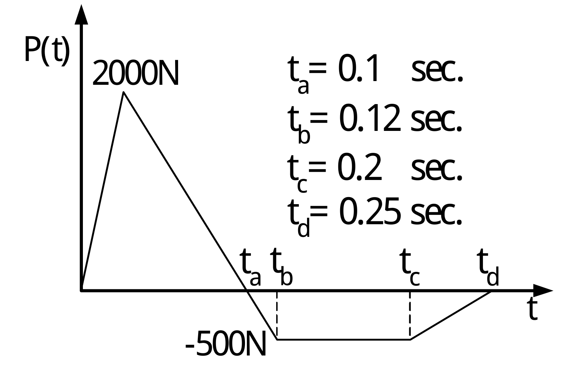

# SD-2003-2 題目正本

> 本檔只記錄考卷上寫了什麼、圖上畫了什麼，不含任何解法。解析見同資料夾 `SD-2003-2.md`。
> 判讀清單經使用者確認前，狀態為「待確認」；確認後本檔原則上不再修改（改動須回考卷原圖並記 log）。

| 項目 | 內容 |
|---|---|
| 考卷 | `raw/exams/SD-2003_結構動力分析與耐震設計.pdf`，第 1 頁（正面），第二題 |
| 考年 | 2003（民國九十二年）專技高考結構工程技師「結構動力分析與耐震設計」 |
| 配分 | 10 分 |
| 附圖 | `SD-2003-2-fig-1.png`（原證據圖，左側有游標雜訊）、`SD-2003-2-fig-2.png`（2026-11-15 由考卷 500 dpi 重新擷取） |
| 判讀狀態 | **已確認**（2026-11-15 使用者授權依 Claude 建議確認；影響答案項目定案：#1 峰值時刻採 0.02 s（下降段為同一直線，由 ta、tb、−500N 推得）。原轉錄：2026-11-15 轉錄；PyMuPDF 110／150 dpi 整頁＋450–500 dpi 局部放大，PDF 文字層與向量座標核對；盲讀於開啟解析前完成） |

## 1. 考卷原文（逐字）

二、考慮一單自由度動力系統，已知質量 $m$＝100kg，勁度 $k$＝100N/m，阻尼比 $\xi$＝30%。若該系統受到如圖所示之外力歷時，試計算最大位移。（10 分）

## 2. 考卷給的公式、附表與參數

- 考卷沒有給任何參考公式或附表。
- 圖上給：峰值 2000N、最小值 -500N；$t_a$= 0.1 sec.、$t_b$= 0.12 sec.、$t_c$= 0.2 sec.、$t_d$= 0.25 sec.
- 考卷沒有給：峰值 2000N 的發生時刻、初始條件（題文未寫靜止，通常解讀為由靜止開始）。
- 卷首注意事項：㈠不必抄題，作答時請將試題題號及答案依照順序寫在試卷上，於本試題上作答者，不予計分。㈡可以使用電子計算器，但需詳列解答過程。考試時間：二小時。

## 3. 附圖

*證據圖 SD-2003-2-fig-2.png（500 dpi 重擷取）*

圖面文字照錄：P(t)、2000N、-500N、t、ta tb tc td、ta= 0.1 sec.、tb= 0.12 sec.、tc= 0.2 sec.、td= 0.25 sec.

## 4. 判讀清單

| # | 項目 | 判讀 | 圖上／題文依據 | 把握 |
|---|---|---|---|---|
| 1 | 峰值時刻（未標註） | 下降段為**一條直線**通過 $t_a$ 延伸到 $t_b$（PDF 同一線段 (238.2,481.9)→(297.7,577.8)），斜率由 $t_a$、$t_b$、−500N 定為 −25000 N/s，故峰值時刻 = 0.1 − 2000/25000 = **0.02 s**；若依圖面時間軸比例量測約 0.025 s | PDF 向量座標：原點 x=221.9、$t_a$ 交點 x=285.9、峰值 x=238.2、$t_b$ x=297.7 | 不確定（影響答案）；建議採 0.02 s（題給數值決定的直線）；使用者授權依建議確認 |
| 2 | 0→峰值 | 由 t=0、P=0 直線上升至 2000N | 圖面 | 確定 |
| 3 | $t_a$ | 力穿越零的時刻 0.1 s（不是峰值結束、也不是負段開始的平台） | 圖面 $t_a$ 標在零交點 | 確定 |
| 4 | $t_a$→$t_b$ | 0 直線降到 −500N（與上一段同一直線） | 圖面 | 確定 |
| 5 | $t_b$→$t_c$ | 維持 −500N（虛線標 $t_b$、$t_c$） | 圖面 | 確定 |
| 6 | $t_c$→$t_d$ | 由 −500N 直線回到 0；$t>t_d$ 為自由振動 | 圖面 | 確定 |
| 7 | 系統參數 | $m=100$ kg、$k=100$ N/m、$\xi=30\%$（代 0.30） | 題文 | 確定 |
| 8 | 所求 | 最大位移（含強迫段與自由振動段的全歷時最大值） | 題文 | 確定（解讀） |
| 9 | 考卷沒有給 | 初始條件；峰值時刻 | 題文、圖面 | 確定 |

---
*轉錄：2026-11-15（SD-U1-3 題目正本推廣・批 1）*
*確認：2026-11-15 使用者授權依 Claude 建議確認（SD-U1-3 題目正本推廣・批 1，關卡一）*
