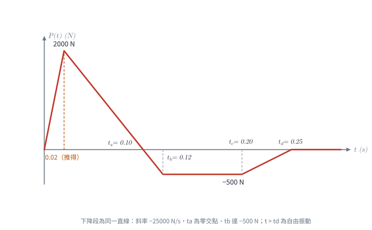
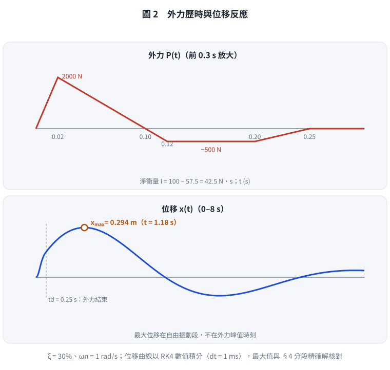

# 考題編號：SD-2003-2

**主分類：** `SD-U1` 結構動力學基礎  
**副分類：** —  
**分析方法：** SDOF 動力分析（Duhamel 積分 + 脈衝近似法）  
**標籤：** `SDOF` `Duhamel積分` `衝量動量定理` `最大位移` `分段線性外力` `阻尼自由振動` `脈衝近似`

---

## 1. 題目（考卷原文見題目正本）

> 考卷原文、公式／附表、附圖與判讀清單（已確認）見 [`SD-2003-2-problem.md`](SD-2003-2-problem.md)。本節只列解題時最容易讀錯的地方與本解使用的記號；題意以題目正本為準。

*重繪自考卷附圖，依題目正本判讀清單；本圖攔下的判讀錯誤：ta 是零交點而不是峰值時刻；峰值時刻考卷沒標，由下降直線推得 0.02 s。*

### 常見誤讀

| 項目 | 正確判讀 | 常見誤讀 |
|------|---------|---------|
| 峰值時刻 | 考卷未標；下降段為同一直線（斜率 $-500/0.02=-25000$ N/s），峰值在 $t=0.1-2000/25000=0.02$ s（判讀 #1，使用者授權依建議確認） | 把 $t_a=0.1$ s 當峰值時刻（本庫舊解 §1、§4 的讀法） |
| $t_a$ | 力的零交點 0.1 s | 峰值結束時刻 |
| $t_a\to t_b$ | 由 0 直線降到 −500 N（與上一段同一直線） | 由 2000 N 陡降到 −500 N |
| 所求 | 全歷時（含 $t>t_d$ 自由振動）的最大位移 | 只看強迫段 |

**本解記號：** $m=100$ kg、$k=100$ N/m、$\xi=0.30$、$\omega_n=1$ rad/s；$x(t)$ 為位移。

---

## 2. 考題核心精神與出題者意圖 (Core Concepts & Examiner's Intent)

本題核心：「**時域短脈衝作用下 SDOF 的最大位移**」

出題意圖：
- 考驗 Duhamel 積分的應用能力
- 考驗對「載重歷時遠短於自然週期」情形下的工程簡化判斷（脈衝近似）
- 考驗阻尼自由振動初始條件的計算

**核心觀察（解題前必判斷）：** $T_0 = 2\pi\,\text{s} \approx 6.28\,\text{s}$，而載重持續時間 $t_d = 0.25\,\text{s}$，比值 $t_d/T_0 \approx 4\%$，屬**短時脈衝**情形。

---

## 3. 解題戰略地圖與陷阱分析 (Strategic Roadmap & Trap Analysis)

**步驟路線：**

$$\omega_0,\,T_0,\,\omega_d \;\to\; \text{定外力折線（峰值時刻）} \;\to\; \text{總衝量 }I=\int F\,dt\text{（量級判斷）} \;\to\; \text{載重結束時 }x(t_d),\ \dot x(t_d)\text{（分段精確解）} \;\to\; \text{阻尼自由振動求極值}$$

**關鍵陷阱：**

**陷阱 1（讀圖）：** $t_a=0.1$ s 是外力的**零交點**，不是峰值時刻。峰值時刻考卷沒有標，下降段是同一條直線通過 $t_a$ 延伸到 $t_b$，斜率 $=-500/(0.12-0.1)=-25000$ N/s，峰值在 $t_p=0.1-2000/25000=0.02$ s（題目正本判讀 #1）。把 $t_a$ 當峰值會把正衝量多算 $15$ N·s 並少算 $5$ N·s 的負衝量。

**陷阱 2：** 見到 $k=100$ N/m、$F=2000$ N，誤以為靜變位 $F/k=20$ m 就是答案。短脈衝的動態位移遠小於靜變位。

**陷阱 3：** 忘記 $t_a\to t_d$ 的負力區段（$-5-40-12.5=-57.5$ N·s），只算正衝量而高估結果。

**陷阱 4：** 本題 $\xi=30\%$，阻尼器在載重期間就吸走可觀的動量（$c\,x(t_d)\approx9$ N·s），「$\dot x(t_d)\approx I/m$、$x(t_d)\approx\frac1m\int(t_d-\tau)F\,d\tau$」這種忽略彈簧與阻尼的運動學近似會高估約 26%（見 §5.1），要用分段精確解（或 Duhamel 積分）求載重結束時的狀態。

**陷阱 5：** 最大位移不在載重期間，而在自由振動段 $t\approx1.18$ s。

---

## 3.5 變數層次分析 (Variable Hierarchy Analysis)

> 複習提示：第一次解題後，在每個卡住的知識點旁標記 `⚠`；第二次複習時只看有 `⚠` 的項目。

### 最終目標
`SDOF 系統在分段線性短時外力下的最大位移`

### 本題關鍵公式（依計算順序）

$$\omega_0 = \sqrt{\frac{k}{m}}, \quad \omega_d = \omega_0\sqrt{1-\xi^2}$$

$$t_p = t_a - \frac{P_{max}}{|P_{min}|/(t_b-t_a)} \quad \text{（下降段同一直線推得峰值時刻）}$$

$$I = \int_0^{t_d} F(t)\,dt \quad \text{（各段三角形／矩形面積之和）}$$

$$m\ddot x + c\dot x + kx = F(t)\ \Rightarrow\ x(t_d),\ \dot x(t_d)\quad\text{（分段線性外力的精確解，逐段以前段終值為初始條件）}$$

$$x(\tau) = e^{-\xi\omega_0\tau}\!\left[A\cos(\omega_d\tau) + B\sin(\omega_d\tau)\right], \quad A=x(t_d),\ B = \frac{\dot{x}(t_d) + \xi\omega_0 A}{\omega_d}$$

$$\tan(\omega_d\tau^*) = \frac{B\omega_d - \xi\omega_0 A}{\xi\omega_0 B + A\omega_d} \quad \text{（極大值條件）}$$

$$\boxed{x_{max} = e^{-\xi\omega_0\tau^*}\!\left[A\cos(\omega_d\tau^*) + B\sin(\omega_d\tau^*)\right]}$$

### L1：題目直接給定

| 符號 | 數值 | 說明 |
|------|------|------|
| $m$ | $100\,\text{kg}$ | 系統質量 |
| $k$ | $100\,\text{N/m}$ | 系統勁度 |
| $\xi$ | $0.30$ | 阻尼比 |
| $t_a$ | $0.1\,\text{s}$ | 外力零交點（由正轉負） |
| $t_b$ | $0.12\,\text{s}$ | 外力達 $-500$ N |
| $t_c$ | $0.2\,\text{s}$ | $-500$ N 平台結束 |
| $t_d$ | $0.25\,\text{s}$ | 外力結束 |
| $P_{max}$ | $2000\,\text{N}$ | 峰值外力（發生時刻考卷未標） |
| $P_{min}$ | $-500\,\text{N}$ | 負向外力 |

### L2：需知識點推導

**Step 1 – 系統頻率**

| 符號 | 公式／來源 | 卡關? |
|------|-----------|-------|
| $\omega_0$ | $\sqrt{k/m} = \sqrt{100/100}$ | |
| $T_0$ | $2\pi/\omega_0$ | |
| $\omega_d$ | $\omega_0\sqrt{1-\xi^2}$ | |
| $c$ | $2\xi m\omega_0 = 60$ N·s/m | |

**Step 2 – 外力折線**

| 符號 | 公式／來源 | 卡關? |
|------|-----------|-------|
| 下降段斜率 | $-500/0.02=-25000$ N/s | |
| $t_p$ | $0.1-2000/25000=0.02$ s | |

**Step 3 – 各段衝量**

| 段 | 公式 | 卡關? |
|----|------|-------|
| $0\to t_p$ | $\frac12\times0.02\times2000$ | |
| $t_p\to t_a$ | $\frac12\times0.08\times2000$ | |
| $t_a\to t_b$ | $\frac12\times0.02\times(-500)$ | |
| $t_b\to t_c$ | $0.08\times(-500)$ | |
| $t_c\to t_d$ | $\frac12\times0.05\times(-500)$ | |

**Step 4 – 載重結束時的狀態（分段精確解）**

| 符號 | 公式／來源 | 卡關? |
|------|-----------|-------|
| $x(t_d)$、$\dot x(t_d)$ | 逐段解 $m\ddot x+c\dot x+kx=a+bt$，特解 $x_p=(a+bt)/k-cb/k^2$ | |

**Step 5 – 自由振動求最大位移**

| 符號 | 公式／來源 | 卡關? |
|------|-----------|-------|
| $A$、$B$ | $A=x(t_d)$、$B=(\dot x(t_d)+\xi\omega_0A)/\omega_d$ | |
| $\tau^*$ | $\arctan(\cdots)/\omega_d$ | |
| $x_{max}$ | 代入 $\tau^*$ | |

### L3：深層知識（不懂就卡住）

| 知識點 | 說明 | 卡關? |
|--------|------|-------|
| 圖上未標的量怎麼定 | 由同一直線上的已知點與斜率推得，不靠量尺 | |
| 衝量的正負 | 負力段產生負衝量 | |
| 何時可忽略彈簧與阻尼 | 須 $\omega_0 t_d\ll1$ **且** $\xi\omega_0 t_d\ll1$ 並看 $c\,x(t_d)$ 相對 $I$ 的大小；本題 $c\,x(t_d)\approx9$ N·s，約為 $I$ 的 21%，不可忽略 | |
| 分段線性外力的精確解 | 每段特解為線性函數，齊次解以前段終值配初始條件 | |
| 最大值時刻的求法 | $dx/d\tau=0$ | |

---

## 4. 步驟化詳細計算過程 (Step-by-Step Detailed Calculation)

### Step 1：系統參數

$$\omega_0 = \sqrt{\frac{k}{m}} = \sqrt{\frac{100}{100}} = 1.0\,\text{rad/s}, \qquad T_0 = 2\pi \approx 6.283\,\text{s}$$

$$\omega_d = 1.0\times\sqrt{1-0.30^2} = 0.9539\,\text{rad/s}, \qquad c = 2\xi m\omega_0 = 2\times0.30\times100\times1.0 = 60\,\text{N·s/m}$$

$t_d/T_0 = 0.25/6.283 \approx 4\%$：外力屬短時脈衝，最大位移會出現在載重結束後的自由振動段。

### Step 2：外力折線（峰值時刻）

下降段為同一條直線通過 $(t_a, 0)$ 與 $(t_b, -500)$：

$$\text{斜率} = \frac{-500-0}{0.12-0.10} = -25000\,\text{N/s}, \qquad t_p = 0.10 - \frac{2000}{25000} = 0.02\,\text{s}$$

折線節點：$(0,0)\to(0.02,2000)\to(0.10,0)\to(0.12,-500)\to(0.20,-500)\to(0.25,0)$。

### Step 3：總衝量

| 段 | 時間區間 | 形狀 | 計算 | 衝量 (N·s) |
|----|---------|------|------|------|
| 1 | $0\to0.02$ | 三角形 | $\frac12\times0.02\times2000$ | $+20$ |
| 2 | $0.02\to0.10$ | 三角形 | $\frac12\times0.08\times2000$ | $+80$ |
| 3 | $0.10\to0.12$ | 三角形 | $\frac12\times0.02\times(-500)$ | $-5$ |
| 4 | $0.12\to0.20$ | 矩形 | $0.08\times(-500)$ | $-40$ |
| 5 | $0.20\to0.25$ | 三角形 | $\frac12\times0.05\times(-500)$ | $-12.5$ |

$$I = 20 + 80 - 5 - 40 - 12.5 = 42.5\,\text{N·s}$$

（正衝量 100 N·s 只由 $2000$ N 與 $t_a=0.1$ s 決定，與峰值時刻無關；峰值時刻只改變正衝量作用的「重心」時間，所以峰值時刻取 0.02 s 或依圖面比例量的約 0.025 s，最大位移只差 0.1%。）

### Step 4：載重結束時的狀態

以分段線性外力的精確解（每段外力 $F=a+bt$，特解 $x_p=(a+bt)/k-cb/k^2$，齊次解以前段終值配初始條件）逐段推進到 $t_d=0.25$ s：

$$x(t_d) = 0.1501\,\text{m}, \qquad \dot x(t_d) = 0.3159\,\text{m/s}$$

量級檢核：若忽略彈簧與阻尼，$\dot x(t_d)\approx I/m=0.425$ m/s；兩者差 $0.109$ m/s，主要來自阻尼器在載重期間吸收的衝量 $\int c\,\dot x\,dt = c\,x(t_d)\approx 60\times0.150=9.0$ N·s（$0.090$ m/s），其餘為彈簧力衝量 $\int kx\,dt\approx1.9$ N·s。

### Step 5：載重結束後的阻尼自由振動

以 $\tau = t - t_d$ 為時間變數：

$$A = x(t_d) = 0.1501\,\text{m}, \qquad B = \frac{\dot x(t_d) + \xi\omega_0 A}{\omega_d} = \frac{0.3159 + 0.30\times1.0\times0.1501}{0.9539} = 0.3783\,\text{m}$$

### Step 6：求最大位移時刻 $\tau^*$

$$\tan(\omega_d\tau^*) = \frac{B\omega_d - \xi\omega_0 A}{\xi\omega_0 B + A\omega_d} = \frac{0.3783\times0.9539 - 0.30\times0.1501}{0.30\times0.3783 + 0.1501\times0.9539} = \frac{0.3159}{0.2567} = 1.2305$$

$$\omega_d\tau^* = 0.8884\,\text{rad}, \qquad \tau^* = 0.9313\,\text{s}$$

**（絕對時刻 $t = 0.25 + 0.93 = 1.18\,\text{s}$）**

### Step 7：計算最大位移

$$e^{-\xi\omega_0\tau^*} = e^{-0.30\times0.9313} = 0.7563$$

$$x_{max} = 0.7563\times\left[0.1501\cos(0.8884) + 0.3783\sin(0.8884)\right] = 0.7563\times\left[0.0947 + 0.2936\right]$$

$$\boxed{x_{max} \approx 0.294\,\text{m}\quad(t\approx1.18\ \text{s})}$$

**交叉驗算：** 以 `scipy.signal.lsim` 對全歷時（0–30 s）數值積分，最大位移 $0.2936$ m 發生於 $t=1.181$ s，與上式一致。

*圖 2　外力歷時與位移反應。峰值在 0.02 s、$t_a$ 是零交點；最大位移出現在外力結束後約 0.93 s，不在外力峰值時刻。*

---

## 5. 關鍵爭議點與進階探討 (Critical Issues & Advanced Discussion)

### 5.1 三種算法的比較

| 算法 | $x(t_d)$ | $\dot x(t_d)$ | $x_{max}$ | 與精確解差 |
|------|---------|---------|---------|---------|
| 分段精確解（本解） | 0.150 m | 0.316 m/s | **0.294 m** | — |
| 純衝量近似（$x_0=0$、$\dot x_0=I/m$） | 0 | 0.425 m/s | 0.285 m | −3% |
| 運動學近似（忽略彈簧與阻尼求 $x_0$、$\dot x_0$） | 0.163 m | 0.425 m/s | 0.370 m | +26% |

純衝量近似反而較準，是因為它同時漏掉了「載重期間的初位移」（使結果偏小）與「阻尼吸收的動量」（使結果偏大），兩者部分抵消；運動學近似只補了前者，所以偏大。高阻尼（$\xi=30\%$）系統要用精確解或 Duhamel 積分。

### 5.2 本庫舊解的讀法（對照）

舊解把 $t_a=0.1$ s 讀成峰值時刻（0→0.1 s 升到 2000 N、0.1→0.12 s 由 2000 N 陡降到 −500 N），淨衝量變成 62.5 N·s，再用運動學近似得 $x_{max}\approx0.50$ m。同一錯誤讀法下以精確解計算為 0.423 m，可見舊答案同時含讀圖錯誤（+44%）與近似誤差（+18%）。

### 5.3 靜力位移 vs 動力位移

靜力位移 $x_{st} = P_{max}/k = 2000/100 = 20\,\text{m}$；動力位移 $x_{max} \approx 0.294\,\text{m}$，比值約 0.015。外力作用時間遠短於週期，結構「來不及」反應，動態位移遠低於靜態值。

*修正日期：2026-11-15（§1 改為指向題目正本，重繪附圖 figs/SD-2003-2-fig-1-problem.svg）*

*修正日期：2026-11-15（FIX-SD-U1-3-B1 解析勘誤（判讀＋觀念）：峰值時刻由誤讀的 ta＝0.1 s 改為由下降直線推得的 0.02 s，淨衝量 62.5→42.5 N·s；載重結束狀態改用分段精確解（舊解的運動學近似忽略 ξ＝30% 阻尼吸收的衝量）；最大位移 0.50 m → 0.294 m；改寫 §3、§3.5、§4、§5。驗證：scripts/fixes/2026-11-15_verify_SD-2003-2.py 分段精確解與 lsim 全歷時數值積分一致，MISMATCHES: 0；與盲解比對紀錄 0.2936 m 一致）*

*圖解補繪：2026-11-15（向量圖，腳本 `gen_SD-2003-2.py`，可重跑；非勘誤、答案不變）*
