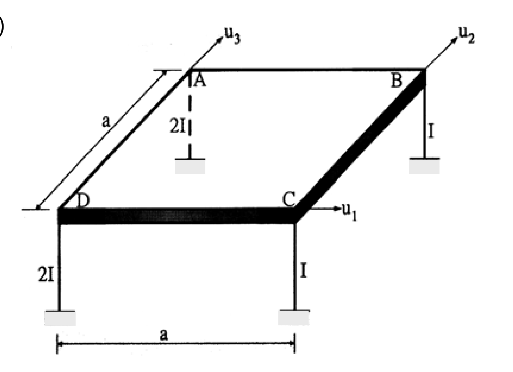

# SD-2003-4 題目正本

> 本檔只記錄考卷上寫了什麼、圖上畫了什麼，不含任何解法。解析見同資料夾 `SD-2003-4.md`。
> 判讀清單經使用者確認前，狀態為「待確認」；確認後本檔原則上不再修改（改動須回考卷原圖並記 log）。

| 項目 | 內容 |
|---|---|
| 考卷 | `raw/exams/SD-2003_結構動力分析與耐震設計.pdf`，第 2 頁（背面）上半，第四題 |
| 考年 | 2003（民國92年）專技高考結構工程技師「結構動力分析與耐震設計」 |
| 配分 | 20 分 |
| 附圖 | `SD-2003-4-fig-1.png`（舊擷取，DC 梁中央有滑鼠游標）、`SD-2003-4-fig-2.png`（2026-11-16 由考卷 500 dpi 重擷取） |
| 判讀狀態 | **已確認（2026-11-16，使用者授權依 Claude 建議）**（2026-11-16 轉錄；PyMuPDF 110 dpi 整頁＋400–500 dpi 局部放大，PDF 文字層核對原文；附圖為嵌入點陣圖；盲讀於開啟解析前完成） |

## 1. 考卷原文（逐字）

四、如圖所示之單層立體構架，樓版為剛性，其質量為 $m$ 且均勻分佈，四根圓柱材質（楊氏係數 $E$）與長度($h$)皆相同，斷面二次矩如圖示。該結構受到沿 $DB$ 方向之水平地震時，其運動方程式可寫為：$\mathbf{M}\ddot{\mathbf{U}}+\mathbf{K}\mathbf{U}=-\mathbf{M}\mathbf{e}\ddot{u}_g$，其中，$\mathbf{M}$ 及 $\mathbf{K}$ 分別為質量及勁度矩陣，$\mathbf{U}$ 為相對於地表之位移向量(分量按 $u_1$、$u_2$、$u_3$ 排列)，$\ddot{u}_g$ 為地表加速度歷時。不計柱之質量，試推求 $\mathbf{K}$ 及 $\mathbf{M}$ 的第二行(column)係數(即 $k_{12}$、$k_{22}$、$k_{32}$ 及 $m_{12}$、$m_{22}$、$m_{32}$)以及 $\mathbf{e}$ 向量。（20 分）

（考卷文字層的雙點符號因字型顯示為「&&」，影像上為 $\ddot{\mathbf{U}}$、$\ddot{u}_g$。）

## 2. 考卷給的公式、附表與參數

- 考卷給的式子：運動方程式 $\mathbf{M}\ddot{\mathbf{U}}+\mathbf{K}\mathbf{U}=-\mathbf{M}\mathbf{e}\ddot{u}_g$（題文）。
- 給定（全為符號）：樓版質量 $m$（均勻分佈、剛性）；四根圓柱同 $E$、同長 $h$；斷面二次矩：$A$、$D$ 柱 $2I$，$B$、$C$ 柱 $I$（圖上）；平面兩邊長皆 $a$（圖上）。
- 考卷沒有給：任何數值；柱端束制條件（柱頂、柱底是否固接，只畫了柱底支承符號）；樓版厚度；阻尼。
- 卷首注意事項：不必抄題，作答時請將試題題號及答案依照順序寫在試卷上，於本試題上作答者，不予計分。可以使用電子計算器，但需詳列解答過程。考試時間：二小時。

## 3. 附圖

*證據圖 SD-2003-4-fig-2.png（500 dpi 重擷取；舊圖 SD-2003-4-fig-1.png 內容相同，DC 梁中央有游標）*

圖面文字照錄：u3、u2、A、B、a、2I、I、D、C、u1、2I、I、a

## 4. 判讀清單

| # | 項目 | 判讀 | 圖上／題文依據 | 把握 |
|---|---|---|---|---|
| 1 | 柱端束制 | 柱底固接（橫線＋灰塊為固定支承）、柱頂與剛性樓版剛接，每柱任一水平方向側向勁度 $12EI_i/h^3$ | 柱底符號為實心底座（非鉸三角）；題文「樓版為剛性」 | 不確定（解讀，影響答案）；定案：兩端固接（$12EI/h^3$），理由：圖上無鉸符號、剛性樓版題型的標準假設（Chopra 同型例題）。若取柱頂鉸接則係數改為 3，比例不變 |
| 2 | 粗黑線 $DC$、$CB$ | 僅為立體圖前緣強調（或表示邊梁），不改變力學模型；樓版整體為剛性 | 題文「樓版為剛性」；圖上無其他說明 | 不確定（解讀）；定案：不影響答案 |
| 3 | 平面幾何 | 正方形 $a\times a$：$D$ 左前、$C$ 右前、$B$ 右後、$A$ 左後；$DC\parallel AB$（記為 $x$ 向）、$DA\parallel CB$（記為 $y$ 向） | 兩條尺寸線皆標 $a$（沿 DC、沿 DA）；斜投影平行四邊形 | 確定（解讀） |
| 4 | 自由度 $u_1$ | $C$ 點沿 $DC$ 方向（$x$）的平移 | 圖上 C 點水平箭頭 u1 | 確定 |
| 5 | 自由度 $u_2$ | $B$ 點沿 $CB$ 方向（$y$，由前往後）的平移 | 圖上 B 點斜箭頭 u2，與 CB 平行 | 確定 |
| 6 | 自由度 $u_3$ | $A$ 點沿 $DA$ 方向（$y$，由前往後）的平移；$u_2$、$u_3$ 兩個 $y$ 向平移合起來描述樓版的 $y$ 向平移與扭轉 | 圖上 A 點斜箭頭 u3，與 DA 平行 | 確定 |
| 7 | 柱斷面 | $A$、$D$ 柱 $2I$；$B$、$C$ 柱 $I$；圓柱 → 兩個方向 $I$ 相同 | 圖上柱旁標字；題文「四根圓柱」 | 確定 |
| 8 | 地震方向 | 沿 $DB$ 對角線方向（$D\to B$，與 $x$、$y$ 各成 45°）的水平地表運動 | 題文「沿 DB 方向之水平地震」 | 確定（解讀，正向取 D→B） |
| 9 | 質量 | 樓版質量 $m$ 均勻分佈於 $a\times a$ 正方形；柱質量不計 | 題文 | 確定 |
| 10 | 所求 | $\mathbf{K}$ 第二行 $k_{12},k_{22},k_{32}$、$\mathbf{M}$ 第二行 $m_{12},m_{22},m_{32}$、$\mathbf{e}$ 向量 | 題文 | 確定 |
| 11 | 考卷沒有給 | 數值、柱扭轉勁度、軸向變形、阻尼 | 題文 | 確定 |

---
*轉錄：2026-11-16（SD-U1-2 題目正本推廣・組 U1-2-G1）*
*確認：2026-11-16 使用者授權依 Claude 建議確認（SD-U1-2 題目正本推廣・組 U1-2-G1，關卡一）*
