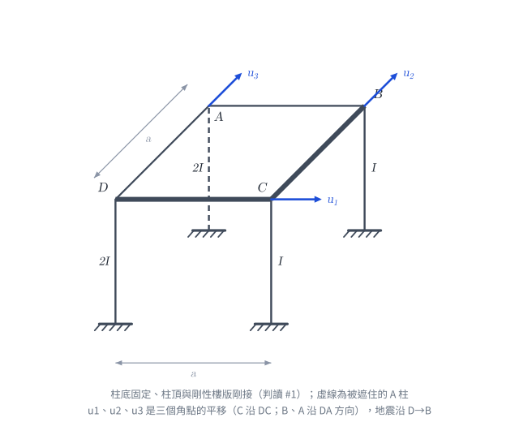
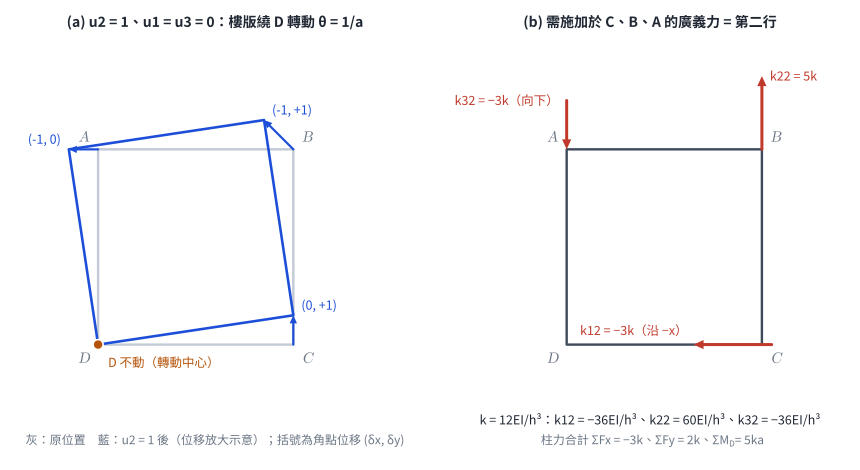

# 考題編號：SD-2003-4

**主分類：** `SD-U1-2` 運動方程式推導  
**副分類：** `SD-U1-3` 多自由度系統之動態分析  
**分析方法：** MDOF 模態分析（剛性樓版 3DOF 系統）  
**標籤：** `3DOF` `剛性樓版` `勁度矩陣` `質量矩陣` `偏心` `剛心偏移` `3D框架` `立體構架` `激振向量`

---

## 1. 題目（考卷原文見題目正本）

> 考卷原文、公式／附表、附圖與判讀清單（已確認）見 [`SD-2003-4-problem.md`](SD-2003-4-problem.md)。本節只列解題時最容易讀錯的地方與本解使用的記號；題意以題目正本為準。

*重繪自考卷附圖，依題目正本判讀清單；本圖攔下的判讀錯誤：u1、u2、u3 是三個角點的平移（C、B、A），不是質心 x、y 平移與扭轉角。*

### 常見誤讀

| 項目 | 正確判讀 | 常見誤讀 |
|------|---------|---------|
| 自由度 | $u_1$＝C 點沿 DC（$x$）平移、$u_2$＝B 點沿 CB（$y$）平移、$u_3$＝A 點沿 DA（$y$）平移（判讀 #4–#6） | 本庫舊解 §1：$u_1$、$u_2$ 為質心 $x$、$y$ 平移，$u_3$ 為繞鉛直軸的扭轉角 |
| 柱端 | 柱底固定、柱頂與剛性樓版剛接，$12EI_i/h^3$（判讀 #1，定案） | 柱頂鉸接（係數 3） |
| 粗黑線 DC、CB | 立體圖前緣強調，樓版整體剛性（判讀 #2） | 當成較剛的梁、其餘邊可變形 |
| 地震方向 | 沿 D→B 對角線（判讀 #8） | 沿 DC 或 CB 單一方向 |

**本解記號：** $k=12EI/h^3$（單根 $I$ 柱的側向勁度）；平面座標原點可取樓版中心，$x$ 沿 DC、$y$ 沿 DA。

---

## 2. 考題核心精神與出題者意圖 (Core Concepts & Examiner's Intent)

本題核心：「剛性樓版用**角點平移**當自由度時，怎麼建 $\mathbf K$、$\mathbf M$ 與影響向量 $\mathbf e$」

- 剛性樓版只有三個平面運動（$x$、$y$ 平移與扭轉），但題目指定的三個自由度是三個角點的平移：$u_1$＝C 點沿 DC、$u_2$＝B 點沿 CB、$u_3$＝A 點沿 DA（題目正本判讀 #4–#6）。考的是能不能把「角點平移」換算成樓版的剛體運動。
- 用角點自由度時，**質量矩陣不再是對角矩陣**（$m_{12}$、$m_{32}\neq 0$），影響向量 $\mathbf e$ 的三個分量也都不為零——這正是出題者只問「第二行」與 $\mathbf e$ 的用意：答案和「質心自由度」的直覺完全不同。
- 左側柱（D、A，$2I$）比右側柱（B、C，$I$）硬，剛心偏左，平移與扭轉耦合；在角點自由度下，這個耦合反映在 $\mathbf K$ 的每一個非對角項。

---

## 3. 解題戰略地圖與陷阱分析 (Strategic Roadmap & Trap Analysis)

**步驟路線：**

$$\text{角點自由度}\to\text{樓版剛體運動 }(u_x,u_y,\theta)\to u_2=1\text{ 的變形（繞 D 轉動）}\to\text{各柱力}\to k_{i2}\;;\;\text{慣性力}\to m_{i2}\;;\;\text{剛體位移}\to\mathbf e$$

**關鍵陷阱：**

**陷阱 1（判讀）：** $u_3$ 是 A 點沿 DA 的**平移**，不是扭轉角；$u_1$、$u_2$ 也不是質心平移。圖上三個箭頭分別畫在 C、B、A 三個角點（題目正本判讀 #4–#6）。

**陷阱 2：** 令 $u_2=1$、$u_1=u_3=0$ 時，C 點 $x$ 向不動、A 點 $y$ 向不動，再加上 D 點本身的約束條件，整塊樓版是**繞 D 點轉動** $\theta=1/a$（D 完全不動）。這一步看懂，第二行係數就能用平衡直接寫出來。

**陷阱 3：** 質量矩陣在角點自由度下**有非對角項**：$m_{12}=-m/2$、$m_{32}=-m/6$。只有質心自由度（$x$、$y$、$\theta$ 且原點在質心）才是對角矩陣。

**陷阱 4：** $\mathbf e$ 是「地表沿 DB 單位位移時各自由度的剛體位移」。三個自由度都是平移且方向都有 DB 的分量，所以 $\mathbf e=\frac{1}{\sqrt2}\{1,1,1\}^T$，**沒有任何一項是 0**（質心自由度下扭轉分量才是 0）。

**陷阱 5：** 圓柱 → 兩方向 $I$ 相同；柱兩端固接（柱底固定、柱頂與剛性樓版剛接；題目正本判讀 #1）→ $k_i=12EI_i/h^3$，不是懸臂 $3EI/h^3$。

---

## 3.5 變數層次分析 (Variable Hierarchy Analysis)

> 複習提示：第一次解題後，在每個卡住的知識點旁標記 `⚠`；第二次複習時只看有 `⚠` 的項目。

### 最終目標
`以角點平移 u1、u2、u3 為自由度，求 K、M 的第二行與影響向量 e`

### 本題關鍵公式（依計算順序）

$$k_i=\frac{12EI_i}{h^3},\qquad k\equiv\frac{12EI}{h^3}\;(\text{D、A 柱 }2k\text{，B、C 柱 }k)$$

$$\theta=\frac{u_2-u_3}{a},\qquad u_y=\frac{u_2+u_3}{2},\qquad u_x=u_1-\frac{u_2-u_3}{2}\quad(\text{原點在樓版中心})$$

$$u_2=1,\;u_1=u_3=0\;\Rightarrow\;\text{繞 D 轉動 }\theta=\tfrac1a$$

$$J_G=\frac{m(a^2+a^2)}{12}=\frac{ma^2}{6}$$

$$\mathbf e=\frac{1}{\sqrt2}\{1,\;1,\;1\}^T$$

### L1：題目直接給定

| 符號 | 數值 | 說明 |
|------|------|------|
| $E$、$h$ | 符號 | 四柱相同 |
| $I_D=I_A$ | $2I$ | 左側柱（圖上） |
| $I_B=I_C$ | $I$ | 右側柱（圖上） |
| $a$ | 符號 | 正方形平面邊長（兩條尺寸線） |
| $m$ | 符號 | 樓版質量，均勻分佈、剛性 |
| 自由度 | $u_1$（C，沿 DC）、$u_2$（B，沿 CB）、$u_3$（A，沿 DA） | 圖上三個角點箭頭 |
| 地震方向 | 沿 D→B | 與 DC、DA 各成 45° |

### L2：需知識點推導

**柱側向勁度**

| 符號 | 公式／來源 | 卡關? |
|------|-----------|-------|
| 兩端固接柱 | $k_i=12EI_i/h^3$（圓柱，兩方向相同） | |
| $k_D=k_A$ | $2k=24EI/h^3$ | |
| $k_B=k_C$ | $k=12EI/h^3$ | |

**角點自由度 ↔ 剛體運動**

| 符號 | 公式／來源 | 卡關? |
|------|-----------|-------|
| 扭轉角 $\theta$ | $(u_2-u_3)/a$（B、A 兩點 $y$ 向位移差除以間距） | |
| $u_y$ | $(u_2+u_3)/2$ | |
| $u_x$ | $u_1-\theta a/2$（C 點在 $y=-a/2$，$u_{x,C}=u_x+\theta a/2$） | |
| $u_2=1$ 的運動 | 繞 D 轉 $1/a$：A 位移 $(-1,0)$、B $(-1,1)$、C $(0,1)$、D $(0,0)$ | ⚠ |

**第二行係數**

| 符號 | 公式／來源 | 卡關? |
|------|-----------|-------|
| $k_{12}$ | 各柱 $x$ 向力總和 $=-3k$ | |
| $k_{22}$ | 對 D 取力矩 $\div a$ $=5k$ | |
| $k_{32}$ | $y$ 向力總和 $-k_{22}=2k-5k=-3k$ | |
| $m_{12}$、$m_{22}$、$m_{32}$ | 同上，用慣性力 $m\,\mathbf a_G$ 與 $J_G\ddot\theta$ | |

### L3：深層知識（不懂就卡住）

| 知識點 | 說明 | 卡關? |
|--------|------|-------|
| 自由度可以任選 | 只要三個量能唯一決定剛性樓版的平面運動即可；選法不同，$\mathbf K$、$\mathbf M$、$\mathbf e$ 的長相就不同，但描述同一個物理系統（以 $\mathbf T^T\mathbf K_c\mathbf T$ 互換） | |
| $\mathbf M$ 為何不是對角 | 角點平移的加速度會同時造成質心平移與轉動加速度，慣性力投影到其他自由度 | |
| $k_{ij}$ 的定義 | 只讓 $u_j=1$、其餘自由度為 0 時，**在自由度 $i$ 的位置、方向**需施加的力 | |
| $\mathbf e$ 的定義 | 地表沿地震方向單位位移時，各自由度的剛體位移 | |

---

## 4. 步驟化詳細計算過程 (Step-by-Step Detailed Calculation)

### Step 1：各柱側向勁度

各柱兩端固接（柱底固定，柱頂與剛性樓版剛接；題目正本判讀 #1），圓柱兩方向 $I$ 相同：

$$k_i=\frac{12EI_i}{h^3},\qquad k\equiv\frac{12EI}{h^3}$$

以 D 為原點、$x$ 沿 DC、$y$ 沿 DA：

| 柱 | 座標（相對 D） | $I_i$ | $k_i$ |
|----|---------------|-------|-------|
| D | $(0,0)$ | $2I$ | $2k$ |
| A | $(0,a)$ | $2I$ | $2k$ |
| B | $(a,a)$ | $I$ | $k$ |
| C | $(a,0)$ | $I$ | $k$ |

### Step 2：$u_2=1$（$u_1=u_3=0$）時樓版怎麼動

- $u_1=0$：C 點 $x$ 向不動；$u_3=0$：A 點 $y$ 向不動；$u_2=1$：B 點 $y$ 向移動 1。
- 由 $\theta=(u_2-u_3)/a=1/a$、$u_y=1/2$、$u_x=-1/2$（中心原點）可算出 D 點位移 $(u_x+\theta a/2,\;u_y-\theta a/2)=(0,0)$——**樓版繞 D 點轉動 $\theta=1/a$**。
- 各角點位移 $\boldsymbol\delta=\theta\,(-y,\;x)$（相對 D）：

| 柱 | 位移 $(\delta_x,\delta_y)$ | 柱力 $k_i\boldsymbol\delta$（樓版須施加） |
|----|--------------------------|-----------------------------|
| D | $(0,0)$ | $(0,0)$ |
| A | $(-1,0)$ | $(-2k,0)$ |
| B | $(-1,1)$ | $(-k,k)$ |
| C | $(0,1)$ | $(0,k)$ |

### Step 3：勁度矩陣第二行

廣義力 $P_1$ 作用在 C 點沿 $x$、$P_2$ 在 B 點沿 $y$、$P_3$ 在 A 點沿 $y$，三者須與柱力合力等值：

$$\sum F_x:\;P_1=-2k-k=-3k$$

$$\sum M_D:\;a\,P_2=\underbrace{2ka}_{A}+\underbrace{2ka}_{B}+\underbrace{ka}_{C}=5ka\;\Rightarrow\;P_2=5k$$

（A 力 $(-2k,0)$ 在 $(0,a)$：$-a(-2k)=2ka$；B 力 $(-k,k)$ 在 $(a,a)$：$ak-a(-k)=2ka$；C 力 $(0,k)$ 在 $(a,0)$：$ka$；$P_1$、$P_3$ 對 D 的力臂為 0。）

$$\sum F_y:\;P_2+P_3=k+k=2k\;\Rightarrow\;P_3=-3k$$

$$\boxed{k_{12}=-\frac{36EI}{h^3},\qquad k_{22}=\frac{60EI}{h^3},\qquad k_{32}=-\frac{36EI}{h^3}}$$

*圖 2　勁度矩陣第二行的物理意義：$u_2$ 是 B 點平移（不是質心 $y$），令 $u_2=1$、$u_1=u_3=0$ 時樓版繞 D 轉動，第二行就是此時 C、B、A 三處需施加的力。*

### Step 4：質量矩陣第二行

令 $\ddot u_2=1$（$\ddot u_1=\ddot u_3=0$）：樓版繞 D 有角加速度 $\ddot\theta=1/a$。質心 G 在 $(a/2,a/2)$：

$$\mathbf a_G=\ddot\theta\,(-y_G,\;x_G)=\left(-\tfrac12,\;\tfrac12\right),\qquad J_G\ddot\theta=\frac{ma^2}{6}\cdot\frac1a=\frac{ma}{6}$$

慣性力合力 $m\mathbf a_G=(-m/2,\;m/2)$ 作用於 G，外加力矩 $ma/6$：

$$\sum F_x:\;Q_1=-\frac m2$$

$$\sum M_D:\;a\,Q_2=\frac a2\cdot\frac m2-\frac a2\cdot\left(-\frac m2\right)+\frac{ma}{6}=\frac{2ma}{3}\;\Rightarrow\;Q_2=\frac{2m}{3}$$

$$\sum F_y:\;Q_2+Q_3=\frac m2\;\Rightarrow\;Q_3=-\frac m6$$

$$\boxed{m_{12}=-\frac m2,\qquad m_{22}=\frac{2m}{3},\qquad m_{32}=-\frac m6}$$

### Step 5：影響向量 $\mathbf e$

地表沿 D→B 單位位移 $\hat{\mathbf n}=(1/\sqrt2,\;1/\sqrt2)$，樓版隨之剛體平移，各自由度位移為 $\hat{\mathbf n}$ 在其方向上的分量：

- $e_1$：C 點沿 $x$ → $1/\sqrt2$
- $e_2$：B 點沿 $y$ → $1/\sqrt2$
- $e_3$：A 點沿 $y$ → $1/\sqrt2$

$$\boxed{\mathbf e=\frac{1}{\sqrt2}\begin{Bmatrix}1\\1\\1\end{Bmatrix}}$$

### Step 6：交叉驗算（第二條路徑：質心座標轉換）

以樓版中心為原點、質心自由度 $\mathbf q=\{u_x,u_y,\theta\}^T$ 時：

$$\mathbf K_c=k\begin{bmatrix}6&0&0\\0&6&-a\\0&-a&3a^2\end{bmatrix},\qquad \mathbf M_c=\mathrm{diag}\!\left(m,\;m,\;\frac{ma^2}{6}\right)$$

（剛心在 $x=-a/6$，故 $y$ 平移與扭轉耦合。）角點與質心自由度的關係 $\mathbf q=\mathbf T\mathbf u$：

$$\mathbf T=\begin{bmatrix}1&-\tfrac12&\tfrac12\\0&\tfrac12&\tfrac12\\0&\tfrac1a&-\tfrac1a\end{bmatrix}$$

$\mathbf K=\mathbf T^T\mathbf K_c\mathbf T$、$\mathbf M=\mathbf T^T\mathbf M_c\mathbf T$ 的第二行與 Step 3、4 完全相同；$\mathbf T\mathbf e=\{1/\sqrt2,1/\sqrt2,0\}^T$ 正是質心自由度下的影響向量。驗算腳本 `SD/scripts/fixes/2026-11-16_verify_SD-2003-4.py`（能量法、座標轉換、平衡法三路一致，MISMATCHES: 0）。

---

## 5. 關鍵爭議點與進階探討 (Critical Issues & Advanced Discussion)

### 5.1 完整矩陣

$$\mathbf K=\frac{12EI}{h^3}\begin{bmatrix}6&-3&3\\-3&5&-3\\3&-3&7\end{bmatrix},\qquad \mathbf M=m\begin{bmatrix}1&-\tfrac12&\tfrac12\\-\tfrac12&\tfrac23&-\tfrac16\\\tfrac12&-\tfrac16&\tfrac23\end{bmatrix}$$

兩者皆對稱；角點自由度下沒有任何一個自由度與其他解耦。

### 5.2 與質心自由度答案的對照（本庫舊解）

本庫舊解把 $u_1$、$u_2$ 當成質心 $x$、$y$ 平移、$u_3$ 當成扭轉角，得 $k_{12}=0$、$k_{22}=72EI/h^3$、$k_{32}=-12EIa/h^3$；$m_{12}=0$、$m_{22}=m$、$m_{32}=0$；$\mathbf e=\{1/\sqrt2,1/\sqrt2,0\}^T$。那組矩陣就是上面的 $\mathbf K_c$、$\mathbf M_c$，力學本身沒錯，但**不是題目指定的自由度**——考卷圖上三個箭頭分別畫在 C、B、A 三個角點，且都是平移箭頭。

### 5.3 一個有趣的結果：$(\mathbf M\mathbf e)_2=0$

$$(\mathbf M\mathbf e)_2=\frac{m}{\sqrt2}\left(-\frac12+\frac23-\frac16\right)=0$$

DB 向地震引起的有效地震力在 $u_2$ 方程式中為零：地表剛體平移時，樓版慣性力的合力 $m\ddot u_g$ 沿 DB 方向、作用於質心 G，而 G 就在對角線 DB 上，所以這個合力**通過 D 點**、對 D 的力矩為零。三個廣義力中只有 $P_2$（B 點沿 $y$）對 D 有力臂，故 $P_2$ 方向的有效地震力為零。這不代表 B 點不動——$u_2$ 仍經由 $\mathbf K$、$\mathbf M$ 的耦合項被激起。

### 5.4 柱端條件

若柱頂改為鉸接，$k_i=3EI_i/h^3$，所有 $k_{ij}$ 乘以 $1/4$，比例不變；$\mathbf M$、$\mathbf e$ 不受影響。

*修正日期：2026-11-16（§1 改為指向題目正本，重繪附圖 figs/SD-2003-4-fig-1-problem.svg；§1 標註題意與本解不符，待階段 C 勘誤）*

*修正日期：2026-11-16（FIX-SD-U1-2-G1 解析勘誤（判讀：自由度定義）：考卷 u1、u2、u3 為角點 C、B、A 的平移，舊解誤作質心 x、y 與扭轉角；k12、k22、k32 由 0、72EI/h³、−12EIa/h³ 改為 −36EI/h³、60EI/h³、−36EI/h³；m12、m22、m32 由 0、m、0 改為 −m/2、2m/3、−m/6；e 由 {1,1,0}/√2 改為 {1,1,1}/√2；§2–§5 全文改寫，舊值移 §5.2 對照；移除 §1 待勘誤警示；標頭主分類 SD-U1 改 SD-U1-2（非勘誤，依索引）。證據：2003 年第 2 頁第四題附圖（500 dpi，三個平移箭頭分別在 C、B、A）。驗證：scripts/fixes/2026-11-16_verify_SD-2003-4.py 能量法、座標轉換、平衡法三路一致，MISMATCHES: 0；與盲解比對一致）*

*修正日期：2026-11-16（非勘誤）圖解補繪：figs/SD-2003-4-fig-2-u2-unit.svg（腳本 gen_SD-2003-4.py，數值取自已驗證正本）*
