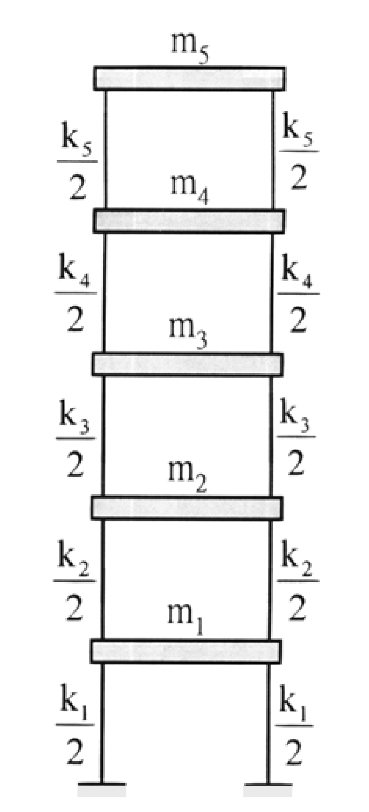

# SD-2003-5 題目正本

> 本檔只記錄考卷上寫了什麼、圖上畫了什麼，不含任何解法。解析見同資料夾 `SD-2003-5.md`。
> 判讀清單經使用者確認前，狀態為「待確認」；確認後本檔原則上不再修改（改動須回考卷原圖並記 log）。

| 項目 | 內容 |
|---|---|
| 考卷 | `raw/exams/SD-2003_結構動力分析與耐震設計.pdf`，第 2 頁（背面），第五題 |
| 考年 | 2003（民國九十二年）專技高考結構工程技師「結構動力分析與耐震設計」 |
| 配分 | 20 分 |
| 附圖 | `SD-2003-5-fig-1.png`（原證據圖，旁有游標雜訊）、`SD-2003-5-fig-2.png`（2026-11-15 由考卷 500 dpi 重新擷取） |
| 判讀狀態 | **已確認**（2026-11-15 使用者授權依 Claude 建議確認。原轉錄：2026-11-15 轉錄；PyMuPDF 110／150 dpi 整頁＋450–500 dpi 局部放大，PDF 文字層與向量座標核對；盲讀於開啟解析前完成） |

## 1. 考卷原文（逐字）

五、考慮下圖之五層樓剪力屋架，各層樓版之質量皆為5000kg，柱之質量不計，樓層勁度為：$k_1=k_2=5\times10^{6}$N/m, $k_3=k_4=k_5=3\times10^{6}$N/m。已知某組側力作用下之“層間”變位為：$\delta_1=6$mm，$\delta_2=5.6$mm，$\delta_3=8$mm，$\delta_4=6$mm，$\delta_5=3.333$mm。則此組側力為何？利用此變形配合雷利法(Rayleigh method)所得之基本振動週期值為何？若以此變形所對應的樓層位移近似第一振態，則對應之有效質量為何？（20 分）

## 2. 考卷給的公式、附表與參數

- 考卷沒有給任何參考公式或附表。
- 給定：五層各層質量 5000 kg；$k_1=k_2=5\times10^{6}$ N/m、$k_3=k_4=k_5=3\times10^{6}$ N/m；層間變位 $\delta_1\ldots\delta_5$ = 6、5.6、8、6、3.333 mm。
- 考卷沒有給：樓高（不需要）、阻尼。
- 卷首注意事項：㈠不必抄題，作答時請將試題題號及答案依照順序寫在試卷上，於本試題上作答者，不予計分。㈡可以使用電子計算器，但需詳列解答過程。考試時間：二小時。

## 3. 附圖

*證據圖 SD-2003-5-fig-2.png（500 dpi 重擷取）*

圖面文字照錄：m5、m4、m3、m2、m1；k5/2、k4/2、k3/2、k2/2、k1/2（左右各一）

## 4. 判讀清單

| # | 項目 | 判讀 | 圖上／題文依據 | 把握 |
|---|---|---|---|---|
| 1 | 樓層勁度 | $k_i$ 為第 i 層樓層勁度（兩柱各 $k_i/2$ 合計 $k_i$），不是每根柱勁度 | 圖上每柱標 $k_i/2$ | 確定 |
| 2 | 樓層編號 | 由下往上 1→5（$m_1$ 為二樓樓版、$k_1$ 為一樓柱） | 圖面標籤位置 | 確定 |
| 3 | 變位性質 | 題文加引號「層間」變位：$\delta_i$ 為第 i 層層間位移，不是樓層位移 | 題文引號 | 確定 |
| 4 | $\delta_5$ | 3.333 mm（照錄小數，無分數記號） | 題文 | 確定 |
| 5 | 質量 | 各層 5000 kg，柱質量不計 | 題文 | 確定 |
| 6 | 所求 | ㈠此組側力（各層）㈡雷利法基本週期 ㈢以此樓層位移近似第一振態時之有效質量 | 題文 | 確定 |

---
*轉錄：2026-11-15（SD-U1-3 題目正本推廣・批 1）*
*確認：2026-11-15 使用者授權依 Claude 建議確認（SD-U1-3 題目正本推廣・批 1，關卡一）*
