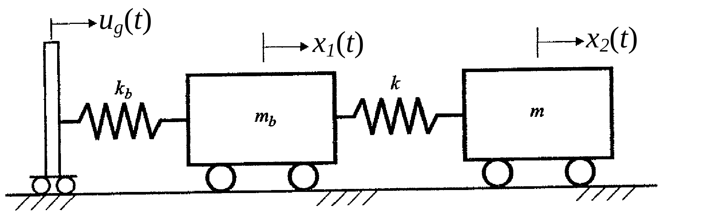

# SD-2004-2 題目正本

> 本檔只記錄考卷上寫了什麼、圖上畫了什麼，不含任何解法。解析見同資料夾 `SD-2004-2.md`。
> 判讀清單經使用者確認前，狀態為「待確認」；確認後本檔原則上不再修改（改動須回考卷原圖並記 log）。

| 項目 | 內容 |
|---|---|
| 考卷 | `raw/exams/SD-2004_結構動力分析與耐震設計.pdf`，第 1 頁（正面），第二題 |
| 考年 | 2004（民國93年）專技高考結構工程技師「結構動力分析與耐震設計」 |
| 配分 | 15 分 |
| 附圖 | `SD-2004-2-fig-1.png`（舊擷取，u_g(t) 標籤上有滑鼠游標）、`SD-2004-2-fig-2.png`（2026-11-16 由考卷 500 dpi 重擷取） |
| 判讀狀態 | **已確認**（2026-11-16，使用者授權依 Claude 建議。原轉錄：2026-11-16 轉錄；PyMuPDF 110 dpi 整頁＋500 dpi 局部放大，PDF 文字層核對原文；盲讀於開啟解析前完成） |

## 1. 考卷原文（逐字）

二、下圖所示為一個隔震結構的簡化模型，其中 $m_b$ 及 $k_b$ 為隔震層之質量及勁度，$m$ 及 $k$ 為原結構之質量及勁度，$u_g(t)$ 為地震位移輸入，$x_1(t)$ 及 $x_2(t)$ 為絕對位移。假設隔震層之質量很小可近似為零，即 $m_b=0$，試推導出該隔震結構之運動方程式（可化簡為單自由度），並求出自然振動周期（以 $m$、$k$ 及 $k_b$ 表示）。（15 分）

（「周期」照考卷原文。）

## 2. 考卷給的公式、附表與參數

- 考卷沒有給參考公式。
- 給定（全部為符號）：隔震層質量 $m_b$（並令 $m_b=0$）、隔震層勁度 $k_b$；原結構質量 $m$、勁度 $k$；地震位移輸入 $u_g(t)$；絕對位移 $x_1(t)$、$x_2(t)$。
- 考卷沒有給：任何數值、阻尼（圖上沒有阻尼器、題文沒有阻尼比）、初始條件。
- 卷首注意事項：㈠不必抄題，作答時請將試題題號及答案依照順序寫在試卷上，於本試題上作答者，不予計分。㈡可以使用電子計算器。考試時間：二小時。

## 3. 附圖

*證據圖 SD-2004-2-fig-2.png（500 dpi 重擷取）；舊圖 SD-2004-2-fig-1.png 內容相同，u_g(t) 標籤上壓有滑鼠游標。*

圖面文字照錄：u_g(t)、k_b、m_b、x_1(t)、k、m、x_2(t)

## 4. 判讀清單

| # | 項目 | 判讀 | 圖上／題文依據 | 把握 |
|---|---|---|---|---|
| 1 | 運動方程式用的座標 | 題文只說 $x_1$、$x_2$ 為絕對位移、「可化簡為單自由度」，沒有指定寫成絕對或相對座標。定案：主線以題目給的絕對位移 $x_2$ 為未知、$u_g$ 為輸入寫方程式，相對位移形式（$x_2-u_g$）列為等價寫法；自然振動周期兩者相同，不影響答案 | 題文 | 不確定（解讀；不影響周期，定案如左） |
| 2 | 左側直立桿 | 地面運動輸入端（隨地表移動的底座），其位移為 $u_g(t)$；桿底畫兩個小滾輪，表示它可水平移動 | 500 dpi：u_g(t) 箭頭起點的短豎線位於桿頂正上方；桿底兩個小圓 | 確定（解讀） |
| 3 | 彈簧 $k_b$ | 一端接直立桿中段，另一端接方塊 $m_b$ 左面（隔震層勁度） | 圖上彈簧與標籤 k_b | 確定 |
| 4 | 彈簧 $k$ | 一端接 $m_b$ 右面，另一端接方塊 $m$ 左面（原結構勁度） | 圖上彈簧與標籤 k | 確定 |
| 5 | $m_b$ | 左方塊，隔震層質量；題文令 $m_b=0$ | 題文＋圖上 m_b | 確定 |
| 6 | $m$ | 右方塊，原結構質量 | 圖上 m | 確定 |
| 7 | 輪子 | 兩方塊各兩輪置於地面，只能水平運動、不計摩擦 | 圖上輪子 | 確定（解讀） |
| 8 | 自由度與正向 | $x_1(t)$ 為 $m_b$、$x_2(t)$ 為 $m$ 的絕對水平位移，向右為正；$u_g(t)$ 向右為正 | 圖上三個向右箭頭；題文「絕對位移」 | 確定 |
| 9 | 地面 | 單一水平地面線，下方三段剖線（直立桿下、$m_b$ 下、$m$ 下） | 圖上 | 確定 |
| 10 | 所求 | ①運動方程式（可化簡為單自由度）②自然振動周期，以 $m$、$k$、$k_b$ 表示 | 題文 | 確定 |
| 11 | 考卷沒有給 | 阻尼（圖上無阻尼器）、任何數值、初始條件 | 題文與附圖 | 確定 |

---
*轉錄：2026-11-16（SD-U3-2 題目正本推廣・U3-2-G1）*
*確認：2026-11-16 使用者授權依 Claude 建議確認（SD-U3-2 題目正本推廣・U3-2-G1，關卡一）*
