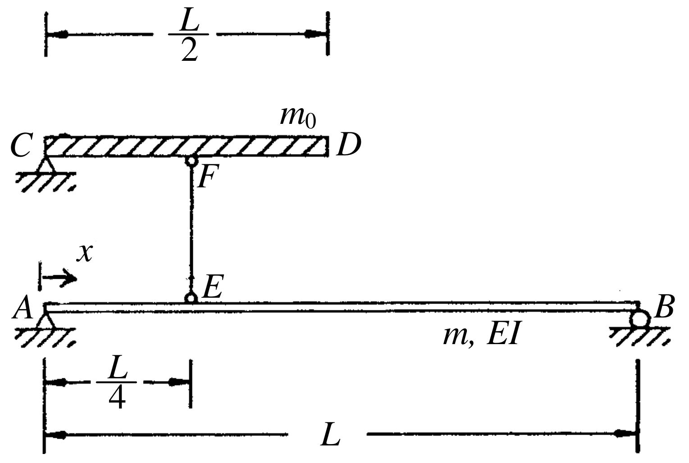

# SD-2004-3 題目正本

> 本檔只記錄考卷上寫了什麼、圖上畫了什麼，不含任何解法。解析見同資料夾 `SD-2004-3.md`。
> 判讀清單經使用者確認前，狀態為「待確認」；確認後本檔原則上不再修改（改動須回考卷原圖並記 log）。

| 項目 | 內容 |
|---|---|
| 考卷 | `raw/exams/SD-2004_結構動力分析與耐震設計.pdf`，第 1 頁（正面）下半，第三題 |
| 考年 | 2004（民國93年）專技高考結構工程技師「結構動力分析與耐震設計」 |
| 配分 | 15 分 |
| 附圖 | `SD-2004-3-fig-1.png`（舊擷取，C 與 A 之間有文字游標）、`SD-2004-3-fig-2.png`（2026-11-16 由考卷 500 dpi 重擷取） |
| 判讀狀態 | **已確認（2026-11-16，使用者授權依 Claude 建議）**（2026-11-16 轉錄；PyMuPDF 110 dpi 整頁＋400–500 dpi 局部放大，PDF 文字層核對原文；附圖為嵌入點陣圖；盲讀於開啟解析前完成） |

## 1. 考卷原文（逐字）

三、考慮下圖之系統，$AB$ 為彈性梁，其斷面撓曲勁度為 $EI$ 且單位長度質量為 $m$；$EF$ 及 $CD$ 都是剛性桿，$EF$ 桿質量可忽略，$CD$ 桿單位長度質量為 $m_0$。今假設 $AB$ 梁之撓曲（垂直）變形為 $v(x,t)=\phi(x)Z(t)$，其中形狀函數取為 $\phi(x)=\sin(\pi x/L)$，$Z(t)$ 為廣義座標。試求本系統之廣義質量（generalized mass）及廣義勁度（generalized stiffness）。（15 分）

## 2. 考卷給的公式、附表與參數

- 考卷給的式子：$v(x,t)=\phi(x)Z(t)$、$\phi(x)=\sin(\pi x/L)$（題文）。
- 給定（全為符號）：$AB$ 梁 $EI$、$m$，跨長 $L$；$CD$ 剛性桿長 $L/2$、單位長度質量 $m_0$；$EF$ 剛性桿無質量；$E$ 距 $A$ 為 $L/4$（圖上）。
- 考卷沒有給：任何數值；$CD$ 與 $AB$ 的高差（圖上未標）；阻尼；外力。
- 卷首注意事項：㈠不必抄題，作答時請將試題題號及答案依照順序寫在試卷上，於本試題上作答者，不予計分。㈡可以使用電子計算器。考試時間：二小時。

## 3. 附圖

*證據圖 SD-2004-3-fig-2.png（500 dpi 重擷取；舊圖 SD-2004-3-fig-1.png 內容相同，C、A 之間有文字游標）*

圖面文字照錄：L/2、m0、C、D、F、x、E、A、B、m, EI、L/4、L

## 4. 判讀清單

| # | 項目 | 判讀 | 圖上／題文依據 | 把握 |
|---|---|---|---|---|
| 1 | $C$ 的水平位置 | $C$ 在 $A$ 的正上方（$x=0$） | 400 dpi：上方 L/2 尺寸線左端界線、C 支承三角形頂點、下方 L/4 與 L 尺寸線左端界線、A 支承頂點同一鉛直線（約 x≈148 px） | 確定（解讀） |
| 2 | $F$ 的位置 | $F$ 在 $E$ 的正上方，$EF$ 鉛直；故 $CF=L/4$ | 400 dpi：E、F 兩鉸圈中心同 x（約 405 px），EF 為鉛直細線；L/4 尺寸線右端界線對齊 E | 確定（解讀） |
| 3 | $E$、$F$ 接頭 | 皆為鉸接（小圓圈），$EF$ 為兩端鉸接的剛性連桿（只傳軸力，$F$ 的鉛直位移等於 $E$ 的） | 圖上 E、F 小圓圈；題文「EF … 剛性桿」 | 確定 |
| 4 | $CD$ 桿 | 剛性桿，$C$ 端鉸支承、$D$ 端自由，長 $L/2$，均佈質量 $m_0$ | 圖上斜線填滿桿、C 端三角形＋地面斜線、上方尺寸 L/2；題文 | 確定 |
| 5 | $AB$ 梁支承 | $A$ 鉸支承、$B$ 滾支承（簡支），跨長 $L$ | 圖上 A 三角形、B 圓圈；尺寸 L | 確定 |
| 6 | 座標 | $x$ 自 $A$ 向右量測 | 圖上 A 點上方「x →」 | 確定 |
| 7 | 變形假設 | $v(x,t)=\sin(\pi x/L)\,Z(t)$，$Z$ 為 $AB$ 跨中撓度 | 題文 | 確定 |
| 8 | 質量來源 | $AB$ 梁 $m$（均佈）＋ $CD$ 桿 $m_0$（均佈）；$EF$ 無質量 | 題文 | 確定 |
| 9 | 勁度來源 | 只有 $AB$ 梁的撓曲 $EI$（$CD$、$EF$ 剛性） | 題文 | 確定（解讀） |
| 10 | 所求 | 系統的廣義質量、廣義勁度 | 題文 | 確定 |
| 11 | 考卷沒有給 | 數值、$CD$ 高度、重力效應（不考慮重力對勁度的影響）、阻尼、外力 | 題文 | 確定 |

---
*轉錄：2026-11-16（SD-U1-2 題目正本推廣・組 U1-2-G1）*
*確認：2026-11-16 使用者授權依 Claude 建議確認（SD-U1-2 題目正本推廣・組 U1-2-G1，關卡一）*
