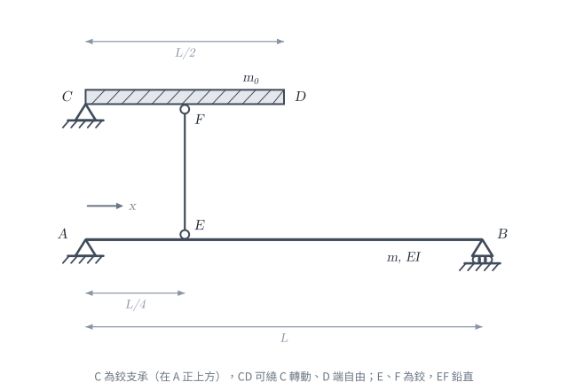
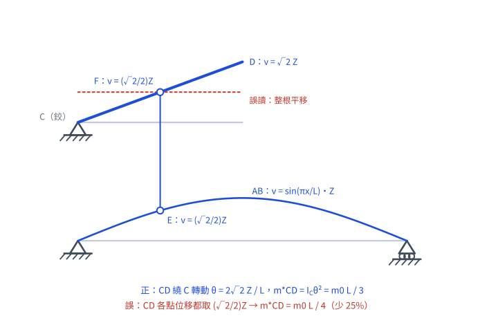

# 考題編號：SD-2004-3

**主分類：** `SD-U1-2` 運動方程式推導  
**副分類：** `SD-U1-3` 單自由度、多自由度系統之動態分析及應用  
**分析方法：** Ritz 法（廣義座標法）：指定形函數 φ(x) = sin(πx/L)，對複合系統（彈性梁 + 剛性桿）求廣義質量與廣義勁度  
**標籤：** `廣義質量` `廣義勁度` `Ritz法` `廣義座標` `形函數` `簡支梁` `剛性桿` `連續體` `分佈質量` `集中質量`

---

## 1. 題目（考卷原文見題目正本）

> 考卷原文、公式／附表、附圖與判讀清單（已確認）見 [`SD-2004-3-problem.md`](SD-2004-3-problem.md)。本節只列解題時最容易讀錯的地方與本解使用的記號；題意以題目正本為準。


*重繪自考卷附圖，依題目正本判讀清單；本圖攔下的判讀錯誤：C 端是鉸支承，CD 繞 C 轉動（F 在 CD 中點），不是整根平移。*

### 常見誤讀

| 項目 | 正確判讀 | 常見誤讀 |
|------|---------|---------|
| CD 的運動 | C 端鉸支承、D 端自由，CD 繞 C 轉動；F 距 C 為 $L/4$（判讀 #1、#2、#4） | 本庫舊解 §1、§4：CD 整根隨 F 鉛直平移（漏看 C 的鉸支承） |
| EF | 兩端鉸接的剛性無質量連桿，$v_F=v_E=\phi(L/4)Z$（判讀 #3） | — |
| 勁度來源 | 只有 AB 梁撓曲（判讀 #9） | 把 CD、EF 算入勁度 |

**本解記號：** $Z(t)$ 為 AB 跨中撓度；$\phi(x)=\sin(\pi x/L)$；$m^*$、$k^*$ 為廣義質量、勁度。

---

## 2. 考題核心精神與出題者意圖 (Core Concepts & Examiner's Intent)

**核心觀念：** 廣義座標法（Ritz 法）將連續體系統降維為單自由度，廣義質量和廣義勁度分別由系統的動能和應變能對廣義座標 $Z$ 取變分而得。

**出題者意圖：**
1. 考查考生能否正確計算「複合系統」的廣義質量——彈性梁的分佈質量與剛性桿的分佈質量需分開積分，再相加
2. 考查廣義勁度的計算——只有彈性構件（梁 AB）貢獻彈性應變能，剛性桿（EF、CD）不貢獻勁度
3. 考查形函數的幾何傳遞與**支承判讀**：E 在 $x = L/4$，F 點位移為 $\phi(L/4)Z=\frac{\sqrt{2}}{2}Z$；C 端是鉸支承，CD 繞 C 轉動 $\theta=v_F/(L/4)$，D 端位移是 F 的兩倍

**關鍵陷阱：**
- ⚠ **CD 不是整根平移**：C 端為鉸支承（題目正本判讀 #1、#4），CD 繞 C 轉動，各點位移 $v(s)=s\,\theta$ 與距 C 的距離 $s$ 成正比；F 點（$s=L/4$）的位移才是 $\phi(L/4)Z$
- ⚠ **EF 和 CD 不貢獻廣義勁度**（剛性桿無彈性應變能）
- ⚠ $\int_0^L \sin^2(\pi x / L)\, dx = L/2$，這是必備積分公式

---

## 3. 解題戰略地圖與陷阱分析 (Strategic Roadmap & Trap Analysis)

**作戰計畫：**

```
Step 1：確認幾何——F 點位移 = φ(L/4)·Z(t)（透過剛性桿 EF 傳遞）；CD 繞 C 鉸轉動 θ = v_F/(L/4)
Step 2：廣義質量
       m*_AB = ∫₀ᴸ m·[φ(x)]² dx = m·L/2
       m*_CD = I_C·(θ/Z)² = [m₀(L/2)³/3]·(2√2/L)² = m₀L/3
       m* = m*_AB + m*_CD
Step 3：廣義勁度（只有 AB 梁貢獻）
       k* = ∫₀ᴸ EI·[φ''(x)]² dx
       φ''(x) = -(π/L)² sin(πx/L)
       k* = EI·(π/L)⁴·L/2 = π⁴EI/(2L³)
```

**關鍵陷阱分析：**

1. ⚠ **形函數傳遞與支承**：EF 為剛性，E 點位移 = F 點位移 $=\frac{\sqrt2}{2}Z$。CD 的 C 端是鉸支承，CD 繞 C 轉動 $\theta=\frac{\sqrt2 Z/2}{L/4}=\frac{2\sqrt2}{L}Z$，D 端位移 $\sqrt2 Z$——**不是**整根平移
2. ⚠ **剛性桿不貢獻勁度**：EF、CD 均為剛性，無彈性變形，應變能為零
3. ⚠ $\sin^2(\pi/4) = 1/2$（注意不是 $\sqrt{2}/2$，要取平方！）

---

## 3.5 變數層次分析 (Variable Hierarchy Analysis)

> 複習提示：第一次解題後，在每個卡住的知識點旁標記 `⚠`；第二次複習時只看有 `⚠` 的項目。

### 最終目標
求廣義質量 $m^*$ 與廣義勁度 $k^*$（以 $m$、$m_0$、$L$、$EI$ 表示）。

### 本題關鍵公式（依計算順序）

$$\text{Step 1：} \quad v(x,t) = \sin\!\left(\frac{\pi x}{L}\right) Z(t), \quad \phi(L/4) = \sin\!\left(\frac{\pi}{4}\right) = \frac{\sqrt{2}}{2}$$

$$\text{Step 2：} \quad m^*_{AB} = \int_0^L m\,\phi^2(x)\,dx = m\int_0^L \sin^2\!\left(\frac{\pi x}{L}\right)dx = \frac{mL}{2}$$

$$\text{Step 3：} \quad \theta = \frac{v_F}{L/4} = \frac{2\sqrt{2}}{L}Z,\qquad m^*_{CD} = \int_0^{L/2} m_0\left(\frac{s\,\theta}{Z}\right)^2 ds = I_C\left(\frac{2\sqrt2}{L}\right)^2 = \frac{m_0L^3}{24}\cdot\frac{8}{L^2} = \frac{m_0 L}{3}$$

$$\text{Step 4：} \quad m^* = m^*_{AB} + m^*_{CD} = \frac{mL}{2} + \frac{m_0 L}{3}$$

$$\text{Step 5：} \quad \phi''(x) = -\left(\frac{\pi}{L}\right)^2 \sin\!\left(\frac{\pi x}{L}\right)$$

$$\text{Step 6：} \quad k^* = \int_0^L EI\,[\phi''(x)]^2\,dx = EI\cdot\left(\frac{\pi}{L}\right)^4 \cdot \frac{L}{2} = \frac{\pi^4 EI}{2L^3}$$

### L1：題目直接給定

| 符號 | 數值 | 說明 |
|------|------|------|
| $\phi(x)$ | $\sin(\pi x / L)$ | 形函數（已給定） |
| $m$ | $m$ | AB 梁單位長度質量 |
| $m_0$ | $m_0$ | CD 桿單位長度質量 |
| $EI$ | $EI$ | AB 梁斷面撓曲勁度 |
| $L$ | $L$ | AB 梁總長 |
| CD 長度 | $L/2$ | 剛性桿 CD 總長 |
| E 位置 | $x = L/4$ | EF 在梁上的連接點 |
| C 端 | 鉸支承（在 A 正上方） | CD 只能繞 C 轉動；F 距 C 為 $L/4$ |
| EF 質量 | 0 | 可忽略 |

### L2：需知識點推導

**幾何傳遞：CD 的廣義位移**

| 符號 | 公式／來源 | 卡關? |
|------|---------|------|
| $v_E = v(L/4, t)$ | $\phi(L/4)\cdot Z = \sin(\pi/4)\cdot Z = \frac{\sqrt{2}}{2}Z$ | |
| $v_F$ | EF 剛性 → $v_F = v_E = \frac{\sqrt{2}}{2}Z$ | |
| CD 轉角 | $\theta = v_F/(L/4) = \frac{2\sqrt{2}}{L}Z$（C 為鉸支承） | ⚠ |
| CD 上距 C 為 $s$ 的點 | $v(s) = s\,\theta$（D 端 $s=L/2$：$\sqrt2 Z$） | |

**廣義質量**

| 符號 | 公式／來源 | 卡關? |
|------|---------|------|
| $m^*_{AB}$ | $\int_0^L m\sin^2(\pi x/L)\,dx = mL/2$ | |
| $I_C$ | $m_0(L/2)^3/3 = m_0L^3/24$（CD 對 C 的轉動慣量） | |
| $m^*_{CD}$ | $I_C(2\sqrt2/L)^2 = m_0 L/3$ | |
| $m^*$ | $m^*_{AB} + m^*_{CD}$ | |

**廣義勁度**

| 符號 | 公式／來源 | 卡關? |
|------|---------|------|
| $\phi''(x)$ | $-(\pi/L)^2 \sin(\pi x/L)$ | |
| $[\phi''(x)]^2$ | $(\pi/L)^4 \sin^2(\pi x/L)$ | |
| $k^*$ | $\int_0^L EI\,(\pi/L)^4 \sin^2(\pi x/L)\,dx = EI\cdot(\pi/L)^4 \cdot (L/2)$ | |

### L3：深層知識（不懂就卡住）

| 知識點 | 說明 | 卡關? |
|--------|------|------|
| Ritz 法廣義質量公式 | $m^* = \int \rho A\,\phi^2\,dx + \sum m_i\,\phi_i^2$（分佈質量積分 + 集中質量求和） | |
| Ritz 法廣義勁度公式 | $k^* = \int EI\,[\phi''(x)]^2\,dx$（僅彈性構件積分） | |
| 剛性桿的動力貢獻 | 剛性桿有質量（貢獻 $m^*$）但無彈性（不貢獻 $k^*$）；繞固定鉸轉動的剛性桿，動能 $\tfrac12 I_C\dot\theta^2$ | |
| $\int_0^L \sin^2(\pi x/L)\,dx$ | $= L/2$（半角公式：$\sin^2\theta = (1-\cos 2\theta)/2$，積分後 $\cos$ 項消失） | |
| $\sin^2(\pi/4)$ | $= (\sqrt{2}/2)^2 = 1/2$（不是 $\sqrt{2}/2$！） | |
| 形函數滿足邊界條件 | $\phi(0)=\sin(0)=0$ ✓，$\phi(L)=\sin(\pi)=0$ ✓（簡支梁兩端位移為零） | |

---

## 4. 步驟化詳細計算過程 (Step-by-Step Detailed Calculation)

### Step 1：確認幾何——CD 的廣義位移幅值

EF 為剛性桿（無彈性變形），E 在梁 AB 上 $x = L/4$ 處：

$$v_E(t) = v\!\left(\frac{L}{4}, t\right) = \phi\!\left(\frac{L}{4}\right) \cdot Z(t) = \sin\!\left(\frac{\pi}{4}\right) Z(t) = \frac{\sqrt{2}}{2}\, Z(t)$$

因 EF 剛性，F 點垂直位移 = E 點垂直位移：

$$v_F(t) = v_E(t) = \frac{\sqrt{2}}{2}\, Z(t)$$

CD 為剛性桿，C 端為**鉸支承**（題目正本判讀 #1、#4），F 距 C 為 $L/4$（判讀 #2），所以 CD 繞 C 轉動：

$$\theta(t) = \frac{v_F}{L/4} = \frac{2\sqrt{2}}{L}\, Z(t)$$

CD 上距 C 為 $s$（$0\le s\le L/2$）的點，垂直位移為

$$v_{CD}(s,t) = s\,\theta(t) = \frac{2\sqrt{2}\,s}{L}\, Z(t),\qquad v_D = \sqrt{2}\,Z(t)$$

> **策略註解：** CD 上各點的位移幅值與距 C 的距離成正比（C 端 0、F 點 $\sqrt2/2$、D 端 $\sqrt2$），不是常數。


*圖 2　CD 的運動：C 端為鉸支承，CD 繞 C 轉動，位移由 C 端 0 線性增加到 D 端 $\sqrt2 Z$；紅虛線為整根平移的誤讀（$m^*_{CD}$ 少算 25%）。*

---

### Step 2：計算廣義質量

廣義質量由系統動能的二倍對 $\dot{Z}^2$ 取係數（等效於對各構件的質量分佈用形函數平方加權積分）：

$$m^* = \underbrace{\int_0^L m\,[\phi(x)]^2\,dx}_{m^*_{AB}} + \underbrace{\int_0^{L/2} m_0\left[\frac{2\sqrt2\,s}{L}\right]^2 ds}_{m^*_{CD}}$$

**AB 梁的貢獻：**

$$m^*_{AB} = \int_0^L m\,\sin^2\!\left(\frac{\pi x}{L}\right) dx$$

利用半角公式：$\sin^2\theta = \dfrac{1-\cos 2\theta}{2}$

$$m^*_{AB} = m \int_0^L \frac{1 - \cos(2\pi x/L)}{2}\,dx = m\left[\frac{x}{2} - \frac{L}{4\pi}\sin\!\left(\frac{2\pi x}{L}\right)\right]_0^L = m \cdot \frac{L}{2}$$

$$\boxed{m^*_{AB} = \frac{mL}{2}}$$

**CD 桿的貢獻：**

$$m^*_{CD} = m_0\,\frac{8}{L^2}\int_0^{L/2} s^2\,ds = m_0\,\frac{8}{L^2}\cdot\frac{L^3}{24} = \frac{m_0 L}{3}$$

交叉驗算（轉動慣量）：$I_C = m_0(L/2)^3/3 = m_0L^3/24$，$m^*_{CD} = I_C\,(2\sqrt2/L)^2 = m_0L/3$ ✓

$$\boxed{m^*_{CD} = \frac{m_0 L}{3}}$$

**EF 桿的貢獻：** 質量可忽略，貢獻 = 0。

**總廣義質量：**

$$\boxed{m^* = \frac{mL}{2} + \frac{m_0 L}{3}}$$

---

### Step 3：計算廣義勁度

廣義勁度由系統應變能對廣義座標 $Z^2$ 取係數。**只有彈性構件貢獻**，剛性桿（EF、CD）無應變能。

對 AB 梁（Euler-Bernoulli 梁理論，彎矩應變能）：

$$k^* = \int_0^L EI\,[\phi''(x)]^2\,dx$$

計算 $\phi''(x)$：

$$\phi(x) = \sin\!\left(\frac{\pi x}{L}\right)$$
$$\phi'(x) = \frac{\pi}{L}\cos\!\left(\frac{\pi x}{L}\right)$$
$$\phi''(x) = -\frac{\pi^2}{L^2}\sin\!\left(\frac{\pi x}{L}\right)$$

因此：

$$[\phi''(x)]^2 = \frac{\pi^4}{L^4}\sin^2\!\left(\frac{\pi x}{L}\right)$$

代入廣義勁度積分：

$$k^* = EI \cdot \frac{\pi^4}{L^4} \int_0^L \sin^2\!\left(\frac{\pi x}{L}\right) dx = EI \cdot \frac{\pi^4}{L^4} \cdot \frac{L}{2}$$

$$\boxed{k^* = \frac{\pi^4 EI}{2L^3}}$$

> **策略註解：** 廣義勁度積分中出現的 $\int_0^L \sin^2(\pi x/L)\,dx = L/2$ 與廣義質量積分相同，是此類題目的關鍵公式，務必記住。

---

### 最終答案彙整

$$\boxed{m^* = \frac{mL}{2} + \frac{m_0 L}{3}}$$

$$\boxed{k^* = \frac{\pi^4 EI}{2L^3}}$$

---

### 驗算：自然頻率的合理性

$$\omega_n = \sqrt{\frac{k^*}{m^*}} = \sqrt{\frac{\pi^4 EI / (2L^3)}{mL/2 + m_0 L/3}} = \pi^2\sqrt{\frac{3EI}{L^4(3m+2m_0)}}$$

**極限驗算：** 若 $m_0 = 0$（無 CD 桿），則

$$\omega_n = \sqrt{\frac{\pi^4 EI / (2L^3)}{mL/2}} = \sqrt{\frac{\pi^4 EI}{mL^4}} = \frac{\pi^2}{L^2}\sqrt{\frac{EI}{m}}$$

此正是**簡支梁第一振態的精確解** ✓（Ritz 法以精確形函數得到精確頻率）

**若加入 CD 桿（$m_0 > 0$）：** $m^*$ 增加 → $\omega_n$ 降低 → 周期變長 ✓（附加質量使系統變「重」）

---

## 5. 關鍵爭議點與進階探討 (Critical Issues & Advanced Discussion)

**本題使用的形函數是否合法？**

$\phi(x) = \sin(\pi x/L)$ 同時滿足：
- 幾何邊界條件：$\phi(0) = 0$，$\phi(L) = 0$（簡支兩端位移為零）✓
- 自然邊界條件：$\phi''(0) = 0$，$\phi''(L) = 0$（簡支兩端彎矩為零）✓

且此形函數恰為簡支梁的**精確第一振態模態**，因此 Ritz 法給出的頻率是**精確解**（對無 CD 桿的純梁系統）。

**加入 CD 桿後的 Ritz 上界性**

Ritz 法用近似形函數得到的頻率是真實頻率的**上界**。加入 CD 桿後，真實第一振態不再是純正弦，因此 Ritz 解可能稍微偏高，但若形函數選得好，誤差很小。

**與「CD 整根平移」讀法的對照（本庫舊解）**

本庫舊解漏看 C 端的鉸支承，把 CD 當成隨 F 整根平移（各點位移均為 $\frac{\sqrt2}{2}Z$），得 $m^*_{CD} = m_0(L/2)(1/2) = m_0L/4$、$m^* = mL/2 + m_0L/4$。考卷附圖 C 端有三角形鉸支承＋地面剖線（與 A 端同符號），CD 只能繞 C 轉動；整根平移的模型需要 C 端不受約束。正確的 $m^*_{CD}=m_0L/3$ 比平移讀法大 $4/3$ 倍：遠端 D 的位移是 F 的兩倍，而動能與位移平方成正比。$k^*$ 兩種讀法相同。

**廣義運動方程式的形式**

$$m^* \ddot{Z}(t) + k^* Z(t) = P^*(t)$$

其中廣義外力 $P^*(t) = \int_0^L p(x,t)\phi(x)\,dx + F_{\text{ext}} \cdot \phi(x_F)$

（此為一 SDOF 廣義方程式，之後可用 SDOF 反應分析求解 $Z(t)$。）

*修正日期：2026-11-16（§1 改為指向題目正本，重繪附圖 figs/SD-2004-3-fig-1-problem.svg；§1 標註題意與本解不符，待階段 C 勘誤）*

*修正日期：2026-11-16（FIX-SD-U1-2-G1 解析勘誤（判讀：漏看 C 端鉸支承）：CD 由「整根平移」改為「繞 C 轉動」，m*_CD 由 m0L/4 改為 m0L/3，m* 由 mL/2＋m0L/4 改為 mL/2＋m0L/3；k* 不變；改 §2、§3、§3.5、§4 Step 1–2 與 ω 式、§5 加舊讀法對照；移除 §1 待勘誤警示。證據：2004 年第 1 頁第三題附圖 C 端三角形鉸支承＋剖線（400–500 dpi）。驗證：scripts/fixes/2026-11-16_verify_SD-2004-3.py 積分法、I_Cθ² 法、數值積分三路一致，MISMATCHES: 0；與盲解比對一致）*

*修正日期：2026-11-16（非勘誤）圖解補繪：figs/SD-2004-3-fig-2-cd-rotation.svg（腳本 gen_SD-2004-3.py，數值取自已驗證正本）*
