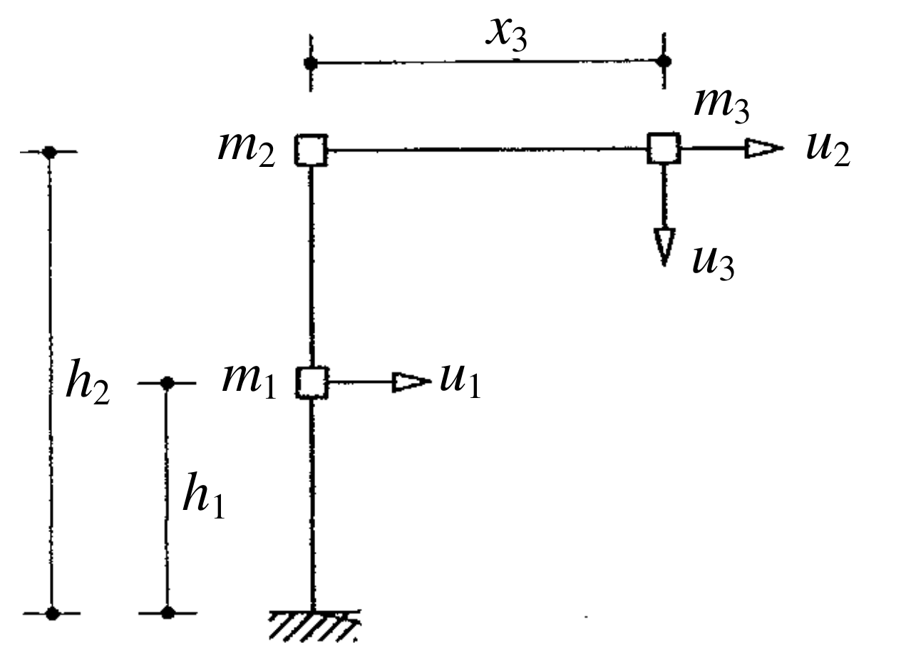

# SD-2004-4 題目正本

> 本檔只記錄考卷上寫了什麼、圖上畫了什麼，不含任何解法。解析見同資料夾 `SD-2004-4.md`。
> 判讀清單經使用者確認前，狀態為「待確認」；確認後本檔原則上不再修改（改動須回考卷原圖並記 log）。

| 項目 | 內容 |
|---|---|
| 考卷 | `raw/exams/SD-2004_結構動力分析與耐震設計.pdf`，第 2 頁（背面）上半，第四題 |
| 考年 | 2004（民國93年）專技高考結構工程技師「結構動力分析與耐震設計」 |
| 配分 | 15 分（㈠3、㈡5、㈢7） |
| 附圖 | `SD-2004-4-fig-1.png`（舊擷取，左側有滑鼠游標）、`SD-2004-4-fig-2.png`（2026-11-16 由考卷 500 dpi 重擷取） |
| 判讀狀態 | **已確認（2026-11-16，使用者授權依 Claude 建議）**（2026-11-16 轉錄；PyMuPDF 110 dpi 整頁＋250–500 dpi 局部放大，PDF 文字層核對原文；附圖為嵌入點陣圖；盲讀於開啟解析前完成） |

## 1. 考卷原文（逐字）

四、考慮如下圖所示之 L 形構架，假設各桿件之軸向為剛性。

㈠求該構架之質量矩陣 $[M]$（自由度按 $u_1$、$u_2$、$u_3$ 排列）（3 分）

㈡假設此構架之支承受到 $X$（水平）向之地表加速度 $\ddot{u}_{gx}(t)$，其引致之地震力可表為 $\{P(t)\}=-[M]\{l_x\}\ddot{u}_{gx}(t)$，試求 $\{l_x\}$。（5 分）

㈢假設此構架之支承運動方式為轉動且順時鐘之轉動角加速度為 $\ddot{\theta}_{gz}(t)$，則引致之地震力可表為 $\{P(t)\}=-[M]\{l_\theta\}\ddot{\theta}_{gz}(t)$，試求 $\{l_\theta\}$。（7 分）

（考卷文字層的雙點符號因字型顯示為「&&」，影像上為 $\ddot{u}_{gx}$、$\ddot{\theta}_{gz}$。）

## 2. 考卷給的公式、附表與參數

- 考卷給的式子：$\{P(t)\}=-[M]\{l_x\}\ddot{u}_{gx}(t)$、$\{P(t)\}=-[M]\{l_\theta\}\ddot{\theta}_{gz}(t)$（題文）。
- 給定（全為符號）：集中質量 $m_1$、$m_2$、$m_3$；高度 $h_1$、$h_2$；水平距離 $x_3$（圖上）；各桿軸向剛性。
- 考卷沒有給：任何數值；$EI$；各質量的轉動慣量；勁度矩陣（本題不問）。
- 卷首注意事項：㈠不必抄題，作答時請將試題題號及答案依照順序寫在試卷上，於本試題上作答者，不予計分。㈡可以使用電子計算器。考試時間：二小時。

## 3. 附圖

*證據圖 SD-2004-4-fig-2.png（500 dpi 重擷取；舊圖 SD-2004-4-fig-1.png 內容相同，左側空白處有游標）*

圖面文字照錄：x3、m2、m3、u2、u3、h2、m1、u1、h1

## 4. 判讀清單

| # | 項目 | 判讀 | 圖上／題文依據 | 把握 |
|---|---|---|---|---|
| 1 | $u_2$ 適用於哪些質量 | $u_2$ 箭頭畫在 $m_3$，但梁軸向剛性 → $m_2$ 與 $m_3$ 的水平位移相同，皆為 $u_2$；柱軸向剛性 → $m_2$ 無鉛直位移 | 題文「各桿件之軸向為剛性」；圖上 u2 只標一次 | 確定（解讀） |
| 2 | 轉動中心 | 支承轉動 $\theta_{gz}$ 以柱底支承點為轉動中心（整個構架隨基座剛體轉動） | 題文「支承運動方式為轉動」；圖上只有一個支承 | 確定（解讀） |
| 3 | 質量性質 | $m_1$、$m_2$、$m_3$ 為集中質量，只計平移慣性，不計轉動慣量 | 圖上小方塊；考卷未給轉動慣量 | 確定（解讀） |
| 4 | 柱底 | 固定支承 | 圖上柱底斜線 | 確定 |
| 5 | $m_1$ 位置與自由度 | 柱上高 $h_1$ 處；$u_1$ 水平向右 | 尺寸線 h1 由柱底量至 m1；空心箭頭 | 確定 |
| 6 | $m_2$ 位置 | 柱頂、梁柱交點，高 $h_2$ | 尺寸線 h2 由柱底量至 m2（兩尺寸線下端同在柱底高程） | 確定 |
| 7 | $m_3$ 位置與自由度 | 梁右端，距柱軸線 $x_3$、高 $h_2$；$u_2$ 水平向右、$u_3$ 鉛直向下 | 尺寸線 x3 左端對齊柱、右端對齊 m3；箭頭方向 | 確定 |
| 8 | 正向 | $u_1$、$u_2$ 向右為正，$u_3$ 向下為正；$\ddot{\theta}_{gz}$ 順時鐘為正 | 圖上箭頭；題文「順時鐘」 | 確定 |
| 9 | 所求 | ㈠$[M]$ ㈡$\{l_x\}$ ㈢$\{l_\theta\}$ | 題文 | 確定 |
| 10 | 考卷沒有給 | 數值、$EI$、轉動慣量、勁度 | 題文 | 確定 |

---
*轉錄：2026-11-16（SD-U1-2 題目正本推廣・組 U1-2-G1）*
*確認：2026-11-16 使用者授權依 Claude 建議確認（SD-U1-2 題目正本推廣・組 U1-2-G1，關卡一）*
