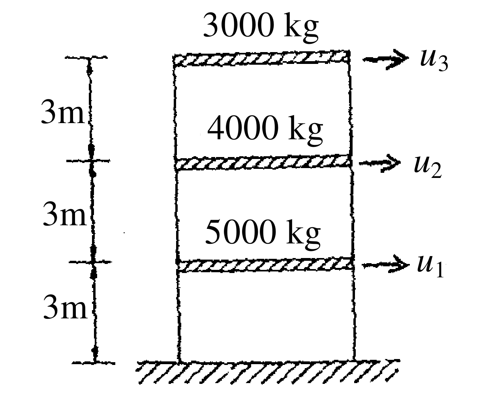

# SD-2004-5 題目正本

> 本檔只記錄考卷上寫了什麼、圖上畫了什麼，不含任何解法。解析見同資料夾 `SD-2004-5.md`。
> 判讀清單經使用者確認前，狀態為「待確認」；確認後本檔原則上不再修改（改動須回考卷原圖並記 log）。

| 項目 | 內容 |
|---|---|
| 考卷 | `raw/exams/SD-2004_結構動力分析與耐震設計.pdf`，第 2 頁（背面），第五題 |
| 考年 | 2004（民國九十三年）專技高考結構工程技師「結構動力分析與耐震設計」 |
| 配分 | 25 分（㈠5 分、㈡20 分） |
| 附圖 | `SD-2004-5-fig-1.png`（原證據圖，尺寸線上有游標雜訊）、`SD-2004-5-fig-2.png`（2026-11-15 由考卷 500 dpi 重新擷取） |
| 判讀狀態 | **已確認**（2026-11-15 使用者授權依 Claude 建議確認。原轉錄：2026-11-15 轉錄；PyMuPDF 110／150 dpi 整頁＋450–500 dpi 局部放大，PDF 文字層與向量座標核對；盲讀於開啟解析前完成） |

## 1. 考卷原文（逐字）

五、考慮如下圖之三層樓剪力屋架，各層樓版之質量如圖示，每樓層之層剪力勁度都為 4×106 N/m，自由度按 $u_1$、$u_2$、$u_3$ 排列。已知前兩個自由振動之振態分別為 $\{\phi_1\}=\langle 0.484, 0.834, 1.0\rangle^{t}$ 及 $\{\phi_2\}=\langle 1.0, 0.118, -0.937\rangle^{t}$，以上 $\{\phi_1\}$ 與 $\{\phi_2\}$ 都是行(column)向量，上標 t 表示矩陣或向量之轉置（transpose）。

㈠試求出對應於第一振態 $\{\phi_1\}$ 之自然振動周期 $T_1$。（5 分）

㈡同理我們也可以求得對應於第二振態 $\{\phi_2\}$ 之自然振動周期 $T_2=0.162$ sec（此不必計算）。今假設工址正規化水平加速度反應譜係數 $C$ 與周期 $T$ 之關係為：

$C=1+5T$，$T\le 0.3$sec

$C=2.5$，0.3sec $\le T\le$ 1sec

$C=2.5/T$，1sec $\le T$

若該建築物工址之設計水平加速度為 0.2g，試利用上述反應譜係數以 SRSS（square-root-of-sum-of-squares）法則疊加前兩個振態求取頂層之最大位移及最大基底剪力。[提示：本題作答與規範無關，僅需利用提供之反應譜係數，做彈性分析即可]（20 分）

## 2. 考卷給的公式、附表與參數

- 考卷給的反應譜係數 $C(T)$ 三段式（照錄於 §1），設計水平加速度 0.2g；提示「與規範無關，僅需利用提供之反應譜係數，做彈性分析」。
- 題給數值參數：$T_2=0.162$ s（不必計算，照用）；$\phi_1$、$\phi_2$（照用）。
- 考卷沒有給：阻尼比、$g$ 值、樓高以外的構件尺寸。
- 卷首注意事項：㈠不必抄題，作答時請將試題題號及答案依照順序寫在試卷上，於本試題上作答者，不予計分。㈡可以使用電子計算器。考試時間：二小時。

## 3. 附圖

*證據圖 SD-2004-5-fig-2.png（500 dpi 重擷取）*

圖面文字照錄：3000 kg、u3、3m、4000 kg、u2、3m、5000 kg、u1、3m

## 4. 判讀清單

| # | 項目 | 判讀 | 圖上／題文依據 | 把握 |
|---|---|---|---|---|
| 1 | 樓版質量 | $m_1=5000$ kg（一樓頂／$u_1$）、$m_2=4000$ kg（$u_2$）、$m_3=3000$ kg（頂層／$u_3$）；質量標籤寫在各自樓版正上方 | 500 dpi 圖面 | 確定 |
| 2 | 樓層勁度 | 三層皆 $4\times10^{6}$ N/m（層剪力勁度） | 題文 | 確定 |
| 3 | 樓高 | 各 3 m（本題計算不需要） | 圖面 | 確定 |
| 4 | 振態 | $\phi_1=\langle0.484,0.834,1.0\rangle^t$、$\phi_2=\langle1.0,0.118,-0.937\rangle^t$，分量依 $u_1,u_2,u_3$ | 題文 | 確定 |
| 5 | $T_2$ | 0.162 s，題給，不必計算 | 題文 | 確定 |
| 6 | 譜值 | 譜加速度 = $C(T)\times$ 0.2g（「設計水平加速度 0.2g」乘正規化係數） | 題文 | 確定（解讀） |
| 7 | 所求 | ㈠ $T_1$；㈡ 前兩振態 SRSS：頂層最大位移、最大基底剪力 | 題文 | 確定 |
| 8 | 考卷沒有給 | 阻尼比、$g$ 值 | 題文 | 確定 |

---
*轉錄：2026-11-15（SD-U1-3 題目正本推廣・批 1）*
*確認：2026-11-15 使用者授權依 Claude 建議確認（SD-U1-3 題目正本推廣・批 1，關卡一）*
