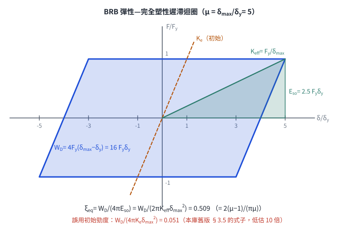

# 考題編號：SD-2005-1

**主分類：** `SD-U3-2` 隔減震原理
**副分類：** 無
**分析方法：** 概念題
**標籤：** `BRB` `挫屈拘束支撐` `消能元件` `位移型阻尼器` `被動控制` `耐震設計`

---

## 1. 題目（考卷原文見題目正本）

> 考卷原文、公式／附表、附圖與判讀清單（已確認）見 [`SD-2005-1-problem.md`](SD-2005-1-problem.md)。本節只列解題時最容易讀錯的地方與本解使用的記號；題意以題目正本為準。

### 常見誤讀

| 項目 | 正確判讀 | 常見誤讀 |
|------|---------|---------|
| ㈠「那一類」 | 考卷沒有指定分類法；本解以位移相依型（遲滯型、金屬降伏）作答，並對照速度相依型（判讀 #1） | 與速度型的黏滯阻尼器混淆 |
| ㈣「發揮最大效果」 | 指 BRB 在構架中的設計與配置（勁度、降伏強度、配置位置、接合與周邊構材容量設計）（判讀 #2） | 只寫「適當配置」 |
| 題型 | 四小題皆為論述，沒有數值、沒有附圖（判讀 #3、#4） | — |

**本解記號：** BRB＝挫屈拘束支撐（內芯＋無黏結層＋外管）；$P_y$ 為內芯降伏軸力。

---

## 2. 考題核心精神與出題者意圖 (Core Concepts & Examiner's Intent)

**核心觀念：** 消能減震（Passive Energy Dissipation）中「位移型阻尼器」的代表元件 BRB，考生必須理解其物理機制（消散遲滯能量）、相對於傳統斜撐的優越性（對稱的拉壓降伏），以及工程設計考量。

**出題者意圖：**
- 測驗考生對「消能元件分類」的掌握（速度型 vs. 位移型）
- 測驗 BRB 與傳統對中心斜撐（CBF）的差異——傳統斜撐壓力下會挫屈，BRB 則藉由外管拘束內芯，使內芯在拉壓下均能達到降伏
- 2005 年 BRB 在台灣耐震設計中屬新興工法，出題者期望考生能說明優缺點與設計原則

---

## 3. 解題戰略地圖與陷阱分析 (Strategic Roadmap & Trap Analysis)

### 作戰計畫
1. **分類**：先定位 BRB 屬「位移型（滯迴型）阻尼器」
2. **設計原理**：拆解「內芯 + 外管 + 無黏結層」三層結構，說明如何避免挫屈
3. **優缺點**：對稱滯迴、穩定耗能 vs. 製造成本、更換困難
4. **最大效果設計**：降伏強度與勁度配置、拘束管防止整體挫屈、變形能力（試驗驗證）、容量設計保護梁柱與接合

### 關鍵陷阱
| 陷阱 | 說明 | 應對 |
|------|------|------|
| ①分類混淆 | 與粘滯阻尼器（速度型）混淆 | BRB 屬**位移型**（依賴塑性變形耗能，非速度）|
| ②拉壓不對稱說反 | 傳統斜撐受壓挫屈，BRB 拉壓均達降伏 | 說明外管拘束使壓力不走挫屈路徑 |
| ③無黏結層功能說漏 | 外管只提拘束力，不承受軸力 | 無黏結層確保內芯與外管間無黏結，軸力全由內芯承受 |
| ④效果設計流於泛泛 | 只說「適當配置」 | 需提具體：降伏強度與勁度配置、以調整後強度做容量設計、變形能力須經試驗驗證 |

---

## 3.5 變數層次分析 (Variable Hierarchy Analysis)

> 複習提示：第一次解題後，在每個卡住的知識點旁標記 `⚠`；第二次複習時只看有 `⚠` 的項目。

### 最終目標
說明 BRB 的分類、設計原理、優缺點，以及達到最大消能效果的設計方法。

### 本題關鍵公式（依計算順序）

$$\text{消散能量} = W_D = 4 \cdot F_y \cdot \delta_p$$

$$\text{等效黏滯阻尼比} = \xi_{eq} = \frac{W_D}{4\pi E_{so}} = \frac{W_D}{2\pi K_{eff}\,\delta_{max}^2},\quad K_{eff} = \frac{F_y}{\delta_{max}}$$

> 本題為概念題，主要考文字論述；上述公式輔助理解「滯迴面積 = 消散能量」的物理意義。

### L1：題目直接給定

| 符號 | 數值 | 說明 |
|------|------|------|
| — | — | 本題無數字給定，全為概念描述 |

### L2：需知識點推導

**分類判斷**

| 符號 | 公式／來源 | 卡關? |
|------|-----------|-------|
| 消能元件類型 | 位移型（滯迴型）vs. 速度型（粘滯型）vs. 頻率型（調諧型）| |
| BRB 所屬 | 位移型：依賴金屬塑性變形耗能 | |

**設計原理參數**

| 符號 | 公式／來源 | 卡關? |
|------|-----------|-------|
| $F_y$ | 內芯降伏力 = $A_{core} \cdot \sigma_y$ | |
| $\delta_p$ | $\delta_{max}-\delta_y$：BRB 軸向位移振幅扣除降伏位移（由層間位移換算到斜撐軸向） | |
| $W_D$ | 每一循環消散能量 = $4F_y\delta_p$（彈性—完全塑性迴圈） | |
| $\xi_{eq}$ | 等效阻尼比 $=W_D/(2\pi K_{eff}\delta_{max}^2)$，$K_{eff}$ 為割線勁度（不是初始勁度 $K_e$） | |

### L3：深層知識（不懂就卡住）

| 知識點 | 說明 | 卡關? |
|--------|------|-------|
| 挫屈機制 | 細長壓桿在歐拉載重下側向挫屈，傳統斜撐受壓無法達到降伏 | |
| 無黏結層（unbonding layer）功能 | 允許內芯軸向自由伸縮，外管提供側向拘束但不分擔軸力 | |
| 滯迴迴圈對稱性 | BRB 拉壓均降伏 → 飽滿矩形迴圈；傳統 CBF 壓側挫屈 → 迴圈不對稱 | |
| 等效線性化 | 消能器的滯迴面積可換算為等效阻尼比，加入反應譜分析 | |

---

## 4. 步驟化詳細計算過程 (Step-by-Step Detailed Calculation)

### (一) BRB 的消能元件分類（3 分）

BRB 屬於**位移型（Displacement-dependent / Hysteretic）消能元件**，又稱滯迴型阻尼器。

消能元件依耗能機制分三類：

| 分類 | 代表元件 | 耗能驅動力 |
|------|---------|-----------|
| **位移型（滯迴型）** | BRB、金屬降伏阻尼器（ADAS／TADAS）、摩擦阻尼器 | 結構位移（塑性變形或摩擦滑動）|
| 速度型（粘滯型） | 油壓阻尼器、粘彈性阻尼器 | 結構速度 |
| 頻率型（調諧型） | TMD（調諧質量阻尼器）、TLD | 系統頻率調諧 |

$$\boxed{\text{BRB} \in \text{位移型（滯迴型）消能元件}}$$

---

### (二) BRB 的設計原理（7 分）

**核心問題：** 傳統對中心斜撐（CBF）受壓時，細長比過大導致挫屈，使壓力降伏承載力遠低於拉力降伏承載力，滯迴迴圈不飽滿，耗能能力差。

**BRB 的解決方案——三層同心構造：**

```
[外管（拘束管）] ⊃ [無黏結層（unbonding layer）] ⊃ [內芯（steel core）]
```

| 構件 | 材料 | 功能 |
|------|------|------|
| 內芯（core） | 一般結構鋼或低降伏點鋼（LYP） | 承受全部軸力；塑性變形耗能 |
| 無黏結層 | 矽脂、薄膜 | 切斷內芯與外管的軸力傳遞；允許軸向自由變形 |
| 外管（restraining tube） | 混凝土填充鋼管 or 鋼管 | 提供側向拘束，防止內芯挫屈；**不承受軸力** |

**工作機制：**

1. 外管對內芯提供側向支撐，有效細長比 $\lambda_{eff} \to 0$
2. 受壓時內芯直接達到材料降伏（$F = A_{core} \cdot \sigma_y$），不發生挫屈
3. 拉壓均能達到降伏 → 滯迴迴圈呈**飽滿矩形**
4. 每一完整循環消散的遲滯能量（彈性—完全塑性迴圈）：

$$W_D = 4 \cdot F_y \cdot \delta_p$$

其中 $F_y = A_{core} \cdot \sigma_y$（內芯降伏力），$\delta_p = \delta_{max} - \delta_y$（軸向位移振幅扣除降伏位移）


*圖：拉壓對稱的飽滿迴圈即 BRB 的消能來源。等效阻尼比以割線勁度 K_eff 計算（ξ＝W_D/(4πE_so)），μ＝5 時 0.509；若誤用初始勁度 K_e 會低估約 10 倍。*

$$\boxed{\text{BRB 藉由外管拘束，使內芯在拉壓均能達到降伏，形成飽滿滯迴迴圈以消散地震能量}}$$

---

### (三) BRB 的優缺點（8 分）

**優點：**

| 優點 | 說明 |
|------|------|
| ① 拉壓對稱降伏 | 滯迴迴圈飽滿，耗能效率高（傳統 CBF 壓側挫屈，迴圈不對稱）|
| ② 穩定可預測的耗能行為 | 降伏力 $F_y = A_{core}\sigma_y$ 精確可控，設計裕度清晰 |
| ③ 不影響建築外觀 | 置於框架斜撐位置，構件細長，建築規劃彈性大 |
| ④ 可更換設計 | 大地震後損傷集中於 BRB，可拆換替代，主結構保持彈性 |
| ⑤ 施工便利 | 工廠預製，現場安裝，品質穩定 |

**缺點：**

| 缺點 | 說明 |
|------|------|
| ① 製造成本較高 | 需精密加工無黏結層與外管，較傳統斜撐昂貴 |
| ② 大震後必須更換 | 雖可更換，但施工費時費力，震後修復工期長 |
| ③ 面外挫屈疑慮 | 端部連接設計不當仍可能發生面外挫屈 |
| ④ 累積低周疲勞 | 多次地震反復塑性變形，累積損傷需評估 |
| ⑤ 設計較複雜 | 需與主結構勁度配合設計，過強或過弱均不佳 |
| ⑥ 增加構架勁度 | BRB 構架勁度大，週期縮短，設計地震力可能增大 |
| ⑦ 殘餘變形 | 內芯降伏後無自復位能力，大震後構架可能留有殘餘層間變位 |
| ⑧ 小震、風時不消能 | 未達降伏前只提供勁度、不提供附加阻尼（位移型元件共通） |

$$\boxed{\text{優點：耗能穩定、可更換；缺點：成本高、勁度增加使地震力增大、殘餘變形、震後須檢查更換}}$$

---

### (四) BRB 要如何設計才能發揮最大效果？（7 分）

**設計策略：讓主結構保持彈性，損傷集中於 BRB（保護主結構概念）**

1. **降伏強度與勁度配置**

   - 內芯降伏強度 $P_y = A_{core}\,F_y$（設計強度 $\phi P_y$）依需求選定，使 BRB 先於梁、柱、接合降伏
   - 內芯面積與降伏段長度同時決定斜撐勁度與降伏位移：各層強度、勁度沿高度宜均勻，避免軟弱層與變形集中

2. **拘束機制與非降伏段**

   - 拘束管（含填充材）須有足夠抗彎勁度與強度，防止 BRB 整體挫屈；無黏結層須讓內芯自由伸縮並容納其受壓膨脹
   - 內芯非拘束段（端部接合、過渡段）須保持彈性並具足夠挫屈強度，接合板須防止面外挫屈

3. **配置位置**

   - 應佈置於**層間位移最大**的樓層（通常為中低樓層）
   - 對稱配置（X 型或 V 型斜撐對），避免產生扭轉效應

4. **變形能力須經試驗驗證**

   - BRB 須能承受設計地震層間變位所對應的軸向變形（含放大）並保持穩定遲滯；AISC 341 的資格試驗以對應設計層間變位 2 倍的變形與累積非彈性變形（約 200 倍降伏變形）驗證（依 AISC 2005／2010 版內容，現行版及台灣規範條文待核）
   - 試驗同時求得受壓強度調整係數 $\beta$（最大壓力／最大拉力）與應變硬化調整係數 $\omega$（最大拉力／降伏強度）

5. **主結構設計（容量設計）**

   - 梁、柱與接合以 BRB 的**調整後強度**設計：受拉 $\omega R_y P_y$、受壓 $\beta\omega R_y P_y$（$R_y$ 為材料超強係數），確保 BRB 發展全部強度時主結構仍不破壞

$$\boxed{\text{先降伏設計 + 對稱配置 + 拘束管防挫屈 + 變形能力試驗 + 容量設計保護主結構}}$$

---

## 5. 關鍵爭議點與進階探討 (Critical Issues & Advanced Discussion)

**1. BRB 與粘滯阻尼器的比較**
- BRB（位移型）：地震下才耗能（需達到降伏位移），對風振無效果
- 粘滯阻尼器（速度型）：只要有速度就耗能，風振、地震均有效
- 選型依據：高風載地區宜選速度型；純耐震考量可選 BRB（成本較低）

**2. 2005 年規範背景**
- 本題出題時（94 年，西元 2005 年）台灣尚無 BRB 專屬設計規範，設計參考美國 AISC 2005 Seismic Provisions
- 現行台灣規範已納入消能元件與挫屈束制斜撐構架的相關規定（建築物耐震設計規範及解說、鋼構造建築物鋼結構設計技術規範；具體條文待核）
- 本庫舊版 ㈣ 曾寫「拘束段細長比 λ_eff＜0.65（AISC 規定）」「層間位移角 θ≤2%」「F_y＝β·R_y·A·σ_y 為降伏力」，皆查無依據或觀念錯誤，已改正（見頁尾修正日期）

**3. 考場建議**
- 分類題（一）寫「**位移型**」即可得分，不需過度解釋
- 設計原理（二）畫出「內芯＋無黏結層＋外管」示意圖，視覺說明比文字更有說服力
- 優缺點（三）各列 3～4 點，優缺點數量均衡，並對應扣題（共 8 分）
- 最大效果設計（四）點出「先降伏」與「能力設計法」兩個核心詞，必可拿到基本分

*修正日期：2026-11-16（§1 改為指向題目正本）*

*修正日期：2026-11-16（勘誤：標頭主分類 SD-U3 改為與索引一致的 SD-U3-2、副分類改為無（索引為準，非勘誤）；§4㈣ 刪除查無依據的「λ_eff＜0.65（AISC）」「θ≤2%」，F_y＝β·R_y·A·σ_y 改為調整後強度 ωR_yP_y／βωR_yP_y 並更正 β、ω 定義，改寫為降伏強度與勁度配置、拘束機制、試驗驗證、容量設計；§4㈢ 缺點補勁度增加、殘餘變形、小震不消能；§3.5／§4㈡ 等效阻尼比改用割線勁度 ξ＝W_D/(2πK_effδmax²)、W_D 改為每循環並定義 δp＝δmax−δy；內芯材料、位移型代表元件更正。驗證：scripts/fixes/2026-11-16_verify_SD-2005-1.py 遲滯迴圈數值積分對閉合式，MISMATCHES: 0；AISC 試驗規定依 AISC 2005／2010 版二手資料，條文待核）*

*修正日期：2026-11-16（非勘誤）圖解補繪：figs/SD-2005-1-fig-1-hysteresis.svg（腳本 gen_SD-2005-1.py，可重跑；數值取自已驗證正本，答案不變）*
