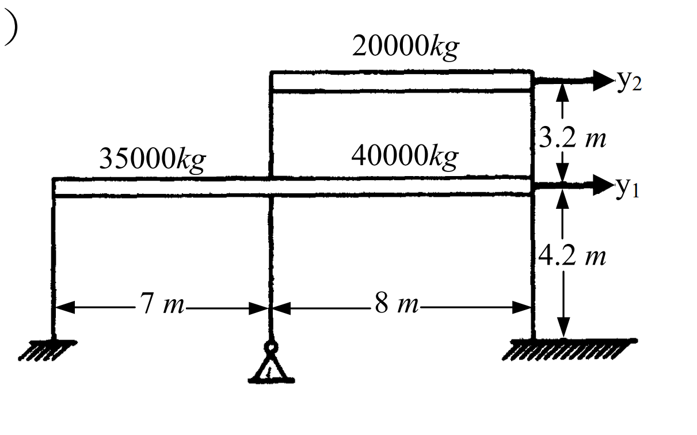

# SD-2005-2 題目正本

> 本檔只記錄考卷上寫了什麼、圖上畫了什麼，不含任何解法。解析見同資料夾 `SD-2005-2.md`。
> 判讀清單經使用者確認前，狀態為「待確認」；確認後本檔原則上不再修改（改動須回考卷原圖並記 log）。

| 項目 | 內容 |
|---|---|
| 考卷 | `raw/exams/SD-2005_結構動力分析與耐震設計.pdf`，第 1 頁（全一頁），第二題 |
| 考年 | 2005（民國94年）專技高考結構工程技師「結構動力分析與耐震設計」 |
| 配分 | 25 分（㈠15 分、㈡10 分） |
| 附圖 | `SD-2005-2-fig-1.png`（原證據圖，左上角殘留題文括號） |
| 判讀狀態 | **已確認**（2026-11-15 使用者授權依 Claude 建議確認。原轉錄：2026-11-15 轉錄；PyMuPDF 110／150 dpi 整頁＋450–500 dpi 局部放大，PDF 文字層與向量座標核對；盲讀於開啟解析前完成） |

## 1. 考卷原文（逐字）

二、下圖為兩層剪力屋架，質量及尺寸如圖所示，一樓三支柱子斷面尺寸均為50cm × 50cm，二樓二支柱子斷面尺寸均為40cm × 40cm，楊氏彈性模數為2.3 × 106 kgf/cm2。

㈠請計算勁度矩陣[k]與質量矩陣[m]。（15 分）

㈡請計算頻率與振態。（10 分）

## 2. 考卷給的公式、附表與參數

- 考卷沒有給任何參考公式或附表。
- 給定：一樓柱 3 支 50cm×50cm、二樓柱 2 支 40cm×40cm；$E=2.3\times10^{6}$ kgf/cm²（重力單位）；質量 35000kg、40000kg（一樓樓版兩跨）、20000kg（二樓樓版）；樓高 4.2 m、3.2 m；跨度 7 m、8 m。
- 考卷沒有給：$g$ 值、阻尼。
- 卷首注意事項：㈠不必抄題，作答時請將試題題號及答案依照順序寫在試卷上，於本試題紙上作答者，不予計分。㈡可以使用電子計算器，但需詳列解答過程。考試時間：2 小時。

## 3. 附圖

*證據圖 SD-2005-2-fig-1.png*

圖面文字照錄：20000kg、y2、3.2 m、35000kg、40000kg、y1、4.2 m、7 m、8 m

## 4. 判讀清單

| # | 項目 | 判讀 | 圖上／題文依據 | 把握 |
|---|---|---|---|---|
| 1 | 左柱底 | 固定支承（剖線） | 450 dpi 圖面 | 確定 |
| 2 | 中柱底 | **鉸支承**（小圓圈＋三角形），一樓中柱為一端鉸接 | 450 dpi 圖面 | 確定 |
| 3 | 右柱底 | 固定支承（剖線） | 450 dpi 圖面 | 確定 |
| 4 | 柱頂 | 剪力屋架：樓版剛性、柱頂不轉動 | 題文「剪力屋架」 | 確定（解讀） |
| 5 | 二樓範圍 | 只在右跨（中柱線至右柱線，8 m）；二樓兩柱位於中柱線與右柱線，中柱連續上到二樓 | 圖面 | 確定 |
| 6 | 一樓樓版質量 | 左跨 35000 kg＋右跨 40000 kg，同屬 $y_1$ 樓版 | 圖面標籤位置 | 確定（解讀） |
| 7 | 二樓樓版質量 | 20000 kg（$y_2$） | 圖面 | 確定 |
| 8 | 樓高 | 一樓 4.2 m（地面至 $y_1$ 樓版線）、二樓 3.2 m（$y_1$ 至 $y_2$） | 尺寸線箭頭 | 確定 |
| 9 | 柱斷面 | 一樓 3 支 50×50 cm、二樓 2 支 40×40 cm（方形，兩軸同 I） | 題文 | 確定 |
| 10 | E 單位 | kgf/cm²（重力單位，換 SI 需乘 g） | 題文 | 確定 |
| 11 | 跨度 | 7 m、8 m（剪力屋架計算不需要） | 圖面 | 確定 |
| 12 | 所求 | ㈠ [k]、[m] ㈡ 頻率與振態 | 題文 | 確定 |

---
*轉錄：2026-11-15（SD-U1-3 題目正本推廣・批 1）*
*確認：2026-11-15 使用者授權依 Claude 建議確認（SD-U1-3 題目正本推廣・批 1，關卡一）*
