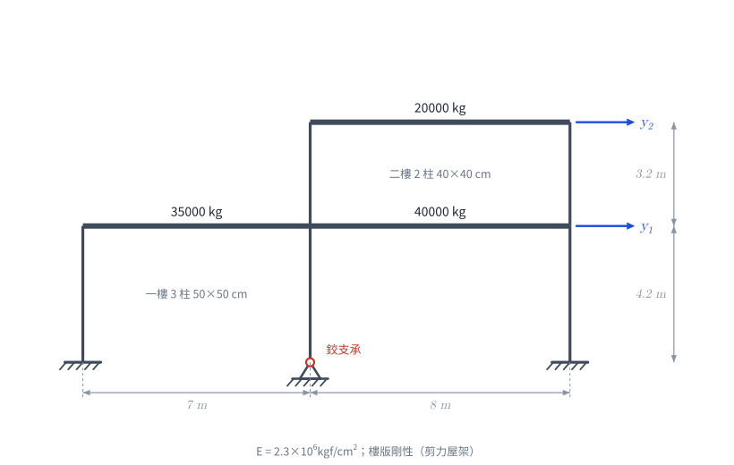
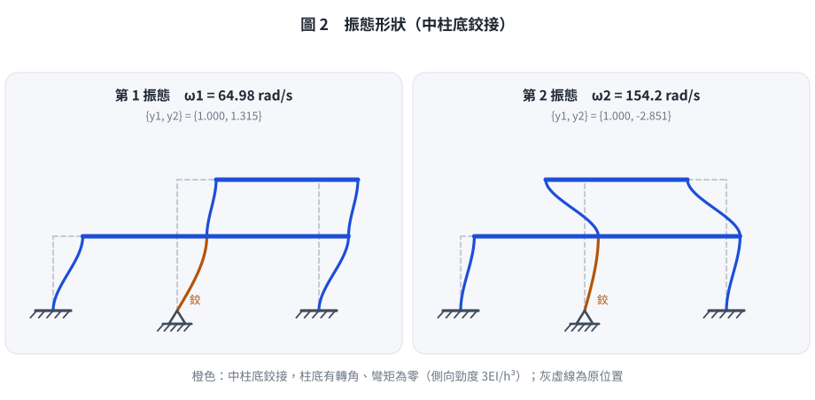

# 考題編號：SD-2005-2

**主分類：** `SD-U1` 結構動力學基礎
**副分類：** `SD-U1-3` 多自由度系統動態分析
**分析方法：** MDOF 模態分析
**標籤：** `MDOF` `剪力屋架` `勁度矩陣` `質量矩陣` `特徵值` `自然頻率` `振態`

---

## 1. 題目（考卷原文見題目正本）

> 考卷原文、公式／附表、附圖與判讀清單（已確認）見 [`SD-2005-2-problem.md`](SD-2005-2-problem.md)。本節只列解題時最容易讀錯的地方與本解使用的記號；題意以題目正本為準。

*重繪自考卷附圖，依題目正本判讀清單；本圖攔下的判讀錯誤：中柱底是鉸支承，側向勁度為 3EI/h³ 而非 12EI/h³。*

### 常見誤讀

| 項目 | 正確判讀 | 常見誤讀 |
|------|---------|---------|
| 中柱底 | **鉸支承**（判讀 #2）：一樓中柱側向勁度 $3EI/h^3$ | 三柱皆固定、一律 $12EI/h^3$（本庫舊解 §1、§4 的讀法） |
| 二樓 | 只在右跨，兩柱（中柱線、右柱線），柱頂底皆固定（剪力屋架） | 三柱 |
| 一樓質量 | $35000+40000=75000$ kg | 只取一跨 |
| $E$ 單位 | kgf/cm²（重力單位，換 SI 乘 $g$） | 直接當 N/cm² |

**本解記號：** $y_1$、$y_2$ 為一、二樓樓版側移；$k_1$、$k_2$ 為一、二樓樓層勁度；$h_1=4.2$ m、$h_2=3.2$ m。

---

## 2. 考題核心精神與出題者意圖 (Core Concepts & Examiner's Intent)

**核心觀念：**
- 剪力屋架（shear frame）模型中，梁假設剛性，側向勁度完全由柱提供
- 每支柱的橫向勁度依柱端條件：兩端固定 $12EI/h^3$；本題一樓中柱底為**鉸支承**（柱頂固定於剛性樓版），為 $3EI/h^3$
- 質量矩陣為對角矩陣（集中質量模型）
- 二自由度系統的自然頻率與振態由特徵值問題求解

**出題者意圖：**
- 測驗剪力屋架的勁度推導能力（$12EI/h^3$ 與一端鉸接 $3EI/h^3$ 的辨識）
- 測驗 2×2 特徵值問題的手算能力
- 測驗振態向量的物理意義判斷（第一模態同向；第二模態反向）

---

## 3. 解題戰略地圖與陷阱分析 (Strategic Roadmap & Trap Analysis)

### 作戰計畫
1. 計算各層柱的慣性矩 $I = a^4/12$（正方形斷面）
2. 計算各層層間勁度 $k_i = \sum k_{\rm col}$：一樓兩支固定柱 $12EI/h^3$＋中柱（底鉸接）$3EI/h^3$；二樓兩支 $12EI/h^3$
3. 組裝勁度矩陣 $[K]$ 與質量矩陣 $[M]$（質量需除以 $g$ 換算）
4. 解特徵值方程式 $\det([K] - \omega^2[M]) = 0$，得 $\omega_1, \omega_2$
5. 代回求各模態振態向量 $\{\phi\}_i$

### 關鍵陷阱

| 陷阱 | 說明 | 應對 |
|------|------|------|
| ⓪ 支承判讀 | 一樓中柱底為鉸支承（圖上小圓圈＋三角形），不是固定 | 中柱 $3EI_1/h_1^3$；$k_1 = (2\times12+3)EI_1/h_1^3 = 27EI_1/h_1^3$ |
| ① 柱數漏乘 | 一樓三柱、二樓兩柱；勁度需各自累加 | $k_2 = 2 \times (12EI_2/h_2^3)$ |
| ② 單位不一致 | 質量給 kg，勁度用 kgf/cm | 質量需轉換：$m \text{(kgf}\cdot\text{s}^2\text{/cm)} = m_{\rm kg} / g_{\rm cm}$ |
| ③ 勁度矩陣組裝錯誤 | $K_{11} = k_1+k_2$，非 $k_1$ | 上層勁度 $k_2$ 亦會影響一樓的等效勁度 |
| ④ 振態正規化方向 | 振態方向任意，注意第一模態 $\phi_2 > \phi_1$（同向），第二模態 $\phi_2 < 0$（反向） | 一般取 $\phi_1 = 1$ 做正規化，說明物理意義 |

---

## 3.5 變數層次分析 (Variable Hierarchy Analysis)

> 複習提示：第一次解題後，在每個卡住的知識點旁標記 `⚠`；第二次複習時只看有 `⚠` 的項目。

### 最終目標
求兩層剪力屋架的勁度矩陣 $[K]$、質量矩陣 $[M]$，以及兩個自然頻率 $\omega_1, \omega_2$ 與對應振態 $\{\phi\}_1, \{\phi\}_2$。

### 本題關鍵公式（依計算順序）

$$k_{\rm col}^{\rm fixed} = \frac{12EI}{h^3} = \frac{Ea^4}{h^3}, \quad k_{\rm col}^{\rm pin} = \frac{3EI}{h^3} = \frac{Ea^4}{4h^3} \quad (I = a^4/12)$$

$$k_1 = 2k_{\rm col,1}^{\rm fixed} + k_{\rm col,1}^{\rm pin}, \qquad k_2 = 2k_{\rm col,2}^{\rm fixed}$$

$$[K] = \begin{bmatrix} k_1+k_2 & -k_2 \\ -k_2 & k_2 \end{bmatrix}, \quad [M] = \begin{bmatrix} m_1/g & 0 \\ 0 & m_2/g \end{bmatrix}$$

$$\det\left([K] - \omega^2[M]\right) = 0 \Rightarrow \omega^4 - \frac{\boxed{k_2}m_1 + (\boxed{k_1}+\boxed{k_2})m_2}{m_1 m_2}\omega^2 + \frac{\boxed{k_1}\boxed{k_2}}{m_1 m_2} = 0$$

$$\frac{\phi_{i,2}}{\phi_{i,1}} = \frac{k_1+k_2 - \boxed{\omega_i^2} m_1}{k_2}$$

### L1：題目直接給定

| 符號 | 數值 | 說明 |
|------|------|------|
| $E$ | $2.3\times10^6$ kgf/cm² | 楊氏彈性模數 |
| $a_1$ | 50 cm | 一樓柱斷面邊長 |
| $a_2$ | 40 cm | 二樓柱斷面邊長 |
| $h_1$ | 420 cm | 一樓層高 |
| $h_2$ | 320 cm | 二樓層高 |
| $n_1$ | 3 | 一樓柱數（左、右柱底固定；中柱底鉸支承） |
| $n_2$ | 2 | 二樓柱數 |
| $M_1$ | 75,000 kg | 一樓總集中質量 |
| $M_2$ | 20,000 kg | 二樓集中質量 |
| $g$ | 980 cm/s² | 重力加速度 |

### L2：需知識點推導

**慣性矩與層間勁度**

| 符號 | 公式／來源 | 卡關? |
|------|-----------|-------|
| $I_1$ | $50^4/12 = 520{,}833 \text{ cm}^4$ | |
| $I_2$ | $40^4/12 = 213{,}333 \text{ cm}^4$ | |
| $k_{\rm col,1}^{\rm fixed}$ | $12EI_1/h_1^3 = Ea_1^4/h_1^3 = 194{,}026$ kgf/cm | |
| $k_{\rm col,1}^{\rm pin}$ | $3EI_1/h_1^3 = 48{,}507$ kgf/cm | |
| $k_1$ | $2\times194{,}026 + 48{,}507 = 436{,}559$ kgf/cm | |
| $k_{\rm col,2}$ | $12EI_2/h_2^3 = Ea_2^4/h_2^3$ | |
| $k_2$ | $2 \times k_{\rm col,2} = 359{,}375$ kgf/cm | |

**質量矩陣（單位換算）**

| 符號 | 公式／來源 | 卡關? |
|------|-----------|-------|
| $m_1$ | $75{,}000/980 = 76.53$ kgf·s²/cm | |
| $m_2$ | $20{,}000/980 = 20.41$ kgf·s²/cm | |

**特徵值求解**

| 符號 | 公式／來源 | 卡關? |
|------|-----------|-------|
| $\lambda_{1,2}$ | 二次方程式公式 $\lambda = \frac{B \pm \sqrt{B^2-4AC}}{2A}$ | |
| $\omega_{1,2}$ | $\omega = \sqrt{\lambda}$ | |
| $\phi_{i,2}/\phi_{i,1}$ | 代回 row 1 方程式 | |

### L3：深層知識（不懂就卡住）

| 知識點 | 說明 | 卡關? |
|--------|------|-------|
| 剪力屋架假設 | 梁剛性無限大 → 柱頂無轉角；柱底固定時側向勁度 $12EI/h^3$，柱底鉸接時為 $3EI/h^3$（同懸臂柱） | |
| 勁度矩陣組裝邏輯 | $K_{11}=k_1+k_2$（1F受到1F柱與2F柱共同抵抗）；$K_{22}=k_2$；$K_{12}=K_{21}=-k_2$ | |
| 質量單位換算 | $[M]$ 元素單位須為 kgf·s²/cm（使 $\omega^2 = k/m$ 有 rad²/s² 量綱）| |
| 特徵向量物理意義 | 模態1同向（低頻整體搖晃）；模態2反向（高頻局部振動）| |

---

## 4. 步驟化詳細計算過程 (Step-by-Step Detailed Calculation)

### (一) 勁度矩陣 $[K]$ 與質量矩陣 $[M]$

#### Step 1：計算各柱慣性矩

正方形斷面：$I = a^4/12$

$$I_1 = \frac{50^4}{12} = \frac{6{,}250{,}000}{12} = 520{,}833 \text{ cm}^4$$

$$I_2 = \frac{40^4}{12} = \frac{2{,}560{,}000}{12} = 213{,}333 \text{ cm}^4$$

#### Step 2：計算各層層間勁度

剪力屋架（樓版剛性，柱頂不轉動）。單柱側向勁度依柱底條件：

$$k_{\rm col}^{\rm fixed} = \frac{12E \cdot (a^4/12)}{h^3} = \frac{Ea^4}{h^3}, \qquad k_{\rm col}^{\rm pin} = \frac{3EI}{h^3} = \frac{1}{4}k_{\rm col}^{\rm fixed}$$

**一樓（3 支柱，$a_1=50$ cm，$h_1=420$ cm；左、右柱底固定，中柱底鉸支承）：**

$$k_{\rm col,1}^{\rm fixed} = \frac{2.3\times10^6 \times 50^4}{420^3} = \frac{2.3\times10^6 \times 6{,}250{,}000}{74{,}088{,}000} = 194{,}026 \text{ kgf/cm}$$

$$k_{\rm col,1}^{\rm pin} = \frac{194{,}026}{4} = 48{,}507 \text{ kgf/cm}$$

$$\boxed{k_1 = 2 \times 194{,}026 + 48{,}507 = 436{,}559 \text{ kgf/cm}}$$

**二樓（2 支柱，$a_2=40$ cm，$h_2=320$ cm，兩端固定）：**

$$k_{\rm col,2} = \frac{2.3\times10^6 \times 40^4}{320^3} = \frac{2.3\times10^6 \times 2{,}560{,}000}{32{,}768{,}000} = 179{,}688 \text{ kgf/cm}$$

$$\boxed{k_2 = 2 \times 179{,}688 = 359{,}375 \text{ kgf/cm}}$$

#### Step 3：組裝勁度矩陣

$$\boxed{[K] = \begin{bmatrix} k_1+k_2 & -k_2 \\ -k_2 & k_2 \end{bmatrix} = \begin{bmatrix} 795{,}934 & -359{,}375 \\ -359{,}375 & 359{,}375 \end{bmatrix} \text{ kgf/cm}}$$

#### Step 4：組裝質量矩陣

集中質量模型，取 $g = 980 \text{ cm/s}^2$：

$$m_1 = \frac{M_1}{g} = \frac{75{,}000}{980} = 76.53 \text{ kgf}\cdot\text{s}^2/\text{cm}$$

$$m_2 = \frac{M_2}{g} = \frac{20{,}000}{980} = 20.41 \text{ kgf}\cdot\text{s}^2/\text{cm}$$

$$\boxed{[M] = \begin{bmatrix} 76.53 & 0 \\ 0 & 20.41 \end{bmatrix} \text{ kgf}\cdot\text{s}^2/\text{cm}}$$

---

### (二) 頻率與振態

#### Step 5：建立特徵值方程式

令 $\lambda = \omega^2$，由 $\det([K] - \lambda[M]) = 0$：

$$m_1 m_2 \lambda^2 - \left[(k_1+k_2)m_2 + k_2 m_1\right]\lambda + k_1 k_2 = 0$$

| 係數 | 計算 | 值 |
|------|------|---|
| $A = m_1 m_2$ | $76.53 \times 20.41$ | $1{,}561.85$ |
| $B = (k_1+k_2)m_2 + k_2 m_1$ | $795{,}934\times20.41 + 359{,}375\times76.53$ | $43{,}746{,}731$ |
| $C = k_1 k_2$ | $436{,}559 \times 359{,}375$ | $1.5689 \times 10^{11}$ |

特徵方程式除以 $A$：

$$\lambda^2 - 28{,}010\,\lambda + 100{,}450{,}000 = 0$$

#### Step 6：求解特徵值（自然頻率平方）

$$\Delta = 28{,}010^2 - 4 \times 100{,}450{,}000 = 382{,}735{,}000, \qquad \sqrt{\Delta} = 19{,}564$$

$$\lambda_1 = \frac{28{,}010 - 19{,}564}{2} = 4{,}223.0 \text{ rad}^2/\text{s}^2, \qquad \lambda_2 = \frac{28{,}010 + 19{,}564}{2} = 23{,}786.6 \text{ rad}^2/\text{s}^2$$

$$\boxed{\omega_1 = \sqrt{4{,}223.0} = 64.98 \text{ rad/s}\ (f_1=10.34\text{ Hz}) \quad \Rightarrow \quad T_1 = 0.0967 \text{ s}}$$

$$\boxed{\omega_2 = \sqrt{23{,}786.6} = 154.2 \text{ rad/s}\ (f_2=24.55\text{ Hz}) \quad \Rightarrow \quad T_2 = 0.0407 \text{ s}}$$

#### Step 7：求振態向量

代入 Row 1 方程式：$\dfrac{\phi_{i2}}{\phi_{i1}} = \dfrac{(k_1+k_2) - \lambda_i m_1}{k_2}$

**第一模態（$\lambda_1 = 4{,}223.0$）：**

$$\frac{\phi_{12}}{\phi_{11}} = \frac{795{,}934 - 4{,}223.0\times76.53}{359{,}375} = \frac{795{,}934 - 323{,}186}{359{,}375} = +1.315$$

$$\boxed{\{\phi\}_1 = \begin{Bmatrix} 1.000 \\ 1.315 \end{Bmatrix}}$$

**第二模態（$\lambda_2 = 23{,}786.6$）：**

$$\frac{\phi_{22}}{\phi_{21}} = \frac{795{,}934 - 23{,}786.6\times76.53}{359{,}375} = \frac{795{,}934 - 1{,}820{,}403}{359{,}375} = -2.851$$

$$\boxed{\{\phi\}_2 = \begin{Bmatrix} 1.000 \\ -2.851 \end{Bmatrix}}$$

（若以二樓分量正規化為 1：$\{\phi\}_1 = \{0.760,\ 1\}^T$、$\{\phi\}_2 = \{-0.351,\ 1\}^T$。）

#### 驗證：以 Row 2 方程式交叉確認

Row 2：$\phi_{i2}/\phi_{i1} = k_2/(k_2 - \lambda_i m_2)$

| 模態 | $\lambda_i m_2$ | $k_2 - \lambda_i m_2$ | $\phi_{i2}/\phi_{i1}$ | 結果 |
|------|-----------------|-----------------------|-----------------------|------|
| 1 | $4{,}223.0 \times 20.41 = 86{,}183$ | $273{,}192$ | $1.315$ | ✓ |
| 2 | $23{,}786.6 \times 20.41 = 485{,}441$ | $-126{,}066$ | $-2.851$ | ✓ |

另以 SI 單位（$g=9.80665$ m/s²、$E=2.3\times10^6\times9.80665\times10^4$ Pa、質量直接用 kg）以 `numpy.linalg.eig` 重算：$\omega_1=65.01$、$\omega_2=154.28$ rad/s，與上式差 0.03%（$g$ 取 980 與 980.665 之差）。

*圖 2　振態形狀。中柱底鉸接，柱底轉動、彎矩為零，所以它只提供 $3EI/h^3$；若畫成與左右柱一樣的雙曲率，就是把鉸支承讀成固定。*

---

### 最終結果彙整

**勁度矩陣：**

$$[K] = \begin{bmatrix} 795{,}934 & -359{,}375 \\ -359{,}375 & 359{,}375 \end{bmatrix} \text{ kgf/cm}$$

**質量矩陣：**

$$[M] = \begin{bmatrix} 76.53 & 0 \\ 0 & 20.41 \end{bmatrix} \text{ kgf}\cdot\text{s}^2/\text{cm}$$

**自然頻率與週期：**

$$\omega_1 = 64.98 \text{ rad/s},\quad T_1 = 0.0967 \text{ s}$$
$$\omega_2 = 154.2 \text{ rad/s},\quad T_2 = 0.0407 \text{ s}$$

**振態：**

$$\{\phi\}_1 = \begin{Bmatrix} 1.000 \\ 1.315 \end{Bmatrix} \quad (\text{同向，整體搖晃})$$

$$\{\phi\}_2 = \begin{Bmatrix} 1.000 \\ -2.851 \end{Bmatrix} \quad (\text{反向，局部振動})$$

**對照：** 若誤把中柱底當固定（本庫舊解），$k_1 = 582{,}078$ kgf/cm，$\omega_1 = 74.04$、$\omega_2 = 156.3$ rad/s，振態 $\{1, 1.452\}$、$\{1, -2.583\}$——第一頻率高估 14%。

---

## 5. 關鍵爭議點與進階探討 (Critical Issues & Advanced Discussion)

**1. 關於 E 值的物理解讀**

本題 $E = 2.3 \times 10^6 \text{ kgf/cm}^2 \approx 225 \text{ GPa}$，與鋼材彈性模數（$\approx 210 \text{ GPa}$）接近。若為 RC 柱，正常 E 值應為約 $2.5\times10^5 \text{ kgf/cm}^2$（≈ 25 GPa）。建議考場不需質疑題目給定值，直接使用計算。

**2. 剪力屋架假設的適用條件**

「梁剛性無限大」假設在樑柱勁度比（beam-to-column stiffness ratio）大時有效，一般 $EI_{\rm beam}/L_{\rm beam} \gg EI_{\rm col}/h$ 時適用。本題未給梁斷面，即以剪力屋架模型處理。

**3. 振態驗証（正交性）**

正確的振態應滿足：

$$\{\phi\}_1^T [M] \{\phi\}_2 = 0 \quad \text{（質量正交性）}$$

$$76.53 \times 1 \times 1 + 20.41 \times 1.315 \times (-2.851) = 76.53 - 76.52 \approx 0 \checkmark$$

**4. 考場建議**

- 特徵值解題時，列出係數 $A, B, C$ 再代入公式，避免展開出錯
- 求振態後，一定要用另一個 row 方程式交叉驗算（本題 Row 2 驗算）
- 振態正規化方式不影響答案（任何倍數均可），說明物理意義即可得分

*修正日期：2026-11-15（§1 改為指向題目正本，重繪附圖 figs/SD-2005-2-fig-1-problem.svg）*

*修正日期：2026-11-15（FIX-SD-U1-3-B1 解析勘誤（判讀）：一樓中柱底為鉸支承（考卷附圖圓圈＋三角形），側向勁度由 12EI/h³ 改為 3EI/h³，k1 由 582,090 改為 436,559 kgf/cm；ω1 74.04→64.98 rad/s、ω2 156.3→154.2 rad/s，振態 {1, 1.452}/{1, −2.583} → {1, 1.315}/{1, −2.851}；改寫 §2、§3、§3.5、§4、§5 正交性驗算。驗證：scripts/fixes/2026-11-15_verify_SD-2005-2.py 閉合解、numpy.linalg.eig、SI 單位三路一致，MISMATCHES: 0；與盲解比對紀錄 65.01／154.28 rad/s 一致）*

*圖解補繪：2026-11-15（向量圖，腳本 `gen_SD-2005-2.py`，可重跑；非勘誤、答案不變）*
