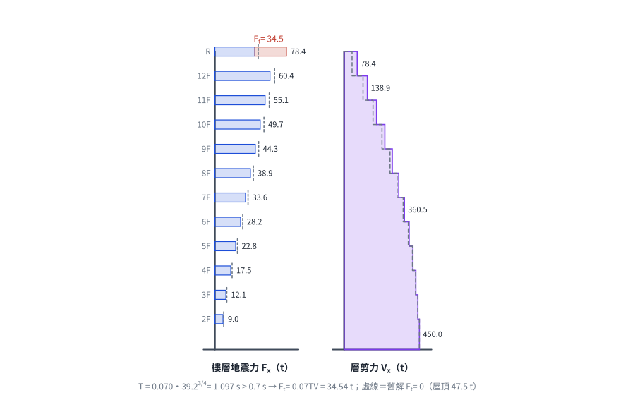

# 考題編號：SD-2005-3

**主分類：** `SD-U2-2` 建築耐震設計規範
**副分類：** （無）
**分析方法：** 等效靜力法（地震力分配）
**標籤：** `等效靜力法` `地震力分配` `樓層剪力` `Fx分配` `高度分布` `RC建築`

---

## 1. 題目（考卷原文見題目正本）

> 考卷原文、公式／附表、附圖與判讀清單（已確認）見 [`SD-2005-3-problem.md`](SD-2005-3-problem.md)。本節只列解題時最容易讀錯的地方與本解使用的記號；題意以題目正本為準。

### 常見誤讀

| 項目 | 正確判讀 | 常見誤讀 |
|------|---------|---------|
| 小題 | 考卷不分小題（一題 25 分），所求為各樓層地震力與各樓層剪力（判讀 #7） | 另列「(一)(二)」小題 |
| 頂層集中力 $F_t$ | 考卷沒給 $T$ 不代表 $F_t=0$；依現行台灣規範以經驗公式估 $T$（結構系統未給，採 RC 抗彎構架）再判斷 $F_t$（判讀 #2，定案） | 「沒給 $T$ → $F_t=0$」（本庫舊解即如此，屋頂力少算 39%；或誤以為 $F_t$ 是舊版規範才有的規定） |
| 屋突 | 重量、高度考卷都沒給，不列質量點，屋頂層仍為 200 噸、$h_n$ 量到屋頂 39.2 m（判讀 #1，定案） | 自補屋突重量或高度，或自訂「屋突重 ≤ 頂層 25% 可合併」之類無出處的門檻 |
| 樓層標高 | 二樓 4 m，以上每層 +3.2 m，屋頂層 39.2 m；質量點 12 個（判讀 #3、#4） | 把一樓也當 3.2 m，或漏掉屋頂層 |
| 「噸」 | 重量（tf），與基底剪力同單位（判讀 #5） | 當質量再乘 g |

**本解記號：** $W_i$、$h_i$＝第 $i$ 樓層重與離地高度；$V$＝基底剪力；$F_i$＝施加於第 $i$ 樓層的地震力；$V_i$＝第 $i$ 樓層剪力；$F_t$＝頂層集中力。

---

## 2. 考題核心精神與出題者意圖 (Core Concepts & Examiner's Intent)

**核心觀念：**
等值靜力法的豎向分配：基底剪力 $V$ 先扣除頂層集中力 $F_t$，其餘依「重量×高度」比例分配（倒三角形）：

$$F_t = 0.07TV \le 0.25V\ \ (T \le 0.7\ \text{s 時 } F_t=0),\qquad F_x = \frac{(V-F_t)\,W_x h_x}{\displaystyle\sum_{i} W_i h_i}$$

物理意義：倒三角形對應第一振態；長週期建築高振態的貢獻集中在頂部，倒三角形低估頂部剪力，因此規範在頂層另加 $F_t$。
題目沒給週期 $T$，**不代表 $F_t=0$**——要用規範經驗公式估 $T$ 再判斷。

**出題者意圖：**
- 測驗豎向分配公式（含 $F_t$ 的適用條件）
- 測驗 12 層建築的樓層高度計算（含不同首層高度）
- 測驗樓層剪力的累積計算（從頂部往下逐層加總）
- 「並有屋突」：提醒屋突的處理（考卷沒給屋突數據，見 §5）

---

## 3. 解題戰略地圖與陷阱分析 (Strategic Roadmap & Trap Analysis)

### 作戰計畫
1. 整理各樓層高度 $h_i$（從基面量起），$h_n$＝基面至屋頂面高度
2. 以現行規範經驗公式估基本振動週期 $T$（RC 建築 $T=0.070h_n^{3/4}$），判斷 $F_t$
3. 計算各樓層 $W_i h_i$，求總和 $\sum W_i h_i$
4. $F_x=(V-F_t)W_xh_x/\sum W_ih_i$，屋頂層再加 $F_t$
5. 從頂部累加得各層剪力 $V_x$，最後應等於 $V=450$ t

### 關鍵陷阱

| 陷阱 | 說明 | 應對 |
|------|------|------|
| ① 高度起算錯誤 | 各樓層高度 $h_i$ 應從**基面**量起，非層高 | 二樓 $h=4.0$ m；三樓 $h=4.0+3.2=7.2$ m |
| ② 屋頂層忘計入 | 屋頂層（12 層樓的頂）有 200 噸，應列入計算 | 屋頂高度 $=4.0+11\times3.2=39.2$ m |
| ③ 沒給 $T$ 就令 $F_t=0$ | 現行規範 §2.11 仍規定 $F_t=0.07TV$（$T>0.7$ s） | 用 §2.6 經驗公式估 $T=1.097$ s ＞ 0.7 s → $F_t=34.54$ t |
| ④ $F_t$ 忘記從 $V$ 扣除 | 倒三角形分配的是 $V-F_t$ | $V-F_t=415.46$ t |
| ⑤ 屋突自補數據 | 考卷沒給屋突重量、高度 | 不列質量點，屋頂層 200 t、$h_n=39.2$ m（題目正本判讀 #1） |
| ⑥ 剪力方向累加 | 樓層剪力需從**頂部往下累加** | $V_x=\sum_{i\ge x}F_i$ |

---

## 3.5 變數層次分析 (Variable Hierarchy Analysis)

> 複習提示：第一次解題後，在每個卡住的知識點旁標記 `⚠`；第二次複習時只看有 `⚠` 的項目。

### 最終目標
求各樓層地震力 $F_x$（二樓～屋頂 12 個樓層）與各層剪力 $V_x$（第 1～12 層）。

### 本題關鍵公式（依計算順序）

$$h_i = 4.0 + (i-2)\times 3.2\ \text{m}\quad (i = 2\ldots12),\qquad h_n = 4.0 + 11\times3.2 = 39.2\ \text{m}$$

$$T = 0.070\,h_n^{3/4}\quad\text{（現行規範 (2-8) 式，RC 建築）}$$

$$F_t = 0.07TV \le 0.25V\quad (T\le0.7\ \text{s 時可為 0})$$

$$F_x = \frac{(V-F_t)W_xh_x}{\sum W_ih_i}\ \ (\text{屋頂層再加 }F_t),\qquad V_x=\sum_{i\ge x}F_i$$

### L1：題目直接給定

| 符號 | 數值 | 說明 |
|------|------|------|
| 一樓層高 | 4.0 m | |
| 標準層層高 | 3.2 m | 其餘 11 層 |
| $W_2$ | 400 t | 二樓重 |
| $W_{3\sim12}$ | 300 t（各） | 三至十二樓標準層重 |
| $W_{\rm roof}$ | 200 t | 屋頂層重（屋突數據考卷未給） |
| $V$ | 450 t | 基底總剪力（已知） |

### L2：需知識點推導

| 符號 | 公式／來源 | 卡關? |
|------|-----------|-------|
| $h_n$ | 39.2 m（基面至屋頂面） | |
| $T$ | $0.070\times39.2^{3/4}=1.0966$ s（規範 §2.6） | |
| $F_t$ | $0.07\times1.0966\times450=34.54$ t ≤ $0.25V=112.5$ t（規範 §2.11） | |
| $\sum W_ih_i$ | 74,240 t·m | |
| $F_x$、$V_x$ | 見 §4 | |

### L3：深層知識（不懂就卡住）

| 知識點 | 說明 | 卡關? |
|--------|------|-------|
| 倒三角形分配 | 第一振態近似直線、各樓層加速度 ∝ 高度 → $F_x\propto W_xh_x$ | |
| 頂層集中力 $F_t$ | 長週期建築高振態使頂部剪力大於倒三角形估計；現行規範 §2.11 保留此規定 | |
| 經驗週期 | 沒給 $T$ 時以規範經驗公式估；RC 建築（剛構架、無剪力牆等）係數 0.070，有剪力牆或斜撐者用 (2-9) 式係數 0.050 | |

---

## 4. 步驟化詳細計算過程 (Step-by-Step Detailed Calculation)

### Step 1：各樓層高度 $h_i$（從基面量起）

| 樓層 | 計算式 | $h_i$ (m) |
|------|--------|-----------|
| 2F | 4.0 | **4.0** |
| 3F | 4.0 + 3.2 | **7.2** |
| 4F | 4.0 + 2×3.2 | **10.4** |
| 5F | 4.0 + 3×3.2 | **13.6** |
| 6F | 4.0 + 4×3.2 | **16.8** |
| 7F | 4.0 + 5×3.2 | **20.0** |
| 8F | 4.0 + 6×3.2 | **23.2** |
| 9F | 4.0 + 7×3.2 | **26.4** |
| 10F | 4.0 + 8×3.2 | **29.6** |
| 11F | 4.0 + 9×3.2 | **32.8** |
| 12F | 4.0 + 10×3.2 | **36.0** |
| 屋頂 | 4.0 + 11×3.2 | **39.2** |

### Step 2：基本振動週期 $T$ 與頂層集中力 $F_t$

考卷沒給週期與結構系統，只說「鋼筋混凝土建築物」；依現行規範 §2.6 (2-8) 式（RC 建築，剛構架、無剪力牆）：

$$T = 0.070\,h_n^{3/4} = 0.070\times39.2^{3/4} = 1.097\ \text{s} > 0.7\ \text{s}$$

依 §2.11：

$$F_t = 0.07TV = 0.07\times1.0966\times450 = 34.54\ \text{t}\ \le 0.25V = 112.5\ \text{t}\quad\checkmark$$

$$V - F_t = 450 - 34.54 = 415.46\ \text{t}$$

### Step 3：各樓層 $W_i h_i$ 及加總

| 樓層 | $W_i$ (t) | $h_i$ (m) | $W_i h_i$ (t·m) |
|------|----------|----------|----------------|
| 2F | 400 | 4.0 | 1,600 |
| 3F | 300 | 7.2 | 2,160 |
| 4F | 300 | 10.4 | 3,120 |
| 5F | 300 | 13.6 | 4,080 |
| 6F | 300 | 16.8 | 5,040 |
| 7F | 300 | 20.0 | 6,000 |
| 8F | 300 | 23.2 | 6,960 |
| 9F | 300 | 26.4 | 7,920 |
| 10F | 300 | 29.6 | 8,880 |
| 11F | 300 | 32.8 | 9,840 |
| 12F | 300 | 36.0 | 10,800 |
| 屋頂 | 200 | 39.2 | 7,840 |
| **合計** | | | **$\sum W_i h_i = 74,240$ t·m** |

### Step 4：各樓層地震力 $F_x$

$$F_x = \frac{W_x h_x}{74{,}240}\times415.46\ \text{t}\quad(\text{屋頂層再加 }F_t=34.54\ \text{t})$$

| 樓層 | $W_x h_x$ (t·m) | 倒三角形分配 (t) | $F_x$ (t) | 對照：$F_t=0$ (t) |
|------|----------------|----------------|----------|----------------|
| 2F | 1,600 | 8.95 | **8.95** | 9.70 |
| 3F | 2,160 | 12.09 | **12.09** | 13.09 |
| 4F | 3,120 | 17.46 | **17.46** | 18.91 |
| 5F | 4,080 | 22.83 | **22.83** | 24.73 |
| 6F | 5,040 | 28.20 | **28.20** | 30.55 |
| 7F | 6,000 | 33.58 | **33.58** | 36.37 |
| 8F | 6,960 | 38.95 | **38.95** | 42.19 |
| 9F | 7,920 | 44.32 | **44.32** | 48.01 |
| 10F | 8,880 | 49.69 | **49.69** | 53.83 |
| 11F | 9,840 | 55.07 | **55.07** | 59.64 |
| 12F | 10,800 | 60.44 | **60.44** | 65.46 |
| 屋頂 | 7,840 | 43.87 | 43.87 + 34.54 = **78.42** | 47.52 |
| **合計** | **74,240** | 415.46 | **450.00** ✓ | 450.00 |

$$\boxed{F_{\rm 2F}=8.95\ \text{t}\ \text{逐層增至}\ F_{\rm 12F}=60.44\ \text{t，}\ F_{\text{屋頂}}=43.87+34.54=78.42\ \text{t}}$$

### Step 5：各層剪力 $V_x$（從頂部累加）

層剪力 = 該層以上（含該層頂樓版）所有地震力之和（即該層柱子承受的水平剪力）：

| 層 | 樓版地震力 (t) | 層剪力 $V_x$ (t) | 對照：$F_t=0$ (t) |
|----|--------------|---------------|----------------|
| 第 12 層（12F–屋頂） | 78.42 | **78.42** | 47.52 |
| 第 11 層（11F–12F） | 60.44 | **138.86** | 112.98 |
| 第 10 層（10F–11F） | 55.07 | **193.92** | 172.63 |
| 第 9 層（9F–10F） | 49.69 | **243.62** | 226.45 |
| 第 8 層（8F–9F） | 44.32 | **287.94** | 274.46 |
| 第 7 層（7F–8F） | 38.95 | **326.89** | 316.65 |
| 第 6 層（6F–7F） | 33.58 | **360.46** | 353.02 |
| 第 5 層（5F–6F） | 28.20 | **388.67** | 383.57 |
| 第 4 層（4F–5F） | 22.83 | **411.50** | 408.30 |
| 第 3 層（3F–4F） | 17.46 | **428.96** | 427.21 |
| 第 2 層（2F–3F） | 12.09 | **441.05** | 440.30 |
| 第 1 層（1F–2F） | 8.95 | **450.00** | 450.00 |

$$\boxed{V_{12}=78.42\ \text{t}\ (\text{頂層}),\quad V_1=450.00\ \text{t} = V\ \checkmark}$$

*圖解：左為各樓層地震力（藍為倒三角形分配 $V-F_t$，紅為頂層集中力 $F_t$），右為層剪力；灰虛線是 $F_t=0$ 的舊答案。本圖攔下「沒給 $T$ 就令 $F_t=0$」的錯誤：頂層力差 65%，其餘樓層只差 7.7%。*

---

## 5. 關鍵爭議點與進階探討 (Critical Issues & Advanced Discussion)

**1. 頂層集中力 $F_t$：現行規範仍保留（本庫舊解的錯誤）**

現行建築物耐震設計規範及解說（111 年版）§2.11 規定 $F_t=0.07TV$、不必大於 $0.25V$，$T\le0.7$ s 時可為零。
本庫舊解以「題目直接給 V、未給 T」為由取 $F_t=0$，並稱 $F_t$ 為舊版規範規定——兩點都不對：沒給 $T$ 時應以 §2.6 經驗公式估算。
舊答案（$F_t=0$）列於 §4 表格對照欄：屋頂 47.52 t、12F 65.46 t、頂層剪力 47.52 t；
現行規範答案屋頂 78.42 t（+65%），其餘各樓層 ×0.923（−7.7%）。

**2. 週期公式的選用**

考卷只寫「鋼筋混凝土建築物」，沒說有無剪力牆。本解採 (2-8) 式（係數 0.070，剛構架、無非結構剛性牆／剪力牆／斜撐）。
若為有剪力牆或斜撐的 RC 建築，改用 (2-9) 式係數 0.050：$T=0.050\times39.2^{3/4}=0.783$ s，仍 ＞ 0.7 s，$F_t=24.67$ t。
作答時應寫明採用的結構系統假設。

**3. 屋突（Penthouse）**

考卷寫「並有屋突」但沒給屋突的重量與高度，本解不列為質量點，屋頂層仍取 200 t、$h_n$ 量到屋頂面 39.2 m（題目正本判讀 #1）。
現行規範對屋突等突出物的地震力另有規定（條文待核），有數據時應另行計算；舊解所稱「屋突重 ≤ 頂層 25% 可合併」查無出處，已刪除。

**4. 一樓是否有地震力**

一樓地面（$h=0$）不分配地震力。一樓以上重量影響的是總重 $W$（用於計算基底剪力 $V$），本題 $V$ 已知，故不影響計算。

**5. 考場建議**

- 先寫出 $T$ 與 $F_t$ 的判斷（這是本題的鑑別點），再整理高度表
- $\sum W_i h_i = 74,240$ t·m 是全題的關鍵數字，建議明確寫出並驗算
- 樓層剪力從頂往下累加，最後應等於 $V = 450$ t 作為自我驗算

*修正日期：2026-11-16（§1 改為指向題目正本（純文字題，無附圖）；刪除 §1 考卷沒有的小題編號；判讀 #2（F_t 依現行規範估 T）與本解 F_t＝0 不符，待階段 C 勘誤，本次答案不變）*

*修正日期：2026-11-16（勘誤（規範條文漏用）：改依現行台灣規範（建築物耐震設計規範及解說 111 年版）§2.11 頂層集中力 Ft＝0.07TV；以 §2.6 (2-8) 式 T＝0.070hn^(3/4)＝1.097 s ＞ 0.7 s 得 Ft＝34.54 t（舊解取 Ft＝0）；屋頂力 47.52→78.42 t、12F 65.46→60.44 t、頂層剪力 47.52→78.42 t，其餘樓層 ×0.923；改寫 §2–§5，刪除無出處的屋突 25% 規則；標頭分類改與索引一致（非勘誤）。驗證：scripts/fixes/2026-11-16_verify_SD-2005-3.py，MISMATCHES: 0；與盲解比對 B-U2-2-G1 一致）*

*修正日期：2026-11-16（非勘誤）圖解補繪：§4 Step 5 後插入 figs/SD-2005-3-fig-1-story-forces.svg（樓層地震力與層剪力，含 F_t 與舊解對照；腳本 gen_SD-2005-3.py）*
