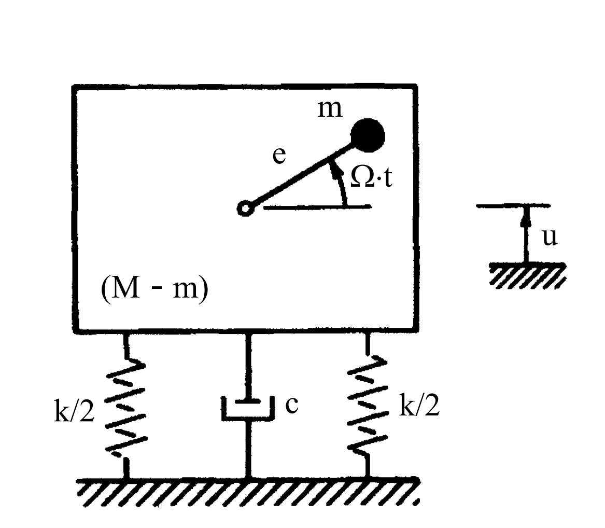

# SD-2005-4 題目正本

> 本檔只記錄考卷上寫了什麼、圖上畫了什麼，不含任何解法。解析見同資料夾 `SD-2005-4.md`。
> 判讀清單經使用者確認前，狀態為「待確認」；確認後本檔原則上不再修改（改動須回考卷原圖並記 log）。

| 項目 | 內容 |
|---|---|
| 考卷 | `raw/exams/SD-2005_結構動力分析與耐震設計.pdf`，第 1 頁（全一頁），第四題 |
| 考年 | 2005（民國94年）專技高考結構工程技師「結構動力分析與耐震設計」 |
| 配分 | 25 分（10／10／5） |
| 附圖 | `SD-2005-4-fig-1.png` |
| 判讀狀態 | **已確認**（2026-11-15 使用者授權依 Claude 建議確認；影響答案形式項目定案：#1 主解採圖上黏滯阻尼器 c，題文「遲滯阻尼」型式於 §5 附註。原轉錄：2026-11-15 轉錄；PyMuPDF 110／150 dpi 整頁＋450–500 dpi 局部放大，PDF 文字層與向量座標核對；盲讀於開啟解析前完成） |

## 1. 考卷原文（逐字）

四、有一棟建築物內裝設有一馬達，其質量為 m，以 Ω rad/sec 頻率運轉，假設馬達質心有 e 之偏心，馬達與建築物之總質量為 M，相對於基礎建築物可視為剛性體，如果基礎的勁度及遲滯阻尼分別為 k 及 c。

㈠請導出垂直方向運動方程式。（10 分）

㈡請導出垂直方向穩態振動反應位移。（10 分）

㈢請計算作用於基礎之力。（5 分）

## 2. 考卷給的公式、附表與參數

- 考卷沒有給任何參考公式或附表。
- 符號：m（馬達質量）、Ω（rad/sec）、e（偏心）、M（馬達與建築物總質量）、k、c。
- 考卷沒有給：數值（全部以符號作答）、初始條件。
- 卷首注意事項：㈠不必抄題，作答時請將試題題號及答案依照順序寫在試卷上，於本試題紙上作答者，不予計分。㈡可以使用電子計算器，但需詳列解答過程。考試時間：2 小時。

## 3. 附圖

*證據圖 SD-2005-4-fig-1.png*

圖面文字照錄：m、e、Ω·t、(M - m)、u、k/2、c、k/2

## 4. 判讀清單

| # | 項目 | 判讀 | 圖上／題文依據 | 把握 |
|---|---|---|---|---|
| 1 | 阻尼型式 | 題文寫「遲滯阻尼」，圖上畫的是黏滯阻尼器（dashpot）符號、係數 c | 題文 vs 圖面 | 不確定（影響答案形式）；建議主解採圖上的黏滯阻尼 $c\dot u$，§5 附遲滯阻尼（$ic$ 或 $\eta k$）型式；使用者授權依建議確認 |
| 2 | 質量 | 方框為 $(M-m)$，加上馬達 m，總質量 M | 圖面、題文 | 確定 |
| 3 | 偏心角 | Ωt 由水平線量起（逆時針） | 圖面 | 確定 |
| 4 | 位移 u | 垂直向上為正 | 圖面右側 u 箭頭向上 | 確定 |
| 5 | 彈簧 | 兩支各 $k/2$，合計 $k$ | 圖面 | 確定 |
| 6 | 剛體 | 建築物相對基礎視為剛體（單自由度垂直運動） | 題文 | 確定 |
| 7 | 所求 | ㈠ 垂直運動方程式 ㈡ 穩態位移 ㈢ 傳到基礎的力 | 題文 | 確定 |

---
*轉錄：2026-11-15（SD-U1-3 題目正本推廣・批 1）*
*確認：2026-11-15 使用者授權依 Claude 建議確認（SD-U1-3 題目正本推廣・批 1，關卡一）*
