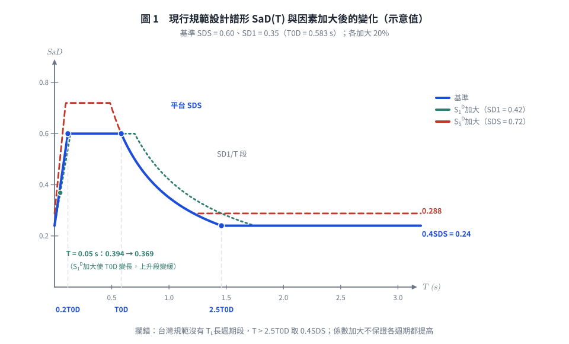

# 考題編號：SD-2006-3

**主分類：** `SD-U2-2` 建築耐震設計規範
**副分類：** `SD-U2-1` 地震力之設計規範
**分析方法：** 概念題
**標籤：** `工址彈性水平譜加速度係數` `反應譜` `場址類別` `地震分區` `短週期加速度SDS` `長週期加速度SD1` `阻尼比` `設計地震` `最大考量地震` `建築耐震規範` `近斷層效應` `地盤分類` `震區係數`

---

## 1. 題目（考卷原文見題目正本）

> 考卷原文、公式／附表、附圖與判讀清單（已確認）見 [`SD-2006-3-problem.md`](SD-2006-3-problem.md)。本節只列解題時最容易讀錯的地方與本解使用的記號；題意以題目正本為準。

### 常見誤讀

| 項目 | 正確判讀 | 常見誤讀 |
|------|---------|---------|
| 規範版本 | 「現行」主線採現行最新台灣規範（111 年版），民國 95 年當時版本的五項因素放 §5（判讀 #1，使用者授權依建議確認） | 照考試當年版本作答而不說明；或把美國 ASCE 7／IBC 的譜形（$S_{DS}=\tfrac23S_{MS}$、$T_L$）當成台灣規範 |
| 所指係數 | 工址水平譜加速度係數的彈性譜值（設計地震 $S_{aD}$、最大考量地震 $S_{aM}$），未除以 $1.4\alpha_yF_u$（判讀 #2） | 把設計地震力 $V/W$ 當成譜加速度係數 |
| 排除項目 | 用途係數 $I$ 與 $F_u$、$\alpha_y$、1.4 都不算在五項因素內（判讀 #3） | 把 $I$ 或 $F_u$ 列為因素 |
| 所求 | 列五項因素，並逐項說明「如何變動才會提高」（判讀 #4） | 只列因素、不說變動方向 |

**本解記號：** $S_a$：工址水平譜加速度係數（設計地震 $S_{aD}$、最大考量地震 $S_{aM}$）；$T$：結構基本振動週期。

---

## 2. 考題核心精神與出題者意圖 (Core Concepts & Examiner's Intent)

本題考台灣「建築物耐震設計規範及解說」的工址水平譜加速度係數是怎麼組出來的。題目說「不考慮用途和各種折減」，就是把用途係數 $I$ 與分母的 $1.4\alpha_yF_u$ 都拿掉，只剩**彈性設計譜本身**：工址所在地的震區係數 → 近斷層修正 → 地盤放大 → 依結構週期在譜形上取值。

出題者意圖：
1. 能否正確列出**台灣規範**的五項決定因素（不是美國 ASCE 7／IBC 的架構）；
2. 能否逐項說明往哪個方向變動會提高譜值——尤其週期 $T$ 的影響不是單調的。

---

## 3. 解題戰略地圖與陷阱分析 (Strategic Roadmap & Trap Analysis)

**答題架構：** 先寫譜值的組成鏈 $S_S^D,\ S_1^D$ →（近斷層修正）→ $F_a,\ F_v$ → $S_{DS},\ S_{D1},\ T_0^D$ → $S_{aD}(T)$；再逐項列五項因素與提高方向；最後補充最大考量地震與臺北盆地。

**關鍵陷阱：**

| # | 陷阱 | 正確觀念 |
|---|------|---------|
| 1 | 套用美國 ASCE 7／IBC 架構（$S_{DS}=\tfrac23S_{MS}$、場址類別 A～F、$T_L$ 長週期段） | 台灣規範的設計地震係數 $S_S^D$、$S_1^D$ 與最大考量地震係數 $S_S^M$、$S_1^M$ **各自查表**，沒有固定的 2/3 關係；地盤只分三類；譜形在 $T>2.5T_0^D$ 取 $0.4S_{DS}$，沒有 $T_L$ 段 |
| 2 | 漏掉近斷層效應 | 工址靠近規範列出的活動斷層時，震區係數須依工址至斷層的最短水平距離線性內插（規範 2.4 節，表 2-3-1～2-3-4），距離越近越高 |
| 3 | 把阻尼比、地震水準列為「因素」 | 設計譜固定以 5% 阻尼定義；設計地震（475 年）與最大考量地震（2500 年）是兩個地震水準，不是決定同一係數的因素，可放在補充說明 |
| 4 | 把週期 $T$ 說成單調 | $T\le0.2T_0^D$ 週期加長譜值上升；平台段最大；$T_0^D<T\le2.5T_0^D$ 週期縮短譜值上升；$T>2.5T_0^D$ 為定值 $0.4S_{DS}$ |
| 5 | 「地盤越軟一定越高」「係數加大各週期一定都提高」 | 放大係數也隨震區係數變化（土壤非線性，以表 2-4 為準）；$S_1^D$ 或 $F_v$ 加大會使 $T_0^D$ 變長，極短週期（$T<0.2T_0^D$）的上升段斜率變緩，譜值反而略降 |

---

## 3.5 變數層次分析（Variable Hierarchy Analysis）

> 複習提示：第一次解題後，在每個卡住的知識點旁標記 `⚠`；第二次複習時只看有 `⚠` 的項目。

### 最終目標
`列出決定工址（彈性）水平譜加速度係數的五項因素，並說明各因素如何變動會提高譜值`

### 本題關鍵公式（依計算順序，現行 111 年版規範，臺北盆地除外）

$$\text{Step 1: } S_S^D,\ S_1^D \ \text{（表 2-1 依工址所在鄉鎮市區；近斷層工址依 2.4 節表 2-3-1～2-3-4 按斷層距離內插）}$$

$$\text{Step 2: } S_{DS}=F_a\,S_S^D,\qquad S_{D1}=F_v\,S_1^D \quad\text{（}F_a\text{、}F_v\text{ 依地盤分類與 }S_S^D\text{、}S_1^D\text{ 查表 2-4，規範 2.5 節）}$$

$$\text{Step 3: } T_0^D=\frac{S_{D1}}{S_{DS}}$$

$$\text{Step 4: } S_{aD}(T)=\begin{cases} S_{DS}\left(0.4+3\,\dfrac{T}{T_0^D}\right) & T\le0.2T_0^D \\[4pt] S_{DS} & 0.2T_0^D<T\le T_0^D \\[4pt] \dfrac{S_{D1}}{T} & T_0^D<T\le2.5T_0^D \\[4pt] 0.4\,S_{DS} & T>2.5T_0^D \end{cases}\quad\text{（表 2-5(a)）}$$

### L1：題目直接給定

| 符號 | 數值 | 說明 |
|------|------|------|
| 不考慮用途 | 不乘 $I$ | 用途係數排除 |
| 不考慮折減 | 不除 $1.4\alpha_yF_u$ | 只談彈性譜值 |

### L2：需知識點推導

| 符號 | 公式／來源 | 卡關? |
|------|----------|:-----:|
| $S_S^D,\ S_1^D$ | 震區短週期、一秒週期設計水平譜加速度係數（表 2-1） | |
| 近斷層修正 | 依工址至斷層最短水平距離線性內插（表 2-3-1～2-3-4） | |
| $F_a,\ F_v$ | 依地盤分類（$V_{S30}$ 分第一、二、三類）與 $S_S^D$、$S_1^D$ 查表 2-4 | |
| $S_{DS},\ S_{D1}$ | $F_aS_S^D,\ F_vS_1^D$ | |
| $T_0^D$ | $S_{D1}/S_{DS}$ | |
| $S_{aD}(T)$ | 四段譜形（表 2-5(a)） | |

### L3：深層知識（不懂就卡住）

| 知識點 | 說明 | 卡關? |
|--------|------|:-----:|
| 為何沒有 2/3 | 台灣規範兩個地震水準的係數分別由危害度分析訂定、分別查表，比值隨地點而變 | |
| 近斷層效應 | 斷層附近的地震動有方向性脈衝、振幅較大，所以按距離提高係數 | |
| 土壤非線性 | 軟弱地盤在小震時放大明顯，強震時土壤軟化、放大倍率降低，所以 $F_a$、$F_v$ 同時依地盤與震區係數查表 | |
| 阻尼不是因素 | 設計譜固定 5% 阻尼；不同阻尼的修正用在動力分析、隔震與消能等章節 | |
| 為何排除 $I$ 與 $1.4\alpha_yF_u$ | $I$ 是用途重要性；$1.4\alpha_yF_u$ 是超強與韌性折減，都不屬彈性地震需求本身 | |

---

## 4. 步驟化詳細計算過程 (Step-by-Step Detailed Calculation)

本題為概念論述題，以下依序說明五項因素；文中示意數值（$S_{DS}=0.60$、$S_{D1}=0.35$）只用來說明趨勢，不是任何工址的規範值。

---

### 前言：工址水平譜加速度係數的定義

工址設計水平譜加速度係數 $S_{aD}(T)$ 是 5% 阻尼的彈性單自由度結構，在設計地震（回歸期 475 年，50 年超越機率 10%）下的譜加速度與 $g$ 的比值。最小設計水平總橫力為

$$V=\frac{S_{aD}\,I}{1.4\,\alpha_y\,F_u}\,W$$

題目要求不考慮 $I$ 與各種折減（$1.4\alpha_yF_u$），也就是只問 $S_{aD}(T)$ 本身由什麼決定。依現行 111 年版規範（臺北盆地除外），$S_{aD}$ 由 §3.5 的四個步驟組成，因此決定因素為：**震區短週期係數 $S_S^D$、震區一秒週期係數 $S_1^D$、近斷層效應、地盤分類、結構基本振動週期 $T$**。

---

### 五項決定因素

#### 因素一：震區短週期設計水平譜加速度係數 $S_S^D$

依工址所在鄉鎮市區由規範表 2-1 查得，反映當地短週期地震危害度。

**如何提高：** 工址位於地震危害度較高的地區 → $S_S^D\uparrow$ → $S_{DS}\uparrow$ → 短週期上升段、平台段與 $T>2.5T_0^D$ 段的譜值提高（$S_{D1}/T$ 段不變）。

#### 因素二：震區一秒週期設計水平譜加速度係數 $S_1^D$

同樣依工址所在地查表 2-1，反映中長週期地震危害度。

**如何提高：** $S_1^D\uparrow$ → $S_{D1}\uparrow$ → $T_0^D<T\le2.5T_0^D$ 段的譜值提高，平台段也延長（$T_0^D$ 變大）。注意 $T_0^D$ 變大也使 $T\le0.2T_0^D$ 上升段的斜率變緩，極短週期的譜值略降（下表）。

#### 因素三：近斷層效應（工址至活動斷層的距離）

工址靠近規範列出的活動斷層時，必須考量近斷層效應：震區係數依工址至斷層地表跡線的最短水平距離，由表 2-3-1～2-3-4 線性內插求得（附近有數條斷層時各參數取最大值）。

**如何提高：** 工址離斷層越近 → 內插所得的短週期與一秒週期係數越大 → $S_{DS}$、$S_{D1}$ 同時提高。

#### 因素四：工址地盤分類（決定 $F_a$、$F_v$）

除臺北盆地外，地盤依地表下 30 m 內的平均剪力波速 $V_{S30}$ 分為第一類（堅實）、第二類（普通，$180\le V_{S30}<270$ m/s）、第三類（軟弱，$V_{S30}<180$ m/s）；$F_a$ 依地盤分類與 $S_S^D$、$F_v$ 依地盤分類與 $S_1^D$ 查表 2-4。

**如何提高：** 地盤由堅實變軟弱，地盤放大係數一般變大（長週期的 $F_v$ 增幅較明顯）→ $S_{DS}$、$S_{D1}$ 提高。但放大係數也隨震區係數變化（強震時土壤非線性、放大倍率降低），實際數值以表 2-4 為準。臺北盆地不用 $V_{S30}$ 分類，改依微分區（臺北一、二、三區）直接給定 $S_{DS}$ 與轉角週期。

#### 因素五：結構基本振動週期 $T$（譜形取值位置）

| 段別 | 週期範圍 | $S_{aD}$ | 週期加長時 |
|------|---------|---------|:---------:|
| 上升段 | $T\le0.2T_0^D$ | $S_{DS}(0.4+3T/T_0^D)$ | 增大 |
| 平台段 | $0.2T_0^D<T\le T_0^D$ | $S_{DS}$（最大值） | 不變 |
| 下降段 | $T_0^D<T\le2.5T_0^D$ | $S_{D1}/T$ | 減小 |
| 下限段 | $T>2.5T_0^D$ | $0.4S_{DS}$ | 不變 |

（分段兩端連續：$T=0$ 時為 $0.4S_{DS}$，$T=0.2T_0^D$ 時為 $S_{DS}$，$T=2.5T_0^D$ 時 $S_{D1}/T=0.4S_{DS}$。）

**如何提高：** 週期落在平台段時譜值最大；在下降段時縮短週期（加大勁度）可提高；在上升段時加長週期才會提高。

*圖 1　現行規範設計譜形（表 2-5(a)）與因素一、二加大 20% 後的變化（示意值）。本圖攔下兩種錯：把美國規範的 $T_L$ 長週期段與 $\tfrac23$ 關係套進台灣規範；以為係數加大後各週期譜值都提高（$S_1^D$ 加大時極短週期反而略降）。*

**示意數值（$S_{DS}=0.60$、$S_{D1}=0.35$，$T_0^D=0.583$ s；各係數加大 20%）：**

| $T$（s） | 0.05 | 0.3 | 0.8 | 1.5 | 3.0 |
|---|---|---|---|---|---|
| 基準 $S_{aD}$ | 0.394 | 0.600 | 0.438 | 0.240 | 0.240 |
| $S_S^D$ 加大（$S_{DS}=0.72$） | 0.510 | 0.720 | 0.438 | 0.288 | 0.288 |
| $S_1^D$ 加大（$S_{D1}=0.42$） | 0.369 | 0.600 | 0.525 | 0.280 | 0.240 |

---

### 五項因素整合摘要

| 因素 | 決定內容 | 提高譜加速度係數的方式 |
|------|---------|:-----------------|
| **①震區短週期係數** $S_S^D$ | $S_{DS}$（平台高度） | 工址位於短週期危害度較高的地區 |
| **②震區一秒週期係數** $S_1^D$ | $S_{D1}$（下降段高度）、$T_0^D$ | 工址位於一秒週期危害度較高的地區 |
| **③近斷層效應** | 依斷層距離內插提高震區係數 | 工址越靠近活動斷層 |
| **④地盤分類** $F_a$、$F_v$ | 地盤放大 | 地盤越軟弱（一般情形；數值依表 2-4）；臺北盆地依微分區 |
| **⑤基本振動週期** $T$ | 在譜形上的取值位置 | 落在平台段；在下降段時縮短週期；在上升段時加長週期 |

---

## 5. 關鍵爭議點與進階探討 (Critical Issues & Advanced Discussion)

### 爭議點 1：考試當年版本與現行版本

題目寫「現行」規範，考試當年（民國 95 年）適用 94 年版。依本庫規範版本政策，主線用現行 111 年版。兩版的五項因素相同（震區短週期係數、震區一秒週期係數、近斷層、地盤分類、週期），差別在內容：94 年版的近斷層效應是以近斷層調整因子 $N_A$、$N_V$ 乘在震區係數上（條文待核），111 年版改為依斷層距離內插表 2-3-1～2-3-4 的係數；111 年版也更新了震區係數與臺北盆地微分區（111 年版解說 2.7 節：94 年版微分區未考量 921、331 等地震的影響）。表 2-4、表 2-5(a) 的原表數值本解未逐字核對，譜形分段已以連續性驗算，條文待核。

**本庫舊解對照（2026-11-16 勘誤前）：** 舊解以美國 ASCE 7／IBC 架構作答（$S_{DS}=\tfrac23S_{MS}$、場址類別 SA～SF、$T_L$ 段、$S_{DS}[0.4+0.6T/T_0]$），五項列為「$S_s/S_1$、場址類別、設計地震等級（改用最大考量地震提高 1.5 倍）、週期、阻尼比」，漏了近斷層效應；「地震等級」與「阻尼比」不是台灣規範一般工址譜加速度係數的決定因素。

### 爭議點 2：週期因素的雙向性

週期 $T$ 提高譜值的方向取決於目前週期落在哪一段，不是「縮短」或「延長」能統一回答。考場最安全的說法：「使結構週期落在平台段（$0.2T_0^D\sim T_0^D$）可得最大值 $S_{DS}$；若在下降段，縮短週期（加大勁度）可提高；若在上升段，加長週期可提高。」

### 補充：地震水準與阻尼（可作加分說明，不列入五項）

- 最大考量地震（回歸期 2500 年，50 年超越機率 2%）的工址譜加速度係數 $S_{aM}$，用 $S_S^M$、$S_1^M$ 以同樣方法求得；它比 $S_{aD}$ 大，但兩者比值隨地點而變，不是固定 1.5 倍。
- 規範譜固定以 5% 阻尼定義；不同阻尼比的修正係數用在動力分析、隔震與消能等章節，不屬本題的工址譜加速度係數本身。

*修正日期：2026-11-16（§1 改為指向題目正本）*

*修正日期：2026-11-16（勘誤：改依現行台灣規範（建築物耐震設計規範及解說 111 年版）重寫 §2–§5——舊解套用美國 ASCE 7／IBC 架構（2/3 關係、SA～SF、T_L 段），五項誤列「設計地震等級」「阻尼比」、漏近斷層效應；改為震區短週期係數、震區一秒週期係數、近斷層效應、地盤分類、基本振動週期；新增示意數值表。證據：2006 年第 1 頁第三題題文；規範第 2.3～2.6 節（國土管理署 PDF）。驗證：scripts/fixes/2026-11-16_verify_SD-2006-3.py 譜形分段連續性、單調性掃描與示意數值，MISMATCHES: 0；與盲解比對紀錄一致）*

*修正日期：2026-11-16（非勘誤）圖解補繪：figs/SD-2006-3-fig-1-spectrum.svg（現行規範譜形與因素加大的變化，§4 因素五）；向量圖，腳本 gen_SD-2006-3.py，可重跑*
