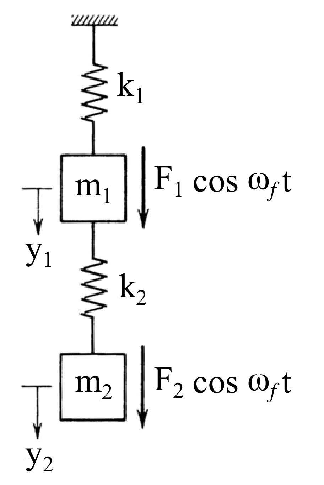

# SD-2007-2 題目正本

> 本檔只記錄考卷上寫了什麼、圖上畫了什麼，不含任何解法。解析見同資料夾 `SD-2007-2.md`。
> 判讀清單經使用者確認前，狀態為「待確認」；確認後本檔原則上不再修改（改動須回考卷原圖並記 log）。

| 項目 | 內容 |
|---|---|
| 考卷 | `raw/exams/SD-2007_結構動力分析與耐震設計.pdf`，第 1 頁（全一頁），第二題 |
| 考年 | 2007（民國96年）專技高考結構工程技師「結構動力分析與耐震設計」 |
| 配分 | 25 分（5／10／10） |
| 附圖 | `SD-2007-2-fig-1.png`（原證據圖，左上角有游標雜訊）、`SD-2007-2-fig-2.png`（2026-11-15 由考卷 500 dpi 重新擷取） |
| 判讀狀態 | **已確認**（2026-11-15 使用者授權依 Claude 建議確認。原轉錄：2026-11-15 轉錄；PyMuPDF 110／150 dpi 整頁＋450–500 dpi 局部放大，PDF 文字層與向量座標核對；盲讀於開啟解析前完成） |

## 1. 考卷原文（逐字）

二、右圖兩個自由度之振動系統，請：

㈠列出其運動方程式。（5 分）

㈡推求模態頻率（Modal frequencies）。（10 分）

㈢推求何時系統會發生共振現象。（10 分）

## 2. 考卷給的公式、附表與參數

- 考卷沒有給任何參考公式或附表；全部為符號（$m_1,m_2,k_1,k_2,F_1,F_2,\omega_f$）。
- 考卷沒有給：阻尼（圖上無阻尼器）、數值。
- 卷首注意事項：㈠可以使用電子計算器。㈡不必抄題，作答時請將試題題號及答案依照順序寫在試卷上，於本試題上作答者，不予計分。考試時間：2 小時。

## 3. 附圖

*證據圖 SD-2007-2-fig-2.png（500 dpi 重擷取）*

圖面文字照錄：k1、m1、F1 cos ωf t、y1、k2、m2、F2 cos ωf t、y2

## 4. 判讀清單

| # | 項目 | 判讀 | 圖上／題文依據 | 把握 |
|---|---|---|---|---|
| 1 | 支承 | 上端固定（剖線），$k_1$ 連固定端與 $m_1$ | 圖面 | 確定 |
| 2 | 串接 | $k_2$ 連 $m_1$ 與 $m_2$；$m_2$ 下方自由 | 圖面 | 確定 |
| 3 | 位移正向 | $y_1$、$y_2$ 向下為正（量自靜平衡位置） | 圖面箭頭 | 確定（解讀） |
| 4 | 外力 | $F_1\cos\omega_f t$ 作用於 $m_1$、$F_2\cos\omega_f t$ 作用於 $m_2$，皆向下，同頻率 | 圖面 | 確定 |
| 5 | 阻尼 | 無 | 圖面 | 確定 |
| 6 | 所求 | ㈠運動方程式 ㈡模態頻率 ㈢共振條件 | 題文 | 確定 |

---
*轉錄：2026-11-15（SD-U1-3 題目正本推廣・批 1）*
*確認：2026-11-15 使用者授權依 Claude 建議確認（SD-U1-3 題目正本推廣・批 1，關卡一）*
