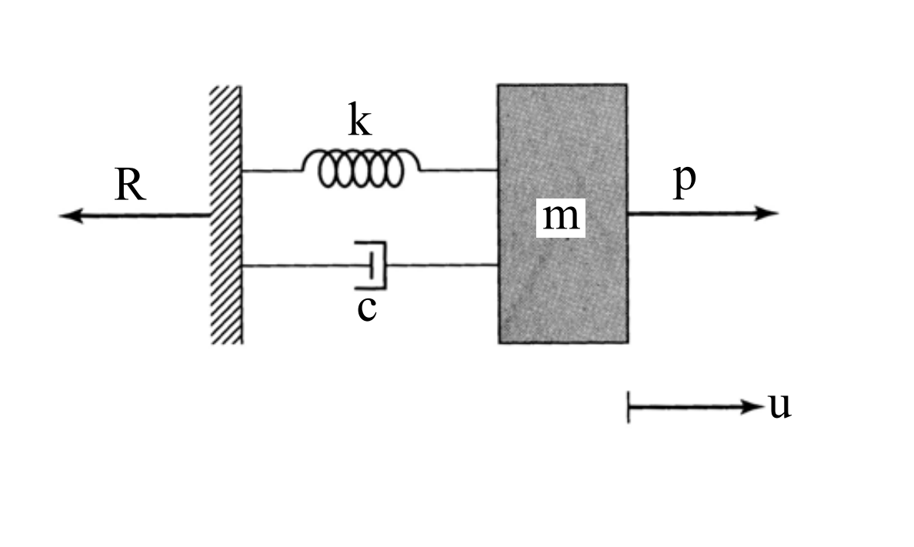

# SD-2007-3 題目正本

> 本檔只記錄考卷上寫了什麼、圖上畫了什麼，不含任何解法。解析見同資料夾 `SD-2007-3.md`。
> 判讀清單經使用者確認前，狀態為「待確認」；確認後本檔原則上不再修改（改動須回考卷原圖並記 log）。

| 項目 | 內容 |
|---|---|
| 考卷 | `raw/exams/SD-2007_結構動力分析與耐震設計.pdf`，第 1 頁（全一頁），第三題 |
| 考年 | 2007（民國96年）專技高考結構工程技師「結構動力分析與耐震設計」 |
| 配分 | 25 分（5／5／5／10） |
| 附圖 | `SD-2007-3-fig-1.png` |
| 判讀狀態 | **已確認**（2026-11-15 使用者授權依 Claude 建議確認。原轉錄：2026-11-15 轉錄；PyMuPDF 110／150 dpi 整頁＋450–500 dpi 局部放大，PDF 文字層與向量座標核對；盲讀於開啟解析前完成） |

## 1. 考卷原文（逐字）

三、右圖單自由度系統受到 $p(t)=p_0\sin\Omega t$ 之激發力：

㈠試列出位移 u 與 $p_0$ 間之轉換函數（transfer function）。（5 分）

㈡試列出加速度 $\ddot u$ 與 $p_0$ 間之轉換函數。（5 分）

㈢若 $p_0$= 0.1 W 且限制最大加速度 $\ddot u_{max}\le 0.05$ g，不考慮阻尼，試設計所需之勁度 k。（5 分）

㈣若 $p_0$= 10 kN，m = 1000 kg，Ω = 2π，且限制最大位移 $u_{max}\le$ 10 cm，不考慮阻尼，試設計所需之勁度 k。（10 分）

## 2. 考卷給的公式、附表與參數

- 考卷沒有給任何參考公式或附表。
- ㈢：$p_0=0.1W$、$\ddot u_{max}\le0.05g$、無阻尼；**考卷沒有給 Ω 數值**（答案只能以 Ω、m 表示）。
- ㈣：$p_0=10$ kN、$m=1000$ kg、$\Omega=2\pi$（rad/s）、$u_{max}\le10$ cm、無阻尼。
- 卷首注意事項：㈠可以使用電子計算器。㈡不必抄題，作答時請將試題題號及答案依照順序寫在試卷上，於本試題上作答者，不予計分。考試時間：2 小時。

## 3. 附圖

*證據圖 SD-2007-3-fig-1.png*

圖面文字照錄：R、k、c、m、p、u

## 4. 判讀清單

| # | 項目 | 判讀 | 圖上／題文依據 | 把握 |
|---|---|---|---|---|
| 1 | 系統 | 質量 m 以彈簧 k、阻尼器 c 並聯接固定牆；㈢㈣不考慮阻尼 | 圖面、題文 | 確定 |
| 2 | 外力 | $p_0\sin\Omega t$ 作用於 m、向右；位移 u 向右 | 圖面 | 確定 |
| 3 | R | 牆的反力（傳到支承的力），本題各小題沒有問 R | 圖面 | 確定 |
| 4 | 轉換函數 | ㈠㈡要的是穩態振幅比（含阻尼的一般式） | 題文 | 確定（解讀） |
| 5 | ㈢ Ω | 考卷沒有給數值；答案以 Ω 表示 | 題文 | 確定 |
| 6 | ㈣單位 | $p_0=10$ kN、$m=1000$ kg、$\Omega=2\pi$ rad/s、$u_{max}\le0.10$ m | 題文 | 確定 |
| 7 | 「最大」 | 指穩態振幅（題目為簡諧激發的轉換函數題） | 題文脈絡 | 確定（解讀） |

---
*轉錄：2026-11-15（SD-U1-3 題目正本推廣・批 1）*
*確認：2026-11-15 使用者授權依 Claude 建議確認（SD-U1-3 題目正本推廣・批 1，關卡一）*
