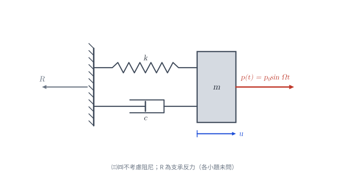
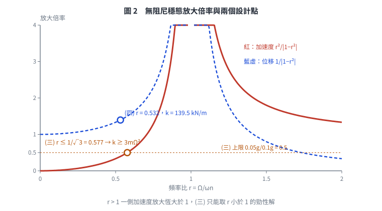

# 考題編號：SD-2007-3

**主分類：** `SD-U1-3` 單自由度系統之動態分析
**副分類：** `SD-U1-2` 運動方程式推導
**分析方法：** SDOF 強迫振動
**標籤：** `SDOF` `轉換函數` `頻率響應函數` `勁度設計` `動力放大` `諧和激振` `振動控制`

---

## 1. 題目（考卷原文見題目正本）

> 考卷原文、公式／附表、附圖與判讀清單（已確認）見 [`SD-2007-3-problem.md`](SD-2007-3-problem.md)。本節只列解題時最容易讀錯的地方與本解使用的記號；題意以題目正本為準。

*重繪自考卷附圖，依題目正本判讀清單；本圖攔下的判讀錯誤：外力作用在質量上，不是支承運動；R 是反力。*

### 常見誤讀

| 項目 | 正確判讀 | 常見誤讀 |
|------|---------|---------|
| 外力 | 作用在質量上的 $p_0\sin\Omega t$ | 支承運動 |
| ㈢ | 考卷沒有給 $\Omega$ 數值，答案以 $\Omega$ 表示 | 自行代入 ㈣ 的 $\Omega=2\pi$ |
| ㈢㈣ | 不考慮阻尼 | — |
| $R$ | 支承反力，各小題未問 | 當成外力 |

**本解記號：** $r=\Omega/\omega_n$、$\omega_n=\sqrt{k/m}$；$u_{max}$、$\ddot u_{max}$ 為穩態振幅。

---

## 2. 考題核心精神與出題者意圖 (Core Concepts & Examiner's Intent)

**核心精神：** 從頻率域（轉換函數）到時域（最大振幅），再到工程設計（求 $k$），是 SDOF 強迫振動的完整應用題。子題(三)(四)要求考生從振幅限制條件反求剛度，考驗設計導向的結構動力思維。

**出題者意圖：**
1. 測試考生能否從頻率域推導位移與加速度之轉換函數
2. 測試能否將振幅限制條件轉化為勁度設計不等式
3. 測試共振避開設計（$k > m\Omega^2$）的工程判斷

**陷阱：**
- 子題(三)(四)均有兩個可能解（$k > m\Omega^2$ 與 $k < m\Omega^2$），但負分支往往不可行（物理上無法保持正 $k$）
- 子題(三)答案需以 $\Omega$ 表示（題目未給具體頻率值）

---

## 3. 解題戰略地圖與陷阱分析 (Strategic Roadmap & Trap Analysis)

**作戰計畫：**
1. 建立運動方程式 → 假設穩態諧和解 → 求複數振幅 → 定義轉換函數
2. 加速度轉換函數 = $(-\Omega^2)$ × 位移轉換函數
3. 子題(三)：代入 $p_0 = 0.1W$，用加速度振幅公式設限，解 $k$
4. 子題(四)：代入數值，用位移振幅公式設限，解 $k$

**關鍵陷阱：**

| # | 陷阱 | 應對策略 |
|---|------|---------|
| 1 | 轉換函數是複數（含相位） | 題目問「轉換函數」，可寫複數形或取模；含阻尼版寫複數形即可 |
| 2 | $k - m\Omega^2$ 可正可負 | 必須分兩種情況討論，並驗證解的可行性 |
| 3 | 子題(三)無給 $\Omega$ | 答案合理地以 $\Omega$ 呈現，並說明需 $k > m\Omega^2$ 的設計條件 |
| 4 | 子題(四)確認是否在共振以下 | 驗算 $\omega_0 = \sqrt{k/m} > \Omega$，確保設計區域正確 |

---

## 3.5 變數層次分析 (Variable Hierarchy Analysis)

> 複習提示：第一次解題後，在每個卡住的知識點旁標記 `⚠`；第二次複習時只看有 `⚠` 的項目。

### 最終目標
建立位移與加速度之轉換函數，並依振幅限制條件設計勁度 $k$。

### 本題關鍵公式（依計算順序）

$$\text{Step 1：} m\ddot{u} + c\dot{u} + ku = p_0\sin\Omega t \quad \text{（運動方程式）}$$

$$\text{Step 2：} H_u(i\Omega) = \frac{U}{p_0} = \frac{1}{k - m\Omega^2 + ic\Omega} \quad \text{（位移轉換函數）}$$

$$\text{Step 3：} H_{\ddot{u}}(i\Omega) = \frac{\ddot{U}}{p_0} = \frac{-\Omega^2}{k - m\Omega^2 + ic\Omega} \quad \text{（加速度轉換函數）}$$

$$\text{Step 4（無阻尼）：} |u|_{max} = \frac{p_0}{|k - m\Omega^2|}, \quad |\ddot{u}|_{max} = \frac{p_0\,\Omega^2}{|k - m\Omega^2|}$$

$$\text{Step 5（子題三，} c=0\text{）：} \frac{0.1W \cdot \Omega^2}{k - m\Omega^2} \leq 0.05g \Rightarrow \boxed{k \geq 3m\Omega^2}$$

$$\text{Step 6（子題四，} c=0\text{）：} \frac{p_0}{k - m\Omega^2} \leq 0.1 \Rightarrow \boxed{k \geq \frac{p_0}{u_{max}} + m\Omega^2}$$

### L1：題目直接給定

| 符號 | 數值 | 說明 |
|------|------|------|
| $p_0$ | 0.1$W$（子題三）；10 kN（子題四） | 激振力振幅 |
| $m$ | — / 1000 kg | 質量 |
| $\Omega$ | — / $2\pi$ rad/s | 激振圓頻率 |
| $u_{max}$ 限制 | — / 10 cm | 最大位移限制 |
| $\ddot{u}_{max}$ 限制 | 0.05$g$ | 最大加速度限制 |

### L2：需知識點推導

**① 轉換函數**

| 符號 | 公式／來源 | 卡關? |
|------|-----------|-------|
| $H_u$ | $1/(k - m\Omega^2 + ic\Omega)$ | |
| $H_{\ddot{u}}$ | $-\Omega^2 \cdot H_u$（加速度 = $-\Omega^2$ × 位移） | |
| $\|H_u\|$（無阻尼） | $1/\|k - m\Omega^2\|$ | |
| $\|\ddot{u}\|_{max}$ | $p_0\Omega^2/\|k-m\Omega^2\|$ | |

**② 勁度設計**

| 符號 | 公式／來源 | 卡關? |
|------|-----------|-------|
| $m\Omega^2$（子題四） | $1000 \times (2\pi)^2 = 4000\pi^2 \approx 39478$ N/m | |
| $k \geq 3m\Omega^2$（子題三） | 由加速度限制 + $W = mg$ 推導 | |
| $k \geq p_0/u_{max} + m\Omega^2$（子題四） | 由位移限制推導 | |

### L3：深層知識（不懂就卡住）

| 知識點 | 說明 | 卡關? |
|--------|------|-------|
| 頻率響應函數（FRF）定義 | 複數比值，分母 $= k - m\Omega^2 + ic\Omega$（阻抗） | |
| 加速度 FRF 與位移 FRF 的關係 | 時域中 $\ddot{u} = -\Omega^2 u$（穩態諧和），故 FRF 乘 $-\Omega^2$ | |
| 設計於共振以下（stiffness-controlled） | $k > m\Omega^2$，分母正值，唯一合理設計區 | |
| 共振以上（mass-controlled）不考慮 | $k < m\Omega^2$ 時正 $k$ 受限，且動態放大更難控制 | |

---

## 4. 步驟化詳細計算過程 (Step-by-Step Detailed Calculation)

### 子題（一）：位移 $u$ 與 $p_0$ 之轉換函數

**運動方程式：**

$$m\ddot{u} + c\dot{u} + ku = p_0\sin\Omega t$$

**假設穩態複數解：** 令 $p(t) = p_0 e^{i\Omega t}$，對應穩態響應 $u(t) = U e^{i\Omega t}$，代入：

$$(-m\Omega^2 + ic\Omega + k)\,U\,e^{i\Omega t} = p_0\,e^{i\Omega t}$$

**位移轉換函數（頻率響應函數）：**

$$\boxed{H_u(i\Omega) = \frac{U}{p_0} = \frac{1}{k - m\Omega^2 + ic\Omega}}$$

取模（振幅比）：

$$|H_u| = \frac{1}{\sqrt{(k - m\Omega^2)^2 + (c\Omega)^2}}$$

---

### 子題（二）：加速度 $\ddot{u}$ 與 $p_0$ 之轉換函數

穩態下 $u(t) = U e^{i\Omega t}$，故：

$$\ddot{u}(t) = -\Omega^2 U e^{i\Omega t} = -\Omega^2 \cdot u(t)$$

**加速度轉換函數：**

$$\boxed{H_{\ddot{u}}(i\Omega) = \frac{\ddot{U}}{p_0} = -\Omega^2 \cdot H_u = \frac{-\Omega^2}{k - m\Omega^2 + ic\Omega}}$$

取模（加速度振幅比）：

$$|H_{\ddot{u}}| = \frac{\Omega^2}{\sqrt{(k - m\Omega^2)^2 + (c\Omega)^2}}$$

---

### 子題（三）：設計 $k$（$p_0 = 0.1W$，$\ddot{u}_{max} \leq 0.05g$，無阻尼）

**無阻尼（$c = 0$）加速度振幅：**

$$|\ddot{u}|_{max} = \frac{p_0\,\Omega^2}{|k - m\Omega^2|}$$

**代入條件** $p_0 = 0.1W = 0.1mg$，令 $k > m\Omega^2$（共振以下，正分母）：

$$\frac{0.1mg\,\Omega^2}{k - m\Omega^2} \leq 0.05g$$

$$0.1m\Omega^2 \leq 0.05(k - m\Omega^2)$$

$$2m\Omega^2 \leq k - m\Omega^2$$

$$\boxed{k \geq 3m\Omega^2 = \frac{3W\Omega^2}{g}}$$

**驗證：** 此設計保持 $k > m\Omega^2$（因 $3m\Omega^2 > m\Omega^2$），設計於共振以下，合理。

> *說明：若 $k < m\Omega^2$ 則分母為負值（共振以上），$|k - m\Omega^2| = m\Omega^2 - k$；此時同樣推得 $m\Omega^2 - k \geq 2m\Omega^2$，即 $k \leq -m\Omega^2 < 0$，不可行。故唯一合理設計為 $k \geq 3m\Omega^2$。*

---

### 子題（四）：設計 $k$（$p_0 = 10$ kN，$m = 1000$ kg，$\Omega = 2\pi$ rad/s，$u_{max} \leq 10$ cm，無阻尼）

**計算 $m\Omega^2$：**

$$m\Omega^2 = 1000 \times (2\pi)^2 = 4000\pi^2 \approx 39{,}478 \text{ N/m}$$

**無阻尼位移振幅限制（令 $k > m\Omega^2$，共振以下）：**

$$|u|_{max} = \frac{p_0}{k - m\Omega^2} \leq 0.10 \text{ m}$$

$$k - m\Omega^2 \geq \frac{p_0}{0.10} = \frac{10{,}000}{0.10} = 100{,}000 \text{ N/m}$$

$$k \geq 100{,}000 + 39{,}478 = 139{,}478 \text{ N/m}$$

$$\boxed{k \geq 139.5 \text{ kN/m} \approx 140 \text{ kN/m}}$$

**驗算共振以下條件：**

$$\omega_0 = \sqrt{\frac{k}{m}} \geq \sqrt{\frac{139{,}478}{1000}} \approx 11.8 \text{ rad/s} > \Omega = 2\pi \approx 6.28 \text{ rad/s} \quad \checkmark$$

**驗算位移限制：**

取 $k = 139{,}478$ N/m：

$$|u|_{max} = \frac{10{,}000}{139{,}478 - 39{,}478} = \frac{10{,}000}{100{,}000} = 0.10 \text{ m} = 10 \text{ cm} \quad \checkmark$$

> *共振以上分支（$k < m\Omega^2$）：需 $m\Omega^2 - k \geq 100{,}000$，即 $k \leq 39{,}478 - 100{,}000 = -60{,}522$ N/m，為負值，不可行。*

*圖 2　無阻尼穩態放大倍率與兩個設計點。$r>1$ 一側加速度放大恆大於 1，(三) 只能取 $r<1/\sqrt3$ 的勁性解；(四) 的 $r>1$ 分支要求 $k<0$，不可行。*

---

## 5. 關鍵爭議點與進階探討 (Critical Issues & Advanced Discussion)

**1. 子題(三)Ω 未給定的設計含義**

子題(三)未給出具體激振頻率 $\Omega$，答案 $k \geq 3m\Omega^2$ 反映了一個**參數化設計準則**：在確定激振頻率後，選擇足夠大的勁度確保系統處於「剛度主導」（stiffness-controlled）區域，使加速度響應得到有效控制。這是結構振動設計中「避免共振、增大勁度」策略的典型體現。

**2. 兩題設計策略的比較**

| | 子題(三) | 子題(四) |
|---|----------|----------|
| 限制量 | 加速度 $\ddot{u}$ | 位移 $u$ |
| 設計變數 | $k$（以 $\Omega$ 參數化） | $k$（數值解） |
| 設計策略 | 增大 $k$（剛度主導） | 增大 $k$（剛度主導） |
| 最小 $k$ | $3m\Omega^2$ | $100{,}000 + 4000\pi^2 \approx 139.5$ kN/m |

**3. 有阻尼時的設計效果**

加入阻尼後，在共振附近可有效降低峰值振幅，設計限制可放寬。無阻尼設計過於保守，但對於考試題目和初步設計是合適的假設。

**4. 考場寫法建議**

轉換函數可寫成複數形或模的形式，通常模的形式更直觀。子題(三)須說明「共振以上分支不可行」，否則容易被扣分。子題(四)建議最後驗算 $\omega_0 > \Omega$ 確認設計合理性。

*修正日期：2026-11-15（§1 改為指向題目正本，重繪附圖 figs/SD-2007-3-fig-1-problem.svg）*

*圖解補繪：2026-11-15（向量圖，腳本 `gen_SD-2007-3.py`，可重跑；非勘誤、答案不變）*
