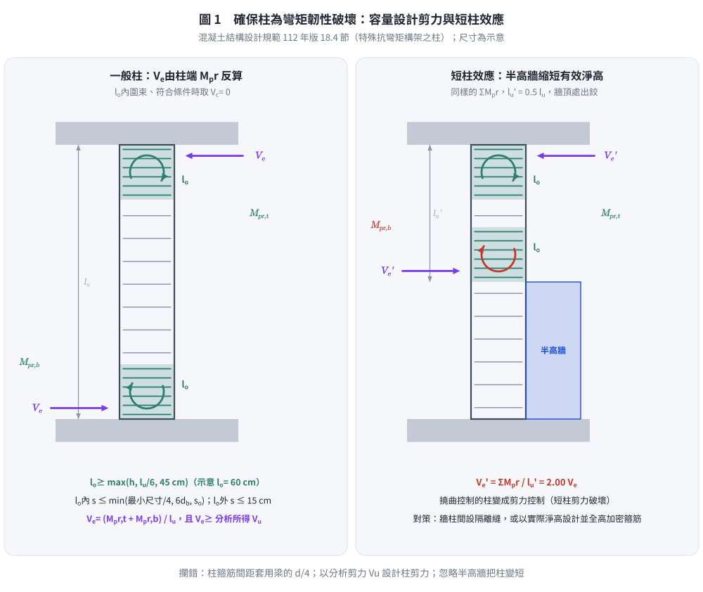

# 考題編號：SD-2007-4

**主分類：** `SD-U2-2` 建築耐震設計規範
**副分類：** `SD-U3-2` 隔減震原理；`SD-U3-1` 結構耐震設計
**分析方法：** 概念題
**標籤：** `475年回歸期` `超越機率` `強柱弱梁` `韌性設計` `剪力破壞` `彎矩破壞` `隔震` `消能` `被動控制` `設計哲學` `容量設計` `機率彎矩強度` `圍束箍筋` `短柱效應`

---

## 1. 題目（考卷原文見題目正本）

> 考卷原文、公式／附表、附圖與判讀清單（已確認）見 [`SD-2007-4-problem.md`](SD-2007-4-problem.md)。本節只列解題時最容易讀錯的地方與本解使用的記號；題意以題目正本為準。

### 常見誤讀

| 項目 | 正確判讀 | 常見誤讀 |
|------|---------|---------|
| ㈡柱的材料 | 考卷未指定；主線以 RC 柱說明，鋼柱可補充（判讀 #1，使用者授權依建議確認） | 只寫強柱弱梁（那是柱與梁的強度關係，不是柱本身彎矩與剪力的先後） |
| ㈠所問 | 「475 年」回歸期由什麼機率定義而來（判讀 #3） | 只答「規範規定」 |
| ㈢所問 | 隔震、消能各自的原理與適用條件，再比較優劣（判讀 #5） | 只說明其中一種，或沒有比較 |
| 規範版本 | 依現行最新台灣規範作答（判讀 #2） | 照考試當年版本而不說明 |
| ㈡柱箍筋間距 | 柱：最小斷面尺寸 1/4、$6d_b$、$s_o$ 取小（混凝土結構設計規範 112 年版 18.4.5.3） | 套用梁的「$d/4$」；依據寫成 ACI |

**本解記號：** 子題記號 ㈠㈡㈢ 同考卷；本題無數值計算。

---

## 2. 考題核心精神與出題者意圖 (Core Concepts & Examiner's Intent)

**核心精神：** 本題考查耐震設計三大哲學基礎：（一）地震危害度（回歸期概念）、（二）結構韌性設計（破壞模式控制）、（三）被動控制策略（隔震 vs 消能）。純觀念但需有深度，僅背公式不足。

**出題者意圖：**
1. 測試考生是否理解「475年」背後的**超越機率**邏輯，而非只知道數字
2. 測試「強柱弱梁、剪力超強」等韌性設計的具體實施方法
3. 測試對隔震與消能兩種策略的原理性理解與比較能力

---

## 3. 解題戰略地圖與陷阱分析 (Strategic Roadmap & Trap Analysis)

**作戰計畫：**
1. 子題(一)：從「50年超越機率10%」推算回歸期，說明設計地震水準的概率基礎
2. 子題(二)：說明柱的破壞模式分類 → 工程手段（容量設計法）→ 具體構造措施
3. 子題(三)：各自說明原理 → 適用條件（分點列出）→ 優劣比較（表格）

**關鍵陷阱：**

| # | 陷阱 | 應對策略 |
|---|------|---------|
| 1 | 475 年只說「是回歸期」而不說機率依據 | 必須說明 50 年 10% 超越機率的換算邏輯 |
| 2 | 子題(二)只說「強柱弱梁」概念，無設計細節 | 需說明容量設計法（Capacity Design）+ 圍束箍筋 + 剪力計算規定 |
| 3 | 子題(三)隔震與消能混淆：兩者目的不同 | 隔震→延長週期避開共振；消能→增加阻尼耗散能量 |
| 4 | 優劣比較過於籠統 | 需具體比較：適用樓層高度、造價、效果、改建難易度 |

---

## 3.5 變數層次分析 (Variable Hierarchy Analysis)

> 複習提示：第一次解題後，在每個卡住的知識點旁標記 `⚠`；第二次複習時只看有 `⚠` 的項目。

### 最終目標
回答三個耐震設計核心概念問題，展現對設計地震水準、韌性破壞控制與被動控制策略的深度理解。

### 本題關鍵公式（依計算順序）

$$\text{子題(一)：} P(\text{超越}) = 1 - \left(1 - \frac{1}{T_R}\right)^{n} \approx \frac{n}{T_R}$$

$$\text{解回歸期：} T_R = \frac{-n}{\ln(1-p)} = \frac{-50}{\ln 0.9} = 474.6 \approx 475 \text{ 年（一階近似 } n/p = 500 \text{ 年偏大）}$$

$$\text{子題(二)，容量設計剪力：} V_e = \frac{M_{pr,t} + M_{pr,b}}{l_u}\ \ge V_u\text{（分析所得）},\qquad \phi V_n \ge V_e$$

### L1：題目直接給定

| 符號 | 數值 | 說明 |
|------|------|------|
| 設計使用年限 $n$ | 50 年 | 建築物設計壽命（規範預設） |
| 超越機率 $p$ | 10% | 設計地震之超越機率（規範設定） |

### L2：需知識點推導

| 符號 | 公式／來源 | 卡關? |
|------|-----------|-------|
| 年超越機率 | $1/T_R$ | |
| $n$ 年超越機率 | $p = 1-(1-1/T_R)^n$ | |
| 回歸期 $T_R$ | $T_R = -n/\ln(1-p)$ | |
| 475年（精確值） | $T_R = -50/\ln(0.9) \approx 474.6$ 年 | |

### L3：深層知識（不懂就卡住）

| 知識點 | 說明 | 卡關? |
|--------|------|-------|
| 超越機率 vs 回歸期 | 回歸期不是「地震只在 475 年後才來」，而是機率概念 | |
| 容量設計法（Capacity Design） | 讓脆性破壞模式所需力 >> 韌性破壞模式所能提供的力 | |
| 強柱弱梁原則 | 柱彎矩容量 > 梁彎矩容量，確保塑性鉸先發生在梁端 | |
| 剪力超強設計 | 以極限彎矩反算柱剪力，確保剪力破壞不先發生 | |
| 隔震原理 | 延長週期 → 避開地盤卓越週期 → 降低譜加速度 | |
| 消能原理 | 增加等效阻尼 → 降低反應譜值 → 減少結構變形 | |

---

## 4. 步驟化詳細計算過程 (Step-by-Step Detailed Calculation)

### 子題（一）：「475 年」的依據

**概念基礎：超越機率（Probability of Exceedance）**

建築物設計壽命（使用年限）一般取 $n = 50$ 年。台灣建築耐震規範規定「設計地震」對應的危害等級為：

$$\text{50年內超越機率} = 10\%$$

**回歸期推算：**

設地震的年超越機率為 $1/T_R$，則 $n$ 年內不超越機率為：

$$P(\text{不超越}) = \left(1 - \frac{1}{T_R}\right)^n$$

$n$ 年內超越機率：

$$p = 1 - \left(1 - \frac{1}{T_R}\right)^n$$

解出回歸期：

$$T_R = \frac{-n}{\ln(1-p)} = \frac{-50}{\ln(1-0.10)} = \frac{-50}{\ln(0.90)} = \frac{-50}{-0.10536} \approx \boxed{474.6 \approx 475 \text{ 年}}$$

**物理意義：**

「475 年回歸期」並非「地震每 475 年才發生一次」，而是指：**在建築物 50 年使用壽命內，有 10% 的機率會遭遇到等於或超過此強度的地震**。這是一種工程風險的量化表達，平衡了安全需求與經濟合理性。

$$\text{年超越機率} = \frac{1}{475} \approx 0.21\% / \text{年}$$

---

### 子題（二）：確保柱為彎矩韌性破壞而非剪力脆性破壞

**破壞模式比較：**

| 破壞模式 | 特性 | 後果 |
|----------|------|------|
| 彎矩破壞（塑性鉸） | 鋼筋逐漸降伏，大變形能力 | 韌性好，可預警，允許消能 |
| 剪力破壞（對角裂縫） | 混凝土突然劈裂，脆性 | 無預警倒塌，危險性極高 |

**工程手段：容量設計法（Capacity Design Method）**

核心原則：**讓柱的剪力強度遠大於柱達到彎矩破壞時所能產生的最大剪力需求**，從而確保剪力破壞永遠不會先於彎矩破壞發生。

**Step 1：強柱弱梁設計**

確保柱端彎矩容量大於梁端彎矩容量，使塑性鉸先發生於梁，保護柱：

$$\sum M_{nc,col} \geq \frac{6}{5}\sum M_{nb,beam}$$

（混凝土結構設計規範 112 年版 18.4.3.2）梁柱接頭處，柱的標稱彎矩強度之和須不小於梁的標稱彎矩強度之和的 1.2 倍；含地震效應之因數化軸壓力不超過 $A_gf'_c/10$ 的柱端可免。強柱弱梁讓塑性鉸先出現在梁端，柱只在底部出鉸，減少柱的彎矩與剪力需求。

**Step 2：以極限彎矩反算設計剪力（剪力超強設計）**

柱的設計剪力不以地震分析結果（彈性分析）決定，而是以柱端**實際可能發生的最大彎矩**（超強彎矩 $M_{pr}$）反算：

$$V_e = \frac{M_{pr,t} + M_{pr,b}}{l_u}$$

其中 $M_{pr}$ 為柱端機率彎矩強度（鋼筋拉應力取 $1.25 f_y$、$\phi=1.0$），取與因數化軸力範圍相應的最大值；$l_u$ 為柱淨高。規範 18.4.6.1.1 另規定：$V_e$ 不必大於由接頭兩側梁的 $M_{pr}$ 推得的值，但**無論何種情況，$V_e$ 皆不得小於結構分析所得的因數化剪力 $V_u$**。剪力強度須滿足 $\phi V_n \ge V_e$（剪力 $\phi=0.75$）。

**Step 2.5：塑鉸區不計混凝土剪力強度（$V_c=0$）**

規範 18.4.6.2.1：在 $l_o$ 範圍內，若同時符合 ①地震引致的剪力（18.4.6.1）不小於 $l_o$ 內最大需求剪力強度的一半、②含地震效應的因數化軸壓力 $P_u < A_gf'_c/20$，則橫向鋼筋須依 $V_c=0$ 設計。理由：反覆塑性變形使塑鉸區混凝土開裂劣化，剪力只能靠箍筋。

**Step 3：圍束箍筋設計（韌性確保）**

即使發生彎矩塑性鉸，也需確保足夠的曲率延性：
- 潛在塑性鉸區域加密箍筋（圍束核心混凝土）：範圍 $l_o \ge \max(h,\ l_u/6,\ 45\text{ cm})$（18.4.5.1，$h$ 為柱斷面深度）
- 提高混凝土的極限壓應變能力（圍束量 $A_{sh}$ 依 18.4.5.4）
- 防止縱向鋼筋挫屈（箍筋間距含 $6d_b$ 限制、耐震彎鉤與繫筋）

**Step 4：規範規定摘要**

依現行混凝土結構設計規範（112 年版）18.4 節特殊抗彎矩構架之柱：
- 強柱弱梁：$\sum M_{nc} \ge 1.2\sum M_{nb}$（18.4.3.2）
- 設計剪力 $V_e$ 由柱端 $M_{pr}$ 反算，且不小於分析所得 $V_u$（18.4.6.1.1）；符合條件時 $l_o$ 內取 $V_c=0$（18.4.6.2.1）
- $l_o$ 內箍筋間距不得大於下列最小值（18.4.5.3）：柱最小斷面尺寸的 1/4；最小縱向鋼筋直徑的 6 倍（$f_y=4200$ kgf/cm²；5000 取 5.5 倍、5600 取 5 倍）；$s_o = 10 + \dfrac{35-h_x}{3}$ cm（$10 \le s_o \le 15$ cm，$h_x$ 為受側向支撐縱筋的最大中心距）
- $l_o$ 以外箍筋間距不大於 15 cm 及相同的縱筋直徑倍數（18.4.5.5）

**Step 5：避免短柱效應**

窗台、半高牆、樓梯平台會把柱的有效淨高 $l_u$ 縮短，$V_e = \sum M_{pr}/l_u$ 隨之劇增，原本撓曲控制的柱變成剪力控制（921 地震中常見的校舍短柱剪力破壞）。對策：牆與柱之間設隔離縫，或以實際淨高計算 $V_e$ 並全高加密箍筋。

> 鋼柱補充：斷面寬厚比符合高韌性要求以防局部挫屈，腹板剪力強度以柱端塑性彎矩推求，並同樣遵守強柱弱梁。

*圖 1　柱的容量設計剪力與短柱效應（尺寸示意；$l_o$ 與箍筋間距依混凝土結構設計規範 112 年版 18.4 節）。本圖攔下三種錯：柱箍筋間距套用梁的 $d/4$；以分析剪力 $V_u$ 而非 $M_{pr}$ 反算的 $V_e$ 設計柱剪力；忽略半高牆使有效淨高變短、$V_e$ 加倍。*

---

### 子題（三）：隔震與消能之原理、適用條件與優劣比較

#### 一、隔震（Base Isolation / Seismic Isolation）

**原理：**

在結構底部設置隔震層（如鉛心橡膠支承 LRB、高阻尼橡膠支承 HDRB），大幅**延長結構自然週期**（從約 0.5～1.5 秒延長至 2.5～4 秒），遠離地盤卓越週期，大幅降低地震加速度反應。

$$T_{IS} = 2\pi\sqrt{\frac{W}{g \cdot K_{eff}}} \quad \text{（隔震週期，遠大於未隔震週期）}$$

上部結構幾乎視為剛體，層間位移極小，結構內部加速度均勻分布。

**適用條件：**
- 低矮至中低層建築（$T_{fixed} < 1.0$ 秒），隔震效果最顯著
- 場址非軟弱地盤（第三類軟弱地盤或臺北盆地等長週期地盤不建議，長週期地震動對隔震不利）
- 建築重要性高（醫院、核設施、文物建築、指揮中心）
- 容許底部有足夠隔震位移空間（需設置隔震溝）

**優點：**
- 上部結構幾乎完整保留，非結構構件損失極少
- 加速度降低顯著（可達 50～80%）
- 長期效益高，免震效果穩定

**缺點：**
- 造價高（支承、隔震溝、維護成本）
- 底部位移大（需設計足夠位移容量）
- 高層建築（長週期）或軟弱地盤效果有限甚至反效果

---

#### 二、消能（Energy Dissipation / Passive Damping）

**原理：**

在結構樓層間安裝**消能元件**（如粘滯阻尼器 VD、摩擦阻尼器 FD、挫屈束制支撐 BRB、粘彈性阻尼器 VED），透過材料非線性或粘滯行為，**增加等效阻尼比**，縮小反應譜值，減少結構地震反應。

等效阻尼：

$$\xi_{total} = \xi_{structure} + \xi_{added} \quad \text{（可從 2～5\% 提升至 15～25\%）}$$

消能不改變週期，而是通過減小反應譜縱坐標（降低 $S_a$）來減少地震力。

**適用條件：**
- 中高層建築（$T > 1.0$ 秒），消能效果亦佳
- 舊有建築補強（外加消能裝置，不需大規模改建）
- 場址不限（軟弱地盤亦可適用）
- 容許一定層間位移（消能需靠位移啟動）

**優點：**
- 適用範圍廣（各種高度、場址）
- 改建舊建築可行性高
- 造價相對合理
- 可針對特定樓層選擇性加強

**缺點：**
- 結構本體仍承受一定變形（消能依靠層間位移）
- 非結構構件損傷控制不如隔震徹底
- 部分消能裝置（如 BRB）在大地震後需更換

---

#### 三、隔震 vs 消能 比較表

| 比較項目 | 隔震 | 消能 |
|----------|------|------|
| **原理** | 延長週期，避開共振 | 增加阻尼，耗散能量 |
| **減震方式** | 降低加速度（反應譜往右移） | 降低譜值（反應譜往下壓） |
| **適用樓層** | 低矮至中低層（最佳 $T < 1$ 秒） | 中高層均可 |
| **場址要求** | 避開軟弱地盤 | 各類場址均可 |
| **加速度控制** | 效果極佳（上部幾乎剛體） | 效果中等 |
| **層間位移控制** | 極佳（層間位移幾乎為零） | 良好（靠消能吸收） |
| **既有建築補強** | 困難（需頂舉建築物） | 容易（外加裝置） |
| **造價** | 較高 | 中等 |
| **維護需求** | 定期檢查支承 | 視裝置類型而定 |

---

## 5. 關鍵爭議點與進階探討 (Critical Issues & Advanced Discussion)

**1. 回歸期的哲學意涵**

「475 年回歸期」不代表台灣每 475 年才發生大地震，而是一個機率閾值。大地震可能在任何時間點發生。設計地震水準（50 年 10% 超越機率）是在「安全性」與「建造成本」之間的工程折衷，是社會決策的產物，不同使用族群（如生命線工程）採用更低超越機率（如 50 年 2% 超越機率，計算得 2475 年，規範取 2500 年，即最大考量地震）。

**2. 容量設計法的核心思想**

容量設計不只是「計算超強」，而是**主動設計破壞順序**。工程師選擇「可接受的破壞模式」（彎矩塑性鉸），並確保「不可接受的破壞模式」（剪力脆性）永遠無法實現。這與一般強度設計「每個部位都要夠強」的思路根本不同。

**3. 隔震與消能的搭配使用**

現代高性能設計中，兩者可組合使用：隔震裝置（如 LRB）本身即具有阻尼消能功能，而隔震層也可加設額外阻尼器控制位移。這種「雙重被動控制」策略在重要建築中越來越普遍。

**4. 考場時間分配建議**

三個子題共 25 分，子題(一) 5 分、子題(二) 10 分、子題(三) 10 分。建議在子題(三)畫出比較表，可在有限時間內展示最多考點，避免遺漏。

*修正日期：2026-11-16（§1 改為指向題目正本）*

*修正日期：2026-11-16（勘誤：㈡柱的規定改依現行混凝土結構設計規範（112 年版 18.4 節）——柱箍筋間距由誤用梁的「d/4、6 倍縱筋徑、150 mm」改為最小斷面尺寸 1/4、6d_b、s_o（10～15 cm）；補 V_c＝0 條件（P_u＜A_g f′c/20 且地震剪力≥一半）、V_e 不小於分析所得 V_u、l_o≥max(h, l_u/6, 45 cm)、強柱弱梁軸力豁免、短柱效應與鋼柱補充；依據由「ACI」改為台灣規範；㈢美國場址類別 S_D/S_E 改為台灣地盤分類；§3.5 回歸期式改為 −50/ln0.9＝474.6 年（原寫 50/0.10＝500≈475）；§5 最大考量地震註明規範取 2500 年；§1 常見誤讀補一列。㈠、㈢結論不變。證據：2007 年第 1 頁第四題㈡；混凝土結構設計規範 112 年版 18.4.3.2、18.4.5.1、18.4.5.3、18.4.6.1.1、18.4.6.2.1（國土管理署公告 PDF）。驗證：scripts/fixes/2026-11-16_verify_SD-2007-4.py，MISMATCHES: 0）*

*修正日期：2026-11-16（非勘誤）圖解補繪：figs/SD-2007-4-fig-1-column-capacity.svg（柱容量設計剪力、l_o 圍束區與短柱效應，§4 子題二）；向量圖，腳本 gen_SD-2007-4.py，可重跑*
