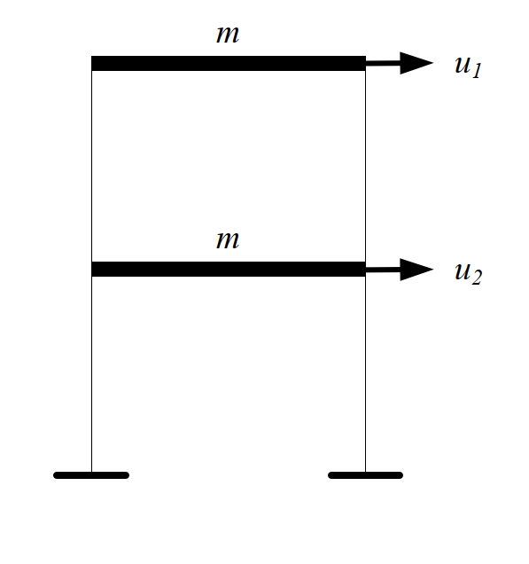

# SD-2008-1 題目正本

> 本檔只記錄考卷上寫了什麼、圖上畫了什麼，不含任何解法。解析見同資料夾 `SD-2008-1.md`。
> 判讀清單經使用者確認前，狀態為「待確認」；確認後本檔原則上不再修改（改動須回考卷原圖並記 log）。

| 項目 | 內容 |
|---|---|
| 考卷 | `raw/exams/SD-2008_結構動力分析與耐震設計.pdf`，第 1 頁（正面），第一題 |
| 考年 | 2008（民國97年）專技高考結構工程技師「結構動力分析與耐震設計」 |
| 配分 | 30 分（10／5／10／5） |
| 附圖 | `SD-2008-1-fig-1.png` |
| 判讀狀態 | **已確認**（2026-11-15 使用者授權依 Claude 建議確認。原轉錄：2026-11-15 轉錄；PyMuPDF 110／150 dpi 整頁＋450–500 dpi 局部放大，PDF 文字層與向量座標核對；盲讀於開啟解析前完成） |

## 1. 考卷原文（逐字）

一、一具傳統阻尼特性之二層樓平面剪力樓房結構，如下圖所示，$u_1$ 及 $u_2$ 為其自由度。其中每層樓的質量均為 $m$＝1500kg，且每個樓層的側向勁度皆為 $k$（未知）。若經由系統識別方式得知本結構各模態之自然振動週期為 $T_1$＝0.197 sec 及 $T_2$＝0.0752 sec，且各模態之阻尼比皆為5%，請回答下列問題：

㈠若樓層的側向勁度 $k$ 可表示為 $p\times10^{q}$ N/m，其中 $p$ 為個位數整數而 $q$ 為整數，請問 $p$ 及 $q$ 值各為何？（10 分）

㈡請計算此結構系統各模態之振態向量（將自由度 $u_1$ 相應之振態值正規化為 1）。（5 分）

㈢請計算此樓房結構之阻尼係數矩陣。（10 分）

㈣當應用「多振態反應譜疊加法」計算結構反應的分析過程中，是否必需建立此一阻尼係數矩陣？（5 分）

## 2. 考卷給的公式、附表與參數

- 考卷沒有給任何參考公式或附表。
- 給定：$m=1500$ kg（每層）、$T_1=0.197$ s、$T_2=0.0752$ s、各模態 $\xi=5\%$；$k=p\times10^{q}$（p 為個位數整數）。
- 考卷沒有給：樓高、柱尺寸。
- 卷首注意事項：㈠不必抄題，作答時請將試題題號及答案依照順序寫在試卷上，於本試題上作答者，不予計分。㈡可以使用電子計算器，但需詳列解答過程。考試時間：2 小時。

## 3. 附圖

*證據圖 SD-2008-1-fig-1.png*

圖面文字照錄：m、u1、m、u2

## 4. 判讀清單

| # | 項目 | 判讀 | 圖上／題文依據 | 把握 |
|---|---|---|---|---|
| 1 | 自由度編號 | **$u_1$ 在頂層（屋頂）、$u_2$ 在二樓（下層）**，與一般「由下往上」的編號相反 | 圖面箭頭標籤位置 | 確定 |
| 2 | ㈡正規化 | 「$u_1$ 相應之振態值正規化為 1」＝頂層分量為 1 | 題文＋#1 | 確定 |
| 3 | 質量、勁度 | 兩層質量皆 m＝1500 kg；兩樓層側向勁度皆 k（未知） | 題文 | 確定 |
| 4 | 柱底 | 固定（短水平粗線） | 圖面 | 確定（解讀） |
| 5 | 週期 | $T_1=0.197$ s、$T_2=0.0752$ s，系統識別所得（題給數值） | 題文 | 確定 |
| 6 | 阻尼 | 傳統（古典）阻尼，各模態 5% | 題文 | 確定 |
| 7 | 所求 | ㈠ p、q ㈡兩振態向量 ㈢阻尼係數矩陣 ㈣反應譜疊加法是否需要阻尼矩陣 | 題文 | 確定 |

---
*轉錄：2026-11-15（SD-U1-3 題目正本推廣・批 1）*
*確認：2026-11-15 使用者授權依 Claude 建議確認（SD-U1-3 題目正本推廣・批 1，關卡一）*
