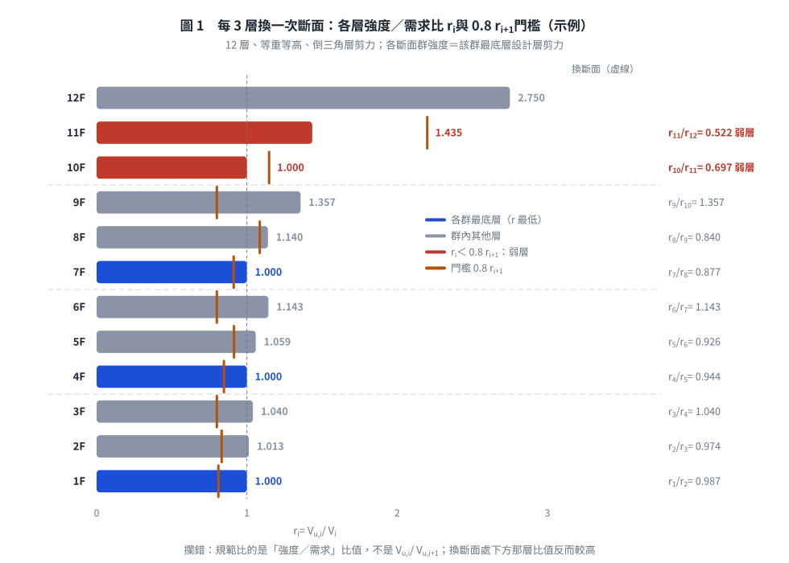

### 考題編號：SD-2008-2

**主分類：** `SD-U2-2` 建築耐震設計規範
**副分類：** `SD-U3-1` 結構耐震設計（含RC結構與鋼結構）
**分析方法：** 概念題（規範論述）
**標籤：** `耐震設計規範` `最大考量地震` `VM設計地震力` `極限層剪力強度` `崩塌防止` `弱層機制` `層崩塌機制` `韌性需求集中` `斷面變換` `剪力強度分布` `層間強度比` `容量設計` `強度需求比` `非結構牆`

---

## 1. 題目（考卷原文見題目正本）

> 考卷原文、公式／附表、附圖與判讀清單（已確認）見 [`SD-2008-2-problem.md`](SD-2008-2-problem.md)。本節只列解題時最容易讀錯的地方與本解使用的記號；題意以題目正本為準。

### 常見誤讀

| 項目 | 正確判讀 | 常見誤讀 |
|------|---------|---------|
| $V_M$ | 題文「避免最大考量地震崩塌之設計地震力」（判讀 #2） | 與設計地震的最小設計水平總橫力 $V$ 混淆 |
| 抗側力垂直構件 | 柱、剪力牆、斜撐等豎向抗側力構件（判讀 #4） | 只想到柱 |
| 規範版本 | 依現行最新台灣規範（111 年版）作答，條文與考試當年不同處放 §5（判讀 #1，使用者授權依建議確認） | 照考試當年條文而不說明 |
| 所求 | ㈠為何依 $V_M$ 設計後仍要檢核極限層剪力強度；㈡從該檢核評論分段變換斷面（判讀 #3、#5） | ㈡只談施工經濟性，未扣回極限層剪力強度 |

**本解記號：** $V_M$：避免最大考量地震崩塌之設計地震力；子題記號 ㈠㈡ 同考卷；本題無數值計算。

---

## 2. 考題核心精神與出題者意圖 (Core Concepts & Examiner's Intent)

本題考核考生對台灣建築耐震設計規範中**「三水準設計」思想的深層理解**，特別是：
1. 等效靜力法 $V_M$ 的計算與其**假設前提的侷限性**
2. 「極限層剪力強度」檢核所要防止的**弱層崩塌機制（Soft/Weak Story Collapse）**
3. 實務設計中斷面跳層設計的**耐震弱點**

出題意圖：測試考生不只是背規範條文，而是真正理解**等效靜力法分析結果 ≠ 實際層間強度分佈**，以及斷面跳層設計如何形成「規律性弱層」。

---

## 3. 解題戰略地圖與陷阱分析 (Strategic Roadmap & Trap Analysis)

**(一) 的論述框架：** 從 $V_M$ 的計算假設出發 → 指出其侷限 → 說明極限層剪力強度檢核補充的目的

**(二) 的論述框架：** 描述跳層設計的強度分佈 → 說明在「極限層剪力強度比」要求下如何形成弱層 → 指出具體缺點

**陷阱分析：**

| # | 陷阱 | 應對策略 |
|---|------|---------|
| 1 | 只說「VM 不夠安全」，未具體說明原因 | 必須指出：VM 等效靜力法假設強度均勻分佈，但實際未必如此 |
| 2 | 混淆「弱層（Weak Story）」與「軟層（Soft Story）」 | 弱層：強度不足；軟層：勁度不足；本題問的是強度（強度弱層） |
| 3 | (二)只說「斷面變小所以強度變小」，未提到「比例」問題 | 關鍵是各層「極限層剪力強度／設計層剪力」比值 $r_i$ 的變化：不得低於上層比值的 80%（規範 2.17 節），比的不是強度本身 |

---

## 3.5 變數層次分析 (Variable Hierarchy Analysis)

> 複習提示：第一次解題後，在每個卡住的知識點旁標記 `⚠`；第二次複習時只看有 `⚠` 的項目。

### 最終目標
`說明 VM 設計仍需極限層剪力強度檢核的原因，以及跳層斷面設計在此檢核觀點下的缺點`

### 本題關鍵公式（依計算順序）

本題為純論述題，關鍵關係式如下（理解用，不需數值計算）：

$$\text{規範要求（2.17 節）：} r_i = \frac{V_{u,i}}{V_i} \;\geq\; 0.8\,r_{i+1}\qquad(V_i\text{：第 }i\text{ 層設計層剪力})$$

$$V_{u,i} = \text{第 }i\text{ 層之極限剪力強度（由各柱牆塑性強度加總）}$$

$$\text{VM 設計：等效靜力分析} \rightarrow \text{確保整體}V_{base}\geq V_M\text{，但未檢核逐層強度比}$$

### L1：題目直接給定

| 概念 | 說明 |
|------|------|
| $V_M$ | 避免最大考量地震（MCE）崩塌之設計地震力 |
| 極限層剪力強度 $V_{u,i}$ | 第 $i$ 層所有抗側力構件在塑性狀態下能抵抗的最大水平剪力 |
| 跳層設計 | 每 3–5 層縮減一次斷面（每個轉換樓層上方斷面突然變小） |
| 設計層剪力 $V_i$ | 第 $i$ 層的設計層剪力（需求），沿高度平滑變化 |

### L2：需知識點推導

**概念鏈：VM 設計 → 仍需極限層剪力強度檢核**

| 知識點 | 核心原因 | 卡關? |
|--------|---------|:-----:|
| VM 等效靜力假設 | 靜力分析假設樓層強度分佈與地震力分佈相符，實際不然 | |
| 弱層崩塌機制 | 若某層強度突然偏低，韌性需求集中於該層，超出局部容量 | |
| 強度比規範要求 | 規範規定各層「強度／設計層剪力」比值不得低於其上層比值的 80%（2.17 節；二層樓以上建築物皆須檢核，計入非結構牆強度） | |

### L3：深層知識（不懂就卡住）

| 知識點 | 說明 | 卡關? |
|--------|------|:-----:|
| 等效靜力法的「強度均勻性假設」 | VM 法確保基底剪力足夠，但無法保證各層實際強度與需求的相對關係 | |
| 強度弱層 vs 勁度軟層 | 本題「極限層剪力強度」是**強度**問題（非勁度）；混淆者會論述錯誤 | |
| 跳層設計的比值鋸齒 | 每個斷面群的最底層 $r_i$ 最低，塑性變形集中於此；換斷面處下層比值反而較高，不會被判弱層；不符 $r_i\ge0.8r_{i+1}$ 的是群內需求下降快的下方樓層（§4 示例第 10、11 層） | |

---

## 4. 步驟化詳細計算過程 (Step-by-Step Detailed Calculation)

### (一) VM 設計後仍需極限層剪力強度檢核的原因

**背景：VM 的設計邏輯**

「避免最大考量地震崩塌之設計地震力 $V_M$」係依據最大考量地震（MCE）之加速度反應譜計算基底剪力，並採用等效靜力法將其分配至各樓層。其目的是確保**整體結構**在 MCE 作用下不致崩塌。

**為何仍需極限層剪力強度檢核？**

原因一：**等效靜力法無法保證各層強度均勻分佈**

等效靜力法（如倒三角分配）所得到的各層設計剪力，是依**假設的地震力分布型式**計算。此分布型式隱含「各層強度需求呈連續遞減」的假設。然而，實際設計中各層構件的截面選配（配合結構使用需求、業主要求等）可能造成**某些樓層的實際強度遠低於鄰層**，等效靜力分析無法發現此一現象。

原因二：**強度弱層（Strength-Weak Story）機制造成局部韌性需求集中**

若某一樓層 $i$ 的極限剪力強度 $V_{u,i}$ 顯著低於其上下相鄰樓層，則在強震作用下，結構整體的**非線性變形（韌性需求）將集中於此弱層**。即使整體基底剪力滿足 $V_M$ 要求，弱層中所有柱與牆的局部韌性需求仍可能大幅超過其延性容量，導致**層崩塌（Story Collapse）機制**形成。

原因三：**設計地震力分布與實際強度分布的不匹配**

$V_M$ 設計時採用的地震力豎向分配（如倒三角）是一種近似，實際地震下高振態效應可能使某些中間樓層的層間剪力偏大。若這些樓層恰好是強度較弱的樓層，則等效靜力設計預留的強度裕度不足。

原因四：**構件尺寸常不是由地震力決定**（規範解說 2.17）

構件斷面與配筋常由垂直載重、最小尺寸、建築需求或斷面統一控制，各層實際極限強度與需求不成比例；再加上非結構牆（磚牆、RC 隔間牆）會大幅提高某些樓層的強度（例如上層有隔間牆、一樓開放），所以規範要求計算極限層剪力強度時**須計入非結構牆的貢獻**，且所有二層樓以上建築物都要檢核。解說也說明：相鄰各層強度相差不大時，大震時較易普遍降伏、共同消能；若有強度特別低的弱層，只在該層降伏，韌性很快耗盡而崩塌。弱層的強度若足以抵抗規範所訂的總剪力（相當於最大考量地震下仍在彈性限度內），則不在此限（豁免式的確切寫法條文待核）。

**結論：**

> 極限層剪力強度檢核的目的，在於驗證**各樓層的實際強度分佈無突變**，確保在 MCE 作用下任何樓層均不致形成弱層崩塌機制，從而補足等效靜力法（$V_M$ 設計）在「逐層強度連續性」方面的盲點。

---

### (二) 每 3–5 層變換一次斷面設計的缺點（從極限層剪力強度觀點）

**設計描述**

建築物抗側力垂直構件（RC柱、剪力牆）的斷面尺寸與配筋由下至上每 3 至 5 個樓層變換一次，即：

```
樓層示意（由下至上）：
第 1–3 層：較大斷面（強度較高）
第 4–6 層：較小斷面（強度中等）         ← 第4層：轉換點①
第 7–9 層：更小斷面（強度更低）         ← 第7層：轉換點②
...
```

**缺點說明**

**缺點一：強度／需求比 $r_i$ 呈鋸齒，每個斷面群最底層比值最低**

以轉換點① 為例：第 3 層（大斷面）之極限層剪力強度 $V_{u,3}$ 遠大於第 4 層（小斷面）之 $V_{u,4}$。注意上層本來就該比下層弱，規範比的不是強度本身，而是**強度與需求的比值** $r_i = V_{u,i}/V_i$（$V_i$ 為該層設計層剪力）：

$$r_i < 0.8\,r_{i+1} \;\Longrightarrow\; \text{第 } i \text{ 層為強度弱層}$$

需求 $V_i$ 沿高度平滑變化、供給 $V_{u,i}$ 卻是階梯，使 $r_i$ 呈鋸齒：轉換層上方第一層（第 4 層）的 $r_i$ 最低，在大震下最先降伏、非線性變形集中於此；同一斷面群內越往上需求下降越快、$r_i$ 越高，群內下方樓層便容易出現 $r_i < 0.8\,r_{i+1}$，被判為「**強度弱層**」，極限層剪力強度檢核不通過。

**示例（說明用，非規範例題）：** 12 層、各層重量與樓高相同、設計層剪力依倒三角分配（$V_i\propto\sum_{j\ge i}j$），每 3 層換一次斷面，各斷面群的強度恰等於該群最底層的設計層剪力：

| 層 $i$ | $V_i$ | $V_{u,i}$ | $r_i=V_{u,i}/V_i$ | $r_i/r_{i+1}$ |
|---|---|---|---|---|
| 12 | 12 | 33 | 2.750 | — |
| 11 | 23 | 33 | 1.435 | 0.522（＜0.8，弱層） |
| 10 | 33 | 33 | 1.000 | 0.697（＜0.8，弱層） |
| 9 | 42 | 57 | 1.357 | 1.357 |
| 8 | 50 | 57 | 1.140 | 0.840 |
| 7 | 57 | 57 | 1.000 | 0.877 |
| 6 | 63 | 72 | 1.143 | 1.143 |
| 5 | 68 | 72 | 1.059 | 0.926 |
| 4 | 72 | 72 | 1.000 | 0.944 |
| 3 | 75 | 78 | 1.040 | 1.040 |
| 2 | 77 | 78 | 1.013 | 0.974 |
| 1 | 78 | 78 | 1.000 | 0.987 |

- 每群最底層（第 1、4、7、10 層）$r_i=1.000$ 最低：大震時塑性變形集中在這幾層，群內上方樓層的強度閒置。
- 換斷面處（第 3、6、9 層對其上層）$r_i/r_{i+1}$ 為 1.040～1.357，下層比值反而較高，**不會**被判為弱層。
- 依 2.17 節判為弱層的是頂部斷面群內需求遞減最快的樓層：第 10 層（0.697）、第 11 層（0.522）——檢核不通過，需提高強度、逐層調整配筋，或證明符合豁免條件。



*圖 1　每 3 層換一次斷面時，各層強度／需求比 $r_i$ 呈鋸齒（示例數值）。本圖攔下兩種錯：把規範檢核寫成強度對強度 $V_{u,i}/V_{u,i+1}$；以為換斷面處下方那層（大斷面一側）會被判為弱層——比值最低的是每群最底層，能否通過 0.8 門檻要看群內需求遞減的快慢。*

**缺點二：弱層位置恰好有規律地分佈於全樓**

每 3–5 個樓層就有一個轉換點，意味著全樓有多個比值驟變的位置（每群最底層 $r_i$ 最低、群內需求驟降處可能不符 0.8 門檻）。這些位置在強震下均可能形成層崩塌機制，降低整體耐震安全性。

**缺點三：無法充分發揮整體結構韌性**

耐震設計的精神在於讓韌性消能均勻分散於各層。跳層斷面設計使韌性需求集中於各轉換樓層，而相鄰的大斷面樓層卻幾乎不參與消能，造成**韌性資源浪費**，整體結構效率低落。

**缺點四：轉換層配筋設計困難**

在轉換層，上層較小斷面柱的縱筋必須錨入下層較大斷面節點，施工與設計複雜度增加，配筋細節若處理不當，節點強度進一步降低。

**規範觀點結論：**

> 從「極限層剪力強度之檢核」觀點，每 3–5 層變換一次斷面的設計方式，使各層「強度／設計層剪力」比值 $r_i$ 呈鋸齒：每個斷面群的最底層比值最低、塑性變形集中，群內需求驟降處容易不符 $r_i \ge 0.8\,r_{i+1}$ 而成為弱層。正確做法應使各層強度分佈與層剪力需求相吻合；若必須分段縮減斷面，應逐層調整配筋或採**漸進式斷面縮減**（每一至兩層微幅縮減），使 $r_i$ 沿高度接近均勻、符合規範 2.17 節。

---

## 5. 關鍵爭議點與進階探討 (Critical Issues & Advanced Discussion)

**強度弱層 vs. 勁度軟層的辨別：**
- **勁度軟層（Soft Story）**：某層相對鄰層勁度過低，地震下層間位移集中（勁度不規則）
- **強度弱層（Weak Story）**：某層相對鄰層極限強度過低，超過塑性容量（強度不規則）
- 本題問的是「極限層剪力強度」，屬於**強度弱層**問題。在概念上兩者有關聯（勁度軟層往往也是強度弱層），但定義不同，考場應區別說明。

**規範對極限層剪力強度比的規定：**
台灣建築物耐震設計規範（111 年版第 2.17 節極限層剪力強度檢核）：**不得有任一層強度與其設計層剪力的比值低於其上層所得比值 80% 者**；二層樓以上建築物皆須檢核，計算時須計入非結構牆強度；弱層強度足以抵抗規範所訂總剪力者不在此限。比較的是「強度／需求」比值，而非強度本身。跳層斷面設計使比值呈鋸齒分布，很容易違反此規定。（2026-10-24 勘誤：原寫「不得低於上一層極限層剪力強度的 65%」，數字與比較對象均與現行條文不符。）

**容量設計（Capacity Design）的視角：**
容量設計原則強調：弱構件（梁）先降伏以保護強構件（柱），同時確保各樓層強度無突變，避免整體結構因單一弱層崩塌。本題的跳層設計方式明顯與容量設計精神相悖。

*修正日期：2026-11-16（§1 改為指向題目正本）*

*修正日期：2026-11-16（勘誤：§3.5 關鍵公式由強度對強度 V_u,i/V_u,i+1（2026-10-24 勘誤殘留）改為 r_i＝V_u,i/V_i ≥ 0.8 r_i+1；§3 陷阱 3、§3.5 L2/L3、§4 結論改與 §4 缺點一一致；條文出處由「表 1-1 立面不規則第 5 項」改為規範第 2.17 節，補二層樓以上皆須檢核、計入非結構牆、豁免條件；㈠補原因四（構件尺寸常非地震力控制、非結構牆，規範解說 2.17）；㈡補 12 層示例表。答案方向不變。證據：2008 年第 1 頁（正面）第二題；規範第 2.17 節本文與解說（國土管理署 PDF）。驗證：scripts/fixes/2026-11-16_verify_SD-2008-2.py，MISMATCHES: 0）*

*修正日期：2026-11-16（非勘誤）圖解補繪：figs/SD-2008-2-fig-1-strength-ratio.svg（每 3 層換斷面時 r_i 與 0.8 r_i+1 門檻，§4 子題二）；向量圖，腳本 gen_SD-2008-2.py，可重跑*
