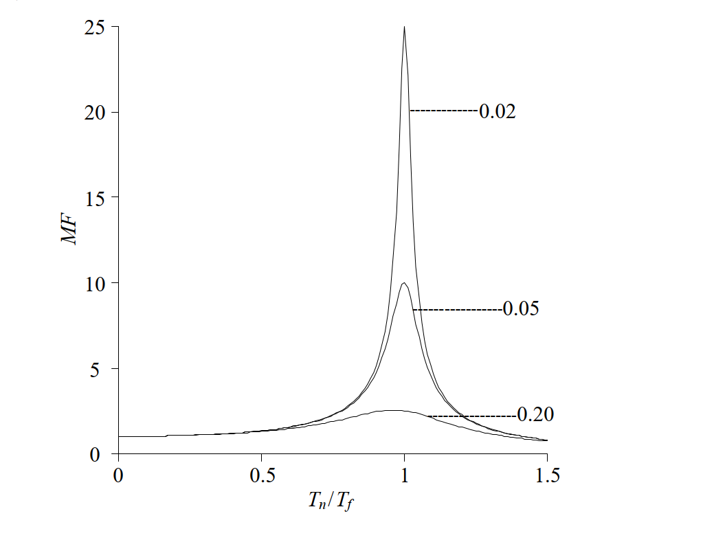

# SD-2008-3 題目正本

> 本檔只記錄考卷上寫了什麼、圖上畫了什麼，不含任何解法。解析見同資料夾 `SD-2008-3.md`。
> 判讀清單經使用者確認前，狀態為「待確認」；確認後本檔原則上不再修改（改動須回考卷原圖並記 log）。

| 項目 | 內容 |
|---|---|
| 考卷 | `raw/exams/SD-2008_結構動力分析與耐震設計.pdf`，第 2 頁（背面），第三題 |
| 考年 | 2008（民國97年）專技高考結構工程技師「結構動力分析與耐震設計」 |
| 配分 | 30 分（10／10／10） |
| 附圖 | `SD-2008-3-fig-1.png`（考卷關係圖；本題為曲線圖，不重繪） |
| 判讀狀態 | **已確認**（2026-11-15 使用者授權依 Claude 建議確認。原轉錄：2026-11-15 轉錄；PyMuPDF 110／150 dpi 整頁＋450–500 dpi 局部放大，PDF 文字層與向量座標核對；盲讀於開啟解析前完成） |

## 1. 考卷原文（逐字）

三、一含阻尼比 $\xi$ 之單自由度結構系統（週期為 $T_n$）受簡諧外力（週期為 $T_f$）作用下，其位移之放大係數為 $MF=1\big/\sqrt{[1-(T_n/T_f)^2]^2+[2\xi(T_n/T_f)]^2}$。位移放大係數（MF）與週期比（$T_n/T_f$）在不同阻尼比（$\xi$＝2%、5%及 20%）條件下的關係圖（垂直軸為 MF 而水平軸為 $T_n/T_f$）如下所示，請回答下列問題：

㈠一具阻尼比2%之單自由度結構承受 $T_n/T_f$＝1 的簡諧外力作用，為降低其振動反應，故加裝被動消能元件使其整體結構阻尼比增加到20%（假設 $T_n$ 不變），請問加裝消能元件後之位移反應與加裝前位移反應的比值為何？另若此結構係承受 $T_n/T_f$＝1.5 的簡諧外力作用時，在相同條件下其位移反應的比值又為何？（10 分）

㈡請由「位移放大係數與週期比的關係圖」及問題㈠之計算結果，說明在何種情況下結構裝設被動消能元件，於受震時能獲得較大的減振效益。（10 分）

㈢請利用「位移放大係數與週期比的關係圖」，說明當結構的阻尼比大於5%時，何以耐震設計規範中所訂定的短週期阻尼修正係數 $B_S$ 大於長週期阻尼修正係數 $B_1$。（10 分）

## 2. 考卷給的公式、附表與參數

- 考卷給的公式：$MF=1/\sqrt{[1-(T_n/T_f)^2]^2+[2\xi(T_n/T_f)]^2}$（照錄）。
- 考卷給的關係圖：MF（0–25）對 $T_n/T_f$（0–1.5），三條曲線標 0.02、0.05、0.20。
- 考卷沒有給：結構質量、勁度、外力大小（只需比值）。
- 卷首注意事項：㈠不必抄題，作答時請將試題題號及答案依照順序寫在試卷上，於本試題上作答者，不予計分。㈡可以使用電子計算器，但需詳列解答過程。考試時間：2 小時。

## 3. 附圖

*證據圖 SD-2008-3-fig-1.png*

圖面文字照錄：25、20、15、10、5、0（MF 軸）；0、0.5、1、1.5（Tn/Tf 軸）；MF、Tn/Tf；0.02、0.05、0.20

## 4. 判讀清單

| # | 項目 | 判讀 | 圖上／題文依據 | 把握 |
|---|---|---|---|---|
| 1 | 橫軸 | $T_n/T_f$（結構週期／外力週期＝$\Omega/\omega_n$ 頻率比） | 題文、圖軸 | 確定 |
| 2 | 計算依據 | ㈠的比值以考卷給的 MF 公式計算（圖只作示意） | 題文公式 | 確定（解讀） |
| 3 | 曲線標籤 | 0.02、0.05、0.20 分別為 ξ＝2%、5%、20% | 圖面 | 確定 |
| 4 | ㈠條件 | $T_n$ 不變、$\xi$ 0.02→0.20；兩個工況 $T_n/T_f$＝1 與 1.5 | 題文 | 確定 |
| 5 | 所求 | ㈠兩個位移比值 ㈡何時消能元件效益大 ㈢為何 $\xi>5\%$ 時 $B_S>B_1$ | 題文 | 確定 |
| 6 | 本題索引分類 | 主分類 SD-U1-3、designMethod 混合（計算＋論述） | question_index.json | 確定 |

---
*轉錄：2026-11-15（SD-U1-3 題目正本推廣・批 1）*
*確認：2026-11-15 使用者授權依 Claude 建議確認（SD-U1-3 題目正本推廣・批 1，關卡一）*
