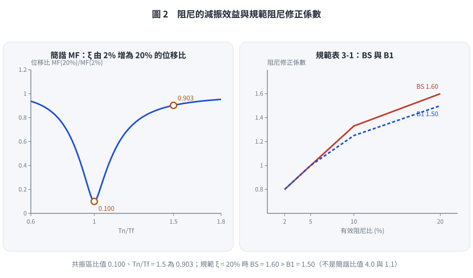

### 考題編號：SD-2008-3

**主分類：** `SD-U1-3` 單自由度、多自由度系統之動態分析及應用
**副分類：** `SD-U1-1` 結構動力基本性質及原理
**分析方法：** SDOF動力分析（強迫振動穩態反應 + 消能減震概念）
**標籤：** `SDOF` `簡諧外力` `動力放大係數` `MF` `頻率比` `阻尼比` `共振` `被動消能元件` `減振效益` `阻尼修正係數` `BS` `B1` `短週期阻尼修正` `長週期阻尼修正` `隔震規範`

---

## 1. 題目（考卷原文見題目正本）

> 考卷原文、公式／附表、附圖與判讀清單（已確認）見 [`SD-2008-3-problem.md`](SD-2008-3-problem.md)。本節只列解題時最容易讀錯的地方與本解使用的記號；題意以題目正本為準。

### 常見誤讀

| 項目 | 正確判讀 | 常見誤讀 |
|------|---------|---------|
| 橫軸 | $T_n/T_f$（＝$\Omega/\omega_n$） | $T_f/T_n$ |
| ㈠計算 | 以考卷給的 MF 公式計算（圖只作示意） | 由圖目測 |
| 條件 | $T_n$ 不變、$\xi$ 0.02→0.20；兩個工況 1 與 1.5 | — |

**本解記號：** $MF(r,\xi)$，$r=T_n/T_f$。

---

## 2. 考題核心精神與出題者意圖 (Core Concepts & Examiner's Intent)

本題以一張「MF vs $T_n/T_f$」圖貫穿三個子問題，考核考生：
1. MF 公式的數值應用（共振vs非共振）
2. 阻尼對減振效益的**頻率依賴性**
3. 耐震規範中阻尼修正係數 $B_S > B_1$ 的物理詮釋

核心觀念：**阻尼的減振效果在共振附近最顯著，遠離共振則趨於無效。** 這一結論直接連結到規範阻尼修正係數的設計邏輯。

---

## 3. 解題戰略地圖與陷阱分析 (Strategic Roadmap & Trap Analysis)

**作戰計畫：**
1. (一)：代入 MF 公式，分別計算 $\xi=2\%$ 與 $\xi=20\%$ 的 MF 值，取比值
2. (二)：從 (一) 的計算結果歸納規律，結合圖形說明
3. (三)：從圖形觀察短週期（$T_n/T_f \approx 1$）和長週期（$T_n/T_f > 1$）區域的曲線間距差異

**陷阱分析：**

| # | 陷阱 | 應對策略 |
|---|------|---------|
| 1 | MF 公式中混淆 $T_n/T_f$ 與 $T_f/T_n$ | 題目明確給出 $MF$ 以 $T_n/T_f$ 表示，注意分子分母 |
| 2 | $T_n/T_f = 1$ 時誤認 MF = 1 | 代入 $1-(T_n/T_f)^2=0$，MF = $1/(2\xi)$，共振放大 |
| 3 | (三) 說明 $B_S > B_1$ 時，混淆「減振效益大 → B 大」的邏輯 | $B = MF(\xi=5\%)/MF(\xi)$，減振效益越大（MF 下降越多），B 越大 |
| 4 | 認為長週期阻尼修正 $B_1 \approx 1$（沒有效果）但計算時仍誤算 | 長週期區各曲線確實趨近，但要從圖形中清楚說明 |

---

## 3.5 變數層次分析 (Variable Hierarchy Analysis)

> 複習提示：第一次解題後，在每個卡住的知識點旁標記 `⚠`；第二次複習時只看有 `⚠` 的項目。

### 最終目標
`計算兩種工況下的位移比值，並說明阻尼減振效益的頻率依賴性，進而詮釋 BS > B1`

### 本題關鍵公式（依計算順序）

$$\text{Step 1: } MF = \frac{1}{\sqrt{(1-r^2)^2+(2\xi r)^2}}, \quad r = T_n/T_f$$

$$\text{Step 2（共振）: } r=1 \implies MF = \frac{1}{2\xi}$$

$$\text{Step 3: 位移比值} = \frac{MF(\xi=20\%)}{MF(\xi=2\%)}$$

$$\text{Step 4: } B_S = \frac{MF(\xi=5\%,\;r\approx1)}{MF(\xi,\;r\approx1)}, \quad B_1 = \frac{MF(\xi=5\%,\;r=1.5)}{MF(\xi,\;r=1.5)}$$

### L1：題目直接給定

| 符號 | 數值 | 說明 |
|------|------|------|
| $\xi_{\text{before}}$ | 2% | 加裝消能元件前阻尼比 |
| $\xi_{\text{after}}$ | 20% | 加裝消能元件後阻尼比 |
| $r_1$ | 1.0 | 工況一：$T_n/T_f = 1$（共振） |
| $r_2$ | 1.5 | 工況二：$T_n/T_f = 1.5$（遠離共振） |

### L2：需知識點推導

**Step 1：計算各工況 MF**

| 工況 | $\xi$ | $r$ | $MF$ | 公式 |
|------|------|-----|------|------|
| 共振前 | 2% | 1.0 | 25.0 | $1/(2\times0.02)$ |
| 共振後 | 20% | 1.0 | 2.5 | $1/(2\times0.20)$ |
| 長週期前 | 2% | 1.5 | 0.799 | $1/\sqrt{1.5625+0.0036}$ |
| 長週期後 | 20% | 1.5 | 0.721 | $1/\sqrt{1.5625+0.36}$ |

**Step 2：位移比值**

| 符號 | 公式 | 卡關? |
|------|------|:-----:|
| 比值（$r=1$） | $MF_{20\%}/MF_{2\%} = 2.5/25$ | |
| 比值（$r=1.5$） | $MF_{20\%}/MF_{2\%} = 0.721/0.799$ | |

### L3：深層知識（不懂就卡住）

| 知識點 | 說明 | 卡關? |
|--------|------|:-----:|
| 共振時 MF 公式 | $r=1$ 代入後 $(1-r^2)^2=0$，MF $= 1/(2\xi)$，與阻尼成反比 | |
| $B$ 係數的定義方向 | $B = \text{(5\%阻尼反應)} / \text{(設計阻尼反應)}$；B 越大代表阻尼越有效 | |
| 阻尼在長週期的無效性 | $r > 1$ 後各曲線收斂，阻尼項 $(2\xi r)^2$ 被 $(1-r^2)^2$ 主導，阻尼影響力消失 | |

---

## 4. 步驟化詳細計算過程 (Step-by-Step Detailed Calculation)

### (一) 位移反應比值

**定義：** 令 $r = T_n/T_f$，MF 公式在各工況下：

$$MF(\xi, r) = \frac{1}{\sqrt{(1-r^2)^2+(2\xi r)^2}}$$

---

**工況一：$T_n/T_f = 1$（共振）**

共振條件 $r=1$ 使 $(1-r^2)^2 = 0$，公式化簡：

$$MF = \frac{1}{\sqrt{(2\xi)^2}} = \frac{1}{2\xi}$$

$$MF(\xi=2\%) = \frac{1}{2\times0.02} = \frac{1}{0.04} = 25.0$$

$$MF(\xi=20\%) = \frac{1}{2\times0.20} = \frac{1}{0.40} = 2.5$$

$$\boxed{\text{位移比值} = \frac{MF_{20\%}}{MF_{2\%}} = \frac{2.5}{25.0} = \frac{1}{10} = 0.10}$$

> *加裝消能元件後（$2\% \to 20\%$），共振條件下位移反應降為原來的 **1/10**（降幅 90%）。*

---

**工況二：$T_n/T_f = 1.5$（遠離共振）**

代入 $r = 1.5$：

$$1 - r^2 = 1 - 2.25 = -1.25, \quad (1-r^2)^2 = 1.5625$$

$$\xi = 2\%: \quad (2\times0.02\times1.5)^2 = (0.06)^2 = 0.0036$$
$$MF(2\%, 1.5) = \frac{1}{\sqrt{1.5625+0.0036}} = \frac{1}{\sqrt{1.5661}} = \frac{1}{1.2514} = 0.799$$

$$\xi = 20\%: \quad (2\times0.20\times1.5)^2 = (0.60)^2 = 0.36$$
$$MF(20\%, 1.5) = \frac{1}{\sqrt{1.5625+0.36}} = \frac{1}{\sqrt{1.9225}} = \frac{1}{1.3866} = 0.721$$

$$\boxed{\text{位移比值} = \frac{0.721}{0.799} = 0.902 \approx 0.90}$$

> *同樣將阻尼從 2% 提升至 20%，但在 $T_n/T_f = 1.5$ 時位移反應僅降為原來的 **0.90**（降幅僅約 10%），效益極小。*

---

### (二) 何種情況下消能元件減振效益較大

**對比兩工況的計算結果：**

| 工況 | $T_n/T_f$ | 阻尼 $2\%$ 時 MF | 阻尼 $20\%$ 時 MF | 位移比值 | 降幅 |
|------|-----------|-----------------|-----------------|---------|------|
| 共振 | 1.0 | 25.0 | 2.5 | 0.10 | **90%** |
| 遠離共振 | 1.5 | 0.799 | 0.721 | 0.90 | 10% |

**結論：**

從計算結果與 MF-$T_n/T_f$ 關係圖可歸納，**當結構受震的頻率比 $T_n/T_f$ 接近 1 時（即結構自然週期接近地震主要激振週期，趨近共振狀態），裝設被動消能元件的減振效益最大。**

物理原因：
- 共振區（$T_n/T_f \approx 1$）：$MF = 1/(2\xi)$，阻尼比直接控制放大倍率，阻尼增加一倍則 MF 減半，效益顯著
- 遠離共振（$T_n/T_f \gg 1$ 或 $\ll 1$）：MF 由 $(1-r^2)^2$ 主導，阻尼項 $(2\xi r)^2$ 相對微小，即使大幅增加阻尼，MF 改變也有限

**實際應用意涵：**
> 若建築物自然週期與場址卓越週期（地震之主要頻率）相近，加裝被動消能元件（如黏滯阻尼器、BRB）可大幅降低振動反應。反之，若兩者相差較遠，消能元件的效益有限，宜改用基礎隔震（延長週期）等方式。

---

### (三) 為何 $\xi > 5\%$ 時 $B_S > B_1$

**$B$ 係數定義：** 阻尼修正係數 $B$ 定義為 $5\%$ 阻尼反應與設計阻尼 $\xi$ 之反應的比值，表示增加阻尼後反應的「縮減倍率」：

$$B = \frac{\text{5\% 阻尼下的反應}}{\xi\text{ 阻尼下的反應}} = \frac{MF(\xi=5\%, r)}{MF(\xi, r)}$$

**從 MF-$T_n/T_f$ 圖觀察：**

**短週期區（$T_n/T_f \approx 1$，共振附近）：**

在共振區，三條曲線（$\xi=2\%$、$5\%$、$20\%$）的 MF 值**差異懸殊**（分別約為 25、10、2.5），曲線彼此距離很大。

$$B_S \approx \frac{MF(5\%, r=1)}{MF(20\%, r=1)} = \frac{10}{2.5} = 4.0$$

→ 增加阻尼可大幅降低短週期反應，$B_S$ 數值大。

**長週期區（$T_n/T_f = 1.5$ 以上）：**

超過共振後，三條曲線**逐漸收斂**，各阻尼比對應的 MF 差距很小（$r=1.5$ 時 2%、5%、20% 分別為 0.799、0.794、0.721）。

$$B_1 \approx \frac{MF(5\%, r=1.5)}{MF(20\%, r=1.5)} = \frac{0.794}{0.721} \approx 1.10$$

→ 增加阻尼對長週期反應的折減有限，$B_1$ 只略大於 1。

**結論：**

$$\boxed{\text{簡諧 MF 比值（示意）：}B_S \approx 4.0 > B_1 \approx 1.10 \quad (\xi = 20\%)}$$

**規範實際數值（現行建築物耐震設計規範表 3-1，阻尼比異於 5% 時以線性內插）：**

| 有效阻尼比 | <2% | 5% | 10% | 20% | 30% | 40% | >50% |
|---|---|---|---|---|---|---|---|
| $B_S$ | 0.80 | 1.00 | 1.33 | 1.60 | 1.79 | 1.87 | 1.93 |
| $B_1$ | 0.80 | 1.00 | 1.25 | 1.50 | 1.63 | 1.70 | 1.75 |

規範係數由地震紀錄反應譜（參照 IBC2000 略加調整）統計而來，不是單一簡諧外力的 MF 比值，所以 $\xi=20\%$ 時是 $B_S=1.60$、$B_1=1.50$，而不是 4.0 與 1.1；簡諧 MF 圖說明的是「為何 $B_S>B_1$」的**趨勢**：短週期結構的反應受接近其週期的地震頻率成分主導、處於共振敏感區，阻尼效益大；長週期結構多處於 $T_n/T_f>1$ 的位移控制區，各阻尼曲線收斂，阻尼效益小。

> 短週期反應處於共振敏感區，阻尼的減振效率遠大於長週期區（post-resonance，位移控制區）。因此當阻尼比大於 5% 時，短週期阻尼修正係數 $B_S$ 恆大於長週期阻尼修正係數 $B_1$。

*圖 2　阻尼的減振效益與規範阻尼修正係數。左圖說明效益集中在共振區；右圖是規範實際數值（$\xi=20\%$：$B_S=1.60$、$B_1=1.50$），兩者不可混為一談。*

---

## 5. 關鍵爭議點與進階探討 (Critical Issues & Advanced Discussion)

**$B_S > B_1$ 的規範意義：**
在台灣建築耐震設計規範（隔震部分）及 ASCE 7 中，阻尼修正係數用來將 5% 阻尼設計譜調整為實際阻尼設計譜：
$$S_{a,\text{設計}} = \frac{S_a(5\%)}{B}$$
$B_S > B_1$ 代表**相同的阻尼提升，在短週期對加速度反應的折減效果遠大於對長週期位移反應的折減效果**。這解釋了為何在隔震設計中，消能元件對「縮小加速度」的幫助大於「縮小位移」。

**被動消能的選用邏輯：**
- 共振區（$T_n/T_f \approx 1$）：增加阻尼效果最好 → 選用**速度型消能元件**（液態黏滯阻尼器）
- 已隔震結構（長週期，$T_n/T_f$ 大）：阻尼對位移幫助有限 → 若要減小隔震位移，使用**位移型或強度型消能元件**（如 LRB、金屬降伏元件），靠增加等效勁度（縮短週期）而非阻尼

**從 $T_n/T_f > 1$ 時阻尼失效的物理直覺：**
當結構週期遠大於激振週期，結構處於「慣性主導（mass-controlled）」區域，質量本身提供了大部分的過濾效果，阻尼幾乎無法再進一步改善。

*修正日期：2026-11-15（§1 改為指向題目正本；移除失效的附圖連結 SD-2008-3-chart-1.png（考卷關係圖見題目正本 SD-2008-3-fig-1.png））*

*修正日期：2026-11-15（FIX-SD-U1-3-B1 解析勘誤（規範數值＋算術）：§4㈢ 長週期簡諧比值 0.72/0.72≈1.0 改為 0.794/0.721≈1.10；結論由「BS≈4.0≫B1≈1.0」改為簡諧比值僅示意趨勢，並補現行規範表 3-1 的 BS、B1（20%：1.60／1.50）。驗證：MF 公式以程式重算 MISMATCHES: 0；表值查國土管理署規範第三章 PDF 表 3-1）*

*圖解補繪：2026-11-15（向量圖，腳本 `gen_SD-2008-3.py`，可重跑；非勘誤、答案不變）*
