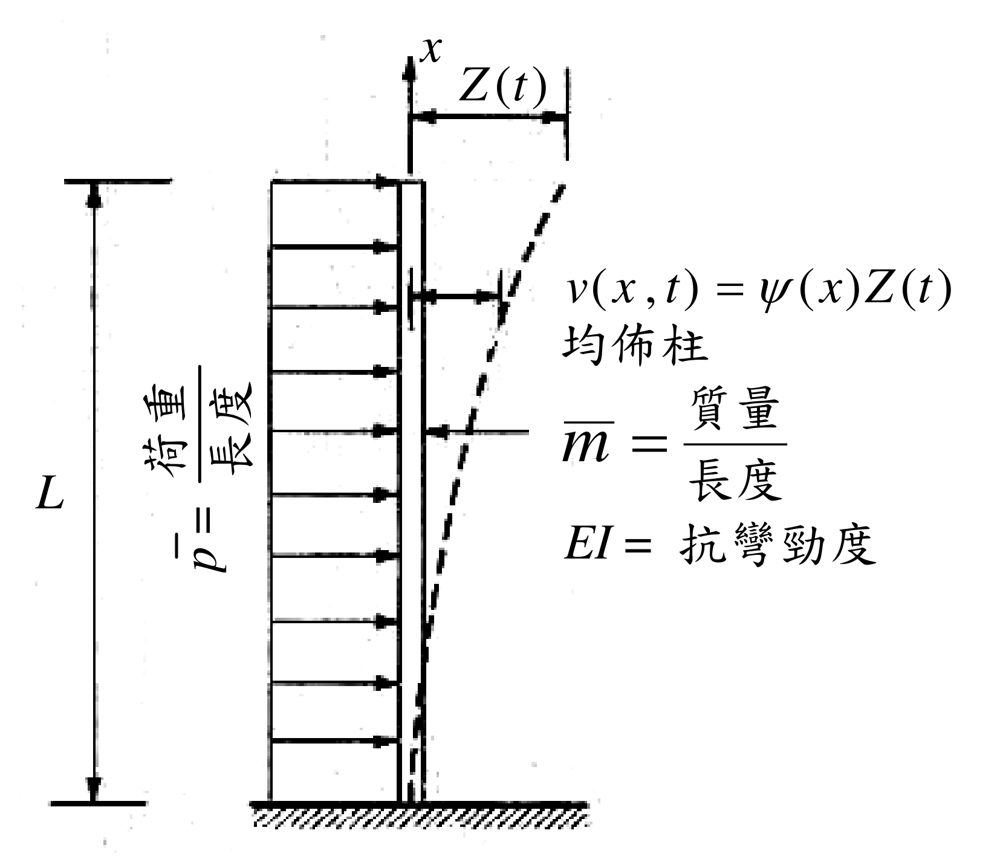

# SD-2009-1 題目正本

> 本檔只記錄考卷上寫了什麼、圖上畫了什麼，不含任何解法。解析見同資料夾 `SD-2009-1.md`。
> 判讀清單經使用者確認前，狀態為「待確認」；確認後本檔原則上不再修改（改動須回考卷原圖並記 log）。

| 項目 | 內容 |
|---|---|
| 考卷 | `raw/exams/SD-2009_結構動力分析與耐震設計.pdf`，第 1 頁（全一頁）上半，第一題 |
| 考年 | 2009（民國98年）專技高考結構工程技師「結構動力分析與耐震設計」 |
| 配分 | 25 分 |
| 附圖 | `SD-2009-1-fig-1.png`（舊擷取，左上有手形游標）、`SD-2009-1-fig-2.png`（2026-11-16 由考卷 500 dpi 重擷取，含右側圖面文字） |
| 判讀狀態 | **已確認（2026-11-16，使用者授權依 Claude 建議）**（2026-11-16 轉錄；PyMuPDF 110 dpi 整頁＋300–500 dpi 局部放大，PDF 文字層核對原文；附圖為嵌入點陣圖＋向量文字；盲讀於開啟解析前完成） |

## 1. 考卷原文（逐字）

一、右圖的柱可視為單自由度系統，且其變位形狀函數被定義為

$$\Psi(x)=\frac{v(x,t)}{Z(t)}=\left(\frac{x}{L}\right)^2\left(\frac{3}{2}-\frac{x}{2L}\right)$$

設每單位長度的均佈質量為 $\overline{m}$，均佈剛性為 $EI$ 及均佈荷重為 $\overline{p}(t)$，請算出廣義物理性質 $m^*$，$k^*$ 及廣義荷重 $p^*(t)$。（25 分）

（題文用大寫 $\Psi$，圖上用小寫 $\psi$，照考卷原文。）

## 2. 考卷給的公式、附表與參數

- 考卷給的式子：形狀函數 $\Psi(x)=(x/L)^2\,(3/2-x/2L)$（題文以分式排版：$\frac{3}{2}-\frac{x}{2L}$）；圖上 $v(x,t)=\psi(x)Z(t)$。
- 給定（全為符號）：柱高 $L$、均佈質量 $\overline{m}$（質量／長度）、撓曲勁度 $EI$、均佈荷重 $\overline{p}(t)$（荷重／長度）。
- 考卷沒有給：任何數值；軸力；阻尼。
- 卷首注意事項：㈠可以使用電子計算器，但需詳列解答過程。㈡不必抄題，作答時請將試題題號及答案依照順序寫在試卷上，於本試題上作答者，不予計分。㈢下列問題之相關公式、物理常數、符號意義及設計參數未提及時，請自行依規範作合理推斷或假設。考試時間：2 小時。

## 3. 附圖

*證據圖 SD-2009-1-fig-2.png（500 dpi 重擷取；舊圖 SD-2009-1-fig-1.png 內容相同，左上有游標）*

圖面文字照錄：x、Z(t)、v(x,t)＝ψ(x)Z(t)、均佈柱、m̄＝質量/長度、EI＝抗彎勁度、L、p̄＝荷重/長度

## 4. 判讀清單

| # | 項目 | 判讀 | 圖上／題文依據 | 把握 |
|---|---|---|---|---|
| 1 | 柱中段向左的箭頭 | 是「m̄＝質量/長度」標註的引線，不是載重 | 500 dpi：該箭頭由右側文字 m̄ 引向柱右緣，與左側荷重箭頭方向相反、只有一支 | 確定（解讀） |
| 2 | 邊界 | 柱底固定、柱頂自由（懸臂） | 柱底斜線；柱頂無支承 | 確定 |
| 3 | 座標 | $x$ 自柱底向上，$0\le x\le L$ | 圖上 x 軸箭頭在柱頂上方、L 尺寸線量柱全高 | 確定 |
| 4 | 廣義座標 $Z(t)$ | 柱頂側向位移（$\Psi(L)=1$） | 圖上 Z(t) 尺寸線量在柱頂高程；$\Psi(L)=1\cdot(3/2-1/2)=1$ | 確定 |
| 5 | 形狀函數 | $\Psi(x)=(x/L)^2(3/2-x/(2L))$；$x/2L$ 為 $x/(2L)$ | 300 dpi 題文分式排版 | 確定 |
| 6 | 荷重 | 均佈側向荷重 $\overline{p}(t)$，沿柱全高、水平向右（與變形同向） | 左側等長箭頭由柱底到柱頂、皆向右 | 確定 |
| 7 | 柱性質 | 均佈 $\overline{m}$、$EI$ | 題文、圖面文字「均佈柱」 | 確定 |
| 8 | 所求 | $m^*$、$k^*$、$p^*(t)$ | 題文 | 確定 |
| 9 | 考卷沒有給 | 數值、軸力（不計幾何勁度）、阻尼 | 題文 | 確定 |

---
*轉錄：2026-11-16（SD-U1-2 題目正本推廣・組 U1-2-G1）*
*確認：2026-11-16 使用者授權依 Claude 建議確認（SD-U1-2 題目正本推廣・組 U1-2-G1，關卡一）*
