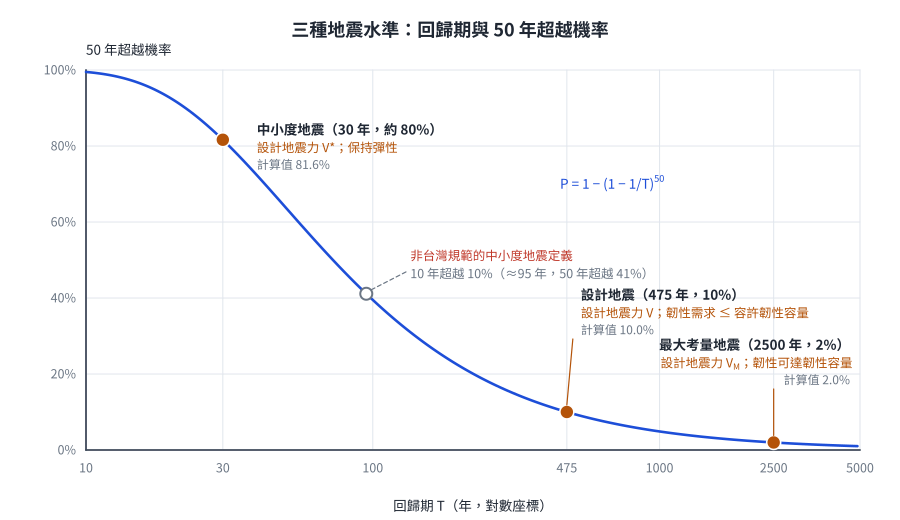

# 考題編號：SD-2009-3

**主分類：** `SD-U2-2` 建築耐震設計規範
**副分類：** `SD-U2-1` 地震力之設計規範
**分析方法：** 概念題（規範論述）
**標籤：** `三水準地震` `設計地震` `中小地震` `最大考量地震` `耐震設計目標` `小震不壞` `中震可修` `大震不倒` `耐震設計基本原則` `回歸期` `超越機率` `韌性折減係數` `性能設計`

---

## 1. 題目（考卷原文見題目正本）

> 考卷原文、公式／附表、附圖與判讀清單（已確認）見 [`SD-2009-3-problem.md`](SD-2009-3-problem.md)。本節只列解題時最容易讀錯的地方與本解使用的記號；題意以題目正本為準。

本題為純文字論述題，考卷無附圖。

### 常見誤讀

| 項目 | 正確判讀 | 常見誤讀 |
|------|---------|---------|
| 規範版本 | 題文「現行」原指民國 98 年當時版本，依本庫規則以現行《建築物耐震設計規範及解說》（111 年版）作答，考試當年版本差異放 §5（判讀 #1） | 照考試當年版本作答而未註明 |
| ㈠所問 | 規範總則中「耐震設計基本原則」那一條條文（判讀 #3） | 只寫三種地震水準，漏答基本原則條文 |
| 題幹與小題 | 題幹為總問句；㈠12 分問條文、㈡13 分問三種地震水準與對應設計目標（判讀 #4、#5） | 兩小題內容混寫、配分失衡 |
| 考卷沒有給 | 三種地震水準的名稱、回歸期、超越機率與性能要求皆須自行依規範作答（判讀 #6） | 把本解補充的回歸期數值當考卷給定 |
| 中小度地震的定義 | 回歸期約 30 年、50 年超越機率約 80%（現行規範 2.10.1 解說、1.2 解說） | 10 年超越機率 10%、回歸期約 95 年（本庫舊解 2026-11-16 前的寫法） |

**本解記號：** 本解以「中小度地震／設計地震／最大考量地震」稱三種地震水準；回歸期與超越機率為本解依規範補充，考卷未給（判讀 #6）。

---

## 2. 考題核心精神與出題者意圖（Core Concepts & Examiner's Intent）

**核心觀念：** 現行《建築物耐震設計規範及解說》（內政部 111 年版）第 1.2 節「耐震設計基本原則」把三種地震水準與三種性能要求寫在同一條條文裡：中小度地震保持彈性、設計地震容許塑性變形但韌性需求不得超過容許韌性容量、最大考量地震可用到規定的韌性容量。第二章再以 $V^*$、$V$、$V_M$ 三個設計地震力把這三個水準落實成數字。

**出題者意圖：**
1. ㈠ 能否寫出基本原則條文的三段內容（不是泛泛的「安全與可使用」）
2. ㈡ 三種地震水準的定量定義（回歸期、50 年超越機率）與對應的性能目標
3. 能否把三個水準和規範的三個設計地震力 $V^*$、$V$、$V_M$ 以及韌性（容許韌性容量 $R_a$、韌性容量 $R$）連起來

---

## 3. 解題戰略地圖與陷阱分析（Strategic Roadmap & Trap Analysis）

**陷阱：**

| # | 陷阱 | 說明 |
|---|------|------|
| ❶ | **中小度地震的定義** | 回歸期約 30 年、50 年超越機率約 80%（規範 2.10.1 解說）；常把它和其他規範的「小地震」定義混用（見 §1 常見誤讀） |
| ❷ | **最大考量地震的定義** | 50 年超越機率 2%、回歸期 2500 年（規範 2.3 節）；工址譜加速度另以最大考量地震的係數（$S_S^M$、$S_1^M$ 系列）給定，不是設計地震乘固定倍數 |
| ❸ | **「中震可修」的「中震」** | 即設計地震（475 年回歸期），不是字面意義的「中等強度地震」 |
| ❹ | **條文不能自己編** | ㈠ 要寫 1.2 節原意的三段，不是寫「維持安全性與可使用性」之類泛稱；公式用台灣形式（含 $1.4\alpha_y$、$F_u$），不要套美式反應修正係數 $R$ 的寫法 |

---

## 3.5 變數層次分析（Variable Hierarchy Analysis）

> 複習提示：第一次解題後，在每個卡住的知識點旁標記 `⚠`；第二次複習時只看有 `⚠` 的項目。

### 最終目標
`寫出 1.2 節基本原則三段，並論述三種地震水準的定量定義（回歸期/超越機率）、性能目標與對應設計地震力`

### L1：題目直接給定
（概念題，考卷沒有給任何數值；以下為須依規範作答的核心）

| 地震水準 | 50 年超越機率 | 回歸期 | 性能目標 | 對應設計地震力 |
|---------|---------|--------|---------|------|
| 中小度地震 | 約 80% | 約 30 年 | 結構體保持彈性、不損壞（小震不壞） | $V^*$（2.10.1） |
| 設計地震 | 10% | 475 年 | 容許塑性變形，韌性需求 ≤ 容許韌性容量（中震可修） | $V$（(2-1) 式） |
| 最大考量地震 | 2% | 2500 年 | 韌性可用到韌性容量，防止崩塌（大震不倒） | $V_M$（2.10.2） |

### L2：需知識點推導

| 知識點 | 內容 | 卡關? |
|--------|------|:-----:|
| 回歸期與超越機率 | $P=1-(1-1/T_R)^{n}$；$n=50$ 年：30 年→81.6%、475 年→10.0%、2500 年→1.98% | |
| 容許韌性容量 $R_a$ 與韌性容量 $R$ | 設計地震用 $R_a$ 算 $F_u$；最大考量地震用 $R$ 算 $F_{uM}$ | |
| 三個設計地震力 | (2-1) 式之最小總橫力不得低於 $V^*$（避免中小度地震降伏）與 $V_M$（避免最大考量地震崩塌） | |

### L3：深層知識（不懂就卡住）

| 知識點 | 說明 | 卡關? |
|--------|------|:-----:|
| 為何中小度地震用 30 年 | 30 年回歸期地震在 50 年使用年限內超越機率約 80%，幾乎一定會遇到，所以要求不損壞、免修補（2.10.1 解說） | |
| $V^*$ 的大小 | 解說：約為 475 年「未折減」地震力的 $1/4.2$（臺北盆地 $1/3.5$），且不用韌性折減 | |
| 中小度地震的位移檢核 | 同一水準的地震力下層間相對側向位移角不得超過 0.005（2.16.1），保護非結構構材 | |

---

## 4. 詳細論述（Step-by-Step）

### （一）耐震設計基本原則之條文（12 分）

依現行《建築物耐震設計規範及解說》（內政部 111 年版）第一章總則第 1.2 節：

> **「本規範耐震設計之基本原則，係使建築物結構體在中小度地震時保持在彈性限度內；設計地震時容許產生塑性變形，但韌性需求不得超過容許韌性容量；最大考量地震時則使用之韌性可以達規定之韌性容量。」**

條文三段的意義：

| 段落 | 地震水準 | 要求 | 規範如何落實 |
|------|---------|------|------------|
| ① | 中小度地震 | 結構體保持在彈性限度內 | 2.10.1：設計總橫力不得低於 $V^*$，式中不用韌性折減；2.16.1：層間相對側向位移角 ≤ 0.005 |
| ② | 設計地震 | 容許塑性變形，但韌性需求 ≤ 容許韌性容量 $R_a$ | (2-1) 式 $V=\dfrac{S_{aD}I}{1.4\alpha_y F_u}W$（$F_u$ 由 $R_a$ 求得，並依 (2-2) 式修正為 $(S_{aD}/F_u)_m$） |
| ③ | 最大考量地震 | 使用的韌性可達規定韌性容量 $R$ | 2.10.2：設計總橫力不得低於 $V_M=\dfrac{I}{1.4\alpha_y}\left(\dfrac{S_{aM}}{F_{uM}}\right)_m W$（$F_{uM}$ 以 $R$ 代替 $R_a$ 求得） |

$$V^*=\frac{I\,F_u}{4.2\,\alpha_y}\left(\frac{S_{aD}}{F_u}\right)_m W\quad\text{（臺北盆地分母改為 }3.5\alpha_y\text{）}$$

答題時可補充的配套原則（屬第一章其他條文與設計慣例，非 1.2 節原文）：
- **容量設計**：塑性變形要發生在預定位置（如梁端塑鉸），避免剪力等脆性破壞先發生；強柱弱梁為其核心。
- **用途係數 $I$**：依建築物用途分類放大地震力。
- **規則性與動力分析**：高度達 50 公尺或 15 層以上，或超過 20 公尺或 5 層以上且具表 1-1 第 1～3 種立面不規則性或表 1-2 平面扭轉不規則性者，須做動力分析（3.1 節）。

---

### （二）三種地震水準及耐震設計目標（13 分）

規範以三種地震水準對應三種性能目標（多重性能目標），依據為第 1.2 節解說與第 2.3、2.10 節：

#### 第一水準：中小度地震

| 項目 | 內容 |
|------|------|
| 超越機率 | **50 年超越機率約 80%** |
| 平均回歸期 | 約 **30 年** |
| 地震力大小 | $V^*$：約為 475 年未折減地震力的 $1/4.2$（臺北盆地 $1/3.5$），不用韌性折減 |
| 耐震性能目標 | **「小震不壞」——結構體保持彈性、不產生損壞，震後免修補** |

**設計目標說明：** 30 年回歸期地震在 50 年使用年限內超越機率約 80%，發生機率相當高（2.10.1 解說），所以要求結構體不損壞；同一地震水準下另以層間相對側向位移角 ≤ 0.005 限制變形，避免非結構構材在地震不大時即破壞（2.16.1）。

---

#### 第二水準：設計地震

| 項目 | 內容 |
|------|------|
| 超越機率 | **50 年超越機率 10%** |
| 平均回歸期 | **475 年** |
| 地震力大小 | 工址設計譜 $S_{DS}$、$S_{D1}$；設計總橫力 $V=\dfrac{S_{aD}I}{1.4\alpha_yF_u}W$ |
| 耐震性能目標 | **「中震可修」——容許梁端等預定位置形成塑鉸消能，但韌性需求不得超過容許韌性容量，避免不可修復的損壞** |

**設計目標說明：** 設計地震是規範主要設計基準。以容許韌性容量 $R_a$（而非韌性容量 $R$）求 $F_u$，留有餘裕，使損壞控制在可修復範圍。

---

#### 第三水準：最大考量地震

| 項目 | 內容 |
|------|------|
| 超越機率 | **50 年超越機率 2%** |
| 平均回歸期 | **2500 年** |
| 地震力大小 | 工址最大考量地震譜加速度 $S_{aM}$；設計總橫力不得低於 $V_M$ |
| 耐震性能目標 | **「大震不倒」——容許使用到規定的韌性容量，防止崩塌** |

**設計目標說明：** 地震水準已極高，目標只剩防止崩塌、保護人命；規範以 $V_M$（用韌性容量 $R$ 求 $F_{uM}$）確保結構在最大考量地震下的韌性需求不超過其韌性容量。

---

#### 三種水準整合比較

| 地震水準 | 50 年超越機率 | 回歸期 | 對應設計地震力 | 性能目標 | 結構行為 |
|---------|---------|--------|-----------------|---------|---------|
| 中小度地震 | 約 80% | 約 30 年 | $V^*$ | 小震不壞 | 彈性 |
| 設計地震 | 10% | 475 年 | $V$ | 中震可修 | 塑性變形 ≤ 容許韌性容量 |
| 最大考量地震 | 2% | 2500 年 | $V_M$ | 大震不倒 | 韌性可達韌性容量，不崩塌 |



*圖 1　三種地震水準在同一條 $P=1-(1-1/T)^{50}$ 曲線上的位置。中小度地震在 50 年內幾乎一定會遇到（約 80%），所以要求不損壞；圖中灰點「10 年超越 10%」換算成 50 年超越約 41%，不是台灣規範的中小度地震——本圖攔的就是這個混用。*

#### 三水準設計哲學的核心邏輯

```
地震強度：小 ─────────────────────────────→ 大
         中小度地震(30年)  設計地震(475年)  最大考量地震(2500年)
性能要求：不損壞 ─────→ 可修復 ─────────→ 不崩塌
結構行為：彈性 ─────────→ 韌性需求≤Ra ──→ 韌性需求≤R
設計力  ：V*  ─────────→ V ─────────────→ VM
```

此三水準設計哲學反映「以合理的工程成本換取合理的生命安全與財產保護」的社會共識，是性能導向耐震設計的基礎。

---

## 5. 關鍵爭議點與進階探討（Critical Issues & Advanced Discussion）

### 5.1 規範版本：考試當年與現行版

題文「現行」原指民國 98 年考試當時施行的版本；本解依本庫規範版本規則改以現行 111 年版作答。三水準架構（中小度地震／設計地震／最大考量地震）與第 1.2 節基本原則的三段內容是現行版條文（已核對原文）；考試當年版本的細部係數若有差異，答題時以作答當時的現行版為準。

本庫舊解（2026-11-16 前）的錯誤，留此對照：
- 中小度地震寫成「10 年超越機率 10%、回歸期約 95 年、約設計地震的 1/2～1/3」——不是台灣規範的定義；正確為 50 年超越機率約 80%、回歸期約 30 年，$V^*$ 約為 475 年未折減地震力的 $1/4.2$。
- ㈠ 引了一段非規範原文的「目標」條文，公式寫成美式 $V=S_aI_EW/R$，並寫「$V_{min}=0.4S_{DS}I_EW/R$（短週期下限）」——$0.4S_{DS}$ 是靜力分析時工址設計譜加速度係數的下限，用意是避免長週期建築物設計地震力過低（2.2 節），不是短週期下限。
- 最大考量地震寫成「以韌性容量驗證，而非直接計算地震力」——現行規範另有 $V_M$ 式（2.10.2）。

### 5.2 為何以 475 年回歸期作為設計地震？

若建築物使用年限為 50 年，則 475 年回歸期地震在 50 年內的超越機率為：

$$P(\text{超越}) = 1 - \left(1 - \frac{1}{475}\right)^{50} \approx 10\%$$

同理，30 年回歸期 → $1-(1-1/30)^{50}\approx 82\%$（規範解說取約 80%）；2500 年回歸期 → $\approx 2\%$。

### 5.3 考場答題策略

此題為概念論述題，評分重點在：
1. **基本原則條文三段**（中小度地震彈性／設計地震韌性需求 ≤ 容許韌性容量／最大考量地震可達韌性容量）要寫完整
2. **三個水準的定量指標**（回歸期 30、475、2500 年；50 年超越機率約 80%、10%、2%）必須正確，是得分關鍵
3. **三個性能目標**（小震不壞、中震可修、大震不倒）與三個設計地震力 $V^*$、$V$、$V_M$ 明確對應
4. 公式用台灣規範形式，不要套美式 $R$、$I_E$ 寫法

*修正日期：2026-11-16（§1 改為指向題目正本；純文字題無附圖，不重繪）*

*修正日期：2026-11-16（勘誤（規範條文、觀念）：中小度地震由「10 年超越機率 10%、回歸期約 95 年」改為「50 年超越機率約 80%、回歸期約 30 年」；㈠ 改引現行 111 年版第 1.2 節基本原則條文三段，公式改台灣形式（V、V*、VM），刪除「0.4SDS 短週期下限」錯誤敘述；最大考量地震回歸期 2475 改 2500 年並補 VM；全文改依現行台灣規範（建築物耐震設計規範及解說，111 年版）。證據：規範原文第 1.2 節及解說、2.3、2.10.1 解說、2.10.2、2.16.1（國土管理署 PDF）；驗證：scripts/fixes/2026-11-16_verify_SD-2009-3.py，MISMATCHES: 0）*

*修正日期：2026-11-16（非勘誤）圖解補繪：figs/SD-2009-3-fig-1-hazard-levels.svg（三種地震水準的回歸期與 50 年超越機率；向量圖，腳本 `gen_SD-2009-3.py`，可重跑）*
