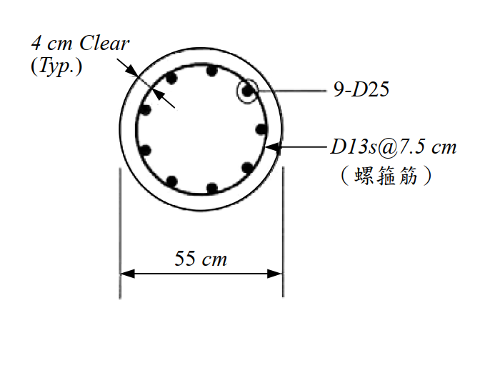

# SD-2009-4 題目正本

> 本檔只記錄考卷上寫了什麼、圖上畫了什麼，不含任何解法。解析見同資料夾 `SD-2009-4.md`。
> 判讀清單經使用者確認前，狀態為「待確認」；確認後本檔原則上不再修改（改動須回考卷原圖並記 log）。

| 項目 | 內容 |
|---|---|
| 考卷 | `raw/exams/SD-2009_結構動力分析與耐震設計.pdf`，第 1 頁（全一頁），第四題（頁面右下） |
| 考年 | 2009（民國98年）專技高考結構工程技師「結構動力分析與耐震設計」 |
| 配分 | 25 分 |
| 附圖 | `SD-2009-4-fig-1.png`（舊擷取，完整、無游標；考卷附圖為內嵌點陣影像，500 dpi 重擷取不增加資訊，未重擷取） |
| 判讀狀態 | **已確認**（2026-11-16，使用者授權依 Claude 建議。原轉錄：2026-11-16 轉錄；PyMuPDF 110 dpi 整頁＋500 dpi 局部放大，PDF 文字層核對原文；盲讀於開啟解析前完成） |

## 1. 考卷原文（逐字）

四、依結構混凝土設計規範，螺箍筋之體積比 $\rho_s$ 不得小於下式之值：

$$\rho_s = 0.45\left(\frac{A_g}{A_c}-1\right)\frac{f'_c}{f_y}$$

式中 $f_y$ 為螺箍筋設計所用之規定降伏強度，$f'_c = 350\ \mathrm{kgf/cm^2}$，$f_y = 4{,}200\ \mathrm{kgf/cm^2}$。檢核右方配置之箍筋圖是否符合結構混凝土設計規範。（25 分）

## 2. 考卷給的公式、附表與參數

- 考卷印出的公式：$\rho_s = 0.45(A_g/A_c-1)\,f'_c/f_y$（照錄；$A_g$、$A_c$ 考卷未另行定義）。
- 給定：$f'_c=350$ kgf/cm²、$f_y=4{,}200$ kgf/cm²（螺箍筋）；圖上：柱外徑 55 cm、淨保護層 4 cm（Typ.）、縱筋 9-D25、螺箍筋 D13，間距（螺距）7.5 cm。
- 考卷沒有給：柱軸力、柱是否為韌性（特殊）抗彎構架柱、縱筋 $f_y$（只說 $f_y$ 為螺箍筋所用）、鋼筋標稱直徑與面積、粒料最大粒徑、柱高。
- 卷首注意事項：㈠可以使用電子計算器，但需詳列解答過程。㈡不必抄題，作答時請將試題題號及答案依照順序寫在試卷上，於本試題上作答者，不予計分。㈢下列問題之相關公式、物理常數、符號意義及設計參數未提及時，請自行依規範作合理推斷或假設。考試時間：2 小時。

## 3. 附圖

*證據圖 SD-2009-4-fig-1.png*

圖面文字照錄：4 cm Clear (Typ.)、9-D25、D13s@7.5 cm、（螺箍筋）、55 cm

## 4. 判讀清單

| # | 項目 | 判讀 | 圖上／題文依據 | 把握 |
|---|---|---|---|---|
| 1 | 是否須做耐震（韌性柱）圍束檢核 | 考卷未說明柱的構架類別；科目為耐震設計且卷首要求「未提及時依規範合理假設」→ 定案：主線檢核公式所示圍束量＋規範一般螺箍筋規定（淨間距、最小號數），耐震韌性柱的額外下限另列檢核並寫明假設 | 題文只說「依結構混凝土設計規範」；卷首注意㈢ | 不確定（解讀）；定案如左 |
| 2 | 考卷公式的規範版本 | 照錄考卷式；依本庫規範版本政策，主線改用現行台灣混凝土結構設計規範對應式（式形相同，$A_c$ 即 $A_{ch}$，量至螺箍筋外緣），差異於解析 §5 註明 | 題文公式；根目錄 CLAUDE.md「規範版本」 | 確定（解讀） |
| 3 | 「4 cm Clear」量測位置 | 柱外表面至螺箍筋外緣的淨保護層 4 cm（兩箭頭分別頂在外圓與內圓線上） | 500 dpi：箭頭尖端位於外圓線與內圓線 | 確定（解讀） |
| 4 | 柱外徑 | 55 cm（尺寸線兩端對齊外圓左右切線） | 500 dpi：延伸線切外圓 | 確定 |
| 5 | 縱筋 | 9 根 D25，沿螺箍筋內側均布 | 圖上數得 9 個黑點；標註 9-D25 | 確定 |
| 6 | 螺箍筋 | D13，螺距（中心距）7.5 cm；「s」為 spiral 記號 | 標註 D13s@7.5 cm（螺箍筋） | 確定（解讀） |
| 7 | 材料 | $f'_c=350$、$f_y=4{,}200$ kgf/cm²（$f_y$ 為螺箍筋） | 題文 | 確定 |
| 8 | 所求 | 檢核此螺箍筋配置是否符合規範（判定合格與否） | 題文 | 確定 |
| 9 | 考卷沒有給 | 軸力、構架類別、縱筋強度、鋼筋面積表、粒料粒徑 | 題文 | 確定 |

---
*轉錄：2026-11-16（SD-U3-1 題目正本推廣・組 U3-1-G1）*
*確認：2026-11-16 使用者授權依 Claude 建議確認（SD-U3-1 題目正本推廣・組 U3-1-G1，關卡一）*
