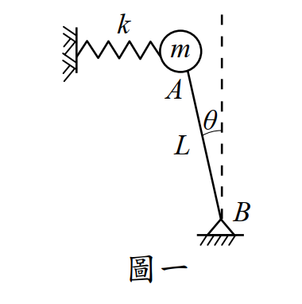

# SD-2010-1 題目正本

> 本檔只記錄考卷上寫了什麼、圖上畫了什麼，不含任何解法。解析見同資料夾 `SD-2010-1.md`。
> 判讀清單經使用者確認前，狀態為「待確認」；確認後本檔原則上不再修改（改動須回考卷原圖並記 log）。

| 項目 | 內容 |
|---|---|
| 考卷 | `raw/exams/SD-2010_結構動力分析與耐震設計.pdf`，第 1 頁（正面），第一題 |
| 考年 | 2010（民國99年）專技高考結構工程技師「結構動力分析與耐震設計」 |
| 配分 | 25 分（㈠10 分、㈡15 分） |
| 附圖 | `SD-2010-1-fig-1.png`（舊擷取，完整、無游標；2026-11-16 以 500 dpi 局部放大核對，內容一致，未重擷取） |
| 判讀狀態 | **已確認**（2026-11-16，使用者授權依 Claude 建議。原轉錄：2026-11-16 轉錄；PyMuPDF 110 dpi 整頁＋500 dpi 局部放大，PDF 文字層核對原文；盲讀於開啟解析前完成） |

## 1. 考卷原文（逐字）

一、圖一剛性桿件 $AB$ 長度為 $L$，$B$ 端鉸承，$A$ 端有一集中質量 $m$，另有一彈簧常數為 $k$ 的線性彈簧與集中質量 $m$ 連接。當 $\theta=0$ 時，彈簧無伸長縮短。不考慮桿件 $AB$ 的質量，假設 $\theta$ 甚小：

㈠請問此系統在什麼條件下為穩定？（10 分）

㈡請列出此系統在穩定情況下的運動方程式及其振動頻率。（15 分）

（「鉸承」照考卷原文。）

## 2. 考卷給的公式、附表與參數

- 考卷沒有給參考公式。
- 給定（符號）：桿長 $L$、集中質量 $m$、彈簧常數 $k$；桿件為剛性、不計質量；$\theta$ 甚小；$\theta=0$ 時彈簧無伸縮。
- 考卷沒有給：重力加速度 $g$ 的文字說明（題文未提重力）、任何數值、阻尼、外力或初始條件。
- 卷首注意事項：㈠可以使用電子計算器。㈡不必抄題，作答時請將試題題號及答案依照順序寫在試卷上，於本試題上作答者，不予計分。考試時間：2 小時。

## 3. 附圖

*證據圖 SD-2010-1-fig-1.png（舊擷取；500 dpi 局部放大核對無差異）*

圖面文字照錄：k、m、A、θ、L、B、圖一

## 4. 判讀清單

| # | 項目 | 判讀 | 圖上／題文依據 | 把握 |
|---|---|---|---|---|
| 1 | 重力 | 圖在鉛垂面內、重力 $g$ 向下；質量在鉸 $B$ 正上方（倒單擺），重力對 $\theta$ 有傾覆作用。定案：題文雖未寫重力，「什麼條件下為穩定」只有計入重力才有意義，故計入 $mg$ | 圖上 $B$ 在下、支承剖線在下方，$A$、$m$ 在上；㈠問穩定條件 | 確定（解讀）；使用者授權依建議確認 |
| 2 | 彈簧方向 | 水平，左端固定於牆、右端接質量 $m$；$\theta$ 甚小時視為保持水平，伸縮量為 $m$ 的水平位移 | 圖上鋸齒彈簧水平，牆面為鉛垂剖線；題文「$\theta=0$ 時彈簧無伸長縮短」 | 確定（解讀） |
| 3 | $\theta$ 的定義 | 桿 $AB$ 與通過 $B$ 的鉛垂線的夾角；$\theta=0$ 時 $A$ 在 $B$ 正上方 | 圖上鉛垂虛線通過 $B$，弧線標 $\theta$ | 確定 |
| 4 | $B$ 支承 | 鉸支承（可自由轉動，無轉動彈簧） | 圖上三角形＋剖線；題文「$B$ 端鉸承」 | 確定 |
| 5 | 桿件 | 剛性、不計質量，長 $L$（$B$ 至 $A$） | 題文；圖上 $L$ 標在桿旁 | 確定 |
| 6 | 質量 | 集中質量 $m$ 在 $A$ 端（圖上畫成圓圈，視為質點、不計轉動慣量） | 題文「集中質量」 | 確定（解讀） |
| 7 | 傾斜方向 | 圖上桿向左（彈簧側）傾斜，屬示意的擾動位置 | 圖上 $A$ 在虛線左側 | 確定 |
| 8 | 阻尼、外力 | 無 | 題文未提 | 確定 |
| 9 | 所求 | ㈠穩定條件（以 $k$、$m$、$g$、$L$ 表示）；㈡穩定時的運動方程式與振動頻率 | 題文 | 確定 |
| 10 | 考卷沒有給 | 數值、$g$ 的明文、頻率要求 rad/s 或 Hz、運動方程式所用自由度（題文以 $\theta$ 描述） | 題文 | 確定 |

---
*轉錄：2026-11-16（SD-U1-2 題目正本推廣・組 U1-2-G2）*
*確認：2026-11-16 使用者授權依 Claude 建議確認（SD-U1-2 題目正本推廣・組 U1-2-G2，關卡一）*
