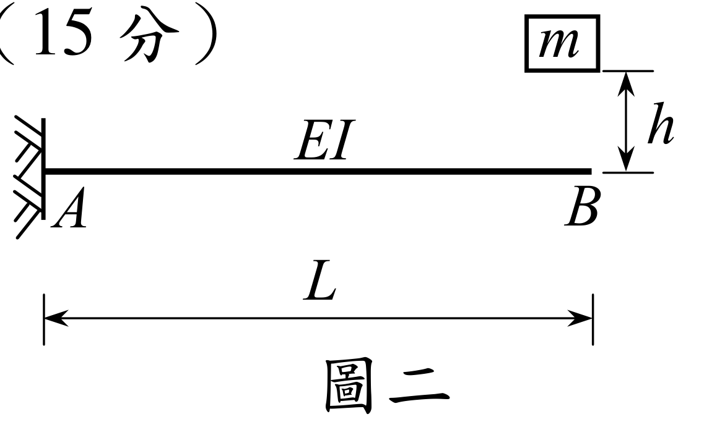

# SD-2010-2 題目正本

> 本檔只記錄考卷上寫了什麼、圖上畫了什麼，不含任何解法。解析見同資料夾 `SD-2010-2.md`。
> 判讀清單經使用者確認前，狀態為「待確認」；確認後本檔原則上不再修改（改動須回考卷原圖並記 log）。

| 項目 | 內容 |
|---|---|
| 考卷 | `raw/exams/SD-2010_結構動力分析與耐震設計.pdf`，第 1 頁（正面），第二題 |
| 考年 | 2010（民國99年）專技高考結構工程技師「結構動力分析與耐震設計」 |
| 配分 | 25 分（10／15） |
| 附圖 | `SD-2010-2-fig-1.png`（舊擷取，梁中段有游標）、`SD-2010-2-fig-2.png`（2026-11-15 由考卷 500 dpi 重擷取） |
| 判讀狀態 | **已確認**（2026-11-15 使用者授權依 Claude 建議確認；影響答案項目定案：#1「最大振幅」主解採繞新靜平衡位置的振動振幅，並另列 B 點自原位置量起的最大撓度（＝靜撓度＋振幅）。原轉錄：2026-11-15 轉錄；PyMuPDF 110 dpi 整頁＋400–500 dpi 局部放大，PDF 文字層核對原文；盲讀於開啟解析前完成） |

## 1. 考卷原文（逐字）

二、圖二懸臂梁 $AB$，其 $EI$ 值為常數，有一點質量（point mass）$m$ 從 $B$ 點上方 $h$ 高度處輕輕放開並落在 $B$ 點，不考慮懸臂梁 $AB$ 的質量，試求：

㈠懸臂梁 $AB$ 的振動頻率。（10 分）

㈡此懸臂梁的最大振幅。（15 分）

## 2. 考卷給的公式、附表與參數

- 考卷沒有給任何參考公式或附表。
- 給定（符號）：$EI$（常數）、梁長 $L$、點質量 $m$、落下高度 $h$；梁質量不計。
- 考卷沒有給：質量落到 $B$ 點後是否附著在梁上（題文只說「落在 $B$ 點」）、阻尼。
- 卷首注意事項：㈠可以使用電子計算器。㈡不必抄題，作答時請將試題題號及答案依照順序寫在試卷上，於本試題上作答者，不予計分。考試時間：2 小時。

## 3. 附圖

*證據圖 SD-2010-2-fig-2.png（500 dpi 重擷取；舊圖 SD-2010-2-fig-1.png 內容相同，梁中段有游標）*

圖面文字照錄：m、h、EI、A、B、L、圖二

## 4. 判讀清單

| # | 項目 | 判讀 | 圖上／題文依據 | 把握 |
|---|---|---|---|---|
| 1 | ㈡「最大振幅」所指 | 考卷沒有定義：可指繞新靜平衡位置的振動振幅，或 $B$ 點自原未變形位置量起的最大撓度（＝靜撓度＋振幅）；兩者差一個靜撓度 $mgL^3/3EI$ | 題文只寫「最大振幅」 | 不確定（影響答案）；使用者授權依建議確認 |
| 2 | 落下後狀態 | 質量落到 $B$ 點後附著於梁、一起振動（完全非彈性接觸、不彈離） | 題文「落在 B 點」；㈠問「懸臂梁 AB 的振動頻率」隱含質量在梁上 | 確定（解讀） |
| 3 | 釋放條件 | 「輕輕放開」＝初速為零，自由落下 $h$ 後以 $\sqrt{2gh}$ 撞擊 $B$ 點 | 題文 | 確定 |
| 4 | $h$ 的量測基準 | 方塊 $m$ 底面到梁頂面（$B$ 點）的距離 | 尺寸線上端對齊方塊底邊、下端對齊梁線（500 dpi） | 確定 |
| 5 | 支承 | $A$ 端固定、$B$ 端自由 | 左端垂直粗線加斜線；右端無任何符號 | 確定 |
| 6 | 跨長 | $L$ 由 $A$ 量到 $B$ | 尺寸線兩端對齊 A、B | 確定 |
| 7 | 梁性質 | $EI$ 常數，梁質量不計 | 題文 | 確定 |
| 8 | 考卷沒有給 | 阻尼、$g$ 數值；本題全為符號 | 題文 | 確定 |

---
*轉錄：2026-11-15（SD-U1-3 題目正本推廣・批 2）*
*確認：2026-11-15 使用者授權依 Claude 建議確認（SD-U1-3 題目正本推廣・批 2，關卡一）*
