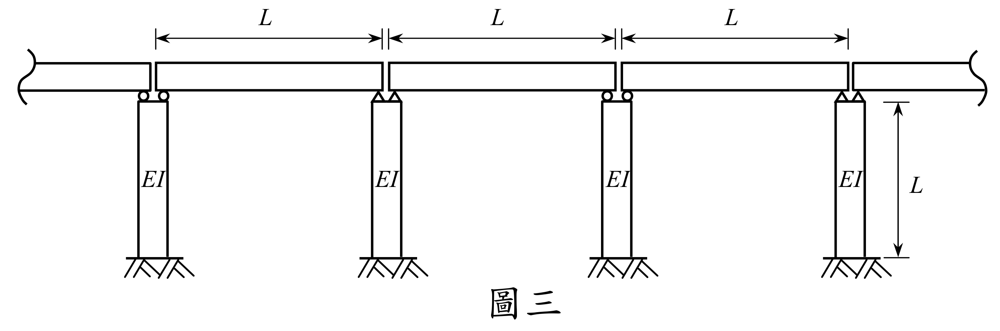

# SD-2010-3 題目正本

> 本檔只記錄考卷上寫了什麼、圖上畫了什麼，不含任何解法。解析見同資料夾 `SD-2010-3.md`。
> 判讀清單經使用者確認前，狀態為「待確認」；確認後本檔原則上不再修改（改動須回考卷原圖並記 log）。

| 項目 | 內容 |
|---|---|
| 考卷 | `raw/exams/SD-2010_結構動力分析與耐震設計.pdf`，第 1 頁（正面），第三題 |
| 考年 | 2010（民國99年）專技高考結構工程技師「結構動力分析與耐震設計」 |
| 配分 | 25 分 |
| 附圖 | `SD-2010-3-fig-1.png`（舊擷取，第三跨梁上有游標）、`SD-2010-3-fig-2.png`（2026-11-16 由考卷 500 dpi 重擷取） |
| 判讀狀態 | **已確認**（2026-11-16，使用者授權依 Claude 建議；#1 計算方向定案為橋軸向（縱向））。原轉錄：2026-11-16；PyMuPDF 110 dpi 整頁＋500 dpi 局部放大，PDF 文字層核對原文；盲讀於開啟解析前完成 |

## 1. 考卷原文（逐字）

三、圖三為簡支橋梁配置的示意圖，若上構單位長度質量為 $m$；墩柱之 $EI$ 值為常數，不考慮墩柱之質量，亦不考慮桿件軸向之伸長縮短。試選取橋梁振動單元，並應用橋梁耐震設計規範公式（如下），計算橋梁周期 $T$。（25 分）

$\beta=\int w(x)U(x)\,dx$，$\gamma=\int w(x)[U(x)]^2\,dx$，$T=2\pi\sqrt{\dfrac{\gamma}{\beta g}}$

其中 $w(x)$ 為橋梁結構單位長度靜載重，$U(x)$ 為橋梁變形。

（「周期」照考卷原文）

## 2. 考卷給的公式、附表與參數

- 考卷給的公式（題文）：$\beta=\int w(x)U(x)\,dx$，$\gamma=\int w(x)[U(x)]^2\,dx$，$T=2\pi\sqrt{\gamma/(\beta g)}$。
- 給定：上構單位長度質量 $m$；墩柱 $EI$ 為常數；跨長 $L$、墩柱高 $L$（圖上）。
- 不考慮：墩柱質量、桿件軸向伸長縮短。
- 考卷沒有給：計算方向（縱向或橫向）、上構 $EI$、數值；支承的文字說明（只在圖上以符號表示）。
- 卷首注意事項：㈠可以使用電子計算器。㈡不必抄題，作答時請將試題題號及答案依照順序寫在試卷上，於本試題上作答者，不予計分。考試時間：2 小時。

## 3. 附圖

*證據圖 SD-2010-3-fig-2.png（500 dpi 重擷取；舊圖 SD-2010-3-fig-1.png 內容相同，第三跨梁上有游標）*

圖面文字照錄：L、L、L（跨長三處）；EI（四支墩柱各一）；L（柱高）；圖三

## 4. 判讀清單

| # | 項目 | 判讀 | 圖上／題文依據 | 把握 |
|---|---|---|---|---|
| 1 | 計算方向 | 橋軸向（縱向）。定案理由：考卷只畫立面、支承以縱向的滾／鉸區分，題文未提橫向 | 題文未指定方向；圖為立面 | 不確定（影響答案）；使用者授權依建議確認 |
| 2 | 墩頂支承配置 | 由左起第 1、3 墩：兩側梁端都是滾支承（各兩小圓）；第 2、4 墩：兩側梁端都是鉸支承（各兩小三角形） | 500 dpi：第 1、3 墩頂各兩圓，第 2、4 墩頂各兩三角 | 確定 |
| 3 | 每跨梁的支承 | 中間三跨各為一端滾、一端鉸的簡支梁：第一跨左滾右鉸、第二跨左鉸右滾、第三跨左滾右鉸；左端延續段在第 1 墩為滾，右端延續段在第 4 墩為鉸 | 由 #2 與梁段在墩頂斷開 | 確定（解讀） |
| 4 | 墩柱底 | 固定 | 柱底橫線加斜剖線 | 確定 |
| 5 | 墩柱頂與梁的連接 | 經支承（鉸或滾）與梁相連，墩頂不受梁的轉動束制 | 支承符號 | 確定（解讀） |
| 6 | 跨長 | 中間三跨皆 $L$，量至相鄰墩頂支承中點（梁縫） | 尺寸線端點對齊梁縫 | 確定 |
| 7 | 墩柱高 | $L$，由墩頂（支承下緣）量至柱底 | 最右墩右側尺寸線上端對齊墩頂、下端對齊柱底 | 確定 |
| 8 | 墩柱 | 四支皆 $EI$ 常數，不計質量、不計軸向變形 | 圖上 EI、題文 | 確定 |
| 9 | $m$ 與 $w(x)$ | $m$ 為上構單位長度質量；$w(x)$ 為單位長度靜載重，題目沒有直接給 $w$ 的數值，與 $m$ 的關係由考生處理 | 題文 | 確定（解讀） |
| 10 | 兩端延續段 | 波浪折斷線表示橋梁向兩側延續，延續段長度與另一端支承未畫 | 兩端波浪線 | 確定 |
| 11 | 所求 | 選取振動單元並以題給公式計算 $T$ | 題文 | 確定 |
| 12 | 考卷沒有給 | 計算方向、上構撓曲勁度、數值、$g$ 值 | 題文 | 確定 |

---
*轉錄：2026-11-16（X-G1 題目正本推廣：SD-U2-3／SD-U1-1）*
*確認：2026-11-16 使用者授權依 Claude 建議確認（X-G1，關卡一）*
